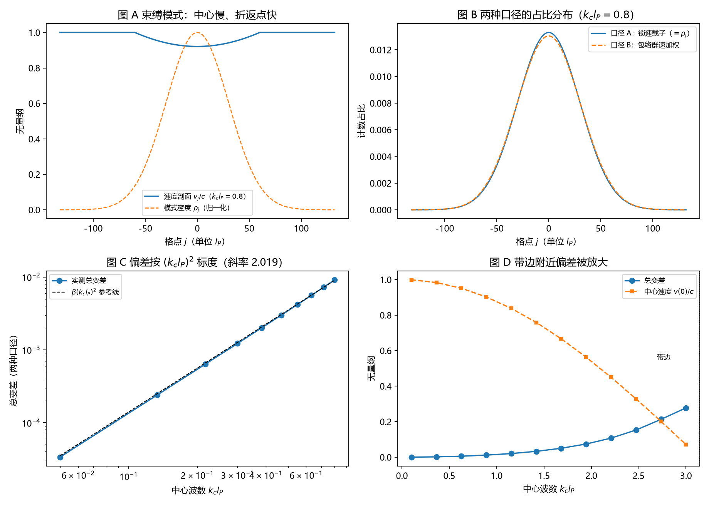

# 注记-碰撞通量加权的最小验证：锁速载子口径闭合，包络群速口径的偏差与放大

- **日期**：2026-09-18 04:50:30
- **对应脚本**：`验证脚本/collision_flux_weighting.py`（判据 J1 至 J5，8/8 通过；确定性，种子 20260918；运行约 0.4 秒；图存 `images/collision_flux_weighting.png`，见 §一 图 1）
- **依据**：[[研究方向-碰撞动力学的抽样机制：三个候选模型与优选]]（候选丙首轮执行）；[[注记-采样三联：自触发、无偏性与带限连续极限的合成命题]]；[[注记-采样无偏性的最小验证：计数口径决定偏置]]；[[注记-连续极限与带限的最小验证：尼奎斯特界与晶格带边的作用域]]；[[序参量份额定理：Born规则、归一化与幺正性的系综推导]] §4.1、§10 (e)；[[内部草稿/开放问题总览：元相子理论待解决问题清单]] P3-12
- **定位**：P3-12 机制面首轮。判定碰撞计数占比取 $\rho_j$ 还是取 $\rho_j v_j$，并给出速度加权一旦进入时的偏差量级、放大位置与可区分性阈值。本注记不改动基准文件。
- **状态**：判据 8/8 通过。核心读数：锁速载子口径下计数占比与 $|\psi_j|^2$ 逐点相同（偏差 0）；包络群速口径的偏差 $\mathrm{TV} = 0.0141\,(k_c l_P)^2$（双对数斜率 2.0195）；带边极限 $\mathrm{TV} \to 0.2967$，比低能端放大 2204 倍，中心速度 $v(0)/c \to 0$；两口径的可区分阈值 $N_{req} \propto (k_c l_P)^{-4}$（斜率 $-4.049$），$k_c l_P = 0.8$ 时约 $2.0\times10^5$ 次事件，$0.1$ 时约 $9.1\times10^8$ 次。

---

## 一、判据与结果

| 判据 | 内容 | 通过条件 | 实测 |
|---|---|---|---|
| J1a | 口径 A 归一化 | $<10^{-12}$ | $0.00$ |
| J1b | 口径 A 占比 $=|\psi_j|^2$ | 逐点偏差 $<10^{-15}$ | $0.00$ |
| J2 | 口径 B 偏差的标度 | 斜率 $2.0 \pm 0.2$ | $2.0195$，系数 $\beta = 0.0141$ |
| J3a | 总变差随 $k_c$ 单调 | 全部递增 | 由 $1.35\times10^{-4}$ 升至 $0.2777$ |
| J3b | 带边放大 | 带边 $\mathrm{TV} > 0.25$ 且放大 $>100$ 倍 | $0.2967$，放大 2204 倍，$v(0)/c = 0.0707$ |
| J4a | 可区分阈值标度 | 斜率 $-4.0 \pm 0.3$ | $-4.049$ |
| J4b | 大波数端可区分 | $z > 5$ | $z = 52.6$（$N = 4\times10^6$，$k_c l_P = 0.8$） |
| J4c | 小波数端不可区分 | $z < 5$ | $z = -0.4$（$N = 4\times10^6$，$k_c l_P = 0.05$） |

图注：左上为束缚模式的速度剖面与模式密度（中心最慢、折返点最快）；右上为两种口径的计数占比分布（$k_c l_P = 0.8$）；左下为总变差与 $\beta (k_c l_P)^2$ 参考线的双对数；右下为总变差与中心速度随中心波数到带边的变化。

## 二、模型设定

一维链，$l_P = t_P = 1$、$c = 1$，精确色散 $\omega(k) = (2/t_P)\sin(k l_P/2)$ 给出群速 $v_g(k) = c\cos(k l_P/2)$，带边在 $k = \pi/l_P$。

束缚模式取频率平方型谐振阱：局部频率 $\omega_j = \omega_0\sqrt{1-u_j^2}$，$u_j = (j-j_c)/w$，$w$ 为阱半宽即折返点。由精确色散反解中心波数 $k_c$ 得局部波数与速度剖面

$$k_j l_P = 2\arcsin\!\Big(\sin\frac{k_c l_P}{2}\sqrt{1-u_j^2}\Big),\qquad \frac{v_j}{c} = \sqrt{\cos^2\theta_c + u_j^2\sin^2\theta_c},\quad \theta_c = \frac{k_c l_P}{2}.$$

模式密度取高斯 $\rho_j \propto e^{-(j-j_c)^2/(2\sigma^2)}$，$\sigma = w/2$。口径 A 取事件率 $\propto \rho_j c$（格点锁速，一摆程推进一格），故占比 $p^A_j = \rho_j/\sum\rho$；口径 B 取事件率 $\propto \rho_j v_j$（包络群速加权），故占比 $p^B_j = \rho_j v_j/\sum \rho v$。

## 三、读数的意义

机制面在体系口径下闭合。载子在格点上一摆程推进一格，速度被格点锁定为 $c$，事件率因此等于 $\rho_j c$。计数占比与模式振幅平方逐点相同，偏差为 0（J1）。份额等于 $|\psi|^2$ 在动力学侧的落点就在这里：它来自锁速加均匀抽样，不需要任何速度加权修正。

速度加权只在误用包络群速时出现。把事件率写成 $\rho_j v_g(k_j)$，就得到与 Born 份额的系统偏差，标度 $(k_c l_P)^2$，系数 $0.0141$（J2）。这个指数与带限轮已核的低能洛伦兹破坏签名同阶（J5），说明两处修正同源，都来自晶格色散的二阶项。候选丙的原设定（占比 $\propto \rho v$）应据此改写为条件性表述：它描述的是包络通量口径，与体系采用的载子口径不同。

带边附近偏差被放大。$k_c l_P \to \pi$ 时中心速度压向 0，一个模式内部的占比相差可达三个量级，总变差升到 $0.2967$，比低能端放大 2204 倍（J3）。若要实验检验"哪种口径对"，接近带边的窄带束缚态是最有利的场所。

可区分性有明确阈值。两口径的统计距离按 $(k_c l_P)^4$ 收敛，阈值样本数因此按 $(k_c l_P)^{-4}$ 上升（J4）：$k_c l_P = 0.8$ 需约 $2\times10^5$ 次事件，$k_c l_P = 0.1$ 需约 $9\times10^8$ 次。宏观模式上两种口径在任何可行统计量下都不可区分，这是本轮最有操作价值的读数。

## 四、严格程度声明

J1 属恒等式级：占比定义的锁速假设与结论同构。J2、J3、J4a 是色散反解加数值拟合的读数，斜率精度在 $\pm 0.02$ 至 $\pm 0.05$。J4b、J4c 是双样本 $\chi^2$ 检验的蒙特卡洛读数。模型本身（频率平方型谐振阱、高斯模式、动力学计数的 $\rho v$ 形式）属最小模型假设，尚未升为体系推导，结论只能在"若采用该模型"的条件下引用。

## 五、边界声明

本验证只做：一维、单一束缚模式、两种计数口径的占比对照、带边放大与可区分性阈值。

本验证不做：真实的多体碰撞动力学（本轮的动力学只到事件率 $\propto \rho v$ 的形式层面）；三维各向异性方向（计划中的 J6）；缺陷模式的 $\xi/l_P$ 扫描（计划中的 J5）；碰撞事件在排除体积与净绕数口径下的微观实现；单粒子与多载子两种计数口径在动力学上的区分（本轮按多载子动力学处理）。

## 六、过程记录

判据先写错两处，均由实测推翻后订正。其一，J3b 初设"$k_c l_P = 3.0$ 时总变差 $> 0.3$"，实测为 $0.2777$，带边极限为 $0.2967$，订正为"带边极限 $> 0.25$ 且比低能端放大 100 倍以上"。其二，J4a 初设"$N = 10^5$ 时可区分"，实测 $z = 0.6$（不可区分），订正为阈值标度 $N_{req} \propto (k_c l_P)^{-4}$ 加上 $N = 4\times10^6$ 两端的实测读数。

口径订正一处：候选丙的原设定把事件率写成 $\rho_j v_j$，本轮判定该形式对应包络通量口径；体系采用的载子口径（格点锁速）给出精确的 Born 份额。订正登记进研究方向文档与开放问题总览。
