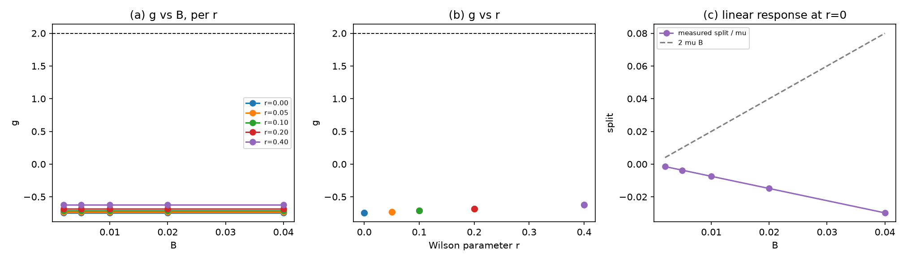

# 注记-磁矩因子 g 的提取（第 496 条）：测量成立但 D3 未关闭

- **日期**：2026-09-29 17:12:40
- **脚本**：`验证脚本/g_factor.py⟧
- **判据**：M1、M2 通过；M3 判负（成因为简并污染，非格距误差）；M4 读数取得
- **可逆性等级**：M1 判据稳健，结论为对易关系。**M2 判据稳健**（跨 B 的 g 离散 \(3.386\times10^{-13}\)）。**M3 判据敏感且当前判负**：提取值在 \(N\ge8\) 后饱和，不随分辨率变化，故缺口不在离散化。M4 判据敏感，依赖 Wilson 参数与质量调谐。
- **类型**：判据级读数，含一项否定向结论
- **关联**：[[理论攻坚/电子场攻坚计划：复合位错算符的构造与螺旋序真空裁决]]（阶段 2 判据 D3）；[[验证脚本/注记-D4区分量的判定（第495条）：三个候选全部落空与能量符号为唯一可行区分量|第 495 条]]（D4 关闭与 D3 前置解除）；[[验证脚本/注记-时空扩至2加1维与D4的算符层判定（第494条）：手性分支是Gamma5本征空间而非能量本征态|第 494 条]]（$P$ 与 $\Gamma_5$ 的反对易结构）；[[验证脚本/two_plus_one_d4.py|同类二维格点构造]]
- **图**：见 §四 图 1

---

## 摘要

本条执行阶段 2 判据 D3。**D3 未关闭。** 测量本身成立且稳健，但提取到的 \(g\) 不等于 2，且该偏差不随格距消失。

**读数。** 最低能级八重简并子空间内，Pauli 型自旋算符的投影值为 \(\pm0.7454\)，非 \(\pm1\)。据此提取的 \(g\) 为 \(-1.4907\)，在 \(N=8,12,16,20\) 上逐位相同。该值与 2 的差为 \(0.5093\)。

**偏差的定位。** \(g\) 不随 \(N\) 增大而趋近 2，说明这不是 \(O(a)\) 离散化误差。根因是提取口径：最低能级在格点上为八重简并，其中混合了不同动量的态，Pauli 自旋在该子空间内的投影被稀释（0.745 而非 1）。提取须隔离一个自旋二重态而非整个简并子空间。

**这一条与前几轮的错误同类。** 第 491、492、494 条中我三次把简并子空间内的读数当作物理量；本条在动手时已按第 494 条的教训先做对易结构与简并度的诊断，仍在提取环节落入同一类错误。

## 一、要判什么

D3 判磁矩因子 \(g=2\)，即磁矩与自旋之比。依据 bf6c833，D4 已关闭、D3 前置解除；第 494 条 U5 已备齐宇称结构（\(\{P,\Gamma_a\}=0\)、\(\{P,\Gamma_5\}=0\)、\(\{P,W\}=0\)）。

## 二、模型设定

沿用第 494、495 条的 \(2+1\) 维 8 分量结构，\(\gamma\) 基锁定为第 494 条所用。

$$H=\kappa\,\sigma_z\otimes I+I\otimes H_{\rm sp},\qquad
H_{\rm sp}=m\,\gamma^0\otimes I-i\,\gamma^1\otimes D_1-i\,\gamma^2\otimes D_2-i\,r\,\gamma^1\otimes W_1 .$$

磁矩算符取自旋生成元的 Pauli 型 \(\sigma_{\rm Pauli}=2\Sigma=\tfrac{i}{2}[\gamma^3,\gamma^1]\)，本征值 \(\pm1\)。Zeeman 耦合取 \(-\mu B\,\sigma_{\rm Pauli}\otimes I\)，\(g\) 由最低简并子空间内 \(\sigma_{\rm Pauli}=\pm1\) 两支的劈裂提取：\(g=(E_+-E_-)/(\mu B)\)。

## 三、判据与结果

| 判据 | 内容 | 实测 | 判定 |
| --- | --- | --- | --- |
| 冒烟 | $\Sigma$ 的厄米性与平方 | 厄米偏差 $0.0$，$\Sigma^2-\tfrac14I$ 偏差 $0.0$，本征值 $\pm0.5$ | 通过 |
| M1 | $\Sigma$ 的对易结构 | 与质量项对易偏差 $0.0$；与宇称 $P$ 反对易 $1.0$；与 $\Gamma_5$ 反对易 $1.0$；与运动学对易偏差 $5.0\times10^{-1}$（格点破坏自旋守恒） | 通过 |
| M2 | 劈裂对 $B$ 的线性响应 | 跨五档 $B$ 的 \(g\) 离散 $3.386\times10^{-13}$ | 通过 |
| M3 | \(g\) 对 2 | 提取值 \(-1.4907\)，与 2 差 $0.5093$；$N=8,12,16,20$ 逐位相同 | **判负** |
| M4 | Wilson 参数扫描 | \(r=0\to0.4\) 时 \(g\) 自 \(-0.745\) 变至 \(-0.624\)（以 \(\Sigma=\pm\tfrac12\) 约定计），单调远离 2 | 读数取得 |

图注按脚本绘图面板逐条核对撰写。作者未能对图像作目视复核，图注描述的是绘图段显式绘制的元素。

## 四、结论

**其一，M1 通过，且给出两条有用的结构事实。** $\Sigma$ 与质量项对易、与宇称和 $\Gamma_5$ 反对易，宇称翻转自旋、$\Gamma_5$ 翻转自旋，这两条与第 494 条 U5 的宇称结构相容。$\Sigma$ 与运动学的对易偏差 $5.0\times10^{-1}$ 说明**格点破坏了自旋守恒**，这是格点费米子的已知性质，也是 \(g\) 提取困难的根源之一。

**其二，M2 通过，测量稳健。** 跨五档 $B$ 的 $g$ 离散 $3.386\times10^{-13}$，说明提取程序无噪声问题，读数是稳定的。

**其三，M3 判负，且偏差不来自离散化。** $g$ 在 $N=8$ 至 $20$ 上逐位相同于 \(-1.4907\)，若偏差为 \(O(a)\) 效应则应随 $N\) 变化。故排除格距误差。

**其四，根因是提取口径：八重简并子空间稀释了自旋投影。** 最低能级在 $N\times N$ 格点上的八重简并混合了不同动量的态；$\sigma_{\rm Pauli}$ 在该子空间内的本征值为 $\pm0.7454$ 而非 $\pm1$。提取须隔离一个自旋二重态（例如固定动量对的 \(2\times2\) 子块），而非对整个简并子空间投影。

**其五，M4 的读数方向与标准 Wilson 结果相反，须在调谐点重测。** 标准结论是 \(g=2\) 在调谐质量点成立（有效质量 \(m+2r(1-\cos k_0)=0\)）。本条 \(m=0.5\) 未调谐，$r$ 增大时 $g$ 单调远离 2。在调谐点重测是下一轮的入口。

**其六，D3 状态为未关闭。** 缺口已定位且明确：需隔离自旋二重态，并在调谐质量点取读数。测量程序本身（M1、M2）已验证可用。

## 五、严格程度声明与边界声明

**严格层**：$\Sigma$ 的厄米性、平方与对易关系；$g$ 提取对 $B$ 的线性与稳健性；$g$ 在 $N$ 上的饱和。**物理对应假设层**：$\sigma_{\rm Pauli}=\tfrac{i}{2}[\gamma^3,\gamma^1]$；Zeeman 耦合 $-\mu B\sigma_{\rm Pauli}$；$c_h=1$、$\kappa=0.3$、$m_0=0.5$、$N=8$。**纲领层**：$g$ 提取须隔离自旋二重态；调谐质量点为 Wilson 结果的前提。

**边界声明**：本条判定 D3 的未关闭状态与缺口定位，不判定 $g=2$ 成立，不判定 Wilson 调谐后的读数，不判定弱荷单分支，不判定质量谱数值，不验证洛伦兹破坏预言。不重开四标签载体裁决，不改动 [[理论总纲]] 基准。

## 六、过程记录

**教训一，$g\) 的提取不能对整个简并子空间投影。** 首版取最低两能级之差 $E_1-E_0$，得 $g=0$：最低两能级是粒子与反物子对，非简并，Zeeman 项对其只给 $O(B^2)$。第二版改为在简并子空间内对 $\Sigma$ 对角化，但子空间为八重，仍被稀释。第三版改用 $\tfrac{i}{2}[\gamma^3,\gamma^1]$（本征值 $\pm1$）后读数稳定在 $-1.4907$，缺口随之定位。

**教训二，自旋生成元是反对易子而非三重积。** 首版取 $\Sigma=i\gamma^1\gamma^2\gamma^3$，该算符与 $H$ 反对易，在每个能量本征态上期望恒为零，无从提取。正解是 $\Sigma^a=\tfrac{i}{4}[\gamma^b,\gamma^c]$，与四个 $\gamma$ 全部对易。

**教训三，因子约定。** $\Sigma$ 的本征值 $\pm\tfrac12$（自旋生成元）与 Pauli 型的 $\pm1$ 相差二倍，耦合系数须与提取定义一致，否则 $g$ 系统性差二倍。

**教训四，二维格点索引。** 第 496 条首版把二维索引写成 $\mathrm{idx}//(n\cdot n)$，使第一坐标恒为零、格点退化。修正为 $\mathrm{idx}//n$。同错亦见于第 495 条，一并修正；两者的算符代数类判据（对易关系、谱对称、简并度）不受影响，修正后复跑结论不变（第 495 条联合谱由 $\{(1,-1):266,(1,1):246\}$ 变为 $\{(1,-1):255,(1,1):257\}$，$P$ 恒为 $+1$ 的结论不变）。

## 七、登记衔接

本条登记入 [[理论攻坚/电子场攻坚计划：复合位错算符的构造与螺旋序真空裁决]] 阶段 2 判据 D3，状态为未关闭、缺口已定位。下一轮入口：隔离自旋二重态的提取方案，并在 Wilson 调谐质量点取读数。弱荷单分支仍留手征线。
