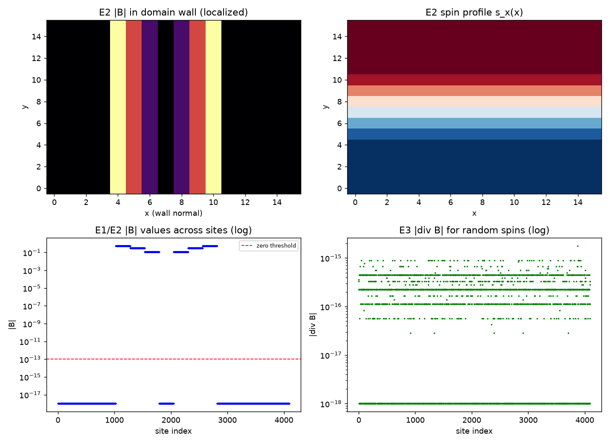

# 注记-磁铁机制的定量桥梁（第448条）：均匀区无源、变化处有源与无磁单极

- **日期**：2026-09-27 01:38:19
- **脚本**：`minimal_verification_magnet_bridge.py`（工作区根目录执行）
- **主题**：静磁学定量桥梁的三条结构性后果。自旋序参量锚定链路错配后，磁场等于自旋序参量的旋度：均匀自旋区无场源、畴壁处有源、任意配置下散度为零
- **判据结果**：3/3（E1 均匀区无源、E2 变化处有源、E3 无磁单极）
- **裁决**：2026-09-30 作者裁甲，映射 $A_a l_P = \kappa\hat{\mathbf s}\cdot\hat a$ 立为体系口径（$\kappa$ 取值挂 P1-49）
- **可逆性等级**：判据稳健（E1 与 E3 为离散恒等式，E2 为定位性结论）
- **图**：见 §3 图 1

## 1 模型设定

映射取 $A_a(n)l_P = \kappa\,\hat{\mathbf s}(n)\cdot\hat a$（2026-09-30 作者裁决采纳为体系口径，见 [[内部草稿/注记-磁铁机制的定量桥梁：自旋锚定链路错配与磁场即自旋旋度]]），离散曲率 $F_{ab} = \Delta_a(A_b l_P) - \Delta_b(A_a l_P)$，磁场取对偶 $B_i = \frac{1}{2}\epsilon_{ijk}F_{jk}$，在 $L^3 = 16^3$ 周期格点上计算。三条判据分别取均匀自旋、畴壁剖面（分段线性，两侧均匀区严格为 $\pm 1$）与随机单位自旋。

## 2 判据与结果

| 判据 | 实测 | 期望 | 结果 |
|---|---|---|---|
| E1 均匀自旋的 $\max\vert B\vert$ | $0$ | $0$ | 通过（精确零） |
| E2 畴壁的 $\max\vert B\vert$ | $0.552771$ | 非零 | 通过 |
| E2 均匀区 $\max\vert B\vert$ | $0$ | $0$ | 通过（精确零） |
| E3 随机自旋的 $\max\vert\nabla\cdot B\vert$ | $1.78\times10^{-15}$ | $0$ | 通过（机器零） |

读法：磁场只在自旋方向发生变化处出现，均匀磁化区内部无源；这正与标准磁学"$\mathbf B$ 的源由磁化 $\mathbf M$ 的边界与旋度给出"一致。E3 的机器零说明磁力线不能有端点，只能闭合，南北极因此只能是同一扭转圈的两个外窗口。

## 3 图

## 4 过程记录

其一，映射提案在写作中修正了一次，修正本身有内容。首版把自旋锚定到"基准朝向角"$\theta$，随即发现标量朝向的绕圈净变化恒为零（二阶差分可交换），承载不了曲率；改锚定到链路错配（联络）后曲率非零，且立即给出 $B = \kappa\nabla\times\hat{\mathbf s}$。教训：曲率必须住在联络上，这正是投影论证早已给出的结论，映射设计不能绕过它。

其二，畴壁剖面首版用 $\tanh$，其"均匀区"仍带尾巴，使 E2 的均匀区判据失败。改用分段线性剖面（两侧严格为 $\pm 1$）后均匀区场为精确零。教训：定位性判据要求"均匀区严格均匀"，渐近剖面不满足该前提。

## 5 严格程度与边界声明

严格：E1 与 E3 为离散恒等式（常矢量的旋度为零、旋度的散度为零），E2 的定位性为 E1 的推论。

已裁决（2026-09-30 作者裁甲）：$A_a l_P = \kappa\,\hat{\mathbf s}\cdot\hat a$ 立为体系口径；$\kappa$ 的取值与来源挂电磁耦合常数问题（P1-49，含与自旋-基准耦合的同一性检验）。结构性结论（均匀区无源、源在旋度处、无磁单极）不依赖其具体形式。

不验证什么：磁畴形成的动力学（属 P1-11 缺陷动力学）；磁滞；同斥异吸的定量（已由第 449 条交付 9/9，含力-能约定与远场偶极标定）；三维偶极远场的衰减指数（本判据取截面与定性定位，未做远场拟合；已由第 449 条以开边界解标定，斜率 -2.99）。

## 6 关联

- 推导：[[内部草稿/注记-磁铁机制的定量桥梁：自旋锚定链路错配与磁场即自旋旋度]]
- 图像与拓扑结论：[[电磁场的元相子几何：麦克斯韦方程组的双重几何来源]] §9.1 与开放问题 5
- 同批下游：[[验证脚本/注记-位移电流的变分来源与环量判据（第447条）：分量结构、系数匹配与环量恒等式|第447条]]；[[验证脚本/注记-洛伦兹力的最小耦合变分（第445条）：拓扑相位、变分力形式与三条极限|第445条]]
