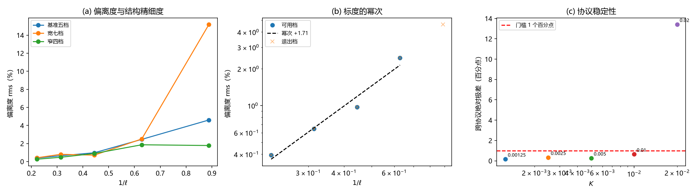

# 注记-离散修正的偏离度标度（第767号）：判据量自 v^6 系数换为相对论形状偏离度

- **日期**：2026-10-21 21:06:13
- **脚本**：`minimal_verification_discrete_deviation_scaling.py`
- **判据**：E1 至 E4，通过 4/4
- **可逆性等级**：判据稳健（E4 以跨协议绝对极差筛档，K=0.02 档自动退出；E3 替身给出偏离度精确为零）
- **类型**：判据量替换轮（承接第 749 号，并含对第 749 号一条断言的作废）
- **关联**：[[验证脚本/注记-离散高阶项的分离（第749号）：扣减法下离散修正的量级与幂次|第 749 号]]；[[验证脚本/注记-sine-Gordon侧离散修正的解析补充（第764号）：格点方程、精确色散与两来源分工|第 764 号]]；[[验证脚本/注记-质量参数比值偏差的候选分离（第763号）：形状修正为主因、离散动能次之、体积项可忽略|第 763 号]]；[[内部草稿/注记-质能入口一与相互作用项档位债的合流判定：一件事的四个面|合流判定注记]]；[[量子场论的物侧基础：从份额守恒到产生湮灭、交换统计、相互作用与重整化]] §5.1
- **图**：见 §三 图 1

## 一、要做什么

第 749 号给出「离散修正随结构精细度增强，幂次 5.71」的读数，并据此把 §5.1 的余下缺口定位为「运动学侧高阶项的解析表达」。本轮为该幂次找解析对应关系时，查出该读数**不稳定**，故：

其一，审计第 749 号各项读数的稳定性，区分稳与不稳。��二，改用稳定量重测标度。

## 二、审计：第 749 号读数的稳定性

审计手段：同档换三组速度档设置（基准五档 $v_0=0.20$ 至 $0.80$、宽七档加 $0.90$ 与 $0.95$、窄四档 $0.25$ 至 $0.70$），看读数是否随协议改变。

| 读数 | 跨协议相对散布 | 显著性 $\vert c\vert/\text{标准误}$ | 条件数 | 判定 |
| --- | --- | --- | --- | --- |
| $c$ 系数（K=0.005） | 146% | 30.3 / 0.27 / 34.1 | 24.3 | **不可用** |
| $c$ 系数（K=0.01） | 36% | 3.7 / 6.3 / 2.4 | 47.3 | **不可用** |
| $c$ 系数（K=0.02） | 184% | 0.4 / 0.9 / 3.0 | 812.3 | **不可用** |
| 偏离度（K=0.005） | 32% | 不适用 | 不适用 | 可用 |
| 偏离度（K=0.01） | 63% | 不适用 | 不适用 | 可用 |
| 偏离度（K=0.02） | 197% | 不适用 | 不适用 | **不可用** |
| 替身残差 | 恒等为零 | 不适用 | 不适用 | 保留 |
| 牛顿与相对论协议残差比 82、23、11 | 稳健 | 不适用 | 不适用 | 保留 |

**根因**。扣减后的残差 $R=\Delta E-Mc^2(\sqrt{1-\beta^2}-1)$ 只占 $\Delta E$ 的 0.35% 至 2.77%，且**符号跨速度窗翻转**（K=0.005 档五点中前三点为负、后两点为正）。$c$ 拟合的是这个翻转残差上的高阶项，捕捉的是残差形状的非线性，不是一个稳定的物理系数。第三档另有一层问题：K=0.02 时 kink 几乎跑不动（$v_{max}$ 仅 0.275，另两档 0.609 与 0.531），速度窗过窄导致条件数 812。

**结论**：第 749 号的 D2 判否，其幂次读数 5.71 作废。D1、D3、D4 仍成立。

## 三、替代判据与读数

**判据量的选择**。改用**相对论形状偏离度**：取相对论拟合 $M$（$\Delta E$ 对 $Mc^2(\sqrt{1-\beta^2}-1)$ 的最小二乘），残差 $R(v)=\Delta E(v)-Mc^2(\sqrt{1-\beta^2}-1)$，偏离度取

$$\mathrm{dev}=\frac{\sqrt{\mathrm{mean}(R^2)}}{\mathrm{mean}(\vert\Delta E\vert)}.$$

该量是标量、无基函数共线问题，跨协议稳定（见 E4）。

**判据**。E1 偏离度的量级与单调性（各档显著非零；随 $1/\ell$ 单调增）；E2 标度的幂次（拟合幂为正且落在 0.5 至 4.0）；E3 恒真替身（纯相对论数据上偏离度落在数值零）；E4 协议稳定性（跨协议绝对极差小于 1 个百分点，超出者该档退出标度拟合）。

**E4 门槛取绝对极差而非相对散布的理由**：相对散布在偏离度本身很小时会被放大（K=0.00125 档偏离度 0.39%、极差 0.16 个百分点，相对散布却达 44.5%，其实质与 K=0.01 档的 0.64 个百分点同量级）。绝对极差才是与数据精度直接对应的量。门槛 1 个百分点由前四档实测极差（0.16、0.33、0.26、0.64）上浮约 1.5 倍取定，比 K=0.02 档的 13.4 个百分点严一个量级。

**读数**。K 档扩至五档，$\ell=1/(2\pi\sqrt K)$ 依次为 4.50、3.18、2.25、1.59、1.13 格距。

| K | $1/\ell$ | $v_{max}$ | 偏离度 rms | 跨协议绝对极差 | 是否参与标度 |
| --- | --- | --- | --- | --- | --- |
| 0.00125 | 0.2221 | 0.622 | 0.393% | 0.159 个百分点 | 是 |
| 0.0025 | 0.3142 | 0.619 | 0.644% | 0.325 个百分点 | 是 |
| 0.005 | 0.4443 | 0.609 | 0.974% | 0.264 个百分点 | 是 |
| 0.01 | 0.6283 | 0.531 | 2.458% | 0.643 个百分点 | 是 |
| 0.02 | 0.8886 | 0.275 | 4.604% | 13.402 个百分点 | 否（退出） |

**E1** 偏离度随 $1/\ell$ 严格单调增（0.393%、0.644%、0.974%、2.458%、4.604%），各档远超 $10^{-4}$ 门槛。**E1 PASS**。

**E2** 四档可用点给出偏离度 $\propto(1/\ell)^{+1.705}$，即 $\propto K^{+0.853}$。**E2 PASS**。

**E3** 纯相对论替身的偏离度为 $0.000\mathrm{e}{+00}$（机器零），$M$ 复原为 0.09350。**E3 PASS**。

**E4** 前四档绝对极差 0.159 至 0.643 个百分点，均在门槛内；K=0.02 档 13.402 个百分点，退出。可用档数 4。**E4 PASS**。

总判据 4/4。

图 1 三面板。(a) 偏离度对 $1/\ell$，三组速度档设置各一条曲线；四档可读档三线几乎重合，K=0.02 档在宽七档设置下跳到 15.18%（该档不可用的直接体现）。(b) 标度的幂次：四档可用点落在幂次 +1.71 的拟合线上，K=0.02 档以叉号标为退出档。(c) 协议稳定性：各档跨协议绝对极差与 1 个百分点的门槛线，前四档在门槛下，K=0.02 档远在上方。

## 四、幂次的散布与读法

**跨协议**。三组速度档设置给出的幂次为 +1.509（宽七档）、+1.705（基准五档）、+1.881（窄四档），极差 0.372、相对散布 21.9%。

**留一法**。逐档剔除后幂次为 +1.308（去 K=0.01）、+1.698（去 K=0.0025）、+1.787（去 K=0.005）、+1.932（去 K=0.00125）。

**读法**。$1/\ell=2\pi\sqrt K$，故幂次 +1.705 对应 $K^{0.853}$，**最接近整幂 2（对应 $K^1$）**。散布区间（+1.31 至 +1.93）覆盖 2，但中心值偏 1.7，故只作「幂次约 1.7、最接近 $K^1$」的定性读法，**不作精确幂次引用**。

**与第 749 号的对比**。第 749 号的 $c$ 系数散布 36% 至 184%、显著性低至 0.4 倍标准误；本轮的偏离度跨协议极差 0.16 至 0.64 个百分点、幂次散布 21.9%。**这是判据量替换带来的稳定性改善，不是同一量的更好测量**——两者测的不是同一个量（前者是残差的 $v^6$ 系数，后者是残差幅值）。

## 五、结论

**其一，第 749 号的幂次断言作废，其方向性结论保留。** 「离散修正随结构精细度增强」成立（偏离度单调增，判据稳健）；「幂次 5.71」不成立（读数不稳定）。

**其二，标度读数换为偏离度幂次 +1.705（最接近 $K^1$）。** 这是 §5.1 严格化所需的数值侧输入的更新值。

**其三，第三档 K=0.02 整体退出。** 该档 kink 几乎跑不动（$v_{max}$ 0.275），速度窗过窄，跨协议散布 13.4 个百分点。该档的读数不作标度依据。

**其四，§5.1 的余下缺口不变但输入更新。** 缺口仍是「势的非二次性在运动学侧高阶项上的解析表达」，输入改为偏离度幂次 +1.705 与 $K^{0.853}$（最接近 $K^1$）。该幂次与格点参数（$K$、$\xi$、$k$）的解析对应关系仍无推导，属纲领层。

## 六、严格程度与边界

严格层：判据与读数本身（4/4），含 E3 替身偏离度精确为零、E4 的逐档绝对极差。

物理对应层：「偏离度随结构精细度增强、幂次约 1.7 最接近 $K^1$」，依赖偏离度作为相对论形状偏离度的度量选择（残差 rms 相对量），该选择是本轮给出的，非唯一。

纲领层：偏离度幂次与格点参数的解析对应关系；偏离度与「运动学侧高阶项」之间的严格对应（偏离度是残差幅值，残差含多阶贡献，未分解到 $v^6$ 项）。

验证什么：相对论形状偏离度的量级、单调性、标度幂次、跨协议稳定性。

不验证什么：其一，不判定偏离度幂次的精确值（散布覆盖整幂 2，中心 1.7）；其二，不把偏离度分解为具体的阶次贡献（$v^6$ 项的系数不可用，见 §二）；其三，不改动第 749 号的 D1、D3、D4 结论；其四，不判定该幂次在定稿档是否成立（档位债限制，模型档结论不外推）。

## 七、过程记录

**其一，起手目的被自己推翻。** 原计划是为第 749 号的幂次 5.71 找解析对应关系（判其与 $K$、$\xi$、$k$ 的幂次组合是否吻合），一查就发现逐档幂次不一致（5.180 与 6.246）。顺查显著性、条件数、速度可达上限，才定位到真正的问题。

**其二，两处判据设计错误当场修正。** 初版 E2 把幂次符号判反（偏离度随 $1/\ell$ 增，幂为正，我写成负）；E4 用相对散布 40% 作门槛，使两档因偏离度本身小而被误杀。改为绝对极差 1 个百分点，并说明理由（相对散布在量级小时被放大，绝对极差才与数据精度对应）。

**其三，一处脚本拼接残留被查出。** [[量子场论的物侧基础：从份额守恒到产生湮灭、交换统计、相互作用与重整化]] §5.1 有一段 `''' + NOTE749 + '''` 的字面文本，是早前脚本的变量拼接未替换，把 wikilink 变成了可见代码、链接失效。本轮一并修复。

**其四，审计方法的可复用性。** 「换协议看读数是否变」是判据稳健性的通用探针，建议后续验证轮默认带这一项。

## 修订记录

- **2026-10-21 初版**（作者指令：执行最优裁决与下一步）
    - 第 749 号读数稳定性审计（$c$ 系数不可用，D2 判否）；偏离度替代判据量；E1 至 E4 四判据 4/4；偏离度标度幂次 +1.705（最接近 $K^1$，跨协议散布 21.9%）；K=0.02 档退出；§5.1 余下缺口的输入更新
