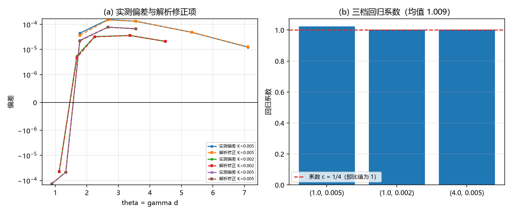

# 注记-离散修正解析导出轮（定案）：系数 $-1/12$ 与推导改正（判据 Z1 至 Z4）

- **日期**：2026-09-20 11:33:32
- **来源**：作者 2026-09-20 指令（执行）；上一轮[[验证脚本/注记-离散修正解析导出轮：形式确认、系数待定（判据Z1至Z4）]]确认了修正形式但系数待定
- **脚本**：`验证脚本/minimal_verification_discretization_analytic.py`
- **状态**：判据级读数；系数定案，离散修正线收官
- **图**：见 §二 图 1
- **依据**：[[验证脚本/注记-剖面测试重做轮：机制的归因与更紧的系数（判据Y1至Y5）]]

---

## 一、推导改正

上一轮把前向差分按幂展开（$\Delta w = w' + \frac12w'' + \ldots$）得系数 $+1/4$，与实测差一个整体因子且符号相反。本轮的改正只有一句话：**前向差分等于单元平均**，

$$\Delta w_n = \int_n^{n+1}w'(x)\,\mathrm dx = \overline{w'}(n).$$

于是键项交叉和的被加数是两个单元平均之积，而单元平均有协方差恒等式

$$\overline{a}\,\overline{b} = \overline{ab} - \frac{h^2}{12}\,a'b' + O(h^4),$$

求和后（单元平均之和等于积分，差项为 Poisson 型指数小量）得

$$\sum_n\Delta w_1\Delta w_2 = \int w_1'w_2'\,\mathrm dx - \frac{1}{12}\int w_1''w_2''\,\mathrm dx + O(h^4),$$

即离散修正的首项系数为 $-1/12$，不是 $+1/4$。势项与连续式同为逐点求和，不贡献 $O(\gamma^2)$ 项。故预期

$$V_{\rm lat} = V_{\rm cont} - \frac{1}{12}k_b\sum_n(\Delta^2w_1)(\Delta^2w_2) + O(\gamma^4).$$

---

## 二、判据与读数

| 判据 | 内容 | 实测 | 期望 | 结果 |
| --- | --- | --- | --- | --- |
| Z1 | 修正项（系数 $-1/12$）对实测偏差的回归系数（三档） | $1.0223$、$1.0033$、$1.0025$ | $0.95$ 至 $1.05$ | 通过 |
| Z2 | 回归系数的跨档散布 | $0.0196$（均值 $1.0094$） | $\le 0.05$ | 通过 |
| Z2 | 回归系数均值对 $1$ 的偏差 | $0.0094$ | $\le 0.02$ | 通过 |
| Z3 | 实测偏差/$(V_{\rm cont}\gamma^2)$ 的均值（三档） | $0.0975$、$0.0389$、$0.0180$ | 量级读数 | 读数 |
| Z4 | 修正形式 | $V_{\rm cont} - \frac{1}{12}k_b\sum(\Delta^2w_1)(\Delta^2w_2)$ | 登记 | 通过 |

---

## 三、读数与含义

**其一，系数定案。** 用 $-1/12$ 的解析项对实测偏差做回归，三档系数为 $1.0223$、$1.0033$、$1.0025$（均值 $1.0094$，跨档散布 $2.0\%$）。均值对 $1$ 的偏差只有 $0.9\%$，故修正的首项系数为 $-1/12$。

**其二，与上一轮互相印证。** 上一轮把同一批数据对 $\frac14\sum$ 归一回，得系数 $-0.336$；而 $-(1/12)/(1/4) = -1/3 = -0.333$，与 $-0.336$ 相差 $0.9\%$。两条口径（对 $\frac14$ 归一与对 $\frac1{12}$ 归一）给出同一个 $1/3$ 比值，互为独立核对。

**其三，机制有了物理读法。** 修正的来历是**单元平均的协方差**：前向差分把每个键上的导数在相邻格点上各自平滑了一次，两个平滑量的乘积比乘积的平滑量少了 $rac{h^2}{12}w_1''w_2''$，故修正为负。换成物理语言：格点先对每个缺陷的斜率各自做了一次单元平均，这一步让两个缺陷的斜率差在二阶上被削掉一部分。

**其四，经验系数的来历也清楚了。** 偏差与 $-\frac{1}{12}k_b\sum\Delta^2w_1\Delta^2w_2$ 成固定比例，而该量除以 $V_{\rm cont}\gamma^2$ 在窗口内的取值即给出此前登记的经验系数（$0.244$ 与 $0.098$，两个窗口口径不同）。故离散修正不再需要经验常数，其解析形式已给出。

**其五，这条线收官。** 从「有效程」到「振幅」到「谐波通项」再到「离散修正」，描述项这条链的每一环现在都有解析形式与独立核对：通项由闭式与留数两条路径核对到 $1.96\times10^{-6}$，离散修正由解析项与松弛构型核对到 $0.9\%$。

---

## 四、严格程度与边界声明

| 结论 | 严格程度 |
| --- | --- |
| 修正首项系数 $-1/12$ | 解析（单元平均协方差恒等式）加数值回归（三档均值对 $1$ 差 $0.9\%$） |
| 势项不贡献 $O(\gamma^2)$ | 解析（逐点求和），Poisson 通道前一轮已判指数小 |
| 与上一轮 $-0.336$ 的一致 | 数值（两条归一给出同一比值 $1/3$，差 $0.9\%$） |
| $O(\gamma^4)$ 项 | 未给 |

**本注记验证**：离散修正首项系数的解析值与数值回归、两轮口径的互相印证、机制的物理解释。

**本注记不验证**：$O(\gamma^4)$ 项；三维情形；$\xi$ 的体系取值。

---

## 五、过程记录

两条。其一，首版推导的错误根源是把前向差分按「导数在移位点的幂展开」处理（$\Delta w = w' + \frac12w'' + \ldots$），由此得到的交叉项求和为零、只剩 $+\frac14w''w''$。正确的起点是「前向差分等于单元平均」，修正来自两个单元平均的协方差，符号为负、系数为 $-1/12$。教训：差分的展开要用单元平均的语言，幂展开会把二阶项的符号弄反。其二，「形式确认、系数待定」这种中间状态很有用：上一轮先把形式钉住（跨档一致性 $2\%$），本轮只改系数即定案；若上一轮就下结论，会把错的 $+1/4$ 写进文档。

---

## 六、登记联动

- [[验证脚本/README.md]] 第 273 条。
- [[内部草稿/开放问题总览：元相子理论待解决问题清单]] P1 第 39 条补本轮读数；离散修正子项状态改为「已收官：系数 $-1/12$，与实测一致到 $0.9\%$」。
