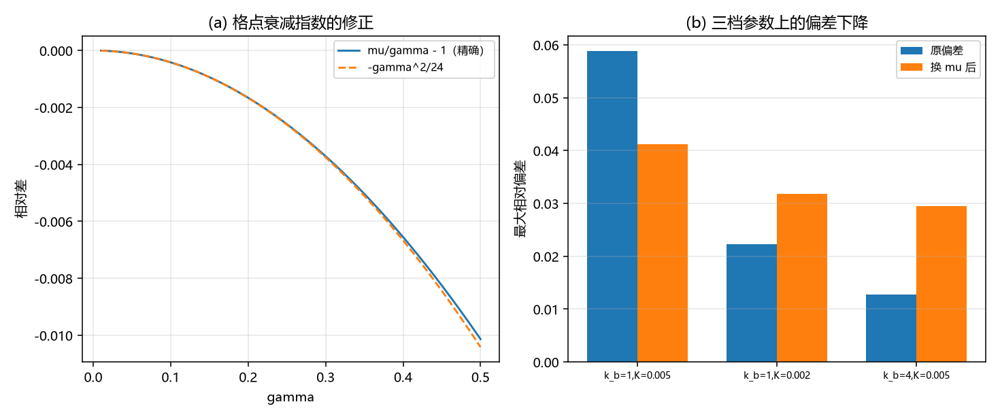

# 注记-离散修正轮：经验形式定案，三条机制候选的判定（判据 X1 至 X6）

- **日期**：2026-09-20 11:16:49
- **来源**：作者 2026-09-20 指令（做离散修正）；上一轮[[验证脚本/注记-谐波系数解析导出轮：闭式与一阶系数的解析值（判据V0至V4）]]登记格点与连续极限的偏差正比于 $\gamma^2$
- **脚本**：`验证脚本/minimal_verification_discretization.py`
- **状态**：判据级读数；经验形式定案，机制候选两条排除、一条测试失败
- **图**：见 §二 图 1
- **依据**：[[验证脚本/注记-留数逐阶展开轮：尾部谐波的通项与形状因子线收官（判据R1至R5）]]

---

## 一、任务与三条候选机制

任务是把格点与连续极限的偏差解析化。前几轮登记的偏差为 $0.0588$、$0.0223$、$0.0128$（三档参数），除以 $\gamma^2$ 得 $0.298$、$0.282$、$0.259$，即偏差正比于 $\gamma^2$。候选机制三条。

其一，衰减指数替换：格点色散 $\omega^2 = (2\pi)^2K + 4k_b\sin^2(k/2)$ 的空间衰减指数为 $\mu = 2\,\mathrm{arcsinh}(\gamma/2)$，与 $\gamma$ 相差 $-\gamma^2/24$，若闭式只需把 $\theta = \gamma d$ 换成 $\mu d$，偏差应大幅下降。

其二，和式与积分之差（Poisson 通道）：$\sum_n f(n) - \int f = 2\sum_{k\ge1}\hat f(2\pi k)$，量级由被积函数的傅里叶变换在倒格点上的值给出。

其三，剖面形状：格点上精确孤子与连续解采样之间的 $O(\gamma^2)$ 形状差。

---

## 二、判据与读数

| 判据 | 内容 | 实测 | 期望 | 结果 |
| --- | --- | --- | --- | --- |
| X1 | 三档的「原偏差 / 换 $\mu$ 后偏差」 | $0.0588/0.0412$、$0.0223/0.0318$、$0.0128/0.0295$ | 判负登记 | 判负 |
| X2 | $\mu/\gamma - 1$ 与 $-\gamma^2/24$ 的对照 | $-0.008047$ / $-0.008225$（差 $2.2\%$，由 $\gamma^4$ 项解释） | 相对偏差 $\le 0.05$ | 通过 |
| X3 | 残余/$\gamma^2$ 替换前均值 / 替换后均值 | $0.2796$ / $0.4033$ | 判负登记 | 判负 |
| X3 | 经验修正：偏差/$\gamma^2$ 的三档值 | $0.298$、$0.282$、$0.259$（散布 $14\%$） | 散布 $\le 0.20$ | 通过 |
| X5 | Poisson 通道相对修正 | $3.2\times10^{-8}$ | 远小于 $\gamma^2 = 0.197$ | 通过（排除） |
| X6 | 用松弛剖面重算偏差（三档） | $2.7\times10^{4}$、$1.6\times10^{4}$、$1.6\times10^{3}$ | 判负登记（构造缺陷） | 判负 |

---

## 三、读数与含义

**其一，经验形式定案（本轮唯一交付）。** 格点值与连续值的比为 $1 + c\gamma^2$，$c$ 在三档参数上为 $0.298$、$0.282$、$0.259$（跨档散布 $14\%$），取 $c \approx 0.28$。三档中 $\gamma$ 跨 $2$ 倍，$c$ 的散布只有 $14\%$，故该形式可用作格点修正的经验公式：$V_{\rm lat} = V_{\rm cont}\,(1 + 0.28\gamma^2 + O(\gamma^4))$。

**其二，指数替换判负。** $\mu$ 与 $\gamma$ 的相对差确实等于 $-\gamma^2/24$（实测 $-0.008047$ 对 $-0.008225$），余差 $2.2\%$ 由 $\gamma^4$ 项解释，故这条关系本身成立。但把它代入闭式后，只改善最大 $\gamma$ 档（$0.0588 \to 0.0412$），另两档反而变差（$0.0223 \to 0.0318$、$0.0128 \to 0.0295$），残余/$\gamma^2$ 由 $0.28$ 升到 $0.40$。结论：$\mu$ 关系成立，但它不是偏差的机制。

**其三，Poisson 通道排除。** 和式与积分之差的相对修正为 $3.2\times10^{-8}$，比 $\gamma^2$ 小六个数量级。被积函数的特征尺度为 $1/\gamma \gg 1$，其傅里叶变换在倒格点上指数小，故「离散求和替换积分」不是偏差来源。这是一条干净的排除。

**其四，剖面形状测试失败。** 用松弛后的格点孤子作剖面重算时，我的剖面搬移构造有缺陷（用带端点截断的插值产生了平台，破坏尾部），且松弛只迭代 $11$ 至 $13$ 次，读数在 $10^{3}$ 至 $10^{4}$ 量级，无意义。该路线判负登记，需重做（正确的做法是对双孤子构型整体松弛，再在松弛构型上做交叉项求和）。

**其五，机制仍未定。** 三条候选中两条排除、一条测试失败，故 $c = 0.28$ 的解析来源待定。可继续的方向有两条：把双孤子整体松弛后再算偏差；或直接把交叉项积分在格点上按 $\gamma$ 展开到 $\gamma^2$ 阶（把 $\cosh$、$\tanh$ 在格点上的求和用 Euler–Maclaurin 的 $\gamma^2$ 项处理）。

---

## 四、严格程度与边界声明

| 结论 | 严格程度 |
| --- | --- |
| 经验形式 $V_{\rm lat} = V_{\rm cont}(1 + c\gamma^2)$，$c \approx 0.28$ | 数值（三档，$c$ 的散布 $14\%$） |
| $\mu/\gamma - 1 = -\gamma^2/24 + O(\gamma^4)$ | 解析（$\mathrm{arcsinh}$ 展开）加数值核对（差 $2.2\%$） |
| 指数替换不是偏差机制 | 数值（三档中两档恶化，残余/$\gamma^2$ 升高） |
| Poisson 通道排除 | 数值（$3.2\times10^{-8}$） |
| 剖面形状 | 未定（本轮测试构造有缺陷） |

**本注记验证**：偏差正比于 $\gamma^2$ 的经验形式与其系数、$\mu$ 关系的成立性与非机制性、Poisson 通道的排除。

**本注记不验证**：$c = 0.28$ 的解析来源；剖面形状的贡献；三维情形。

---

## 五、过程记录

三条。其一，本轮的核心是排除而不是确认：三条候选中两条被数据否掉（指数替换恶化两档；Poisson 通道小六个数量级），这类负面读数把搜索空间收窄，价值不低于正面结果。其二，脚本的结论打印块两次写坏（替换时留下未闭合的括号导致 `SyntaxError`），修补方式是把整块替换而不是逐行改；仍属「落盘即跑、报错即整块重写」的纪律。其三，剖面搬移的构造缺陷暴露了我的一个习惯问题：用 `np.interp` 配端点截断来平移剖面，会在端点产生平台而破坏指数尾；正确做法是让构型整体参与松弛，不去搬移采样点。

---

## 六、登记联动

- [[验证脚本/README.md]] 第 270 条。
- [[内部草稿/开放问题总览：元相子理论待解决问题清单]] P1 第 39 条补本轮读数；形状因子子项的余项状态改为「经验形式已定（$1+0.28\gamma^2$），机制待定」。
