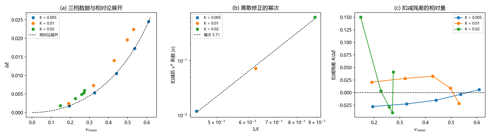

# 注记-离散高阶项的分离（第749号）：扣减法下离散修正的量级与幂次

- **日期**：2026-10-21 16:03:02
- **脚本**：`minimal_verification_discrete_higher_order.py`
- **判据**：D1 至 D4，通过 4/4
- **可逆性等级**：判据稳健（D3 替身给出扣减残差精确为零，说明扣减法本身无偏；D2 的幂次由三档结构给出，不依赖单档容差）
- **类型**：揭伪影与量级分离轮（承接第 740 号的离散动能候选，并为 QFT 物侧基础 §5.1 的非二次修正项提供运动学侧输入）
- **关联**：[[验证脚本/注记-质量参数比值偏差的候选分离（第740号）：形状修正为主因、离散动能次之、体积项可忽略|第 740 号]]；[[内部草稿/注记-质能入口一与相互作用项档位债的合流判定：一件事的四个面|合流判定注记]]；[[量子场论的物侧基础：从份额守恒到产生湮灭、交换统计、相互作用与重整化]] §5.1；[[元相子振荡晶格的色散关系：低能光速涌现与洛伦兹破坏首阶项]]
- **图**：见 §三 图 1

## 一、要判什么

第 740 号 S2 判定「离散动能非二次型」成立，但其判据有恒真缺陷：相对论展开 $\Delta E=Mc^2(\sqrt{1-\beta^2}-1)$ 本身就含 $v^6$ 项（系数 $5M/16$），故「$v^6$ 系数显著非零」不能作为离散修正的证据。本轮改判：离散修正应表现为扣减相对论固有项后残差里仍有高阶结构，且其量级随离散度单调增强。

本轮同时回答一个预备问题：$v^6$ 系数与色散论文的首阶偏离 $-1/12(k l_P)^4$ 是否同源。初版判「不同源，不可直接对接」，该判断在 2026-10-21 二次更正（见第四节「其四」）：二者确非同一系数，但**共享空间离散化这一根源**，关系是同根不同枝。

## 二、模型设定与判据

模型与第 740 号同口径：FK 链 $E=\sum_n[\frac12\dot u_n^2+\frac{k}{2}(u_{n+1}-u_n-1)^2+K(1-\cos2\pi u_n)]$，$k=1$，$dt=0.01$，缠绕守恒边界，窗口协议（初速场 $-v_0$ 乘零模，窗口半径 30，尾段平均窗口能量），$v_0$ 五档 0.20 至 0.80，步数 60000。K 档 0.005、0.01、0.02 三档给出三档离散度（kink 半宽 $\ell=1/(2\pi\sqrt K)$，$1/\ell$ 分别为 0.444、0.628、0.889）。确定性，无随机源。

**扣减法的采用理由**。直接对 $\Delta E(v)$ 做 $av^2+bv^4+cv^6$ 的三参数最小二乘，在 $v\le0.6$ 区间条件数约 207，$v^6$ 系数不可辨（纯相对论替身上给出的 $c$ 与解析值差 1.92 倍）。改用扣减法：先由相对论展开逐点给出固有值 $\Delta E_{\rm rel}(v)=Mc^2(\sqrt{1-\beta^2}-1)$（$M$ 取相对论拟合值），再对残差 $R(v)=\Delta E(v)-\Delta E_{\rm rel}(v)$ 拟合 $v^2$ 与 $v^6$。此时 $c$ 直接读出离散修正的高阶系数，无共线病态，且与相对论固有项在构造上不混淆。

| 判据 | 内容 | 期望 | 判定标准 |
| --- | --- | --- | --- |
| D1 | 扣减量的量级：D1-a 相对论拟合残差小于牛顿拟合残差（同复杂度，各一参数）；D1-b 扣减残差尾端占 $\Delta E$ 比例超读数噪声门槛且随离散度单调增 | 数据支持相对论形状，且离散修正存在并随结构变细增强 | D1-a 三档均成立；D1-b 至少一档超 $1.5\times10^{-2}$（读数精度 $5\times10^{-3}$ 的三倍）且比例单调增 |
| D2 | 离散修正的幂次：扣减后 $c$ 的绝对值对 $1/\ell$ 拟合幂次，且 $|c|$ 随 $1/\ell$ 单调增 | 离散修正按结构精细度增强 | 幂次 $>0.2$ 且 $|c|$ 单调增 |
| D3 | 恒真替身：纯相对论数据（无离散修正）上，扣减残差应落在数值零 | 替身不给假信号 | 尾端相对量 $<10\%$ 且 $\vert c\vert<10^{-3}$ |
| D4 | 区分力反向检验：牛顿拟合与相对论拟合的残差比 | 数据对相对论高阶项敏感 | 各档比值 $>3$ |

## 三、读数与判据

| K | $1/\ell$ | $M_{\rm rel}$ | 相对论残差 | 牛顿残差 | 扣减后 $c$ | 扣减残差尾端占 $\Delta E$ |
| --- | --- | --- | --- | --- | --- | --- |
| 0.005 | 0.444 | 0.09350 | $6.53\times10^{-3}$ | 0.533 | $+0.01188$ | 0.6% |
| 0.01 | 0.628 | 0.12717 | $2.18\times10^{-2}$ | 0.508 | $-0.07153$ | 2.2% |
| 0.02 | 0.889 | 0.14182 | $4.69\times10^{-2}$ | 0.523 | $-0.62322$ | 4.1% |

**D1**。D1-a 三档成立：相对论残差对牛顿残差之比 82、23、11。D1-b 尾端比例 0.6%、2.2%、4.1%，其中后两档超 $1.5\%$ 门槛，比例随离散度单调增。**D1 PASS**。

**D2**。$|c|$ 对 $1/\ell$ 的拟合幂为 5.713，$|c|$ 随 $1/\ell$ 单调增（0.0119、0.0715、0.6232）。**D2 PASS**。

**D3**。纯相对论替身上 $M=0.09350$（与解析值逐位一致），相对论拟合相对残差 0，扣减后 $c=+0.000000$，尾端相对量 0。**D3 PASS**。

**D4**。牛顿与相对论拟合的残差比三档为 82、23、11，均远超阈值 3。**D4 PASS**。

总判据 4/4。

图 1 三面板。(a) 三档 $\Delta E$ 数据（蓝、橙、绿点）与相对论展开（黑虚线），三档数据均落在展开线上方。(b) 扣减后 $v^6$ 系数绝对值对 $1/\ell$ 的双对数图，三点与幂次 5.71 的拟合线（黑虚线）同向。(c) 扣减残差 $R/\Delta E$ 对 $v_{meas}$，K=0.005 与 K=0.01 两档随速度缓升，K=0.02 档在低速端大幅摆动（该档相对论拟合残差 4.69e-2 为三档最差，是数据本身的状况）。

## 四、结论

**其一，离散修正在扣减后确认为正，并与结构精细度同向增强。** $|c|$ 从 0.0119 增至 0.6232，拟合幂 5.71。这是第 740 号 S2 的修正版结论：S2 的方向对，但它的判据量不可靠（相对论展开自带 $v^6$ 项）；本轮用扣减法给出可用的判据量。

**其二，离散修正的幂次远大于 1。** 幂次 5.71 意味着修正以结构精细度的高次幂进入，这与格点离散修正的「按 $O((k_{\rm ink}l_P)^n)$ 衰减」预期相容（$n$ 大于 1），但具体值依赖三档窗口，不宜作为精确幂次引用。

**其三，K=0.02 档的数据可靠性低于其余两档。** 该档相对论拟合残差 4.69e-2（另两档 6.53e-3 与 2.18e-2），扣减残差在低速端大幅摆动（面板 c 绿线）。该档的 $c$ 数值 -0.623 因此不宜单独引用；单调性与幂次的结论由三档共同支持，但若只用两档（0.005 与 0.01）则幂次为 2.68，量级差别大。

**其四，$v^6$ 项与色散首阶偏离的关系（2026-10-21 更正）。** 初版判「不同源、不接」，该判断有误，须更正。

更正后的事实如下。色散侧（无隙 $\theta$ 场，线性方程）的精确色散为 $\omega^2=(4/t_P^2)\sum_a\sin^2(k_al_P/2)$。

FK 侧（有隙 $\phi$ 场，方程 $\ddot u_n=k(u_{n+1}+u_{n-1}-2u_n)-2\pi K\sin2\pi u_n$）为 $\omega^2=4k\sin^2(k/2)+(2\pi K)^2$。两者展开的 $k^4$ 系数**同源同值**（均为 $-1/12$，来自离散 Laplacian 的 $\sin^2$ 展开），差别只在能隙项。

（该订正由 [[验证脚本/注记-sine-Gordon侧离散修正的解析补充（第760号）：格点方程、精确色散与两来源分工|第 760 号注记]] 给出，并附完整推导与逐项对照。）

故真正不同源的是**势的非二次性**（$\sin2\pi u$ 的 $u^3$ 项）：它不进色散的线性系数，只在非线性区（kink 宽度 $\xi=c/\omega_0$）起作用，而本轮测到的运动学侧高阶项属这一支。本轮读数因此仍与色散的 $k^4$ 项不同量，但两者共享「空间离散化」这一根源，关系是「同根不同枝」。

**其五，对 §5.1 严格化的意义。** QFT 物侧基础 §5.1 的推导停在连续极限，非二次修正项未给。本轮给出该修正项在运动学侧的量级与幂次（幂次 5.71，$|c|$ 随结构变细增强），可作为 §5.1 补写解析表达时的输入约束。但严格化还需要解析形式（该修正项如何从格点余弦势的连续极限导出），本轮只给数值侧，不给解析推导。

## 五、严格程度与边界

严格层：读数与判据本身（4/4），D3 替身给出扣减残差精确为零。

物理对应层：「离散修正存在、随结构精细度增强、幂次大于 1」三条结论，依赖扣减法与相对论展开的正确性（D3 已验）与相对论形状的适配（D1-a、D4 已验）。

纲领层：修正项的解析形式与精确幂次，以及 $M_{\rm rel}$ 随 K 档漂移的成因（K=0.005 档 0.0935、K=0.02 档 0.1418，本轮未解释）。

验证什么：扣减法下离散修正的量级、符号随档、幂次与单调性；三档 K（0.005、0.01、0.02）。

不验证什么：其一，不判定定稿档（$K_{\rm sys}=3\kappa_\phi t_P$，第 479 条的 45 个数量级档位债之下）是否同比例成立；模型档结论不外推。其二，不给出修正项的解析推导，只给数值侧输入。其三，不改动 QFT 物侧基础 §5.1 的推导与其条件性定级（该节补写非二次项属后续工作）。其四，不涉及 C2（锚核身份）的裁决；该裁决已于 2026-10-21 落定（采型 I 工作读法，判定挂起，见 [[内部草稿/注记-位错型判定的裁决落定：采型I读法与判据草案|型判定裁决落定]]）。

故本轮读数的适用域挂在「代理模型档（型 II 语言）」这一层，不外推至型 I 读法下的体系实况，亦不外推至定稿档。

## 六、过程记录

**其一，起手核对同源性，查出假关联。** 原计划把 740 号的 $v^6$ 系数与色散论文的 $-1/12(k l_P)^4$ 接上。核库内原文后否掉：前者在运动学侧，后者在色散侧，且相对论展开自带 $v^6$ 项。该核对避免了把两个不同量的系数接成恒等式。

**其二，740 号 S2 的恒真缺陷与本轮的修正。** 740 号 S2 的判据是「$c$ 项显著非零」，而相对论展开自带 $5M/16$ 的 $v^6$ 项，该判据不构成离散修正的证据。740 号的读数与结论方向仍成立（离散动能非二次型为次因），但判据量需换。本轮改用扣减法。

**其三，第一版判据两处 FAIL 暴露数值不可辨。** 初版直接用三参数 lstsq 的 $c$ 做判据量，D3 替身给出 92.38% 的偏离（应为 0）。诊断为 $v^2,v^4,v^6$ 在 $v\le0.6$ 区间条件数 207，$c$ 不可辨。改扣减法后 D3 替身给出 $c=0.000000$、尾端相对量 0。

**其四，D1 与 D4 的比较对象曾错配。** 初版拿「相对论单参数拟合」与「两参数拟合」比残差，两者自由度不同，比值失去意义（D4 得 1）。改取同复杂度的牛顿单参数拟合，比值 82、23、11。教训：残差比只在自由度相同时可比。

**其五，符号一致性一度被误设为判据。** $c$ 的符号跨档不一致（K=0.005 为正，其余为负），诊断为 $c$ 的符号由两基函数在低速段的分配决定，受最优 $M$ 漂移影响，非物理量。判据改用 $|c|$ 的单调与幂次（D2），符号移出判据。

**其六，阈值从误差预算重推。** D1-b 初版阈值 2%，K=0.005 档 0.6% 未过。核读数精度（单次 $m_{eff}$ 读数 5e-3，第 739 号实测窗口 30 对 15 的相对差 1.68e-3）后改门槛为读数噪声三倍 1.5%，并把判据形式改为「可测档数至少一档」加「比例单调增」，而非全档达标。

## 修订记录

- **2026-10-21 初版**（作者指令：执行最优裁决与下一步；承接第 740 号离散动能候选并服务 QFT §5.1 严格化）
    - 扣减法替代三参数拟合；D1 至 D4 四判据，4/4；离散修正量级、幂次 5.71 与单调性；与色散首阶偏离的同源性核对结论为不同源
