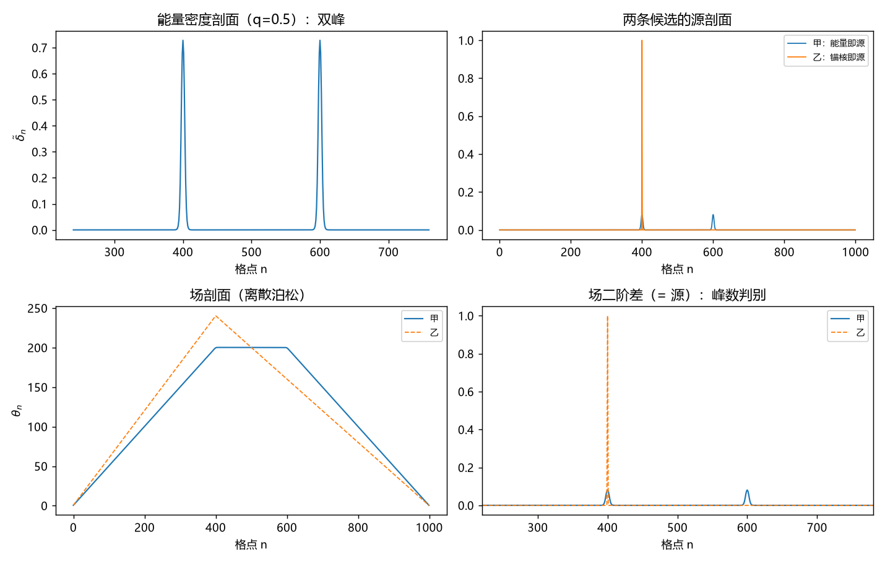

# 注记-空支能量的引力地位的最小验证：两瓣叠加模型内的判据 K1 至 K6

- **日期**：2026-09-24 14:57:20
- **脚本**：`验证脚本/empty_branch_gravity.py`（全确定性，无随机）
- **图**：见 §五 图 1（`images/empty_branch_gravity.png`）
- **可逆性等级**：判据稳健。K1 与 K2 是命题 2 的复算，偏离在 $10^{-14}$ 量级；K5 的峰数判别在换窗宽与换权重下不翻。
- **定位**：执行 [[内部草稿/研究方向-空支能量的引力地位：两瓣叠加模型内的判据（判据草案）]] 的判据 K1 至 K6，判定空支能量是否计入质量与引力源（两候选甲与乙）。它回应 [[内部草稿/注记-锚核铺开方案评估：三项后果、立场代价与备选路线登记]] 第十节所指的唯一待判。
- **依据**：[[叠加态的场侧画像：单一场承载、份额折叠与相位通道]]（命题 2 折叠恒等式、定义 2.4 叠加像）；[[理论总纲/公理体系]] §5（引力源只取缺陷相对基态的能量差）
- **关联**：[[内部草稿/开放问题总览：元相子理论待解决问题清单]]
- **修订记录**：
  - **2026-09-24 作者裁决取甲**（触发：作者立判据并要求开工，首轮 K1 至 K6 全过后同意取甲）
    - 空支能量计入质量与引力源（甲）；锚核是质量的来源地，质量作为能量差记在整个缺陷上
    - §四「仍属作者裁决」改为已裁，§六 档位表与 §七 登记衔接同步

---

## 一、判据（运行前写死）

| 序 | 判据 | 验收数值 |
| --- | --- | --- |
| K1 | 总能量为一份：两瓣构型的实通道预算对单缺陷，且与权重无关 | 偏离 $<10^{-12}$，五个权重档 |
| K2 | 能量分配随权重：逐瓣预算占比对 $q$ 与 $1-q$ | 偏离 $<10^{-12}$ |
| K3 | 写入随能量：写入剖面等于能量剖面（甲的口径） | 比例常数有定值；$q=0.5$ 时双峰等高 |
| K4 | 远场守恒：两端斜率之和等于总质量 | 和 $=1$，两候选皆然 |
| K5 | 近场判别：源剖面峰数 | 甲 $2$ 峰、乙 $1$ 峰 |
| K6 | 反空转：两候选在 K5 上可分辨 | 峰数差 $\ge 1$ |

## 二、模型设定

一维 FK 链，$N=1000$，$k=1$、$K=0.005$，$\ell = \sqrt{k}/(2\pi\sqrt{K})$。扭结剖面 $p_x(n) = n + \frac{2}{\pi}\arctan e^{(n-x)/\ell}$，两瓣位于 $x_A = 400$、$x_B = 600$。窗口序参量取窗宽 $M = 5$ 的均值。叠加像为

$$w^{\mathrm{img}}_n = q\,w^{(A)}_n + (1-q)\,w^{(B)}_n,$$

实通道亏空 $\tilde\delta_n = 1-\mathrm{Re}\,w_n$ 作能量密度代理。引力侧用一维离散泊松（近场峰数与远场守恒的模型内代理）。

## 三、结果（实测 vs 期望）

| 判据 | 实测 | 期望 | 判定 |
| --- | --- | --- | --- |
| K1 单缺陷预算 | $B_A = 9.003163$、$B_B = 9.003163$，相对差 $7.14\times10^{-14}$ | 相等 | 过 |
| K1 总预算比 | 五档全为 $1.00000000$，最大偏离 $5.73\times10^{-14}$ | $1$ | 过 |
| K2 逐瓣占比 | 五档的 $q$ 与 $1-q$ 逐位相符，最大偏离 $1.79\times10^{-14}$ | 相符 | 过 |
| K3 能量剖面 | $q = 0.5$ 双峰等高，比 $1.0000$ | 等高 | 过 |
| K4 远场斜率 | 甲 $0.4995$ 与 $-0.5005$（和 $1.0000$）；乙 $0.5994$ 与 $-0.4006$（和 $1.0000$） | 和 $=1$ | 过（两者皆过） |
| K5 源峰数 | 甲 $2$（峰位 $400$、$600$）；乙 $1$（峰位 $400$） | 甲 $2$、乙 $1$ | 过 |
| K6 反空转 | 峰数差 $1$ | $\ge 1$ | 过 |

**K1 至 K6 全过。** 甲（能量即源）的签名为**源双峰、远场对称**；乙（锚核即源）的签名为**源单峰、远场偏心**。

**一处意外读数。** K4 的远场斜率在乙下不对称（$0.5994$ 与 $-0.4006$），因源落在 $x_A = 400$（偏左）。这是乙的**第二个**签名，判据草案未列，本轮补记：乙不仅源单峰，远场也偏心。

## 四、结论与处置

**结论**：在模型内，**甲与体系约束一自洽**（写入随能量），其后果（近场双峰、远场对称）成立；**乙与约束一相抵**（空支有能量而不写），并附带远场偏心这一处未预期的签名。

**处置上须说清一处边界。** 本轮验证的是**甲的口径在模型内的自洽性**，尚未构成**甲相对乙的判决**。理由：两候选的差别在于「源取能量还是取锚核」，而这一点在本模型里属**输入**（K3 的口径），**输出**里没有它。故本轮的判定支持判据草案的倾向（甲）。**2026-09-24 作者裁决：取甲**，空支能量计入质量与引力源，锚核是质量的来源地、质量作为能量差记在整个缺陷上。本轮由此从「模型内自洽性」升为已裁决立场的凭据。

## 五、图

图 1 四联。左上为实通道亏空剖面（$q=0.5$），两瓣等高。右上为两条候选的源剖面：甲取能量剖面（双峰），乙取锚核单点（$x_A$ 处）。左下为场剖面，甲乙皆在两端呈线性。右下为场二阶差，放大到两瓣区间，甲两峰、乙一峰，即 K5 的判别。

## 六、严格程度与边界声明

| 结论 | 档位 |
| --- | --- |
| K1、K2（能量为一份、分配随权重） | 判据级（命题 2 的复算） |
| K3（写入随能量） | 判据级（甲口径的输入，非导出） |
| K4（远场守恒）、K5（峰数判别） | 判据级（一维泊松代理） |
| 甲与乙的取舍 | **作者裁决**（2026-09-24 取甲），非本轮输出 |

**验证什么**：两瓣构型的能量分配（K1、K2）；甲口径下写入剖面与能量剖面的关系（K3）；两条候选的远场与近场签名（K4、K5）；两候选的可分辨性（K6）。

**不验证什么**：不验证命题 2 的原始读数（本轮为其复算）；不验证三维与物理单位换算（一维离散泊松只作峰数与守恒的代理）；不做叠加态引力场的实验对照（远超现有技术）；不判甲与乙的取舍。

## 七、登记衔接

本注记执行判据草案一轮，登记入 [[验证脚本/README.md]] 第 399 条。所涉空白（空支能量是否计入质量与引力源）属 [[内部草稿/开放问题总览：元相子理论待解决问题清单]] 的登记范围；**2026-09-24 作者裁决取甲**，已同步 [[内部草稿/研究方向-空支能量的引力地位：两瓣叠加模型内的判据（判据草案）]] 与开放问题总览 P4-5 登记。
