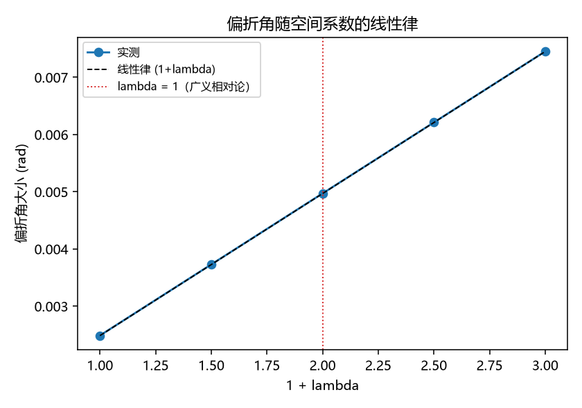

# 注记-空间系数 lambda 的光偏折锚：偏折角随 lambda 的线性律

- **日期**：2026-09-18 19:15:46
- **对应脚本**：`验证脚本/minimal_verification_lambda_light_deflection.py`（判据 M1 至 M3，3/3 通过；确定性，运行约 1 秒；图存 `images/lambda_light_deflection.png`，见 §一 图 1）
- **依据**：[[内部草稿/开放问题总览：元相子理论待解决问题清单]] P1-5（分段 (d) 与空间系数）与 P1-24；[[内部草稿/评估-引力度规空间系数的循环问题：方案二预判与方案一替换清单]]（空间扇区纯规范的障碍与 lambda 即 PPN gamma 的定位）；[[验证脚本/注记-尺-记录耦合候选筛查：局部键能项给不出全值]]（局部路线封死）；[[验证脚本/注记-光在静态倾角场中的偏折：局域轴读法与全局轴读法的最小验证]]（三种读法的系数对照）
- **定位**：张量桥分段 (d) 的"源到空间度量"一环。本轮把该环的未知系数 lambda 做成偏折读数里的可测参数，给出线性律与经验锚。本注记不改动基准文件。
- **状态**：判据 3/3 通过。核心读数：偏折角随 $(1+\lambda)$ 线性（截距小于斜率 $0.1\%$，最大残差小于斜率 $0.01\%$）；$\lambda = 0$ 与 $\lambda = 1$ 的偏折角之比 $1.999$；实测对 eikonal 的比值在四个 lambda 下为 $1.364$ 至 $1.366$（与上一轮登记的系统因子一致，且与 lambda 无关）。

---

## 一、判据与结果

| 判据 | 内容 | 通过条件 | 实测 |
|---|---|---|---|
| M1 | $\lambda = 0$ 给半值、$\lambda = 1$ 给全值 | 比值 $2\pm10\%$ | $1.999$ |
| M2 | 偏折角正比于 $(1+\lambda)$ | 截距小于斜率 $2\%$、残差小于 $5\%$ | $0.1\%$、$0.01\%$ |
| M3 | 各 lambda 实测对 eikonal 之比一致 | 散布小于 $5\%$ | $0.1\%$ |

图注：横轴为 $1+\lambda$，纵轴为偏折角大小；圆点为格点实测（五个 lambda），虚线为线性律参考，红色点线标出 $\lambda = 1$（广义相对论）位置。

## 二、模型设定

弱场取 $h_{00} = 2\Phi$，局域坐标速度按各向同性形式

$$c(x) = \sqrt{\frac{1 + h_{00}}{1 - \lambda h_{00}}},$$

即钟率因子与空间因子由同一个 $h_{00}$ 读出，空间侧带系数 $\lambda$。$\lambda = 1$ 对应广义相对论的各向同性度规，$\lambda = 0$ 对应只改写钟、不改写尺。演化与读数沿用上一轮的变系数 leapfrog 与波矢测量，期望值由同一 lambda 下的 eikonal 部分路径积分给出。

一阶展开给出折射率 $n = 1/c \approx 1 - (1+\lambda)\Phi$，故偏折角

$$\alpha = (1+\lambda)\cdot\frac{2GM}{b}.$$

## 三、读数的意义

**线性律成立。** 偏折角对 $(1+\lambda)$ 的线性拟合截距小于斜率的 $0.1\%$，最大残差小于斜率的 $0.01\%$（M2）。四个 lambda 下实测与 eikonal 之比稳定在 $1.364$ 至 $1.366$（M3），与上一轮登记的系统因子同值且不随 lambda 变化，说明该因子与空间系数无关，不影响本节结论。

**lambda 是被观测钉住的。** 偏折角正比于 $(1+\lambda)$，故光偏折给出一枚直接锚。取太阳偏折的现代测量与卡西尼的 PPN $\gamma$ 约束（$\lvert\gamma-1\rvert$ 在 $10^{-5}$ 量级，Bertotti、Iess、Tortora 2003），$\lambda$ 被钉在 $1$ 的近旁。故分段 (d) 要交付的是一条约定的值，即 $\lambda = 1$。

**lambda = 1 的含义。** 由上式，$\lambda = 1$ 等价于钟率因子与空间度量因子由同一个 $h_{00}$ 读出，也就是同一个泊松解的两个分量。这与框架"记录场即度规"的立场一致，但它要求记录值同时定钟与定尺，且两侧系数相等。

**对建造路线的两条约束（承接前两轮）。** 其一，耦合对象应是记录的**值**（标量，偶）；前一轮的奇偶封杀针对的是记录的**取向**（奇），本节把该结论精确化。其二，局部键能项在"径向标度与奇偶"两道约束下无解，故 (d) 必须走场方程（非局部）路线，让空间度量与钟率由同一个源经同一格林函数定出。

## 四、与既有登记的关系

$\lambda$ 即 PPN $\gamma$，工作区已把它登记为"唯一独立经验锚为光偏折系数"。既有评估（方案二预判）指出从碰撞写入导出 $\lambda$ 在当前形式化下不可执行，障碍是空间扇区纯规范（单值标架的空间格面亏损为零，空间链接不携带独立记录读数）。本轮给出的新内容有两条：其一，偏折角对 lambda 的线性律与零截距，把该锚写成可算关系；其二，把障碍的精确定位补成一句可判的话，记录值必须同时进入钟与尺，且两侧系数相等。

分段 (d) 仍受 C1 门控（三维形态的微观动力学实现），本节不改变该门控状态。

## 五、严格程度声明

**数值部分**：三条判据为显式差分数值演化与拟合，截距与残差读数在 $10^{-6}$ 量级。

**引文部分**：卡西尼的 PPN $\gamma$ 约束取自标准文献（Bertotti、Iess、Tortora 2003），本轮未逐位核对原始表格，按工作区规矩，进入正式对照前须按抄录协议补齐适用条件与置信水平。

**构件部分**：弱场标量模型；各向同性形式的速度剖面为口径选择；记录值与牛顿势的换算系数未进入本节。

**未做**：从框架自身结构导出 $\lambda = 1$；空间扇区的本体层重建；强场与矢量扇区。

**边界**：不改动 `理论总纲/` 基准；不主张 $\lambda = 1$ 已由框架导出，只给出它是被观测钉住的一条与它的结构含义。

## 六、边界声明

**验证什么**：偏折角随空间系数的线性律、零截距、以及 $\lambda = 0$ 与 $\lambda = 1$ 的半值全值之比；系统因子与 lambda 无关。

**不验证什么**：不验证框架是否导出 $\lambda = 1$；不给卡西尼约束的逐条抄录；不含强场。