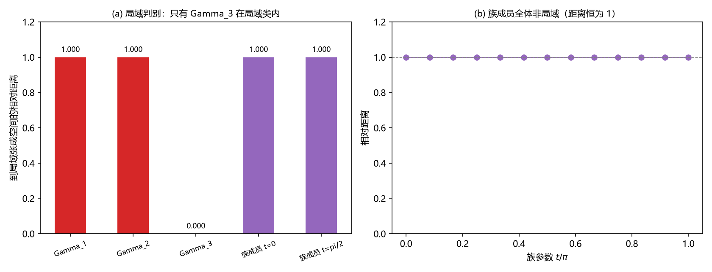

# 注记-第四枚生成元能否由体系选出（判据第 645 号）

## 元数据

- **日期**：2026-10-16 05:48:29
- **脚本**：`验证脚本/minimal_verification_fourth_generator.py`
- **判据**：冒烟加 K1 至 K3（K1 为读数，K2 与 K3 为判据），另附恒真反例一处
- **可逆性等级**：判据稳健。K1 是代数穷举给出的维数（与容差无关）；K2 是条件的空集与非空集之别；K3 是相对距离读数（口径同第 639 号）。构造不变则不翻
- **类型**：狄拉克线质量项轮（第四枚生成元），承接第 637、639 号
- **所属计划**：[[理论攻坚/狄拉克方程攻坚计划：从元相子几何导出狄拉克方程与完整几何意义]]
- **关联**：[[验证脚本/注记-手性算符的格点原生表达式与两套标号的相容性（判据第637号）|第 637 号]]、[[验证脚本/注记-手性口径对表的算符层核对（判据第638号）|第 638 号]]、[[验证脚本/注记-格点三枚生成元是否对应自旋空间的三枚（判据第639号）|第 639 号]]、[[验证脚本/注记-两因子张量积结构判据化（第491条）：宇称唯一性、Wilson相容与谱的因子化代价|第 491 号]]、[[内部草稿/注记-质量项形式的存在性审计：第四枚生成元能否由体系选出（2026-10-16）|质量项形式存在性审计]]
- **图**：见 §四 图 1

---

## 一、要判什么

存在性审计（[[内部草稿/注记-质量项形式的存在性审计：第四枚生成元能否由体系选出（2026-10-16）|审计注记]]）的结论为「缺一条选择原则」，并给出两条线索。线索甲的原话是「改用与三枚空间生成元反对易且与它们连乘积对易一类不含号差的条件重做穷举」。本轮把这句话判一遍：那样的条件能不能从候选族里选出唯一的一枚。另补一条局域判别，即第四枚有没有格点局域实现，这正是第 639 号对三枚生成元做过的同一件事。

## 二、模型设定

褶皱空间取四分量，三枚空间生成元取第 636 号口径 $\Gamma_1=I\otimes\sigma_3$、$\Gamma_2=\sigma_3\otimes\sigma_1$、$\Gamma_3=\sigma_1\otimes\sigma_1$（与第 638、639 号同口径），连乘积 $\omega=\Gamma_1\Gamma_2\Gamma_3$。候选第四枚定义为「与三枚全反对易的厄米算符」。

局域张成空间取第 639 号读出的四维分支块 $\{I,\ I\otimes\sigma_1,\ \sigma_1\otimes I,\ \sigma_1\otimes\sigma_1\}$，相对距离口径照第 639 号（先归一化再取正交余量）。

## 三、判据与结果

| 判据 | 内容 | 期望 | 实测 | 判定 |
| --- | --- | --- | --- | --- |
| 冒烟 | 三对反对易子、三枚平方、$\omega$ 与三枚的对易子 | 全零 | $0$、$0$、$0$ | 通过 |
| K1 | 与三枚反对易的厄米空间实维数 | 读数（配第 637 号 Y7 的 $2$） | $2$ | 读数 |
| K1 | 该空间内任元素平方 | 标量倍 $I$ | 非标量偏差 $1.7\times10^{-16}$ | 通过 |
| K2 | 候选与 $\omega$ 的对易子 | 非零（「与 $\omega$ 对易」条件为空集） | $1.414$、$1.414$ | 通过 |
| K2 | 候选与 $\omega$ 的反对易子 | $0$ | $2.2\times10^{-16}$ | 通过 |
| K3 | 族成员到局域张成空间的相对距离 | 非零 | 全体 $1.000000$ | 读数 |
| K3 | 对照（第 639 号口径） | $\Gamma_3=0$、$\Gamma_1=\Gamma_2=1$ | $1.000000$、$1.000000$、$0.000000$ | 通过 |
| 反例 | 把族成员并入张成空间后其距离 | 翻为零 | $1.9\times10^{-16}$ | 通过 |

## 四、结果解读

**线索甲的条件是空集。** K2 读到全部候选与 $\omega$ 的对易子都是 $1.414$（非零），即「与连乘积 $\omega$ 对易」这一条件在候选族上一个都不满足。这一点可以直接看出：候选与三枚生成元都反对易，而 $\omega$ 是三枚之积，三次反号抵消一次，故候选必与 $\omega$ 反对易。所以该条件在候选族上恒为空集，不能用来收窄候选。审计注记里线索甲的这条表述据此订正。

**候选族是一维对合族，代数条件选不出其一。** K1 读到与三枚全反对易的厄米空间实维数为 $2$，空间内元素平方恒为标量倍 $I$，归一化即给出一个一参数的对合族（配第 637 号 Y7 的同一读数）。族成员彼此反对易子为零，且全体与 $\omega$ 反对易（K2）。只用三枚生成元与 $\omega$ 搭出来的条件，对族成员一视同仁，选不出某一枚。这与第 638 号的代数盲区是同一件事换了对象：那一轮说的是格点三枚与标准侧三元组之间的代数关系判不出区别，这一轮说的是第四枚在族内判不出区别。

**局域判别给出否证。** K3 读到族成员全体到局域张成空间的相对距离为 $1.000000$，与 $\Gamma_1$、$\Gamma_2$ 同（$\Gamma_3$ 为 $0.000000$，是唯一落在局域类内的那枚）。按第 639 号确立的判别器，族里没有一枚能由格点上零位移的局域字给出。第 638 号 Z4 另读到格点原生七枚算符里与三枚全反对易者为零枚。两处合起来：第四枚在格点上没有原生实现。

### 图 1

图注按脚本绘图面板逐条核对撰写，两面板经目视复核。

## 五、结论与登记

**第四枚（时间）生成元不能由体系选出。** 代数相容只给一维族，且只用三枚生成元搭出来的条件无从收窄（K1、K2）；局域判别的结果是否证（K3）。故它的选择属输入项，与第 635 号的时间方向指派同类：那一轮判「哪个生成元带 $\mathrm{i}$」不能由格点判定，这一轮判「第四枚是哪一枚」同样不能。审计注记的线索甲据此作废；出口一只剩线索乙（复结构语言里的实结构混合），而线索乙停在来源层纲领性，本轮不动。

这条读数不改动任何既有结论：第 491 号的宇称唯一性仍是复现层结果，第 501 号的来源不唯一仍成立，正稿 §2.5 的「第四枚由质量项与摆程供给」措辞不变，只是「供给」的性质由本轮定为输入项。

## 六、严格程度声明与边界声明

**严格层**：K1 为代数穷举给出的维数；K2 为对易子量值的符号判定；K3 与反例为相对距离读数（口径同第 639 号）。

**读数层**：族成员距离的具体数值。

**边界声明**：本轮不判三枚生成元以外的对象身份、不重开第 637 至 639 号与第 491、501 号、不判线索乙（来源层纲领）、不判质量项的数值与内容（另属 P1-57 与质量机制线）、不改动 `理论总纲/` 基准。

---

## 修订记录

- **2026-10-16 初版**（触发：作者授权按最优判断执行裁决与下一步；承接质量项形式存在性审计）
    - 判据 K1 至 K3 与反例：候选族实维数 $2$；「与 $\omega$ 对易」条件为空集（订正审计注记的线索甲）；族成员局域距离全体 $1.000000$
    - 结论：第四枚生成元不能由体系选出，属输入项，与第 635 号同格
