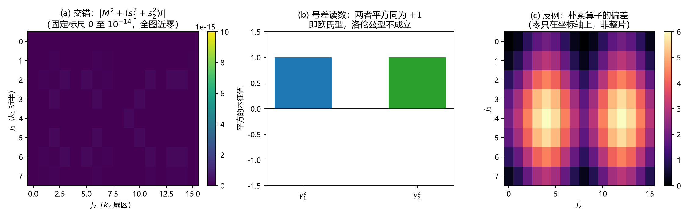

# 注记-粗格涌现构造：常值平方生成元的提取与号差读数（判据第 632 号）

## 元数据

- **日期**：2026-10-15 14:05:00（初版）
- **脚本**：`验证脚本/coarse_grain_generators.py`
- **判据**：T1 至 T5（通过 5/5，T4 为读数）
- **可逆性等级**：判据稳健。T3 为精确代数恒等式（偏差为零，无容差）；T2 与 T1 为构造一致性，容差为机精度；T4 为符号读数；T5 为反例对照（解析值 $6$ 与实测逐位一致）。
- **类型**：狄拉克线阶段 2 第三轮（粗格涌现构造）
- **所属计划**：[[理论攻坚/狄拉克方程攻坚计划：从元相子几何导出狄拉克方程与完整几何意义]]（阶段 2）；承接 [[验证脚本/注记-格点奇偶供给的反交换与生成元资格（判据第631号）]]
- **关联**：[[验证脚本/注记-电子算符Dirac骨架（第489条）：S¹×ℝ反周期谱结构、D2连续极限与D1甲乙首测|第 489 号]]；[[内部草稿/裁决备忘-狄拉克线阶段二主线：子格奇偶路线的取舍，与第二轮实现规格]]
- **图**：见 §四 图 1

---

## 一、要判什么

第 631 号读到 $D^2$ 本征值从 $0$ 铺到 $4$、散布 $4.000$，据此判定方向差不是 Clifford 生成元（生成元要求平方为常值），落档为「构造未完成」。本轮问的是：**把格点按奇偶对折、在粗格上读，能否得到平方为常值的生成元。**

对折的构造如下。交错算子在动量空间耦合 $k$ 与 $k-\pi$（因为奇偶符号 $\eta_2(n)=(-1)^{n_1}$ 就是 $\mathrm{e}^{\mathrm{i}\pi n_1}$）。把 $k_1$ 限制在半个布里渊区，令二分量为 $(u,v)=(\tilde\psi(k),\tilde\psi(k-\pi))$，则算符在每一点 $k$ 上是 $2\times2$ 矩阵

$$M(k)=\mathrm{i}\sin k_1\,\sigma_3+\mathrm{i}\sin k_2\,\sigma_1 .$$

## 二、模型设定

二维周期格点 $16\times16$，单分量场。$\eta_1=1$、$\eta_2(n)=(-1)^{n_1}$，故交错算子 $D_{\text{stag}}=D_1+P_1D_2$（$P_1=\operatorname{diag}((-1)^{n_1})$），朴素算子 $D_{\text{naive}}=D_1+D_2$。

判据与先立的期望写在脚本头部。对折形式与格点算符的对照用同一随机场做：一边直接作用后取二维 FFT，一边用 $M(k)$ 作用二分量的 FFT 分量。

## 三、判据与结果

| 判据 | 内容 | 期望 | 实测 | 判定 |
| --- | --- | --- | --- | --- |
| T1 | 对折形式与格点算符逐位一致 | 机精度 | $1.913\times10^{-14}$（交错）、$1.855\times10^{-14}$（朴素） | 通过 |
| T2 | $M^2+(s_1^2+s_2^2)I$ 的最大模 | $0$ | $2.220\times10^{-16}$ | 通过 |
| T3 | 生成元平方与反对易 | $\gamma_a^2=I$、$\{\gamma_1,\gamma_2\}=0$ | 两者偏差均为 $0.000\times10^{0}$ | 通过 |
| T4 | 生成元**平方**的本征值（号差） | 读数 | $[1,1]$ 与 $[1,1]$，同号 | 读数：欧氏型 |
| T5 | 反例：朴素算子与"常数乘单位阵"的偏差 | 非零 | $6.000\times10^{0}$（解析值 $2(s_1^2+s_1s_2+s_2^2)$ 的最大值 $6.000000$） | 通过（反例成立） |

## 四、结果解读

**构造成功，生成元有两枚且平方为常值。** T1 表明对折形式逐位复现格点算符（机精度）；T2 表明在味道空间上 $M^2$ 是常数乘单位阵；T3 表明 $\gamma_1=\sigma_3$ 与 $\gamma_2=\sigma_1$ 的平方精确为 $+1$ 且严格反对易。第 631 号判否的那一处由此补上：**反交换对本身不是生成元，但对折之后组合出来的两个算符是。** 定性上，缺的那一步就是"把动量按奇偶对折"。

**但号差是欧氏型。** T4 读到两个生成元平方的本征值都是 $[1,1]$，即两枚生成元同号。预期的"一个负配三个正"在二维这一层**不成立**。洛伦兹号差不在粗格涌现这一层，须另找来源（时间方向的那份不对称，或相位圆的复结构 $\mathrm{i}$，两者均在第五节的登记里）。

**反例成立且与解析逐位一致。** T5 表明朴素算子在同样的对折基下，平方与"常数乘单位阵"差出 $6$，解析式 $2(s_1^2+s_1s_2+s_2^2)$ 在该格点上的最大值恰为 $6.000000$。去掉奇偶符号，生成元资格随之丧失，这一条确认判据有区分力。

### 图 1

图注按脚本绘图面板逐条核对撰写。

## 五、结论与登记

**落档由「构造未完成」推进为「构造完成，号差未落地」。** 生成元资格成立，前提是必须做动量对折（等价于按奇偶分块）；号差读数为欧氏型，洛伦兹号差不在这一层。两件事分开登记，因为它们缺的东西不同：前者缺的是构造，现已给出；后者缺的是号差来源，属另一处。

**由此更新下一轮任务。** 号差来源的两个候选已在库内：其一，时间方向与空间方向在格点上的不对称（时间由摆程给出、空间由格距给出）；其二，相位圆的复结构 $\mathrm{i}$（平方为 $-1$，第 631 号供给表已列）。下一轮即在粗格生成元上接入这两个候选之一，读平方符号是否出现唯一负号，并给出恒真反例。

**631 与 632 的关系须记明。** 631 判否的是"方向差自身"，632 判成的是"对折后的组合"。两者不矛盾：632 的 $M(k)$ 里 $\gamma_a$ 来自对折（味道空间），$\sin k_a$ 来自方向差，二者分工不同。

## 六、严格程度声明与边界声明

**严格层**：对折形式与格点算符的逐位一致（机精度）；$M^2=-(s_1^2+s_2^2)I$ 的代数恒等式；$\gamma_a^2=I$ 与 $\{\gamma_1,\gamma_2\}=0$ 精确为零；反例解析值 $6$ 与实测逐位一致。

**读数层**：号差为欧氏型（平方本征值 $[1,1]$ 与 $[1,1]$）。

**边界声明**：本条在二维（两个空间方向）完成构造，**不判**三维加时间下的推广（下一轮或后续轮），**不判**号差来源（下一轮），**不判** taste 与加倍的手征处置（阶段 4 接口），**不判**「旋量分量 = 子格指标」在连续极限下的合法性（须另立读数）。二维对折后的味道空间是二分量，与二维狄拉克旋量的分量数一致，此处只说数目相合，不作身份判定。本条不改动 `理论总纲/` 基准。

## 修订记录

- **2026-10-15 初版**（阶段 2 第三轮，粗格涌现构造）
    - 判据 T1 至 T5 通过 5/5；T3 为精确恒等式（偏差零）
    - 构造：动量按奇偶对折，二分量化后 $M(k)=\mathrm{i}\sin k_1\sigma_3+\mathrm{i}\sin k_2\sigma_1$
    - 关键读数：生成元平方为常值（$+1$）且严格反对易，生成元资格成立；**号差为欧氏型，洛伦兹型不成立**
    - 落档推进为「构造完成，号差未落地」；下一轮任务（接入时间不对称或复结构 $\mathrm{i}$，读唯一负号）写定
    - 呈现更正两处：号差读数改画**平方**的本征值（原画生成元本身，误导）；面板 (a) 改固定标尺（原用 log 自标度，把舍入噪声放大成假结构）
