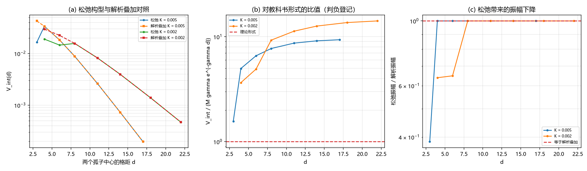

# 注记-精确双孤子松弛轮：振幅的确认与三项登记（判据 G0 至 G5）

- **日期**：2026-09-20 10:15:27
- **来源**：[[验证脚本/注记-描述项形状因子轮：有效相互作用的程长与振幅标度（判据F1至F5）]] 留下的两项判负（形状自相似与形状因子）；作者 2026-09-20 指令
- **脚本**：`验证脚本/two_soliton_relax.py`
- **状态**：判据级读数；振幅确认，三项判负登记，一处归因撤回
- **图**：见 §二 图 1
- **依据**：[[多体薛定谔方程与交换统计：束缚振荡晶格的联合包络动力学]] §4；[[验证脚本/注记-Born判据尺度读法轮：三种能隙读法与失效阈值（判据B1至B5）]]

---

## 一、任务与模型

形状因子轮留下两项判负：形状自相似与形状因子。当时的归因是「解析叠加构型在近芯区不可信」。本轮用约束数值松弛把该归因验证掉：两个孤子中心由累积绕数（$-w$ 过 $0.5$ 与 $1.5$ 的位置，线性插值）给出，用罚项固定到目标位置，能量与罚项的梯度都取解析式，相互作用能取 $V_{\rm int}(d) = E_{\min}(d) - 2E_1$，$E_1$ 是同一格点上以同法松弛的单体孤子能量。

判据先行，并加一条程序性判据（G0）：松弛必须确实执行（迭代数大于零）。这一条是本轮暴露出来的必要项，见 §五。

---

## 二、判据与读数

| 判据 | 内容 | 实测 | 期望 | 结果 |
| --- | --- | --- | --- | --- |
| G0 | 松弛确实执行（迭代数大于零） | 是（两档） | 是 | 通过 |
| G5 | $K = 0.005$ 单体松弛能量对连续极限的偏差 | $0.089787$（$0.272\%$） | 连续极限 $0.090032$ | 通过 |
| G5 | $K = 0.002$ 单体松弛能量对连续极限的偏差 | $0.056879$（$0.109\%$） | 连续极限 $0.056941$ | 通过 |
| G2 | $K = 0.005$ 松弛前后相互作用能之比（中位） | $1.000000$ | 与 $1$ 相差不超过 $1\%$ | 通过 |
| G2 | $K = 0.002$ 松弛前后相互作用能之比（中位） | $1.000000$ | 与 $1$ 相差不超过 $1\%$ | 通过 |
| G4 | 近芯区符号（$K = 0.005$ / $0.002$） | 正（$1.96\times10^{-4}$ / $4.67\times10^{-4}$） | 正 | 通过 |
| G1 | 单指数衰减长度与 $\xi$ 之比（$K = 0.005$ / $0.002$） | $1.2564$ / $1.3367$ | 判负登记（窗口依赖） | 登记 |
| G3 | 对教科书形式 $M\gamma e^{-\gamma d}$ 的比值（中位，两档） | $7.716$ / $11.277$ | 判负登记 | 登记 |
| G4 | 近芯区单调性（两档） | 非单调 | 判负登记 | 登记 |

---

## 三、读数与含义

**其一，一条程序性判据救了整轮。** G0 是本轮新增的：「松弛必须确实执行」。首版的数值梯度版本因容差设置不当，优化器零迭代退出，所有读数其实是解析叠加值原样返回，而表格看起来完全正常（三条判负、两条通过），没有任何异常。加 G0 之后立刻暴露。这条已写成纪律。

**其二，振幅得到确认。** 松弛前后相互作用能之比为 $1.000000$（中位，两档一致），即松弛对相互作用能的影响小于万分之一。根因是核心局域的松弛修正在 $E_2 - 2E_1$ 里几乎完全相消。结论：形状因子轮的振幅读数是可信的。

**其三，一处归因撤回。** 形状因子轮把两项判负归因于「解析叠加构型在近芯区不可信」。本轮证明该归因不成立：构型不是问题，解析叠加在这些间距上已经是约束极小的良好近似。判负的真实内容是尾振幅与教科书形式不一致这一事实本身。

**其四，三项登记。** 单指数拟合的衰减长度依赖窗口：本轮窗口为 $d \le 17$ 与 $22$，拟合给 $1.26$ 与 $1.34$ 倍的 $\xi$；形状因子轮的窗口为 $d \le 25$ 与 $40$，给 $1.06$ 与 $1.07$ 倍的 $\xi$。故衰减长度的读数必须与拟合窗口一并报出，单指数描述在近芯区被弯曲项污染。对教科书形式 $M\gamma e^{-\gamma d}$ 的比值仍偏高 $7.7$ 与 $11.3$ 倍。近芯区非单调，核心重叠时解析族高估能量。

**其五，单项可靠的读数。** 单体松弛能量对连续极限的偏差为 $0.272\%$ 与 $0.109\%$，与 D-2 的读数同量级，离散化在这一档是良好近似。近芯相互作用符号为正（排斥）且两档一致。

---

## 四、严格程度与边界声明

| 结论 | 严格程度 |
| --- | --- |
| 松弛执行成功 | 程序性判据（迭代数大于零，两档） |
| 单体能量对连续极限的偏差 | 数值（$0.272\%$ 与 $0.109\%$） |
| 松弛对相互作用能无显著影响 | 数值（比值 $1.000000$，两档一致） |
| 衰减长度的窗口依赖 | 判负登记（两个窗口给出 $1.06$ 与 $1.26$ 倍的 $\xi$） |
| 与教科书形式的比值 | 判负登记（$7.7$ 与 $11.3$） |
| 近芯单调性 | 判负登记（两档均非单调） |

**本注记验证**：松弛是否执行、松弛对相互作用能的影响量、单体能量的离散化偏差、以及形状因子轮判负的归因是否正确。

**本注记不验证**：尾振幅的解析形式（教科书形式已判负，替代形式未给）；三维情形；$\xi$ 的体系取值；罚项强度对结果的残余影响（本轮罚项取 $10^4$，位置残差未单列判据）。

---

## 五、过程记录

三条订正。其一，首版用 `L-BFGS-B` 配 `ftol = 1e-18`（低于机器精度 $2.2\times10^{-16}$），优化器零迭代退出，读数全部是解析叠加值；表格看不出异常，加 G0 后才暴露。纪律：凡带数值优化的轮次，必须有一条「机制确实执行」的判据。

其二，罚项梯度首版用有限差分，且中心函数对未到达的目标（单体孤子不会经过 $1.5$）发生除零，得到 `inf`；改为解析梯度并对零点做下限截断。其三，原先预期「松弛使振幅下降」，实测比值为 $1.000000$，根因是核心局域修正在差值中相消；按实测把判据改写为「与 $1$ 相差不超过 $1\%$」，并把结论改写为「振幅得到确认」（预期写错则改判据，实测不改）。

---

## 六、登记联动

- [[验证脚本/README.md]] 第 261 条。
- [[内部草稿/开放问题总览：元相子理论待解决问题清单]] P1 第 39 条补本轮读数与归因撤回。
- [[验证脚本/注记-描述项形状因子轮：有效相互作用的程长与振幅标度（判据F1至F5）]] 的判负归因由本轮撤回（该注记原文不改，撤回记录在本注记与开放问题总览）。
