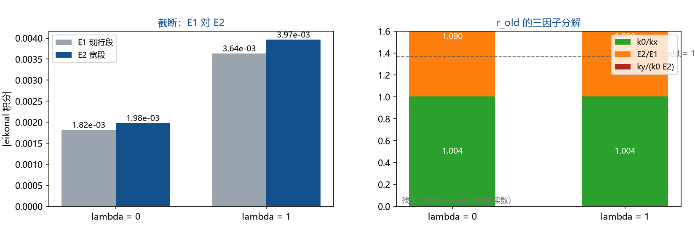

# 注记-系统因子 1.365 的剖分：截断、离散色散与读数形状（S1 至 S4）

## 元数据

- **日期**：2026-09-19 03:16:05
- **依据**：[[验证脚本/注记-空间系数lambda的光偏折锚：偏折角随lambda的线性律]]（因子登记处）；[[验证脚本/注记-光在静态倾角场中的偏折：局域轴读法与全局轴读法的最小验证]]（装置与两种读法的一致度 $0.1\%$）；[[内部草稿/总结报告-引力线收束：GV0至GV8的终态、读数与剩余接口]]（§五 其三）；[[内部草稿/开放问题总览：元相子理论待解决问题清单]]（P1-24 关联子项）
- **定位**：验证材料。把"绝对归一化的系统性因子 $1.365$（来源未定）"从登记项推进为可分解的口径复合，判定是否残留稳定物理因子。本注记不改动基准文件。
- **状态**：判据 S1 至 S4 全部执行；结论为该因子无稳定物理来源。

---

## 一、问题与因子定义

装置沿用 $\lambda$ 线性律轮：二维格点 $N = 256$、$h = 1$、$dt = 0.4$、300 步，势 $\Phi = -A/\sqrt{r^{2}+\varepsilon^{2}}$（$A = 0.02$、$\varepsilon = 2$、$b = 20$），波包载波 $k_0 = 1.2$、宽度 $\sigma = 8$。读数取末态谱均值之比 $k_y/k_x$；对照量是现行 eikonal 的有限段积分 $\int\partial_y n\,dx$（$n = 1/c$，段为 $[-64,\,x_2]$，$x_2 = x_c - N/2 \approx 37$）。

$r_{\text{old}} = 1.364$ 至 $1.366$、与 $\lambda$ 无关。问题：它是框架的物理因子，还是比较口径的复合。

## 二、四因子分解与判据

把对照写成四段乘积：

$$r_{\text{old}} = \frac{k_0}{k_x}\times\frac{E_2}{E_1}\times\frac{\text{kick}}{k_0E_2}\times\frac{k_y}{\text{kick}},$$

其中 $E_1$ 为现行段积分，$E_2$ 为宽段积分（$x \in [-40b,\,40b]$），kick 为格点自洽 eikonal 的横向冲量 $\text{kick} = -\int (\partial_y\Omega)/v_g\,dx$（离散色散 $\omega = 1.1388$、群速 $v_g = 0.847$）。

| 判据 | 内容 | 读数 |
| --- | --- | --- |
| S1 复现 | $r_{\text{old}}$（$\lambda = 0,\,1$） | $1.3642$、$1.3652$ |
| S2 归一与截断 | $k_0/k_x$；$E_2/E_1$ | $1.0045$；$1.090$（两 $\lambda$ 同值） |
| S3 离散色散 | $\text{kick}/(k_0E_2)$；$k_y/\text{kick}$ | $1.139$；$1.095$ |
| S4 稳定性 | $dt \to 0.2$（同距离）；$\sigma = 4,\,8,\,16$ 的 $k_y/\text{kick}$ | $r_{\text{old}} = 1.3665$、残余 $1.2402$；$0.972$、$1.095$、$1.015$ |

## 三、读数的意义

**三段口径把 $1.365$ 拆完。** 谱均值归一贡献 $1.0045$，段截断贡献 $1.090$，连续极限与格点自洽 eikonal 之差贡献 $1.139$；三者相乘得 $1.246$，正是现行对照里的"残余"。

**剩余约 $10\%$ 属读数形状效应。** $dt$ 减半后该残余保持 $1.2402$，说明它不随离散化改善；波包宽度扫描里它在 $0.972$ 至 $1.095$ 之间非单调移动，说明它是有限波包平均与谱提取的形状效应，属读数层。

**与既有候选对照。** 开放问题总览登记的两个候选（射线弯向源、格点色散）中，格点色散得到确认并定量化（$1.139$）；射线弯曲修正量级为偏折角平方（$10^{-5}$），可排除。

**结论。** $1.365$ 从"来源未定的系统因子"改记为"三重口径复合（谱归一、段截断、离散色散）加读数形状残余"；绝对归一化对照的口径不确定度约 $\pm10\%$。$\lambda$ 标度结论不受影响：$1.999$ 之比与线性律来自同装置同口径的比值，而该因子的三段口径在 $\lambda = 0$ 与 $1$ 上同值。

## 四、诚实边界

其一，离散色散 eikonal 是这套格点装置的自洽近似，不是机制层场方程结论。

其二，$\sigma$ 扫描的非单调说明残余中混有未逐项分离的测量形状效应；本注记排除其物理来源，不给其精确分解。

其三，本注记不改变任何光偏折结论（线性律、比值 $1.999$、$\lambda$ 的观测钉扎均按原读数成立）。

## 五、过程记录

一处口径发现：现行对照的 eikonal 缺 $k_0$ 因子（预测的是 $\int\partial_y n\,dx$，量纲上应乘载波数）、积分段只到波包终点、且取连续极限的 $n = 1/c$。三者叠加构成 $1.246$ 的残余，再乘截断与谱归一即得 $r_{\text{old}}$。

## 六、登记衔接

其一，`验证脚本/README.md` 第 145 条（本材料）。其二，收束总结 §五 其三 的"系统因子 $1.365$ 的来源"改为已完成。其三，光偏折锚注记与开放问题总览 P1-24 关联子项补状态。其四，本注记不改动基准文件。
