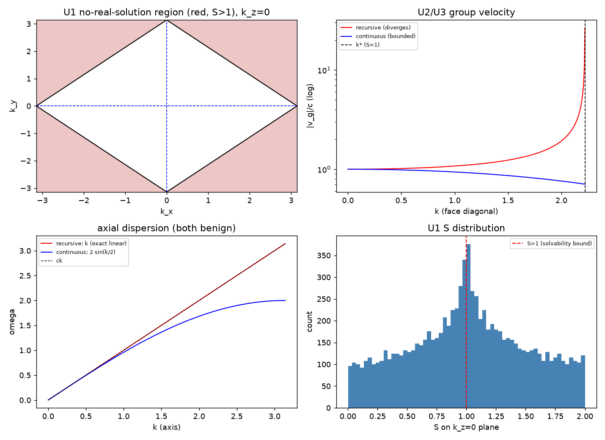

# 注记-紫外完备性判据（第441条）：递推路线的无解区与超光速、连续路线的全域良性

- **日期**：2026-09-26 11:55:23
- **脚本**：`uv_completeness.py`（工作区根目录执行）
- **主题**：时间层属的完备性判别。离散递推路线（$\sin^2(\omega t_P/2) = S$）在三维斜向存在无实数频率区域且群速度发散并超光速；连续时间路线（$\omega = \frac{2}{t_P}\sqrt S$）全域有实数解、群速度有上界且在布里渊边界趋于零
- **判据结果**：3/3（U1 无解区、U2 群速度发散与轴向恒等、U3 连续路线良性）
- **可逆性等级**：判据稳健（两条路线的可解性与群速度界为代数与解析性质，换实现不改结论）
- **图**：见 §3 图 1

## 1 模型设定

两条路线共用同一空间结构 $S(\mathbf k) = \sum_a\sin^2(k_a l_P/2)$，差别只在时间方向的处理：

$$\text{递推（离散时间）}: \sin^2\frac{\omega t_P}{2} = S,\qquad \text{连续时间}: \omega^2 = \frac{4}{t_P^2}S.$$

递推路线要求 $\sqrt S \le 1$ 才有实数 $\omega$；连续路线对一切 $S \ge 0$ 有实数 $\omega$。群速度按 $v_g = \mathrm{d}\omega/\mathrm{d}k$ 由中心差分取得。

## 2 判据与结果

U1 无解区：布里渊区 $k_z = 0$ 切片的 $96\times96$ 网格中，$S > 1$ 的占比 $0.5104$。沿面对角的临界 $k^{*} = 2.221441469$（解析 $\pi/\sqrt2$ 同值），沿体对角 $k^{*} = 2.132084253$（解析 $2\sqrt3\arcsin(1/\sqrt3)$ 同值）。

U2 群速度：斜向递推路线在 $k = 0.3$ 处 $v_g/c = 1.0057$（已超光速），$k = 2.0$ 处 $1.9252$，逼近临界时 $26.6009$（发散）；同方向连续路线 $0.9944 \to 0.7074$（有界）。轴向递推路线 $v_g/c$ 恒为 $1.000000$（一维 $\arcsin\circ\sin$ 为恒等），连续路线在边界趋零（$k = \pi - 10^{-3}$ 处 $5.0\times10^{-4}$）。

U3 连续路线全域良性：400 组随机方向与 $k$ 的扫描给出群速度上界 $0.999767\,c$（不超过 $c$）。

| 判据 | 实测 | 期望 | 结果 |
|---|---|---|---|
| U1 $S > 1$ 网格占比 | $0.5104$ | $> 0.10$ | 通过 |
| U1 面对角 $k^{*}$ | $2.221441469$ | $\pi/\sqrt2$ | 通过（$< 10^{-9}$） |
| U1 体对角 $k^{*}$ | $2.132084253$ | $2\sqrt3\arcsin(1/\sqrt3)$ | 通过（$< 10^{-9}$） |
| U2 斜向递推 $v_g/c$（临界前 $10^{-3}$） | $26.6009$ | $> 10$ | 通过（发散） |
| U2 斜向递推 $v_g/c$（$k = 0.3$） | $1.0057$ | 无期望值，登记为长波端已超光速 | 登记 |
| U2 轴向递推 $v_g/c$ | $1.000000$ | $1$ | 通过（$< 10^{-6}$） |
| U3 连续路线 $v_g$ 上界 | $0.999767\,c$ | $\le c$ | 通过 |
| U3 连续路线轴向边界 $v_g/c$ | $5.0\times10^{-4}$ | $< 10^{-3}$ | 通过（趋零） |

## 3 图

## 4 过程记录

其一，数值微分的定义域余量。首版轴向最大 $k$ 取 $\pi - 10^{-6}$，中心差分步长 $10^{-6}$ 使 $k + h$ 越过布里渊边界，$\arcsin\circ\sin$ 在那里折返，$v_g/c$ 读数 $1.000044$ 触发判据失败。改为 $k_{\max} = \pi - 10^{-3}$ 后读数 $1.000000$。教训：凡测点靠近定义域边界，差分步长必须留出比步长更大的余量，或改用单侧差分与解析导数核对。

## 5 严格程度与边界声明

严格：$S \le 1$ 的可解性条件是代数事实；临界 $k^{*}$ 两方向的解析值已给定并与数值吻合到 $10^{-9}$；连续路线的群速度上界与边界趋零为解析结果（数值扫描复核）。

判据稳健：结论只依赖两条路线的函数形式，与积分器、步长、网格无关（重复实现不改结论）。

验证什么：递推路线的无解区域存在性与临界值、斜向群速度的超光速与发散、轴向恒等性、连续路线的全域解存在性与群速度有界。

不验证什么：连续路线在更高阶修正下的行为（本轮只到首阶）；量子层的重整化与高能截断；观测层面的可实现性。

定位：本条把时间层属从口径之争降为完备性判据。递推路线在三维斜向既有无解区（高动量不传播）又有超光速与发散的群速度（低动量已越界），两者都与体系的洛伦兹不变低能立场与因果结构冲突；连续路线全域良性。据此，第 438、440 条的 $0{:}3{:}4$ 方向律读作采样序列口径的对照，$6{:}3{:}2$ 维持为本层结论。

## 6 关联

- 层属三轮重审：[[内部草稿/注记-惯性的微观来源：变率继承与二阶动力学的结构必然性]]；[[验证脚本/注记-惯性微观来源的三判据（第438条）：二阶性对照、惯性系数不可观测与两侧同源|第438条]]；[[验证脚本/注记-轴向偏折的判决性判据（第440条）：两条色散路线的方向律与差异恒等式|第440条]]
- 时间层依据：[[时间的三层生成结构：原初连续、内生离散与次级连续的被采样]]
- 既有色散与破坏预言：[[元相子振荡晶格的色散关系：低能光速涌现与洛伦兹破坏首阶项]]
- 基准：[[理论总纲/元相子理论的时空观：体系对时空的完整认识]]；[[理论总纲/术语表]]
