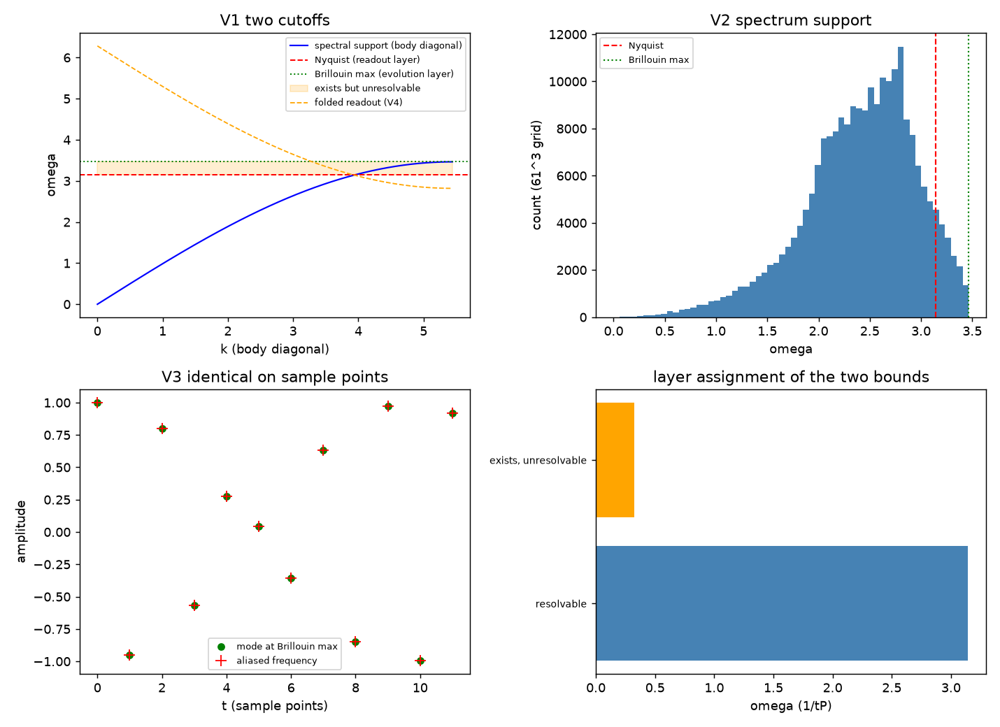

# 注记-紫外截断的层属归属（第442条）：存在性上限与可分辨性上限的分工

- **日期**：2026-09-26 13:58:10
- **脚本**：`minimal_verification_uv_cutoff_layers.py`（工作区根目录执行）
- **修订记录**：
  - **2026-09-27 增补轮 V4**（触发：P3-26 采样率严格化）
    - 新增 V4 折叠映射：混叠区模式的读数频率全落在 $[2\pi - \omega_{BZ}, \omega_N)$，读数频率有下界；左上面板叠加折叠曲线；判据由 3/3 升为 4/4
- **主题**：紫外截断的两个上限分属两层。演化层的谱支撑上限 $\omega_{\mathrm{BZ}} = 2\sqrt3/t_P$（布里渊体对角角点），读数层的可分辨性上限 $\omega_N = \omega_P/2 = \pi/t_P$；前者大于后者，区间 $(\omega_N, \omega_{\mathrm{BZ}}]$ 的模式存在但不可分辨
- **判据结果**：4/4（V1 两上限数值关系、V2 两上限来源不同、V3 区间模式的混叠、V4 折叠映射；2026-09-27 增补轮）
- **可逆性等级**：判据稳健（两上限为谱支撑与采样率的解析性质，混叠为三角恒等式）
- **图**：见 §3 图 1

## 1 问题

开放问题第 26 号（P3-26）登记了紫外截断的两界调和：尼奎斯特型界限 $\omega \le \omega_P/2$ 与晶格色散带宽（布里渊角点 $\omega = 2\sqrt3/t_P$）的关系，以及"不可分辨"与"不存在"的本体论界限。2026-09-18 已给出"两界属作用域分工"的判定（见 [[注记-采样率与尼奎斯特界限：摆程定义、碰撞计数与因子 2 的来历]]）。本条把该判定量化并落到层属。

## 2 判据与结果

V1 两上限的数值关系：演化层谱支撑上限 $\omega_{\mathrm{BZ}} = 3.464101615/t_P$（解析 $2\sqrt3$ 同值），读数层可分辨上限 $\omega_N = 3.141592654/t_P$（$\pi$ 同值），比值 $1.102657791$，区间宽度 $0.322508962/t_P$。

V2 两上限的来源不同：$\omega_{\mathrm{BZ}}$ 来自色散谱的支撑集，$S$ 的最大值 3.000000 出现在布里渊角点（三个分量各 $\pi/l_P$）；$\omega_N$ 来自采样率 $1/t_P$ 的尼奎斯特界限（每摆程一次事件），与色散谱无关。

V3 区间模式的地位：取 $\omega = \omega_{\mathrm{BZ}}$，其混叠频率 $\omega_P - \omega = 2.819084/t_P$ 落在可分辨区内（$< \omega_N$）；两个模式在采样点上的时间序列最大差 $1.176\times10^{-13}$（机器零），即区间模式在读数层与一个低频模式逐点不可区分。

V4 折叠映射（增补轮）：扫描混叠区 $\omega \in (\omega_N, \omega_{\mathrm{BZ}}]$，读数频率 $\omega_P - \omega$ 全落在 $[2\pi - \omega_{\mathrm{BZ}}, \omega_N) = [2.819083692, 3.141592654)/t_P$，即读数频率存在下界 $2\pi - 2\sqrt3 = 2.819083692/t_P$；全区间抽样点序列最大差 $1.662\times10^{-13}$。

| 判据 | 实测 | 期望 | 结果 |
|---|---|---|---|
| V1 $\omega_{\mathrm{BZ}}$ | $3.464101615$ | $2\sqrt3$ | 通过（$< 10^{-12}$） |
| V1 $\omega_N$ | $3.141592654$ | $\pi$ | 通过 |
| V1 比值 | $1.102657791$ | $2\sqrt3/\pi$ | 通过（$< 10^{-12}$） |
| V2 谱支撑角点 $S$ | $3.000000$ | $3$ | 通过（$< 10^{-12}$） |
| V3 混叠序列最大差 | $1.176\times10^{-13}$ | $< 10^{-10}$ | 通过 |
| V3 混叠频率可分辨 | $2.819084/t_P$ | $< \omega_N$ | 通过 |
| V4 读数频率范围 | $[2.819083692, 3.141591654]/t_P$ | $[2\pi-2\sqrt3, \pi]$ | 通过（$< 10^{-8}$，扫描步长内含） |
| V4 全区间序列最大差 | $1.662\times10^{-13}$ | $< 10^{-10}$ | 通过 |

## 3 图

## 4 过程记录

本轮一次通过，无判据修正。设计上取两处稳健做法：其一，谱支撑上限由 $61^3$ 网格扫描给出，端点包含角点，故扫描值为精确值，可直接与 $2\sqrt3$ 比对；其二，混叠判据用三角恒等式 $\cos(\omega t_P s) = \cos((\omega_P - \omega)t_P s)$ 作序列比对，避免了依赖采样重建算法的实现细节。

## 5 严格程度与边界声明

严格：两上限的解析值与数值吻合到 $10^{-12}$；混叠为三角恒等式（舍入地板量级）。

判据稳健：结论只依赖色散谱的支撑集与采样率，与网格密度、积分器无关。V4 的读数频率上端受扫描步长限制与 $\omega_N$ 相差约 $10^{-6}$，属采样步长而非物理间隙。

验证什么：两上限的数值关系与来源差异、区间模式的混叠（存在但不可分辨的显式构造）。

不验证什么：读数层实际探测器的分辨率（属观测层）；区间模式与物质的耦合截面（是否可被间接探测）未涉及；$\omega_N$ 所依据的"每摆程一次事件"仍属模型图像（P3-26 原层级标注）。

层属归属：$\omega_{\mathrm{BZ}}$ 属演化层（连续时间色散的谱支撑），$\omega_N$ 属读数层（采样率给出的可分辨界限）。两界不必相等，其差额区间正是"存在但不可分辨"的本体论与认识论分界，与 [[理论总纲/元相子理论的时空观：体系对时空的完整认识]] §二 的层属总图一致。

## 6 关联

- 判据前序：[[验证脚本/注记-紫外完备性判据（第441条）：递推路线的无解区与超光速、连续路线的全域良性|第441条]]
- 采样率与尼奎斯特界限：[[注记-采样率与尼奎斯特界限：摆程定义、碰撞计数与因子 2 的来历]]
- 层属框架：[[内部草稿/注记-层属总图：连续层与离散层的分工（波函数、光的局域传播、引力度规与紫外截断）]]；[[内部草稿/注记-连续与离散的层属辨析：实轴方向动力学的演化层与采样层]]
- 开放问题：编号第 26 号（P3-26）
