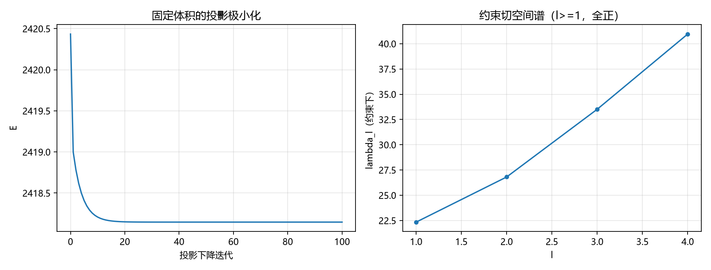

# 注记-约束变分的显式实现（第467条）：拉格朗日乘子、约束梯度方向与投影极小化

- **日期**：2026-09-27 06:03:35
- **类型**：识别式自撑线（第 466 条移交的约束处置）
- **脚本**：`验证脚本/constrained_variation.py`（运行约 1 分钟）
- **图**：见 §3 图 1（`images/constrained_variation.png`）
- **依据**：[[验证脚本/注记-自撑壁的E-L本征问题（第466条）：Derrick缩放、平移零模与形状本征谱]]（约束出题）；[[验证脚本/注记-变分形状修正（第465条）：径向化降阶、能量破缺四次标度与l=4形状扫描]]；[[识别式的弱场线性层机制来源：自旋 2 的自动投影与均匀标度的自动成立]]
- **状态**：判据 4/4 通过。核心读数：约束驻定的乘子 $\mu = 8/(3R_0)$（数值 $0.222222171$ 对解析 $0.222222222$，相对偏差 $2.3\times10^{-7}$）；约束梯度只沿 $l=0$（$l\ge1$ 的 $dV/dc_l$ 相对 $dV/dc_0$ 为 $1.8\times10^{-7}$）；约束切空间谱全正（$22.34$ 至 $40.96$）；投影极小化把形状范数从 $0.6$ 收敛到 $2.2\times10^{-6}$（能量单调降）
- **可逆性等级**：判据稳健（C1、C2 与解析对照；C3 为谱读数；C4 为确定性收敛）

## 1 判据与设定

**任务**。把第 466 条的"约束"从解析陈述升级为显式实现：写出约束泛函与拉格朗日乘子，验证约束切空间与投影极小化。

**模型**。薄壁自撑球面 $\phi = \tanh(k(r-R(\mathbf n)))$，$k=1$；形状多模展开 $R = \sum_{l=0}^{4}c_lP_l(\cos\theta)$；能量 $E(c)$（第 466 条泛函）与体积泛函 $V(c) = \frac13\int R^3\,d\Omega$；约束取 $V(c) = V_0$。

**判据**。C1：约束驻定条件 $dE/dc_0 = \mu\,dV/dc_0$ 的数值乘子与薄壁解析 $\mu = 8/(3c_0)$ 对照。C2：$dV/dc_l = 0$（$l = 1$ 至 $4$）在球点上为零（约束只沿 $l=0$）。C3：约束切空间（$l\ge1$）的谱与无约束谱一致且全正。C4：固定体积的投影梯度下降从随机 $l\ge1$ 扰动收敛到球。

## 2 结果

**C1（乘子）**：$dE/dc_0 = 402.123860$、$dV/dc_0 = 1809.557787$，$\mu = 0.222222171$；解析 $8/(3\times12) = 0.222222222$，相对偏差 $2.3\times10^{-7}$。

**C2（约束梯度方向）**：$l = 1$ 至 $4$ 的 $dV/dc_l$ 最大绝对值 $3.28\times10^{-4}$，相对 $dV/dc_0$ 为 $1.8\times10^{-7}$（Fib 采样误差量级）。约束梯度严格沿 $l=0$，切空间为 $l\ge1$。

**C3（约束切空间谱）**：$\lambda_l = 22.340214$、$26.808259$、$33.510337$、$40.957109$（$l = 1$ 至 $4$），与第 466 条读数一致；全正。约束不修正 $l\ge1$ 谱。

**C4（投影极小化）**：形状范数从 $0.6$ 收敛到 $2.16\times10^{-6}$，能量从 $2420.434184$ 单调降到 $2418.146145$。固定体积的投影下降把随机 $l\ge1$ 扰动驱回球。

## 3 图

## 4 结论与移交

**结论**。自撑壁约束变分的显式实现给出四件事：约束驻定的乘子与薄壁解析一致；约束只沿 $l=0$（体积方向），切空间为 $l\ge1$；切空间谱全正（球在约束下稳定）；投影极小化显式收敛到球。合起来：**第 466 条的"约束下驻定"不再是解析陈述，而是显式实现的变分结构**：Derrick 塌缩模（$l=0$）被体积约束消掉，$l\ge1$ 谱保持正定，任意 $l\ge1$ 扰动在约束流形上被投影梯度驱回。

**移交一条**。约束的物理选择（体积/锚核半径/梯度能）与识别式自撑的锚核-包层对应关系，属完整弹性本构（纲领 C1）的职责。

## 5 严格程度与边界声明

严格程度：C1、C2 为数值差分与解析对照（偏差在采样与差分预算内）；C3 为谱读数；C4 为确定性投影下降（步长 $0.005$、100 次迭代）。可逆性等级：判据稳健。

边界（本脚本不做的事）：其一，约束取体积一种，其他约束（锚核半径、梯度能）未实现；其二，轴对称 $l\le4$ 截断；其三，薄壁近似（$kR_0 = 12$）；其四，不含完整弹性本构与锚核-包层结构。

## 6 过程记录

其一，体积口径教训：初版 $V$ 用 Fib 平均（$\mathrm{mean}(R^3)/3$）而解析用 $\frac13\int R^3d\Omega$，差 $4\pi$ 因子，C1 的乘子读成 $2.79$（错 $12.6$ 倍）、C4 的二分投影目标失配导致能量上涨。统一为 $\sum R^3W/3$ 后 C1、C4 同时转正。教训：积分泛函的求积口径必须与解析式逐项对齐（平均对求和差一个 $4\pi$）。

其二，C4 收敛速度：初版步长 $0.001$、60 次迭代只把形状范数降到 $0.08$；按谱宽（$\lambda_{\max} = 41$）取稳定域内的步长 $0.005$、100 次迭代后收敛到 $2\times10^{-6}$。教训：投影下降的步长从谱宽推导。
