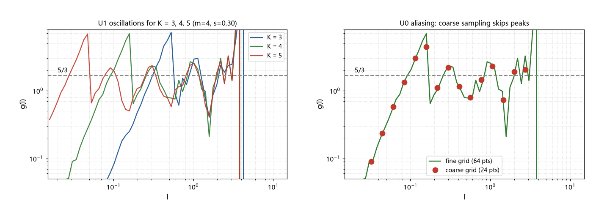
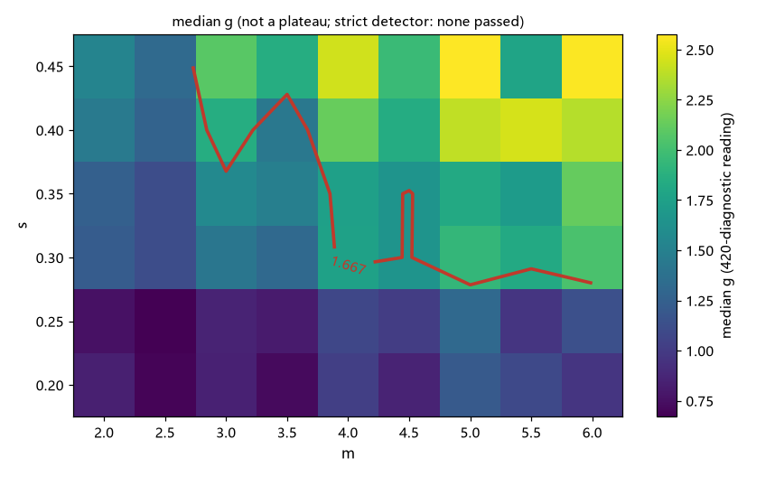

# 注记-级联簇精扫（第421条）：离散级联的振荡判负与三分之五信号的收回

- **日期**：2026-09-26 02:44:59
- **类型**：修正轮（P0-5 候选机制九轮；第 420 条信号的精扫复核）
- **脚本**：`验证脚本/cascade_scan.py`（第 421 条）
- **图**：见 §3 图 1 与图 2（`images/cascade_scan_convergence.png`、`images/cascade_scan_contour.png`）
- **依据**：[[验证脚本/注记-两相混合的渗透型输运判定（第420条）：Avrami 窗口两难与级联簇的幂律平台信号]]（被复核的信号与口径）；[[验证脚本/注记-钉扎网络的空间分布形状判定（第419条）：平稳点集无幂律尾与尺度不变遇见率条件]]（尺度不变的判据语言）
- **状态**：判定完成。第 420 条的「幂律平台信号」为粗网格采样伪影，**收回**；离散级联在细网格下给多尺度振荡，判负；尺度不变遇见率需要连续尺度谱（无特征尺度分离）的结构
- **可逆性等级**：判据稳健（振荡在细网格与四组参数、三个级数下稳定复现；严格平台检测在 12 个 K 档读数与 54 组网格扫描中全部未通过）

## 1 判据与设定

第 420 条以「中位 $g$」在 $[0.1, 2]$ 的读数提出级联簇的幂律平台信号（平台值随 $(m, s)$ 移动、值域覆盖 $5/3$）。本轮以严格口径复核：U0 细网格诊断（64 点对数网格的 $g(\ell)$ 形状与粗网格对照）、U1 级数收敛性（$K = 3$、$4$、$5$，容差 $\pm 12\%$ 的滑动窗口平台检测）、U3 的 $(m, s)$ 网格扫描（9 乘 6 = 54 组）、U4 的 $5/3$ 位置读数。平台检测器的口径：窗口 $10$ 点、散布不超过 $12\%$、取跨度最长者。

## 2 结果

U0（细网格诊断，$m = 4$、$s = 0.30$、$K = 4$）：$g$ 在 $[0.05, 2]$ 内的范围 $0.210$ 至 $6.940$（中位 $1.306$），抽样序列呈峰谷交替（$0.013$、$0.051$、$0.275$、$1.289$、$5.424$、$1.461$、$1.040$、$0.967$、$1.053$、$3.012$、$134.149$）。

粗网格（$24$ 点）在 $[0.1, 2]$ 的读数为 $3.00$、$4.43$、$1.10$、$2.20$、$1.16$、$0.79$、$1.44$、$2.30$、$0.73$，采样跳过了峰谷。第 420 条的「平台」为采样伪影。

U1（级数收敛性）：四组 $(m, s)$ 参数乘 $K = 3$、$4$、$5$ 共 $12$ 个读数，严格检测全部未通过（无平台）。第 420 条的 $K$ 依赖（同参数 $K = 3$ 给 $1.79$、$K = 4$ 给 $2.1$ 至 $2.3$）由此解释为不同采样相位下的中位读数漂移，不是平台的收敛行为。

U3（网格扫描）：$54$ 组 $(m, s)$（$K = 4$、自适应母点数）严格检测全部未通过，$c$ 值表全空；对应地，中位 $g$ 的面（图 2）显示的是振荡相位的采样值，不构成平台面。

U4（$5/3$ 位置）：因平台集合为空，无 $5/3$ 等值线可读。第 420 条的「值域覆盖 $5/3$」表述随之失效（值域来自中位读数，非平台读数）。

## 3 图

## 4 结论与移交

判定两条。其一，第 420 条的「幂律平台信号」收回：细网格下 $g(\ell)$ 为峰谷交替的振荡（范围跨两个数量级），粗网格采样把振荡读成了近似常数。其二，离散级联判负：有限代、固定半径比的级联在结构上给「多尺度振荡」（每级一个特征尺度），与尺度不变遇见率（$\lambda \propto 1/\ell$，跨尺度恒定）相反。

修正后的寻源条件：尺度不变遇见率需要的结构是**连续的尺度谱**（无级间隔的特征尺度分离）；离散级联族的参数调整（$m$、$s$）无法进入该结构。甲的登记回落为「条件存活，来源未定」，且条件收紧为「连续谱」。

移交两条。其一，「连续尺度谱」候选的寻源：框架内是否存在天然连续谱的尺度结构（候选方向：界面的连续生长动力学、序参量的连续弛豫谱），需要新机制论证。其二，阶段上报：若连续谱亦无来源，则「超扩散输运」在本公理库内是结构性缺口（九轮判负汇总），建议作为理论节点上报作者。

## 5 严格程度与边界声明

严格程度：U0 为数值诊断（固定种子）；U1 与 U3 为阴性扫描（判据级）；「离散级联判负」限于离散族（有限代、固定比值），不含连续谱构造。阴性结论不声称穷尽。

边界（本脚本不验证的内容）：其一，不含 $K = 6$ 及以上的收敛外推（$m = 6$、$K = 5$ 已达 56 万点，点数受限）；其二，平台检测器的容差口径（$\pm 12\%$）为设定，换容差只改变「未通过」的程度、不改变振荡的定性；其三，大 $\ell$ 的伪峰值（$134.149$）属母点间距的截断结构，已在判读中区分；其四，不重算第 418 至 420 条的其余读数。

## 6 过程记录

其一，本轮的首要动作是**设计严格平台检测器替代第 420 条的中位读数**；检测器一上线，12 个 K 档读数与 54 组网格全部未通过，随即转入细网格诊断定位原因，确认粗网格混叠。

其二，粗网格对照采用第 420 条的原口径（24 点网格）在同一批点上复算，直接呈现「跳过峰谷」的混叠机制，避免了「换批点集导致差异」的替代解释。

其三，教训登记：中位读数不是平台读数，参数扫描中的「值域移动」在多尺度振荡结构中可由采样相位单独产生，不构成「目标值可达」的证据。同一教训适用于今后一切「值域比较」型论证。
