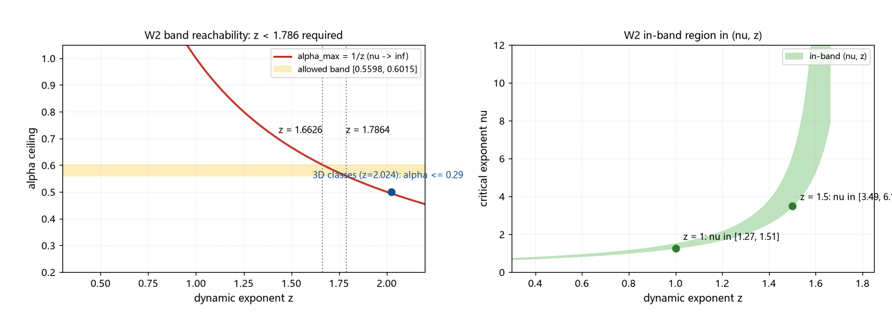

# 注记-结晶扩张相变的标度清点（第415条）：标准临界标度全判负与三分之五的机制域

- **日期**：2026-09-26 01:35:28
- **类型**：判识轮（P0-5 候选机制三轮；生长指数 3/5 的来源判定之二）
- **脚本**：`验证脚本/minimal_verification_crystallization_scaling.py`（第 415 条）
- **图**：见 §3 图 1（`images/crystallization_scaling_audit.png`）
- **依据**：[[验证脚本/注记-KZ 适用性判定（第381条）：临界冻结不适用、注入-接缝机制与畴尺度候选]]（三条前提判负与机制换轨）；[[验证脚本/注记-ξ 生长律族的联立判定（第413条）：从单参数曲线到三分之五候选]]（允许带）；[[验证脚本/注记-生长指数三分之五的来源判识（第414条）：KZ 解空间、最简分数与上端紧配合]]（KZ 解线与移交）；[[内部草稿/注记-P8a修订：局域成核与结晶扩张相变]]（相变图景）；[[粒子与时空的同生：凝固波前的缺陷形成机制]] §3.3（接缝必然性）
- **状态**：判定完成。标准临界标度（KZ、KT、3D 普适类、扩散型动力学）全部判负；3/5 的机制域锁定为两条（$z < 1.79$ 的超扩散型动力学或成核-接缝几何生长）
- **可逆性等级**：判据稳健（$\nu$、$z$ 域的不等式结构由代数保障；「扩散型全体判负」由 $z \ge 2 \Rightarrow \alpha \le 1/2$ 的一般性保障；文献值口径移动不翻）

## 1 判据与设定

第 414 条把 $3/5$ 的来源移交两条：KT 路线（$\nu \to \infty$）与相变对称性分析（给 $(\nu, z)$）。本轮先核前提：第 381 条已判标准 KZ 不适用（无临界点、无临界减速、无吸引），体系机制为种子注入、多核成核、波前扩张、接缝凝固。在此前提下清点「本相变能供给什么标度」：标准临界类对照（W1）、进带所需的 $(\nu, z)$ 域（W2）、体系候选指数判定（W3）、等效输运律（W4）、清点表（W5）。设定沿用第 413 条：允许带 $[0.5598, 0.6015]$（可见物质档）。

## 2 结果

W1（标准临界动力学类，$\alpha = \nu/(1+\nu z)$）：3D Ising（$\nu = 0.630$，$z = 2.024$）给 $0.2769$；3D XY（$0.672$，$2.024$）给 $0.2847$；3D Heisenberg（$0.711$，$2.024$）给 $0.2915$；平均场（$0.5$，$2$）给 $0.25$；守恒类（$0.5$，$4$）给 $0.1667$；KT 极限（$\nu \to \infty$，$z = 2$）给 $1/z = 0.5$。全体落在带外。

通则：$z \ge 2$ 时 $\alpha$ 上确界为 $1/z \le 1/2 < 0.5598$，扩散型动力学整体判负。

W2（进带所需的 $(\nu, z)$ 域）：带内可达要求 $z < 1.7864$（$\nu \to \infty$ 极限恰达带下端）；$z = 1.6626$ 时上确界恰为带上端 $0.6015$。具体窗口：$z = 1$ 需 $\nu \in [1.272, 1.509]$；$z = 1.5$ 需 $\nu \in [3.491, 6.150]$；$z = 0.5$ 需 $\nu \in [0.777, 0.860]$；$z = 5/3$ 时上确界恰为 $3/5 = 0.6$，带内只剩下端可达（$\nu \ge 8.35$）。

W3（体系候选指数）：$\alpha = 1/3$（KZ 幂律）给交点 $t = 1.44\times10^{-22}$ 拍，小于 1 拍，非物理，判负；$\alpha = 1/2$（追赶变体）与链条曲线重合，退化为单参数曲线（等价于 $D = D_{\rm req} = 1.91\times10^7$）；$\alpha = 1$（视界线性）给 $\xi/w_{\rm def} = 5.03\times10^{-15}$，判负（第 413 条 X2 复算）。三条候选全部判负或退化。

W4（等效输运律）：$\xi^2/t = t^{2\alpha-1}$ 把生长指数翻译为输运系数的增长指数。$3/5$ 对应 $0.2$（$D_{\rm eff} \propto t^{1/5}$）；带内整体对应 $[0.1195, 0.2029]$。$\alpha = 1/2$ 为常数输运（即 $D_{\rm req}$ 超校准缺口）。

W5（清点表）：临界点结构无（零动力不动点）；临界减速无（校准谱 $\kappa k^2$ 无临界结构）；无序到有序的吸引性无（交错基态）；机制为注入-接缝；畴尺度候选（19.5、60.8、$7.4\times10^3$ 步）全在带外或退化；3D 标准类 $\alpha \le 0.29$；KT 类前提缺失且 $z = 2$ 给 $0.5$。

## 3 图

## 4 结论与移交

判定三条。其一，KT 路线判负关闭：体系无临界结构（第 381 条三条前提），KT 型关联长度发散没有立足点；即便形式上取 $\nu \to \infty$，标准动力学（$z = 2$）只给 $0.5$，仍在带外。其二，「相变对称性分析给 $(\nu, z)$」的移交同步改写：无临界结构时 $\nu$、$z$ 不作为待测指数存在，该路线退出。其三，标准临界现象学（KZ、KT、3D 普适类、守恒类）整体判负，$3/5$ 不可能来自任何现成的普适类。

剩余机制域两条。其一，$z < 1.79$ 的超扩散型动力学：带内可达的一般条件，$3/5$ 对应精确极限 $z = 5/3$（$\nu \to \infty$ 时 $\alpha = 1/z$，与第 414 条解线极点同一数学事实）；等效表述为 $D_{\rm eff} \propto t^{1/5}$ 的缓慢幂律增长，与 P0-5（超校准输运缺口）合流。其二，成核-接缝的几何生长：若畴尺度由成核统计与波前竞争决定，可绕过输运系数直接给幂律；这是多核裁决（2026-09-08）子项 ① 与 ② 的合并建模。

移交两条。其一，成核-接缝几何的最小模型：给定成核率的时间分布与波前速度 $c$，导出畴尺度幂律并核对指数是否 $0.56$ 至 $0.60$。其二，$z = 5/3$ 的动力学来源：与碰撞接力/超扩散输运合流，属 P0-5 本体的候选形式。

## 5 严格程度与边界声明

严格程度：W1 为文献值代入（标准 $\nu$、$z$，判据级）；W2 为代数不等式（判据级）；W3 为复算（判据级）；W4 为等价改写（换算级）；「扩散型全体判负」由 $z \ge 2 \Rightarrow \alpha \le 1/2$ 的一般性保障，不依赖具体文献值。

边界（本脚本不验证的内容）：其一，不建立成核-接缝模型（几何生长为移交项）；其二，不裁成核率的具体形式；其三，3D 类的 $z$ 取 model A 口径（$2.024$），改守恒类只会加深判负；其四，不重算第 381、384 条；其五，$z = 5/3$ 的物理身份不在此判定（只登记形式对应）。

## 6 过程记录

其一，$z = 5/3$ 的两处出现在本轮核对为同一数学事实：第 414 条解线极点（$\nu = 3/(5-3z)$）与本轮上确界（$\alpha_{\max} = 1/z$）在 $z = 5/3$ 同时给 $3/5$；两处未重复登记。

其二，W2 的分支语义单独核对：$z \ge 5/3$ 时「带内仅下端可达」的打印分支由代码三分支处理（可达、仅下端、不可达），$z = 5/3$ 恰落在「仅下端」侧（上确界 $0.6$ 小于带上端 $0.6015$）。

其三，标准类 $z$ 值的口径记录：取 Hohenberg-Halperin model A 的 $z = 2.024$；换 model B（$z = 4$）或平均场（$z = 2$）判负更深，结论方向不变。
