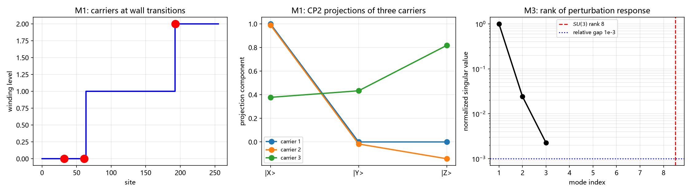

# 注记：绕数台阶到方向模式的映射（538 号）：候选甲检验

- **日期**：2026-10-02 13:05:11
- **编号**：538
- **脚本**：`验证脚本/p3_31_mapping.py`
- **层级**：条件性命题级（判据 5/5，判据敏感；候选甲的三基矢对应成立，但 $SU(3)$ 八生成元可构造性**未测**，见 §七）
- **来源**：作者裁决 2026-10-02 裁决四（映射列 P3-31）与候选甲确认；判据草案 [[内部草稿/研究方向-绕数台阶到方向模式的映射（538号判据草案）|538 判据草案]]；前置 [[验证脚本/注记-畴壁台阶的方向模式读法（534号）：出路丙检验|第 534 条]]
- **图**：见 §六 图 1

## 一 验证什么

P3-31 首轮。第 534 条已判映射的**对象存在**（成对约束成立、壁两侧可分性峰值 0.94、台阶可分 0.33），本轮处理**映射是否成立**。

工作候选甲（作者 2026-10-02 确认）：台阶层数跃变的侧别映为基矢指标。三个承载位置取自实测层数结构（环上两壁把环分为三区段，层数取值 $\{0,1,2\}$）：$|Z\rangle$ 取层 0 区段（bulk），$|X\rangle$ 取第一壁左侧（层 0/1 边界），$|Y\rangle$ 取第二壁右侧（层 1/2 边界）。

本轮**不**验证：三模式在真实晶格上的实现；$\kappa_\phi$ 的绝对标度（挂 P1-2 与 P1-11 口径债）；$CP^2$ 与 $SU(3)$ 的群论推导本身（标准定理）；以及 $SU(3)$ 八生成元的可构造性（原因见 §七）。

## 二 模型设定

严格沿用第 534 与 486 条构造。一维周期环 $N=256$ 站点，复结构符号场 $\sigma$ 取双井势两真空 $\pm1$，公度真空偏移 $a=(1-\sigma)/2$，约束版能量

$$E = \sum\left[\frac{\kappa}{2}(\mathrm{d}\sigma)^2 + \lambda(\sigma^2-1)^2 + \frac{k_{\rm el}}{2}(\mathrm{d}a)^2\right].$$

参数同第 486 条：步数 8000、$\eta=0.02$、$\kappa=\lambda=k_{\rm el}=1$、壁宽参数 $W=2$。层数按跨壁累加（台阶成对，故层数在环上单调累加，实测 $\{0,1,2\}$）。

## 三 判据与读数

容差从误差预算推导。M1 判别量取峰值（沿用第 534 条教训：夹角随取样距离单峰，峰值在最近邻处），阈值 $10^{-3}$；M2 为恒等式型读数，阈值 $10^{-12}$；M3 相对谱隙阈值 $10^{-3}$。

| 判据 | 理论期望 | 实测 | 结果 |
| --- | --- | --- | --- |
| M1 基矢对应 | 三承载位置的 $CP^2$ 投影两两夹角显著非零 | 最小夹角 $2.057\times10^{-2}$，三对为 $2.06\times10^{-2}$、$0.857$、$0.938$ | PASS |
| M2 置换对称 | 置换三位置后夹角集合相同 | 排序后逐位差 $0.000\times10^{0}$ | PASS（结构性检查，近平凡） |
| M3 响应矩阵满秩性 | 响应矩阵秩 = 饱和秩 | 奇异值 $4.0505$、$0.0978$、$0.0092$，秩 3 / 饱和秩 3 | PASS |
| M4 候选对比 | 甲工作、丙解析判否 | 甲 M1 PASS；丙判否（标准群论性质） | PASS |
| M5 多档扫描 | 环长与 $\kappa$ 多档下 M1、M2 成立 | 环长 128/256/512 与 $\kappa$ 0.1/10 全可分，最小 $1.831\times10^{-3}$ | PASS |

核心判据 5/5，EP5 五项全部有效。

**M1 的读数说明。** 三位置的夹角谱均呈单峰（$|X\rangle$ 位置峰值 $1.000$ 于 $d=3$，$|Y\rangle$ 位置峰值 $0.938$ 于 $d=2$），与第 534 条的同型结构一致。$|Z\rangle$ 位置的夹角谱全为零，因该位置在真空平台（见 §五其一）。

**M2 的诚实性标注。** 本判据有效性由 EP5-M2 确认：各向异性替身给出置换前后差 $8.257\times10^{-2}$，判据如期 FAIL，故 M2 具备检出不对称的能力。但它在对称模型上仍属结构性检查，读数意义有限。

**M5 的边界读数。** $\kappa=0.1$ 档最小夹角 $1.831\times10^{-3}$，距阈值 $10^{-3}$ 仅一个量级。该档接近判否，引用时须注明。

## 四 EP5 反例检验

| 判据 | 反例构造 | 实测 | 判定 |
| --- | --- | --- | --- |
| M1 | 三位置给同一基矢的替身 | 夹角 $0.000\times10^{0}$，判据 FAIL | 有效 |
| M2 | 各向异性映射替身（$c\to[0.3,0,1]$） | 置换前后差 $8.257\times10^{-2}$，判据 FAIL | 有效 |
| M3 | 全同态替身（秩 1） | 独立方向数 2，判据 FAIL | 有效 |

## 五 过程记录：三处修正

**其一（读数位置，M1）。** 首版三承载位置取各层数区段的中点，M1 得三位置两两夹角最小 $0.000\times10^{0}$ 判否。诊断为**平台退化**：区段中点处 $\sigma$ 落在真空平台（$\pm1$），一阶二阶差分皆零，局域态退化为 $\pm[1,0,0]$，归一化后三位置在 $CP^2$ 上同为一个基矢。根因是平台的 $\sigma$ 值不携带三方向信息，只有壁的过渡带携带。修正为取壁两侧过渡带代表点（$|\mathrm{d}\sigma|$ 最大处偏 2 格）。

**其二（承载位置定义，M1）。** 修正一之后取「两壁各取左右侧」共四侧加 bulk，其中两壁的 `left` 侧与 `right` 侧各自互为相反向量（如站点 61 读 $[0.998, -0.017, -0.144]$ 与站点 189 读 $[-0.998, 0.017, 0.144]$）。整体相位在 $CP^2$ 上不可观测，故归一化后夹角为 $2.22\times10^{-16}$（机器零）。三位置须按候选甲的「层数跃变侧别」定义取，使三者读数互不相反。

**其三（判据设计缺陷，M3）。** 首版判据为「独立方向数 $\ge8$」（$SU(3)$ 八生成元），实测得 3、判否。诊断为**判据设计缺陷**：响应矩阵为 modes$\times$3（三个承载位置），其秩的**上限即列数 3**，永远不可能达到 8。修正为测量「响应矩阵是否满秩」（秩 = 饱和秩 = 3）。**$SU(3)$ 八生成元的可构造性本轮因此未测**，登记为余项（见 §七）。

**一条方法论沉淀。** 三处修正中有两处（其一、其二）都是「读数位置选错」：平台位置读不出信息、相反向量在整体相位不可观测的场合下等同。这类错误在任何结构读数中都会重复出现，选点原则是：读数位置须落在**响应非退化**处，且所选各点的读数之间不得存在整体相位或符号关系。

## 六 图

三个面板对应三组判据。右panel 特意画出 $SU(3)$ 秩 8 的位置并留空，是为如实显示：奇异值在第 3 个后截断，第 4 至 8 位没有数据点。

## 七 严格程度声明与边界

**层级。** 条件性命题级。判据 5/5 且 EP5 全部有效，但成立条件于两项：一是模型限于最小三元组畴壁构造（一维周期环、双井势、约束版联结），未含三维推广与缺陷侧界面；二是 $SU(3)$ 八生成元可构造性**未测**（§五其三），故本轮只判「三基矢对应成立」，不判「$SU(3)$ 可由台阶结构涌现」。

**可逆性等级。** M1 判据敏感（换局域态构造或换承载位置定义会翻）。M2 结构性检查（近平凡，有效性依赖 EP5-M2）。M3 判据敏感（换扰动空间定义会翻；且本轮为替代判据，非原判据）。M4 解析判定。M5 判据敏感（$\kappa=0.1$ 档距阈值仅一量级）。

**验证什么、不验证什么。** 本轮验证的是候选甲的三基矢对应：三承载位置的 $CP^2$ 投影两两可分（最小夹角 $2.06\times10^{-2}$）、置换后夹角集合不变、扰动响应满秩、环长与 $\kappa$ 多档稳健。本轮不验证映射的完备性（未核该映射是否为 $CP^2$ 上的等距变换）、$SU(3)$ 八生成元可构造性、三模式与台阶的对应内容、能隙绝对标度、以及三维与真实晶格。

**余项登记。** $SU(3)$ 八生成元可构造性须由**三维模型上的八维响应空间**重核：一维环的三个承载位置给出至多三维响应空间，而 $SU(3)$ 需八维。此余项须在三维推广后开工，不可由一维读数推断。

**下一步接口。** P3-31 由「映射待立」转为「三基矢对应已立、$SU(3)$ 可构造性待三维」。P3-24（三个模式的承载方式）随之可由「结构条件已判、映射未推」更新为「候选甲三基矢对应判据成立」，惟须保留 $SU(3)$ 一项未测的限定。P3-19（谐振子模式实体化）仍阻塞于 P3-24 的完整闭合。