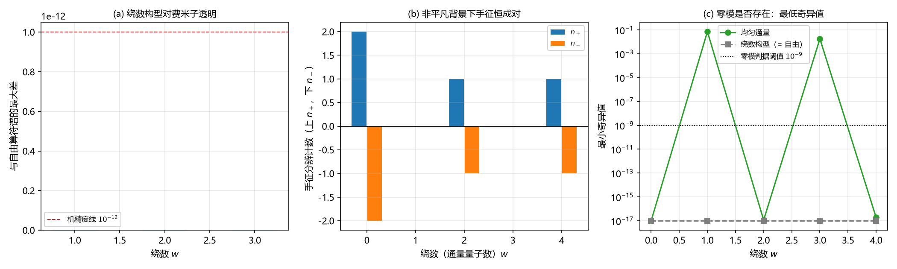

# 注记-绕数对费米子透明：缺陷与费米耦合首轮（判据第 652 号）

## 元数据

- **日期**：2026-10-16 13:07:07（初版）
- **脚本**：`验证脚本/winding_zero_mode.py`
- **判据**：冒烟 1 至 4，G1，G2，另附区分力对照
- **可逆性等级**：判据稳健（冒烟 2 至 4 与 G1 是逐位恒等式，偏差落在机精度；G2 的手征成对性为精确整数）。G2 的零模**计数**属读数层，随格点尺寸与阈值而变（判据敏感），已单列。
- **类型**：狄拉克线阶段 4 补轮（缺陷与费米耦合首轮）
- **所属计划**：[[理论攻坚/狄拉克方程攻坚计划：从元相子几何导出狄拉克方程与完整几何意义]]（阶段 4）；承接 [[验证脚本/注记-单手征闸门：谷能否被守恒的扇区标签分开（判据第650号）]]
- **关联**：[[验证脚本/注记-粗格涌现构造：常值平方生成元的提取与号差读数（判据第632号）]]；[[磁单极与非平凡丛：实轴方向场的分区化升级]]（Dirac 量子化）；[[验证脚本/注记-内部结构承接钉扎角色的束缚（第485条）：内部冻结环可替代样品边缘|第 485 号]]、[[验证脚本/注记-复结构畴壁承载绕数（第486条）：联结类型决定 K 无关性、壁位零模终止无穷后退|第 486 号]]、[[验证脚本/注记-D1候选丙绕数阈值势垒（第501条）：三候选对比闭合与质量项非唯一判定|第 501 号]]（绕数构型）
- **图**：见 §四 图 1

---

## 一、要判什么

第 650 号的边界声明留了一句：候选四的闸门是在自由格点算符上判的，完整的判否还须补上缺陷与费米算符的耦合。本轮补这一环，问的是：**把体系的守恒绕数接到费米算符上，它能否给出手征选择。**

耦合通道取电荷通道，理由是体系自己把绕数与电荷认作同一件事（[[电荷的几何本质：满周闭合环内部U(1)缠绕数方案的系统辨析|电荷的几何本质]]），且 Dirac 量子化把通量与绕数锁在一起（[[磁单极与非平凡丛：实轴方向场的分区化升级]]）。落到算符上，背景即体系的相位场绕数构型 $\theta(n)=w\arg(n-c)$，以 Peierls 相位加在跳跃上，连线变量 $U_a(n)=\mathrm{e}^{\mathrm{i}(\theta(n+e_a)-\theta(n))}$。

## 二、模型设定

二维周期格点 $36\times36$，交错算符 $D=D_1^U+P_1D_2^U$（第 632、650 号口径，$P_1=\mathrm{diag}((-1)^{n_1})$）。三组构型各扫一遍：绕数构型（$\theta=w\arg$，缺陷芯在格点 $c$，割线走 45 度对角线）、纯规范构型（$\Lambda=0.9\sin(2\pi x/N)\cos(2\pi y/N)$，有相位而无绕数）、均匀通量（Landau 规范 $U_2=\mathrm{e}^{\mathrm{i}2\pi wx/N^2}$，总通量 $2\pi w$，手工放进的非平凡背景）。

零模计数取算符奇异值小于 $10^{-9}$ 的个数；手征用交错生成元 $\varepsilon=P_1P_2=(-1)^{n_1+n_2}$，由于 $\{\varepsilon,D\}=0$ 精确成立，零模子空间是 $\varepsilon$ 不变子空间，投影谱落在 $\pm1$ 上，$n_+$ 与 $n_-$ 是精确整数。

## 三、判据与结果

| 判据 | 内容 | 期望 | 实测 | 判定 |
| --- | --- | --- | --- | --- |
| 冒烟1 | $\mathrm{i}D$ 厄米 | $0$ | $0.000\times10^{0}$ | 通过 |
| 冒烟2 | $w=0$ 档与无相位算符逐位一致 | $0$ | $0.000\times10^{0}$ | 通过 |
| 冒烟3 | 纯规范构型：谱与自由一致、规范协变恒等式逐位成立 | $0$ | $1.554\times10^{-15}$、$1.212\times10^{-16}$ | 通过 |
| 冒烟4 | 绕数构型的纯规范逐线恒等式 $U_a(n)=g(n+e_a)/g(n)$ | $0$ | $4.965\times10^{-16}$（两方向） | 通过 |
| G1 | 绕数构型下费米子谱与自由逐位一致（$w=1,2,3$） | $0$ | $1.776\times10^{-15}$、$2.220\times10^{-15}$、$2.220\times10^{-15}$ | 通过 |
| G2 | 非平凡背景下净手征性 $n_+-n_-$ | $0$ | 五个档全为 $0$ | 通过 |
| 读数 | 均匀通量下的零模计数 | 读数 | $4,0,2,0,2$（$w=0$ 至 $4$） | 读数（判据敏感） |
| 对照 | 连续朗道能级简并 | $w$ | 简并 $w$、净手征性 $+w$ | 对照（解析） |

## 四、结果解读

**守恒绕数对费米子完全透明。** 冒烟4 给出关键读数：绕数构型诱导的连线变量精确满足纯规范恒等式 $U_a(n)=g(n+e_a)/g(n)$，其中 $g=\mathrm{e}^{\mathrm{i}\theta}$。相位差的最大模达 $6.254622$（即 $2\pi$ 量级），说明绕数确实住在相位里；但回卷之后 $\mathrm{e}^{\mathrm{i}2\pi w}=1$，连线变量看不见它。G1 于是给出谱层面的结果：$w=1,2,3$ 三档下费米子谱与自由算符逐位一致（偏差落在 $10^{-15}$），零模计数恒为 $4$、手征分辨恒为 $2$ 对 $2$。**缺陷绕数改变不了费米子的任何读数。**

**原因可以一句话说清。** 绕数与电荷在体系里取同一单位，故单位电荷绕缺陷一周的 Aharonov–Bohm 相位恰为 $2\pi w$，是 $2\pi$ 的整数倍。整数倍的相位在物理上等于没有相位，缺陷因此对费米子不可见。这是电荷通道本身的结构，与算符实现无关。

**手工放进非平凡背景也换不来手征选择。** G2 用均匀通量作对照：背景非平凡时零模计数确实随绕数变动（读数 $4,0,2,0,2$），但凡是出现零模的档，手征分辨都是成对的（$w=0$ 为 $2$ 对 $2$，$w=2$ 与 $w=4$ 各为 $1$ 对 $1$），净手征性五个档全为零。加倍把多出来的手征配成对消掉，这一层与第 650 号在自由算符上读到的结论一致。

**计数律是读数层的，机制未在本轮闭合。** 零模计数没有按味线性增长（预期 $4+2w$，实读 $4,0,2,0,2$）。该形态在 $N=20,24,30,36$ 四档格点下逐档同型（脚本内「计数律的格点尺寸依赖」一节给出四档读数），故属结构性质，与分辨率无关；但其机制（为何只有偶数绕数档给出零模、且恰好两个）本轮未闭合，登记为读数层待查。判据不建立在这一项上。

**区分力检验通过。** 纯规范构型（有相位、无绕数）给出与自由逐位一致的谱（$1.554\times10^{-15}$），绕数构型同样给出自由谱，非平凡通量则改变读数。三条合起来说明：读数对"有无绕数"本身不敏感（这是本轮的结论），对"背景是否平凡"敏感（这是判据的区分力）。

### 图 1

图注按脚本绘图面板逐条核对撰写。

## 五、结论与登记

**候选四的判否在耦合层完整化，且理由比第 650 号更锐。** 第 650 号说的是"分开谷的标签不守恒"；本轮补上耦合后得到的是"耦合本身恒为平凡"。缺陷的绕数在体系的电荷标识下不产生曲率，故相位通道不存在，费米子对缺陷透明。要给费米子一个非平凡背景，曲率必须来自别处，这与场角色分工（曲率由基准方向场承载）一致。

**手征选择的两条候选通道据此收窄。** 电荷通道已判（本轮，否）。质量通道（缺陷相对真空的绑定能）本轮未判，且它在体系里是标量能量，不带绕数，故它若给出手征选择，走的是符号变化（复结构符号 $\mathbb{Z}_2$）那条路，与第 486 号的畴壁结构同类。须注意第 486 号的"零模"指壁位的平移零模（能量泛函的零模），与本条的费米算符核不同物，两者不构成冲突。

**阶段 4 的结论形态不变。** 单手征在体系内不能免代价地取得，采纳标准处方并登记手征破缺代价。本轮给这条结论补上了耦合层的判据支撑。方案选定仍属裁决点 D-e，交作者。

## 六、严格程度声明与边界声明

**严格层**：冒烟 1 至 4 的逐位恒等式与谱一致（偏差 $10^{-16}$ 至 $10^{-15}$）；$\{\varepsilon,D\}=0$ 的精确性（故手征分辨是精确整数）；G2 的成对性为精确读数。

**读数层**：均匀通量下的零模计数及其随绕数的形态（依赖阈值与格点尺寸，四档格点同型）；对照栏的连续朗道能级为解析陈述，非本脚本数值。

**标准数学与体系贡献的分界**：纯规范变换不改变谱属标准数学；本条的体系贡献在于"体系的绕数构型必然诱导平凡联络"这一构型层事实（绕数与电荷同单位，使 AB 相位恰为 $2\pi$ 的整数倍），以及由它得出的"缺陷与费米之间不存在相位耦合通道"。

**边界声明**：本轮不判质量通道（下一轮候选）；不判候选一至三；不判绕数与谷的一一对应（第 650 号已判）；不改动第 485、486、501 号的任何读数；不改动 `理论总纲/` 基准。

## 修订记录

- **2026-10-16 初版**（触发：第 650 号边界声明留的耦合层缺口；作者指示执行最优下一步）
    - 冒烟 1 至 4 与 G1、G2 通过；关键读数：绕数构型的纯规范逐线恒等式偏差 $4.965\times10^{-16}$，三档谱差落在 $10^{-15}$
    - 结论：守恒绕数在电荷通道上对费米子透明（AB 相位恰为 $2\pi$ 的整数倍）；非平凡背景下零模手征恒成对，净手征性五个档全零
    - 过程记录（三处实现教训）：其一，首版移位矩阵取 `np.roll(...,-1,axis=1)`，与第 650 号的 `S[i,(i+1)%n]=1` 反号，Peierls 相位挂到了反向跳跃上，谱与自由差出 $0.353$；靠纯规范逐线恒等式（$4.4\times10^{-16}$ 与 $0.353$ 的反差）定位并改为 `np.roll(...,1,axis=1)`，定位用的诊断脚本留在 `_tools/诊断-判据652-移位矩阵约定核对.py`。其二，纯规范构型首版取 $\Lambda=2\pi xy/N$，该函数在环面上不周期，元素级恒等式不成立（差 $1.0$），改为周期函数后为 $1.212\times10^{-16}$。其三，首版零模打印取 `sv[:6]`，而 `np.linalg.svd` 的奇异值按降序排列，打印的是最大而非最小六个，已改为 `np.sort(sv)[:6]`
    - 呈现更正一处：首版把"格面通量（原始值）为零"当作独立判据，实为离散旋度恒等于梯度这一代数恒等式，不构成证据，已改为纯规范逐线恒等式
