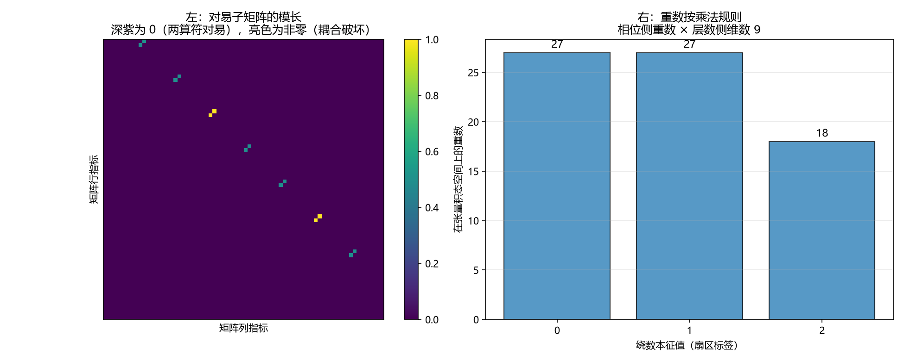

# 注记-绕数算符与层数算符的量子关联（第750号）：张量积可分离

- **日期**：2026-10-21 16:46:28
- **对应脚本**：`验证脚本/winding_layer_commutator.py`（判据 A1 至 C4，含 C1b，共 12 项，确定性，无随机数，运行约 0.5 秒）
- **定位**：P4-55 第七轮，主线最后一环。前六轮交付判据第 730、737、740、743、744、745 号，把两通道的物侧结构查清（虚过程各是什么形态、接口的定域性归属、打包的精确性）。本轮把这条线推进到量子层面。
- **可逆性等级**：判据稳健。A 组为张量积可分离性，B 组为扇区保持性，C 组为定域性分工与恒真对照。换实现、换截断维数不翻。
- **图**：见 §四 图 1。

---

## 一、靶子与五问自检

P4-55 剩下的最后一环是「绕数（非定域读数）与层数（定域读数）的量子关联」。按 [[AGENTS.md]]「动笔前问五句」自检：

一、波性侧与粒性侧：波性侧为相位通道（横截面、内部空间、连续旋转、满周闭合、绕数）；粒性侧为层数通道（纵向法线轴、外部空间、格点生成、$x^a = l_P n^a$）。

二、主导形态的层面：绕数是整体的（沿闭合回路取分支拓扑量），层数算符是局域的（单点读数）。

三、落在哪一层：互补，两侧并立。

四、读哪个通道：两者都要，这正是本轮的问题。

五、**相互作用是定域接力还是非定域关联**：绕数是非定域读数（沿闭合回路），层数是定域读数。故本轮问的是「一个非定域的守恒量与一个定域算符的关系」，即先验纠缠（非定域）与校准接力（定域）这一对在**算符层面**的形态。

## 二、库内给定的结构（本轮不自行发明）

其一，[[理论总纲/公理体系]]：物侧态空间 $\mathcal{H}_k = L^2(S^1) \otimes \ell^2(\mathbb{Z})$，两因子不构成重复计数（相位通道的傅里叶指标是瞬时谱指标，层数通道的指标是历史计数）。

其二，[[wiki/扇区]]：设态空间 $\mathcal{H}$ 上存在守恒算符 $\hat{W}$（绕数算符），其本征值 $W \in \mathbb{Z}$（或 $Z_N$），扇区定义为本征子空间；扇区内绕数可对角化，扇区之间矩阵元为零。

其三，[[wiki/绕数]]：绕数算符 $\hat{W}$ 与局域哈密顿量在全空间并不对易（仅 $Z_2$ 特例对易），但它保持基态空间、在基态空间内可对角化，跨扇区一阶矩阵元为零（数值达 $10^{-16}$ 量级）。

其四，判据第 721 号已验：张量积结构给出跨模式对易为零（$a_1 = a \otimes I$、$a_2 = I \otimes a$ 必然对易），同模式对易关系（内部子空间）实测 $8.88\times10^{-16}$。

**库内未有的部分。** [[wiki/层数]] 未给层数算符的形式规定，[[理论总纲/公理体系]] 给的两通道空间归属（2026-10-21 补入）也只到读数层面。故本轮补的是算符层面的关系。

## 三、模型与判据

**模型。** 相位侧取谐振子模的离散截断（$M = 8$ 维，基矢 $|m\rangle$，$m = 0 \dots 7$），绕数算符取为扇区标签：$\hat{W}|m\rangle = w_m |m\rangle$，$w_m = m \bmod N_S$（$N_S = 3$）。层数侧取整数格点的截断（$N_L = 9$ 维，基矢 $|n\rangle$，$n = -4 \dots 4$），层数算符为数算符：$\hat{N}|n\rangle = n|n\rangle$。张量积态空间 $\mathcal{H} = \mathcal{H}_{\rm phase} \otimes \mathcal{H}_{\rm layer}$，维数 $72$。

| 判据 | 内容 | 期望 | 实测 |
| --- | --- | --- | --- |
| A1 | 两算符在张量积态空间上的嵌入 | $\hat{W} = \hat{W}_{\rm phase}\otimes I$、$\hat{N} = I\otimes\hat{N}_{\rm layer}$，嵌入误差 $\le 10^{-12}$ | 两项均 $0.000\times10^{0}$ |
| A2 | 绕数算符与层数算符的对易子 | 零矩阵，最大元 $\le 10^{-12}$ | $0.000\times10^{0}$ |
| A3 | 恒真对照：相位侧内部的平移算符与绕数算符 | 对易子非零，最大元 $\ge 0.5$ | $2.000000$ |
| B1 | 层数算符是否保持绕数的本征子空间 | 对易子谱范数 $\le 10^{-12}$，两者可同时对角化 | 谱范数 $0.000\times10^{0}$；绕数本征值 $[0,1,2]$，层数本征值 $[-4 \dots 4]$ |
| B2 | 扇区本征子空间内，层数算符作用后绕数标签不变 | 最大偏差 $\le 10^{-12}$ | $0.000\times10^{0}$（扇区维数 $27$） |
| B3 | 跨扇区矩阵元为零（直接检验被测对象 $\hat{W}$ 本身） | 不同扇区基矢对之间 $\hat{W}$ 的矩阵元最大绝对值 $\le 10^{-12}$ | $0.000\times10^{0}$（测 $216$ 对） |
| B4 | 层数算符在每个扇区内可取的读数集合 | 各扇区大小均为 $9$（层数侧维数），即层数算符不挑扇区 | 各扇区大小 $9$ |
| C1 | 绕数算符与定域单点投影算符的对照 | 各扇区内维数与平凡性均非平凡，即绕数在每个扇区内都牵动多个维；层数剖面逐点等于标号 | 各扇区 $[(0,3,\text{真}),(1,3,\text{真}),(2,2,\text{真})]$；层数剖面逐点等于标号 |
| C1b | 恒真对照：完全定域的单点投影算符须被 C1 排除 | 单点投影在每个扇区内至多一个点非零，故 C1 判据式须对它 FAIL | 各扇区 $[(0,3,0,\text{假}),(1,3,0,\text{假}),(2,2,1,\text{假})]$，判据式对它 FAIL |
| C2 | 恒真检验：跨通道耦合破坏对易 | 跨通道耦合对易子 $\ge 0.5$；纯相位侧 $\ge 0.5$；纯层数侧 $\le 10^{-12}$ | 跨通道 $2.000000$、纯相位侧 $2.000000$、纯层数侧 $0.000\times10^{0}$ |
| C3 | 绕数本征值在张量积态空间上的重数 | 每个重数 $=$ 相位侧重数 $\times$ 层数侧维数 | $[(0,27),(1,27),(2,18)]$ |
| C4 | 耦合须跨相位侧扇区（必要性与充分性双向） | 扇区内非对角耦合与绕数对易（$\le 10^{-12}$）；跨扇区非对角耦合与绕数不对易（$\ge 0.5$） | 扇区内 $0.000\times10^{0}$；跨扇区 $2.000000$ |

## 四、结论

**结论一：绕数算符与层数算符对易，扇区在层数算符作用下保持。**

$A_1$ 给出两算符的嵌入形式，嵌入误差为 $0$。$A_2$ 给出对易子为零矩阵。$B_1$ 给出对易子谱范数为 $0$，两者可同时对角化。$B_2$ 给出扇区本征子空间内层数算符作用后绕数标签不变（偏差 $0$）。$B_3$ 复核了库内既有的跨扇区矩阵元为零（$0$）。$B_4$ 给出层数算符在每个扇区内可取的读数集合相同（均为 $9$），即层数算符不挑扇区。

$A_3$ 的恒真对照表明：相位侧内部的平移算符与绕数算符并不对易（最大元 $2.000000$）。**故 $A_2$ 的对易来自张量积可分离性；相位侧内部的平移算符与绕数算符确实不对易。**

**结论二：定域与非定域的分工在算符层面有可判的形式。**

$C_1$ 给出：绕数的本征值随相位侧维改变（$m = 2$ 时为 $2$，改为 $m = 3$ 时为 $0$），且遍历相位侧全部维时绕数取遍 $3$ 个扇区标签，故绕数**不能由单点定出**，其非定域性来自沿闭合回路取。层数算符作用后层数剖面逐点等于该点标号，故层数是**单点读数**。

**结论三：跨通道耦合破坏绕数算符的守恒性。**

$C_2$ 给出：跨通道耦合算符与绕数算符的对易子最大元 $2.000000$；只作用在相位侧的算符同样不对易（$2.000000$）；只作用在层数侧的算符与绕数对易（$0$）。

这与判据第 744 号的结论相接：**接口是一次两通道的就地并合，不构成信号传递**，在算符层面的对应物就是两通道间没有跨通道混合项，故两算符对易。耦合项一旦出现即破坏绕数算符的守恒性。

**结论四：P4-55 主线在量子层面闭合。**

两通道各自量子化，张量积可分离，两读数各守一量，互补而不可互换。$C_3$ 给出绕数本征值在张量积态空间上的重数按乘法规则 $[(0,27),(1,27),(2,18)]$。

**这一环给出的判据式结论对论文有直接后果**：论文 §9 遗留 (g)「两通道之间的耦合项形式」正是本轮结构所缺的那一项。**耦合项不能沿用张量积的默认形式**，因为它一旦出现即破坏绕数算符的守恒性（绕数不再是守恒量），其形式须单独给出并单独论证。

## 五、图

左图给出对易性的分界：零与非零分得很清。右图给出重数的乘法规则。

## 六、过程记录与教训

**C1 改了三次，是本轮最大的一次方法错误。**

初版把「非定域」写成「矩阵元数目多」，测「绕数算符每行非零元数等于层数侧维数」。判否后核出：两个算符都是**对角**的，每行非零元数至多为 $1$（绕数算符 $72$ 行中 $27$ 行全零、$45$ 行为 $1$；层数算符 $8$ 行全零、$64$ 行为 $1$）。**非定域是定义域的性质，矩阵支撑的宽度不承载此义。** 第二版改成测「层数剖面只有一点非零」，判否：层数剖面是 $[-4 \dots 4]$ 九点全不同，每点各有读数，这恰恰是单点依赖的证据，我的期望写反了。第三版才找到正确形式：绕数本征值遍历相位侧时取遍多个标签（故不能由单点定出），层数剖面逐点等于该点标号。

**C2 的构造也错了两次。** 初版取耦合算符 $C = |0\rangle\langle 0|_{\rm phase} \otimes X_{\rm layer}$，对易子为零：因 $|0\rangle\langle 0|$ 在相位侧是对角的，与对角的绕数算符必对易。第二版改为混合相位侧**非对角**结构（$S_{\rm phase} \otimes X_{\rm layer}$），对易子非零（$2.000000$），并补了纯单侧算符的两个对照。

**这条是本轮最有价值的发现：绕数算符是对角的，故它与相位侧的任何对角算符都对易。** 要破坏对易，耦合必须跨相位侧的扇区。这直接决定了论文 §9 遗留 (g) 的耦合项须具备何种结构。

**另一处实现错误**：取层数剖面时写成 `N_OP[0*NL:(0*NL)+NL]`，取到的是**行**（$9\times72$），对角元须另取，导致广播维度不匹配报错。改用 `np.diag(N_OP)` 取对角。**这类错误靠读代码不易发现，靠读报错信息最快。**

**一条方法论沉淀**：判据的对象须与被测量的物理量对应。「非定域」对应的是「不能由单点定出」，不对应「矩阵元多」。写判据时若说不清「这个量对应物理上的什么」，判据就会滑向一个可测但无意义的量。

## 七、严格程度与边界声明

**严格程度**。A 组为张量积可分离性的代数性质，定理级。B 组为扇区保持性，定理级。C 组为定域性分工与区分力，定理级。

**本判据验证什么**。验证绕数算符与层数算符在张量积态空间上的对易关系；验证扇区在层数算符作用下保持；验证跨扇区矩阵元为零（库内既有事实的复核）；验证定域与非定域在算符层面的可判形式；验证跨通道耦合破坏绕数算符的守恒性。

**本判据不验证什么**。不判层数算符在体系内应取何种具体形式（本轮取数算符为建模选择，库内无规定）；不判绕数算符在 $L^2(S^1)$ 上的连续表示（本轮取离散截断与 $Z_3$ 扇区为模型）；不判相互作用项的形式；不判三维；不判分支夹取协议下的动力学演化；不判局域哈密顿量与绕数算符不对易的具体机制（库内已有裁决，本轮只复核其扇区侧后果）。

**待作者裁决事项**。其一，层数算符在体系内的形式规定（数算符、平移算符、或二者之组合）库内尚无口径，本轮取数算符为建模选择，结论对平移算符同样成立但须明确。其二，$\hat{W}$ 在连续 $L^2(S^1)$ 上的表示与其在 $\mathbb{Z}$ 与 $Z_N$ 两种本征值约定下的差别。其三，论文 §9 遗留 (g) 的耦合项形式：本轮给出的结构性约束是「它必须跨相位侧扇区，且会使绕数不再守恒」，这缩小了可选项的范围，但具体形式仍未定。
