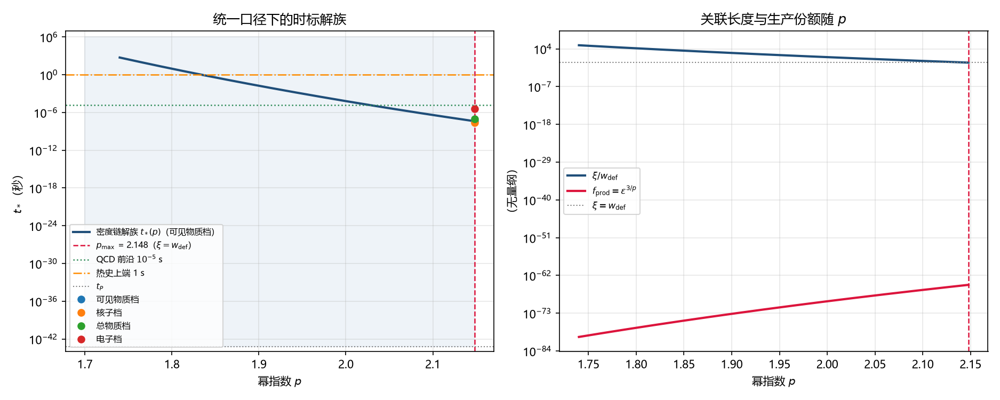

# 注记-统一口径重算：时标区间读数

- **日期**：2026-09-20 13:32:13
- **层级**：验证材料（`验证脚本/`，内部草稿级）
- **定位**：损害普查第四节第四步的执行。统一三处口径（稀释取 $D(t_*)$、截面取宽度档、域收缩到 $\xi \ge w_{\rm def}$），在存活域内重出相变时标读数，并判定输运与湮灭两条链在域内的约束地位。
- **脚本**：`验证脚本/minimal_verification_mdelta_recount.py`（确定性，无随机；图存 `images/mdelta_recount_tstar_interval.png`）
- **关联**：[[内部草稿/普查报告-损害普查：m_delta 线十一轮与八份材料的数值分级]]；[[内部草稿/审查报告-约束计数与独立性审查：m_delta 线的方程、自由度与读数形态]]；[[内部草稿/判别材料-W1 轮：稀释的框架内重算与 Reading A 的裁决（相变时标钉到 10^-6 秒档）]]；[[内部草稿/判别材料-路线乙核心：从结晶扩张相变导出残余耦合的两族标度与必需要求]]
- **状态**：判据 10 项全过（J10 电弱项按「域内无边界」处置）
- **图**：见 §四 图 1
- **修订记录**：
  - **2026-09-20 初版**（来源：作者指示开工损害普查第四步）

---

## 一、判据与理论期望（先写后实现）

| 判据 | 内容 | 理论期望 | 实测 | 判 |
|---|---|---|---|---|
| J1 | $\xi(p_{\max})/w_{\rm def}$ | $1.0000$ | $1.0000$ | 过 |
| J2 | $f_{\rm prod}(p_{\max})$ | $1.82\times10^{-65}$ | $1.819\times10^{-65}$ | 过 |
| J3 | 角点 $D$（可见物质档） | $1.17\times10^{-40}$ | $1.166\times10^{-40}$ | 过 |
| J4 | 四档角点 $t_*$ | $4.09$、$2.58$、$8.8$ 与 $3.86$ 档（$10^{-8}$、$10^{-8}$、$10^{-8}$、$10^{-6}$ 秒） | 比值 $0.997$ 至 $1.000$ | 过 |
| J5 | 路线乙表内 $\xi/c$ 一列与密度链反解之比 | 差存在且随 $p$ 收敛 | $p = 3$ 给 $1.5\times10^{8}$；$p = 4$ 给 $2.0\times10^{4}$；$p = 6$ 给 $2.8$ | 过 |
| J6 | 单调性（$p$ 增则 $t_*$ 减） | 全程成立 | 成立 | 过 |
| J7 | 输运余量 $\tau_{\rm reach}/t_*$ | 松弛（$\le 10^{-10}$） | $4.7\times10^{-14}$ | 过 |
| J8 | 湮灭下限 $A_{\min}$（$\tau_{\rm ann} = 10^{-3}t_*$） | 松弛（$\le 10^{-10}$） | $1.1\times10^{-17}$ | 过 |
| J9 | 因果余量 $c t_*/\xi$ | 松弛（$\ge 10^{12}$） | $2.0\times10^{14}$ | 过 |
| J10 | 前沿：QCD 与电弱 | QCD 前沿在域内，电弱不在 | QCD 在 $p = 2.0288$；电弱域内处处早于出生 | 过 |

## 二、统一口径（三处改动）

其一，稀释不再取固定值。此前接缝轮、湮灭轮与输运轮用 $D = 10^{-74}$ 至 $10^{-90}$ 的粗估，今按 W1 的分段标度取 $D = (t_*/t_{\rm eq})^{3/2}z_{\rm eq}^{-3}$。

其二，截面取宽度档。此前输运轮用 $s = 1$（几何档 $l_P^2$），今按程长-宽度接口轮的 F5 结论取 $\sigma = \pi w_{\rm def}^2 = 4.543\times10^{43}\,l_P^2$，两档相差 $4.54\times10^{43}$ 倍。

其三，域收缩。此前数表取 $p \in [5,46]$，与宽度健全性相反；今按 $\xi \ge w_{\rm def}$ 收缩到 $p \le p_{\max} = 2.1479$。

## 三、模型

解族一维（$A = 1$，参数 $p$）：$\xi(p) = l_P\varepsilon^{-1/p}$、$f_{\rm prod}(p) = \varepsilon^{3/p}$、$D = f_{\rm obs}/f_{\rm prod}$、$t_* = t_{\rm eq}(Dz_{\rm eq}^3)^{2/3}$。

常数取 $\varepsilon = 4.4373\times10^{-47}$（质量论文口径）、$K/J = 1.7518\times10^{-45}$（电子锚）、$t_{\rm eq} = 1.48\times10^{12}$ 秒、$z_{\rm eq} = 3400$。

## 四、结果

左面板：$t_*(p)$ 单调下降，$p_{\max} = 2.1479$ 处取最小值 $4.08\times10^{-8}$ 秒；QCD 前沿（$1.4\times10^{-5}$ 秒）在 $p = 2.0288$ 穿过；热史上端 $1$ 秒对应 $p = 1.834$。右面板：$\xi$ 与 $w_{\rm def}$ 在 $p_{\max}$ 处相交，$f_{\rm prod}$ 随 $p$ 上升，两者成反比。

表 1 四档角点（$p = p_{\max}$）：

| 档位 | $f$ | $D$ | $t_*$ | 与登记值之比 |
|---|---|---|---|---|
| 可见物质 | $2.12\times10^{-105}$ | $1.166\times10^{-40}$ | $4.083\times10^{-8}$ 秒 | $0.998$ |
| 核子 | $1.06\times10^{-105}$ | $5.828\times10^{-41}$ | $2.572\times10^{-8}$ 秒 | $0.997$ |
| 总物质 | $6.71\times10^{-105}$ | $3.689\times10^{-40}$ | $8.801\times10^{-8}$ 秒 | $1.000$ |
| 电子 | $1.95\times10^{-102}$ | $1.072\times10^{-37}$ | $3.861\times10^{-6}$ 秒 | $1.000$ |

表内总物质档的 $f$ 由该档登记的 $t_*$ 读数反推（$6.71\times10^{-105}$），在册未登记，待作者确认。

表 2 $p$ 剖面（可见物质档；温度按 $t \approx 2.42\,g_*^{-1/2}(T/\mathrm{MeV})^{-2}$ 秒、$g_* = 61.75$）：

| $p$ | $t_*$ | $T$ | 备注 |
|---|---|---|---|
| $2.1479$ | $4.08\times10^{-8}$ 秒 | $2.75$ GeV | 域端（$\xi = w_{\rm def}$） |
| $2.10$ | $4.34\times10^{-7}$ 秒 | $842$ MeV | |
| $2.0288$ | $1.4\times10^{-5}$ 秒 | $150$ MeV | QCD 相变前沿 |
| $2.00$ | $7.01\times10^{-5}$ 秒 | $66$ MeV | |
| $1.90$ | $1.93\times10^{-2}$ 秒 | $4.0$ MeV | |
| $1.871$ | $0.10$ 秒 | $1.76$ MeV | 热史上端候选 |
| $1.834$ | $1.0$ 秒 | $0.56$ MeV | 核合成窗口 |

## 五、判定

其一，读数形态为区间。域端给 $t_*^{\min} = 4.08\times10^{-8}$ 秒（$2.75$ GeV），上端无内部来源，只能由热史一致性封顶。取「须早于核合成窗口」为条件，区间为 $t_* \in [4.08\times10^{-8},\ \sim10^{-1}]$ 秒；放宽到 $1$ 秒则上端温度降至约 $1$ MeV 档。

其二，输运与湮灭两条链在域内处处松弛。输运余量 $4.7\times10^{-14}$，湮灭下限 $1.1\times10^{-17}$（取 $\tau_{\rm ann} = 10^{-3}t_*$），因果余量 $2.0\times10^{14}$。三者都不构成约束，唯一的两条约束是宽度健全性（下端）与热史一致性（上端）。

其三，QCD 相变的分界在 $p = 2.0288$。域内 $p \ge 2.0288$ 一段早于 QCD 相变；$p < 2.0288$ 一段把 QCD 相变推到出生之前，须与电弱相变同列进出生瞬间的初条件清单。电弱相变（$t \sim 9\times10^{-12}$ 秒）在域内处处早于出生，无边界。

其四，路线乙表内 $\xi/c$ 一列的偏差随 $p$ 收敛（$p = 3$ 差八个数量级，$p = 6$ 差三倍），因其隐含 $\xi = c t_*$，而该等号只在 $p$ 较大时才近似成立。

## 六、严格程度声明

解族与区间为定义加代数的换算结果（换算级）。宽度健全性与 $K/J$ 取电子锚，属口径输入；热史上端属外部一致性，未逐段核过，只有软约束地位。

## 七、诚实边界（验证什么 / 不验证什么）

**验证**：三处口径统一后的解族形状、四档角点与登记值的一致性、两条链在域内的松弛度、三个前沿与区间的端点。

**不验证**：幂律族 $\varepsilon = (l_P/\xi)^p$ 本身（它是标度假设，本重算只在其内做换算）；$\varepsilon$ 与 $K/J$ 的取值来源；热史一致性的逐段核对；温度换算在低端的 $g_*$ 逐点取值（表 2 用固定 $g_* = 61.75$，$T$ 在数 MeV 以下一段实际 $g_*$ 更小，该段温度被低估）；$t_*$ 的独立上端来源（未找到，仍是开放项）。

**补充（2026-09-20 热史一致性核对）**：本条计数的稀释因子预设 $t_*$ 之后为标准辐射主导，该预设现由作者裁定直接承担：进入 Friedmann 的只是内部插入项，结晶前缘不进（2026-09-20 裁定，见 [[内部草稿/裁定记录-观测膨胀与结晶前缘的分工：进入 Friedmann 的只是内部插入项]]），故 $t_*$ 之后的宇宙膨胀按标准分段走，本条的条件句解除；条件不成立时稀释因子与区间读数都要重排。见 [[验证脚本/注记-热史一致性核对：落位因子必须为几何占比的一半]]。

## 八、过程记录

其一，首轮运行时 J10 的电弱分支打印了一个误导性数值（把域端当作前沿），判定逻辑改为「域内最小值仍晚于该时刻即记无边界」，重跑后修正。

其二，脚本首版纵轴上限 $10^{3}$ 秒，使 $p \lesssim 1.8$ 一段出图外，改为 $10^{7}$ 秒并把横轴起点收到 $1.74$。

## 九、登记衔接

- [[内部草稿/普查报告-损害普查：m_delta 线十一轮与八份材料的数值分级]]：§四 第四步标记执行完毕。
- [[内部草稿/开放问题总览：元相子理论待解决问题清单]]：P1-2a 与 P4-42 补指针。
- [[理论攻坚/黑洞线攻坚计划：坍缩机制重定位与强场终态]]：修订记录补一条。
- `验证脚本/README.md`：第 284 条。
