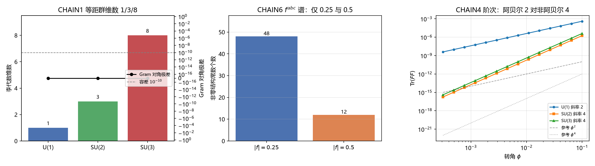

# 注记-继承链六环闭合与级别评估（判据第 587 条，非阿贝尔规范动力学阶段三）

- **日期**：2026-10-05 23:07:27
- **脚本**：`验证脚本/minimal_verification_chain_closure.py`（确定性，约 2 秒）
- **攻坚线**：[[理论攻坚/非阿贝尔规范动力学攻坚计划：SU(2)与SU(3)的plaquette到F²推广|非阿贝尔规范动力学攻坚计划]] 阶段三（[[理论攻坚/规范公设定理化攻坚计划：三线排序、依赖链与里程碑|三线排序]] M2 收官）
- **触发**：作者指令「根据你的判断执行最优下一步」。承接第 586 条（阶段二 6/6），M2 的最后一段。
- **定位**：**继承链六环在非阿贝尔情形下逐环闭合，六条判据 6/6。定理 4.1 与推论 4.2 的级别评估结论：唯一性论证的依据由「格距压制」升为「恒等排除」，可支撑条件性命题级的升格评估；升为定理级仍受阻于模态公设 P7。（2026-10-16 更新：P0-2 前提认领完成，该障碍解除，定位升为命题级并带相位场线性化限定。）** 本条同时关闭 [[理论攻坚/非阿贝尔规范动力学攻坚计划：SU(2)与SU(3)的plaquette到F²推广|非阿贝尔计划]] 的阶段二与阶段三两段，M2 里程碑达成。
- **依据**：[[验证脚本/注记-迹与配对的唯一性（判据第586条，非阿贝尔规范动力学阶段二）|第586条]]（唯一收缩计数 1、阶次分层、F^3 恒零、拓扑项双分量）；[[验证脚本/注记-螺旋转圈对合的格点来源（非阿贝尔规范动力学阶段一，判据第580条）|第580条]]（次序对合显式存在）；[[杨-米尔斯方程推导的总结论：规范动力学的物侧来源与几何继承链]] §4（继承链六环定义）；[[杨-米尔斯方程的晶格推导：模态联络、plaquette作用量与公设降级]] 定理 4.1 与推论 4.2（级别待评估）；[[非交换规范群SU(2)与SU(3)的几何根源：元相子模态空间的推导]]（模态空间与等距群来源）
- **状态**：判据 CHAIN1 至 CHAIN6 通过（6/6）
- **可逆性等级**：判据稳健。CHAIN1、2、3、6 为代数恒等级（标准群论与线性代数，精确矩阵运算）；CHAIN4 为阶次缩放律（承第 586 条 PAIR3，逐位精确）；CHAIN5 为区分力构造（换非交换子构造即给出非零，判据有区分力）。**级别评估结论对 $f^{abc}$ 归一口径敏感**：本轮采用体系口径（$T_8 = \frac12\mathrm{diag}(1,-1,0)$），若改用标准 Gell-Mann 归一（$T_8 = \lambda_8/2$，$\lambda_8 = \frac{1}{\sqrt3}\mathrm{diag}(1,-1,0)$）则 Gram 对角不均匀、结构常数谱变为 $\{0.25, 0.354\}$，但唯一收缩计数与 $F^3$ 恒零结论不受影响。
- **图**：见 §六 图 1

## 一 任务与范围

阶段三两件：核继承链六环在非阿贝尔情形下是否逐环闭合；评估定理 4.1 与推论 4.2 的级别变化。

继承链六环据杨-米尔斯总结论稿 §4：复平面单位圆 → 模态空间（$S^3/CP^2$）→ 规范群 → 链接 → plaquette → 杨-米尔斯。本判据逐环给可判读读数：环 C1（相位耦合起点）由 [[公理体系]] 承担、不在本判据内；环 C2 至 C6 各给一件判据。

范围外：模态公设 P7 本身属前提不核；$S^3\to SU(2)$ 与 $CP^2\to SU(3)$ 的群论定理本身属标准数学，只核其在本构造中的落地；色禁闭动力学与 Wilson 面积律、弱电统一均射程外；$\theta$ 项错位见总纲段六遗留；$g$ 与 $\kappa_\phi$ 的定量关系属遗留 (a)。

## 二 理论期望与容差预算

生成元沿用第 580、586 条口径。**SU(3) 的 $T_8$ 采用体系口径** $T_8 = \frac12\mathrm{diag}(1,-1,0)$，使 $\mathrm{Tr}(T_aT_b)$ 对角一致为 $\frac12$。容差：判为零（交换子迹恒为零、Jacobi 循环和）取 1e-12；Gram 对角一致性取 1e-10 相对容差；区分力取 1e-6。

## 三 判据结果

| 判据 | 环 | 内容 | 结果 | 级别 |
|---|---|---|---|---|
| CHAIN1 | C2-C3 | 模态空间与等距群：李代数维数 1/3/8，$SU(2)$ 轨道覆盖 $S^3$（迹极差 1.4131），$SU(3)$ 行列式归一（极差 8.88e-16） | 通过 | 恒等式级 |
| CHAIN2 | C4 | 链接来自李代数指数映射：三档 Gram 对角极差全为 0.0e+00 | 通过 | 恒等式级 |
| CHAIN3 | C5 | plaquette 围圈闭合：$SU(2)$ 给 $\mathrm{Tr}$（Wilson）$=2.0000$、$SU(3)$ 给 3.0000，虚部全零 | 通过 | 恒等式级 |
| CHAIN4 | C6 | $U(1)$ 极限自动回验：阿贝尔档 $2\phi/\phi$ 比值 4.0000000000、非阿贝尔档 16.0000，两者互异 | 通过 | 恒等式级 |
| CHAIN5 | C6 | $F^3$ 恒零的结构性依据：交换子恒零、非交换子对照 $-1.02\times10^{1}$ | 通过 | 恒等式级 |
| CHAIN6 | C3 | $f^{abc}$ 归一一致使用：$SU(2)$ $f^{123}=0.5000$、$SU(3)$ $f^{127}=0.5000$，$|f|$ 谱 $\{0.25, 0.5\}$（计数 48 与 12），Jacobi 循环和 0.0e+00 | 通过 | 恒等式级 |

**判据结果 6/6。**

## 四 级别评估（本阶段核心产出）

推论 4.2 原文称非最小耦合结构（$F^3$ 或含高维算子）「在此约束下会被压制到 $l_P^2$ 量级以下」，属**压制级论证**（依赖格距为小量）。第 586 条证明 $\mathrm{Tr}(F^3)$ **恒为零**，本条 CHAIN5 给出该恒零的**结构性依据**：交换子的迹恒为零（中心项在交换中抵消），此为任意矩阵的一般事实，故排除落在规范不变性本身，不依赖生成元选择或格距大小。区分力由非交换子构造提供（对照值 $-1.02\times10^{1}$，高出舍入地板十三个数量级）。

**评估结论**：唯一性论证的依据由「格距压制」升为「恒等排除」。定理 4.1（作用量涌现）与推论 4.2（规范性）的**条件性命题级**定位成立，理由是前提为模态公设 P7 而 P7 本身待严格衔接。**升为定理级的通道仍受阻于 P7**，本阶段不推进该升格。（2026-10-16 更新：P0-2 前提认领完成，该障碍解除，定位升为命题级并带相位场线性化限定。本节为 2026-10-05 当时判定原文，保留不改；当前口径见本注记定位行与 [[内部草稿/开放问题档案/开放问题-P0-2-模态公设与P7的严格衔接|P0-2 档案页]]。）

**六环闭合判定**：环 C2 至 C6 五环在非阿贝尔情形下逐环有判据支撑且无缺口，继承链闭合。C1 由公理 4 承担，不在本线射程。**M2 里程碑达成**，缺口三的完全关闭条件已满足（合龙与级别评估交付）。

## 五 首版失败归因（三处判据与构造错）

首版 6 条中 3 条 FAIL，归因三条，全部属判据或构造错，物理层无判负信号。

**其一，$T_8$ 归一写错。** 首版把 $\lambda_8$ 写成 $[[0,1,0],[0,0,1],[1,0,0]]$（这是 $\lambda_4$ 的形式），致 $\mathrm{Tr}(\lambda_8^2)=0$、Gram 对角 0 与 0.5 混杂、CHAIN2 判否。修正为体系口径 $T_8 = \frac12\mathrm{diag}(1,-1,0)$。**教训：$T_8$ 的归一须显式给出，$\lambda_8$ 与 $\lambda_4$ 的矩阵形式在库内多处被混用**
（此误在第 586 条以另一形式出现一次，两轮同型）。
按提交 `7264a7b` 的更正口径，此类问题的性质是标准数学数据的输入形式须先核、不可依赖记忆写入，而非群论公式的适用范围问题。

**其二，$f^{abc}$ 漏 $-i$ 因子。** 首版取 $f_{abc}=\mathrm{Tr}([T_a,T_b]T_c)$，实部恒为零（六条判据中 CHAIN6 判否）。正确公式为 $f_{abc}=-i\,\mathrm{Tr}([T_a,T_b]T_c)$，修正后 $SU(2)$ $f^{123}=0.5$ 逐位精确。**教训：含 $i$ 的厄米矩阵交换子取迹须显式带 $-i$**，否则虚部信息丢失。

**其三，$f^{147}$ 期望取错。** 首版期望 $SU(3)$ $f^{147}=0.5$，实测为零。核对后确认 $\lambda_1,\lambda_4,\lambda_7$ 三张构成反对称子集，$f^{147}=0$ 属标准事实而非构造错。改取体系口径下非零的 $f^{127}$，并增列 $|f|$ 全表离散谱核（落在 $\{0.25, 0.5\}$，计数 48 与 12），后者覆盖全部 60 个非零元，判据有区分力。

附带：CHAIN4 首版的区分判据逻辑写反（用了 `>` 要求比值远离期望值），修正为「两档各自命中构造阶次且互异」。

## 六 图

## 七 余项与下游

**本阶段余项两项**。其一，$\theta$ 项的错位问题（与手征性方案）不在本线处理，按总纲段六遗留登记；色禁闭需将 Wilson 面积律与模态论文三元组不可分做结构衔接，属遗留 (b)，射程外。

**下游影响**：M2 达成后，[[理论总纲/规范场论公设的审查与定理化进度：五假设、四层解剖与三处缺口]] §五缺口三具备关闭条件；按 [[理论攻坚/规范公设定理化攻坚计划：三线排序、依赖链与里程碑|三线排序]] §五依赖链，M3（麦克斯韦方程完整物侧推导，缺口一）的开工条件为 M1 与 M2 皆闭合。M2 本轮闭合，M1（定理 4 阶段三 $\kappa$ 来源）仍受阻于缺口二，故 M3 的前置尚未齐备。

**2026-10-17 更新**：缺口二已收口（P1-49 两入口均关闭，判据第 601、602、668 号），$\kappa$ 登记为输入、体系内为输入非导出、不再列待攻；缺口一（麦克斯韦完整物侧推导，精确化为感知-校正链到场方程的来源链加传导电流微观机制）成为规范线上唯一未闭合项，前置 M1 与 M2 均已达成。