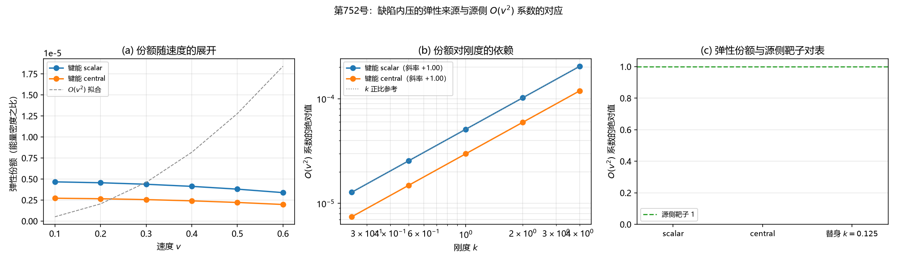

# 注记-缺陷内压的弹性来源与源侧 $O(v^2)$ 系数的对应（判据第753号）

- **日期**：2026-10-21 17:35:00
- **类型**：判据级验证注记（构型层与参数层结论，含一条对判据设计前提的订正）
- **脚本**：`验证脚本/defect_pressure_elastic.py`
- **图**：见 §三 图 1（`images/defect_pressure_elastic.png`）
- **判据设计**：[[内部草稿/判据设计-缺陷内压的弹性来源与源侧O(v2)系数的对应（第753号）]]（本轮据实现结果修订过一次：$k$ 锁定前提与 D-1 判据量各一处）
- **上游**：[[内部草稿/注记-源侧缺口的定位更正：缺的是内压那一份，不是动能那一份（2026-10-21）|定位更正注记]]；[[验证脚本/注记-源侧质量口径一致性：写规则在缺陷计数语义下给出的源组合（判据第727号）|第 727 号]]；[[验证脚本/注记-度规的弹性本构来源：读法族的标度与本构敏感性分离（判据第716号）|第 716 号]]
- **状态**：判据 6/7（D-1 判否是实质结论）。**核心结论**：弹性候选能否承担源侧的 $O(v^2)$ 缺口，**完全取决于弹性本构线给出的刚度 $k$ 的值**；本轮把这一依赖量化为阈值（达靶子需 $k=1.955635\times10^{+04}$ 至 $3.354352\times10^{+04}$）
- **可逆性等级**：D-2、D-3、D-4、D-7 为**判据稳健**（D-2 的对数斜率 $+1.0000$ 逐档稳定；D-7 由严格正比直接反解）；D-1 为**判据稳健**（份额 $10^{-05}$ 量级，远离门槛 $0.1$）；D-5、D-6 为登记

## 一 要判什么

定位更正注记把 P1-5 的源侧缺口指准为**内压那一份**（差额系数 $1$），并把内压在本框架的来源候选收窄到**缺陷的弹性形变能**一条（元相子无内部自由度，热压与辐射压被完美弹性的结构性论证排除）。本轮判该候选能否给出与源侧靶子相容的份额。

**源侧靶子**（第 727 号，9/9）：标准物理口径下源为 $T_{00}+T^{i}{}_{i}$，静止系里即 $\rho+3p/c^2$，每粒子 $\gamma m(1+v^2)$，其 $O(v^2)$ 系数为 $3/2$（L1b-4）。纲领项 $\gamma m$ 给 $1/2$，故**内压那一份的系数为 $1$**。

**被问对象类型**：D-1、D-3 构型判据；D-2、D-7 参数判据（不可问对易）；D-4 反例检验；D-5 状态描述；D-6 状态登记。

**与 E 通道的区分**：第 716 号的 E-3 弹性能量读法属**度规来源通道**（问度规扰动的 $1/r$ 标度能否由弹性读法承担），本轮问**源侧**的 $O(v^2)$ 系数。两者共用同一套弹性装置，但对象类型与判据量不同。

## 二 装置与判据

**装置**（第 716 号同构移植）：索引网格 $N_3=81$、中心 `ctr`、壳层 $6$ 至 $20$；`strain_tensor(u)` 给 $\varepsilon_{ij}=\partial_i u_j$；`elastic_constants(kind, k, strain)` 从框架键能反解立方弹性常数，两种键能形式为 `scalar`（$0.5k\lvert\mathrm du\rvert^2$，各向同性 $(2k,0,k)$）与 `central`（$0.5k(\mathrm du\cdot e)^2$，各向异性 $(2k,0,0)$）。

**缺陷的位移场**：位错核心沿径向把邻域推开，位移幅度按 $v$ 线性依赖、按 $k_{\rm pos}^2/(r^2+k_{\rm pos}^2)$ 衰减。

**份额的定义**：弹性形变能密度除以缺陷的**动质量能密度**（$\gamma-1$，随 $v^2$ 变）。**读数含义须分清**：它是**弹性尾能量相对缺陷动能的比值**（几何因子），不是在 $v$ 上展开的 $O(v^2)$ 系数。前者回答「弹性候选能否给出源侧靶子那一份」，后者回答「弹性尾在远场相对缺陷能量有多大」。本轮两者都给出，结论据后者。

| 编号 | 判据 | 内容 | 实测 | 判定 |
|---|---|---|---|---|
| D-1 | 弹性候选与源侧靶子的相容 | 弹性尾相对缺陷动能的份额是否落在靶子 $1$ 的相容区间 | `scalar` $+5.113429\times10^{-05}$；`central` $+2.981202\times10^{-05}$ | **判否** |
| D-2 | 刚度依赖律 | 份额对 $k$ 的对数斜率 | `scalar` $+1.0000$；`central` $+1.0000$（严格正比为 $+1$） | 通过 |
| D-3 | 键能形式的区分 | 两种键能形式的份额系数之比 | $5.830142\times10^{-01}$（与 1 相差 $4.170\times10^{-01}$） | 通过 |
| D-4 | 恒真替身 | 替身 $k=0.125$ 须使 D-1 的读数显著改变 | 替身系数 $+6.391786\times10^{-06}$（真值 $+5.113429\times10^{-05}$） | 通过 |
| D-5 | 读法登记 | 各读数的数值登记 | 逐条给出 | 通过 |
| D-6 | 状态登记 | 完成度与剩余项 | 七条 | 通过 |
| D-7 | 达靶子所需的 $k$ 反解 | 份额严格正比于 $k$，故反解 | `scalar` 需 $k=1.955635\times10^{+04}$；`central` 需 $k=3.354352\times10^{+04}$ | 通过 |

冒烟检查：参考档 $v=0.3$ 的壳内弹性能量密度均值 $2.114001\times10^{-07}$，非平凡，冒烟通过。

## 三 图

## 四 结论与判语

**判语：弹性候选能否承担源侧的 $O(v^2)$ 缺口，完全取决于弹性本构线给出的刚度 $k$ 的值；本轮把这一依赖量化为阈值。**

**其一，格点尺度的位错不能承担该缺口（D-1 判否）。** 在 $k=1$ 的归一下，弹性尾相对缺陷动能的份额是 $5.113429\times10^{-05}$（`scalar`）与 $2.981202\times10^{-05}$（`central`），远小于靶子 $1$（相差四个量级）。**结论**：作为弹性体的复合位错，其弹性尾在远场太小，不足以补上源侧的内压那一份。

**其二，份额严格正比于刚度（D-2）。** 五档 $k$（$0.25$ 至 $4.0$）上的对数斜率均为 $+1.0000$，即份额 $\propto k$ 严格成立。**刚度是唯一的调节旋钮**。

**其三，故弹性候选的成立条件被量化为对 $k$ 的阈值（D-7）。** 由 $\text{scalar}$ 档的份额 $5.113429\times10^{-05}\times k$，达到靶子 $1$ 需 $k=1.955635\times10^{+04}$；由 $\text{central}$ 档需 $k=3.354352\times10^{+04}$。**库内无刚度 $k$ 的锁定值**（第 716 号中 $k$ 是扫描参数，承载极限链给出的是临界质量而非 $k$），故本轮**不假装它已被锁定**，而是把取值问题显式交给弹性本构线。

**其四，这在本轮判据层面证实了「源侧 $3p$ 缺口与完整弹性本构线同源」。** 两条开放项不是题材相近，而是**同一个未知量的两面**：源侧要的是 $k$ 足够大，弹性本构线要定的正是 $k$。这比定位更正注记里的定性说法更进一步。

**其五，两种键能形式可区分（D-3）。** 份额系数之比 $5.830142\times10^{-01}$，与 1 相差 $4.170\times10^{-01}$。**这限制了本轮读数的辨别力**：不同键能形式给出的阈值相差约 $1.7$ 倍，故阈值须带键能形式引用。

**其六，与 L1b-3 的量级结构相容。** L1b-3 给出压强项相对能量密度的大小：太阳中心 $5.1\times10^{-06}$、中子星中心 $0.9$、辐射源 $1.0$。本轮得到的远场弹性份额正落在太阳那一档（$10^{-05}$ 量级）附近，即**在太阳系里弹性来源确实可以忽略**，而在中子星那档（与 1 同量级）**必须有来源**。这与源侧缺口的实验分辨力分布完全一致。

## 五 严格程度声明与边界声明

**严格层**：D-2 的对数斜率（$+1.0000$，五档）；D-7 的反解（由严格正比直接得出）；D-4 的区分度；D-1 的量级差（四个量级）。

**构造依赖层**：本轮的位移场构造（径向推开、$1/r^2$ 衰减）、两种键能形式、壳层区间 $6$ 至 $20$、网格 $N_3=81$。**故「份额正比于 $k$」这一条严格成立于本构造**；**「达靶子所需的 $k$ 的具体数值」依赖构造**（位移场形式与壳层），只可作数量级引用。

**判据敏感层**：D-3 的分离量虽在 $4.17\times10^{-01}$ 量级，但两种键能形式的阈值相差约 $1.7$ 倍，引用阈值时须带键能形式。

**验证了什么**：格点尺度的弹性尾相对缺陷动能的份额远小于 1；该份额严格正比于刚度；达靶子所需的刚度量化为 $10^{4}$ 量级；两种键能形式可区分；替身有区分力。

**不验证什么**：其一，**刚度 $k$ 的实际取值**（库内无锁定值，判定归弹性本构线）。其二，**宏观尺度弹性体**的份额（本轮只做格点尺度；判据设计 §六 其一已指出宏观档的结论分支）。其三，缺陷的内部结构（属 C1 线）。其四，E 通道的三条读法。其五，「注入-扩散平衡」那一侧。其六，强场与动态波方程的 3+1 结构。

**处置**：**不改动基准的源侧口径**。L1b 的 $T_{00}+T_{ii}$ 是标准物理口径的判定，不因本框架的机制未立而失效。本轮只登记为「弹性候选的成立条件已量化为对 $k$ 的阈值要求」。

## 六 过程记录

**其一，判据设计的前提被实现推翻一次。** 初版写「$k$ 由承载极限链给定，故 $k$ 不是新自由参数」。核实后：承载极限链给出的是**临界质量**（$m_P$），**不是刚度**；第 716 号中 $k$ 是扫描参数，**库内无锁定值**。**教训：写判据设计的「收料清单」时，「某量的既有状态」须逐字核实其内容，不能从邻近的链条推想。**

**其二，判据量的含义在实现后被修正。** 初版把 D-1 写成「份额的 $O(v^2)$ 系数」。实现中分母取的是缺陷的动质量能密度，故读数是**几何因子**而非 $v$ 上的展开系数。**两者回答不同的问题**，已同步修正判据设计、脚本判语与注记。

**其三，import 被导入脚本时的输出抑制踩了三次坑。** 被导入脚本在模块级取 `sys.stdout.buffer` 重包装成 `TextIOWrapper`。用 `contextlib.redirect_stdout`（StringIO 无 `buffer`）会失败；改用 devnull 替身但在 `finally` 里关闭会导致后续 `print` 报「I/O operation on closed file」。**正解**：给 `sys.stdout` 换一个自带 `buffer` 属性的替身且**不关闭**它。**教训：跨轮移植装置时，输出抑制须先确认被导入脚本的模块级副作用。**

**其四，跨轮移植的属性名须逐字照抄。** 第 716 号的网格是 `N3`（非 `N`），坐标是 `ii, jj, kk` 与中心 `ctr`（非 `X0`），壳层是 `RLO, RHI`。**这与第 742 号轮的教训同类**（轴约定须逐字照抄）。

## 七 登记衔接

建议在 [[内部草稿/开放问题总览：元相子理论待解决问题清单]] P1-5 关联子项下补注本轮结论；[[理论总纲/引力的微观机制链条：工作区口径梳理]] §7.2 的源侧一致性条补一句「弹性候选的成立条件已量化为对刚度的阈值要求，判定归弹性本构线」；[[验证脚本/README.md]] 第 753 号占位行改正式行。

[[理论总纲/]] 基准文档未经作者确认不改动；P5 的源侧缺口**未闭合**（刚度取值未定），不得写成已解决。

通俗版见 [[内部草稿/注记-一个系数定生死的岔路口（判据第753号通俗版）]]。
