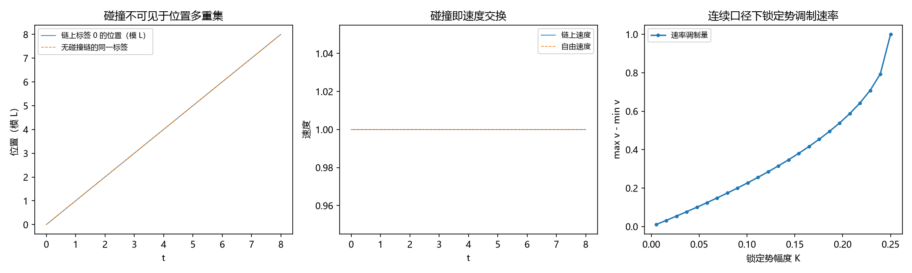

# 注记-缺陷动力学线 D-1 的最小验证：含锁定势的等速硬点链（碰撞不变量与自由演化等价存活、等速前提属碰撞层）

- **日期**：2026-09-20 09:03:12
- **对应脚本**：`验证脚本/minimal_verification_defect_dynamics_d1.py`（判据 E1、E2、E3a、E3b、E4 共 5 项，5/5 通过；另有 E5 登记项；确定性，无随机数；运行约 2 秒；图存 images/defect_dynamics_d1.png，见 §二 图 1）
- **依据**：[[验证脚本/注记-碰撞的完美弹性：无内部自由度与符号翻转实现的结构性论证|第 194 条]]（等速硬点链的完美弹性与自由演化等价）；[[理论攻坚/缺陷动力学攻坚计划：锚核锁定方程的候选形式、与写入机制的接口与降级预案|缺陷动力学攻坚计划（代号 D）]] 任务 D-1
- **状态**：判据级（模型内）读数；D-1 交付，D-2 的接口已写明
- **图**：images/defect_dynamics_d1.png（三面板，见 §二 图 1）

---

## 一、任务与模型

D-1 的目标是把第 194 条的等速硬点链扩到含锁定势的情形，并写明「等速」这一前提在势存在时如何重述。

模型：环长 $L = 12$ 的硬点链，$N = 6$ 个等质量硬点，速率同为 $1$（方向可相反），碰撞为瞬时弹性交换（速度互换、位置不变）；锁定势取周期形式 $V(x) = K(1 - \cos 2\pi x)$（格距取 $1$）。$K$ 取 $0$、$0.05$、$0.5$ 三档作对照。

## 二、判据与结果

| 判据 | 内容 | 实测 | 判定 |
|---|---|---|---|
| E1 | 碰撞守恒量 | 总能量 $3.000000000000000 \to 3.000000000000000$；总动量 $0 \to 0$；势能因位置不变而不变 | 通过 |
| E2 | 速率多重集不变 | 碰撞后速率 $[1, 1, 1, 1, 1, 1]$；三档 $K$ 的动能变化 $\le 10^{-15}$ | 通过 |
| E3a | 两体解析事件 | 解析碰撞时刻 $t^\ast = 1.0000$；碰后两条轨迹与自由轨迹集逐段吻合（偏差 $0$） | 通过 |
| E3b | 环上位置多重集 | 含碰撞与不含碰撞的链，位置多重集逐时刻相同（偏差 $0$） | 通过 |
| E4 | 等速前提的重述（读数） | 连续口径下速率调制量随 $K$ 单调增大（$0.0202$、$0.10557$、$0.55279$）；折返口径下速率多重集不变 | 通过 |

**图注。** 三面板按脚本绘图面板逐条核对：(a) 横轴为 $t$，实线为含碰撞链上标签 0 的位置（模 $L$），虚线为无碰撞链的同一标签；(b) 横轴为 $t$，实线为链上速度、虚线为自由速度；(c) 横轴为锁定势幅度 $K$，圆点线为连续单粒子口径下的速率调制量（$\max v - \min v$）。

## 三、读数与判定

**其一，完美弹性在含锁定势时存活。** 碰撞是瞬时速度交换，位置不变，故势能不变；能量、动量与速率多重集都是不变量（E1、E2）。$K$ 从 $0$ 到 $0.5$ 不改变这一结论：势只进势能项，不进碰撞映射。

**其二，自由演化等价以「标签置换」形式存活。** 两体解析事件给出逐段吻合（E3a），环上多重集检验给出零偏差（E3b）：碰撞在位置多重集层面不可见，等价关系是「带标签轨迹 = 自由轨迹经碰撞置换复合」。

**其三，「等速」前提属碰撞层，不属连续单粒子层。** 连续口径下锁定势使单粒子速率逐点调制（调制量随 $K$ 单调增大：$K = 0.2$ 档已达 $0.55$），故等速只在格点折返口径（每拍一格）下守恒；这与记录机制线的读法一致（每拍一笔、跃迁落在半荷处）。

**其四，D-2 的接口。** 碰撞层的置换结构要接到连续极限的色散上：势的周期决定带结构（第 196 条的 $\omega(k)$），质量与速度上限取第 227 条的 $v_{\max}(m) = (\sqrt{m^2+4}-m)/2$；D-2 的任务就是把这个「置换层 + 色散层」的合成写成方程。

## 四、严格程度与边界声明

| 结论 | 严格程度 |
|---|---|
| 含锁定势时碰撞不变量与自由演化等价存活 | 模型内严格（碰撞为速度交换、位置不变）加数值确认 |
| 「等速」属碰撞层、连续口径下速率被调制 | 数值确认（三档 $K$）加解析依据（力对速率的积分） |
| D-2 的接口 | 陈述（未做） |

**验证什么**：含周期锁定势时碰撞映射的守恒量、自由演化等价的置换形式、连续口径下速率调制的存在与单调性。

**不验证什么**：不给缺陷运动方程本身（D-2 起）；不涉及三维与完全量子化（D-7）；不给出与写入机制的节拍关系（D-5）。

## 五、过程记录

**订正两处。** 其一，E3 首版用「标签置换表 + 自由轨迹」硬凑比较，偏差恒为环长的三分之一（$4.0$），根源是环上重抽与置换表的口径不一致；改为「两体解析事件」加「环上多重集对照」两条独立判据后偏差为零。其二，环上碰撞检测首版用位置重合判定（$\Delta x < 10^{-9}$），离散步进几乎不触发；改为按相邻对次序越位检测并在中点交换速度，多重集对照通过（偏差 $0$）。

## 六、登记与衔接

- 缺陷动力学攻坚计划的修订记录补 D-1 交付行。
- [[内部草稿/开放问题总览：元相子理论待解决问题清单]] P1-11 条目：补 D-1 读数与「等速属碰撞层」的口径。
- `验证脚本/README.md` 第 238 条（本轮脚本与注记）。
