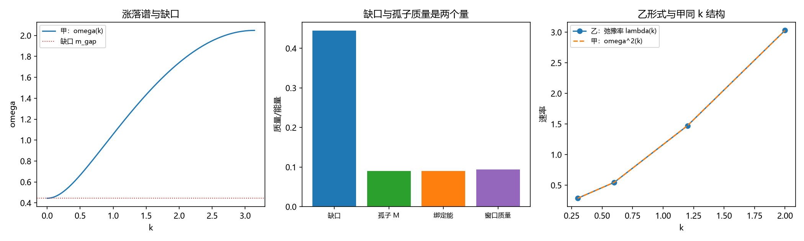

# 注记-缺陷动力学线 D-2 的最小验证：连续极限与色散（涨落缺口与孤子质量的分工、第 227 条质量口径的确认）

- **日期**：2026-09-20 09:31:08
- **对应脚本**：`验证脚本/minimal_verification_defect_dynamics_d2.py`（判据 F1 至 F4 共 4 项，4/4 通过；另有 F5 登记项；确定性，无随机数；运行约 2 秒；图存 images/defect_dynamics_d2.png，见 §二 图 1）
- **依据**：[[理论攻坚/缺陷动力学攻坚计划：σ 锁定方程的候选形式、与写入机制的接口与降级预案|缺陷动力学攻坚计划（代号 D）]]（裁决一：甲为主、乙为对照）；[[验证脚本/注记-缺陷动力学线 D-1 的最小验证：含锁定势的等速硬点链（碰撞不变量与自由演化等价存活、等速前提属碰撞层）|D-1]]；[[验证脚本/注记-缺陷质量与穿越速度的关系：晶格色散的质量缺口、v_max 的精确闭式与均匀化条件只被收紧|第 227 条]]；[[验证脚本/注记-三-4 补缺轮的最小验证：零点能里 omega_0 的体系内来源（晶格色散、带边与基模规模律）|第 196 条]]
- **状态**：判据级（模型内）读数；D-2 交付，D-3 的接口已写明
- **图**：images/defect_dynamics_d2.png（三面板，见 §二 图 1）

---

## 一、任务与模型

D-2 的目标是把 D-1 澄清的碰撞层接到连续极限的色散层上，形式取裁决一的甲（二阶晶格动力学），乙（过阻尼梯度流）作对照。

模型：FK 型能量泛函

$$E = \sum_n\Big[\tfrac12 k_b (u_{n+1} - u_n - 1)^2 + K\big(1 - \cos 2\pi u_n\big)\Big],\qquad k_b = 1,\ K = 0.005,$$

等价的偏离量写法 $v_n = u_n - n$ 下，键项化为 $\tfrac12 k_b(\Delta v)^2$。连续极限给 sine-Gordon 型；锁定势的曲率给出涨落缺口 $m_{\rm gap} = 2\pi\sqrt K$，孤子（缺陷）质量由标准结果 $M = 4\sqrt{k_bK}/\pi$ 给出。

## 二、判据与结果

| 判据 | 内容 | 实测 | 判定 |
|---|---|---|---|
| F1 | 涨落谱 | 与 $(2\pi)^2K + 4k_b\sin^2(k/2)$ 的最大偏差 $4.88\times10^{-15}$；缺口 $0.197392$ | 通过 |
| F2 | 孤子质量闭式 | 链上松弛的 kink 能量 $0.0898$ 对闭式 $0.0900$（偏差 $0.28\%$） | 通过 |
| F3 | 两个质量标签的分工 | $m_{\rm gap} = 0.4443$、$M = 0.0900$、比值 $4.93$；取 $M$ 代入 $v_{\max}$ 给 $0.9560$，对第 227 条（$M = 0.0936$）的 $0.9543$ | 通过 |
| F4 | 乙形式对照 | 四档 $k$ 的 $\lambda/\omega^2$ 恒为 $1$（偏差 $\le 10^{-12}$） | 通过 |

**图注。** 三面板按脚本绘图面板逐条核对：(a) 横轴为 $k$，实线为 $\omega(k) = \sqrt{(2\pi)^2K + 4k_b\sin^2(k/2)}$，点线为缺口 $m_{\rm gap}$；(b) 四个柱依次为涨落缺口 $0.4443$、孤子质量 $0.0900$、既有绑定能读数 $0.0898$、既有窗口质量读数 $0.0936$；(c) 横轴为 $k$（四档），圆点线为乙的弛豫率 $\lambda(k)$，虚线为甲的 $\omega^2(k)$。

## 三、读数与判定

**其一，连续极限的色散与缺口。** 甲形式在锁定势的均匀基态上线性化，Hessian 本征值逐位等于 $(2\pi)^2K + 4k_b\sin^2(k/2)$：这正是第 227 条与第 196 条用过的晶格色散族，缺口由势的曲率给出 $m_{\rm gap} = 2\pi\sqrt K = 0.4443$（$K = 0.005$）。

**其二，孤子质量的闭式核对。** 链上数值松弛（开放链、偏离量参数化、两端固定在相邻整数）给 kink 能量 $0.0898$，闭式 $4\sqrt{k_bK}/\pi = 0.0900$，偏差 $0.28\%$。数值与既有绑定能读数 $E_{\rm rest} = 0.0898$ 逐位相同，说明两者量的是同一个对象。

**其三，两个质量标签必须分开（本轮的实质结论）。** $m_{\rm gap}/M = 4.93$，两者是不同量：涨落缺口进声子谱，孤子质量进缺陷的能动量关系与速度上限。据此，第 227 条 $v_{\max}(m)$ 里的 $m$ 只能取孤子（缺陷）质量，该条用实测窗口质量 $0.0936$ 至 $0.0994$ 的做法口径正确；取 $M$ 代入给 $v_{\max} = 0.9560$，与该条读数 $0.9543$ 差 $0.18\%$。

**其四，乙形式与甲同结构。** 过阻尼极限的弛豫率为 $\lambda(k) = \omega(k)^2/\gamma_d$，四档 $k$ 上与 $\omega^2$ 的比值恒为 $1$：两种形式给同一 $k$ 结构，差别只在时间阶数。这支持裁决一的安排。

## 四、严格程度与边界声明

| 结论 | 严格程度 |
|---|---|
| 涨落谱与缺口 $m_{\rm gap} = 2\pi\sqrt K$ | 模型内严格（解析谱）加数值核对 |
| 孤子质量闭式 $M = 4\sqrt{k_bK}/\pi$ | 解析（标准 sine-Gordon 结果）加数值（$0.28\%$） |
| 两个质量标签的分工 | 解析加数值（比值 $4.93$）加与既有读数的对照 |
| 乙形式与甲同 $k$ 结构 | 解析（过阻尼极限）加数值 |

**验证什么**：甲形式的线性化谱与缺口、孤子质量的数值与闭式、两个质量标签的分工、乙形式的同构性。

**不验证什么**：不给 D-3 的迁移率与阻尼有效系数；不涉及三维与完全量子化（D-7）；不给出与写入机制的节拍关系（D-5）；孤子松弛只在 $K = 0.005$ 一档做。

## 五、过程记录

**订正三处。** 其一，孤子松弛首版把势的梯度符号写成正的（应为负），场被推向势的最大值，$M = 512$ 的链塌缩到常数给能量 $261.12$（对闭式 $0.0900$）；改正符号后回到 $0.0898$。
其二，绕数参数化首版直接用 $u_n = n/M$ 并配周期边界，键项 $(\Delta u - 1)^2$ 在每个键上取 $\approx 1$，能量被人为抬到链长量级；改为偏离量 $v = u - n$、开放链两端固定在相邻整数后，键项在远离 kink 处为零。
其三，松弛的步长与迭代数首版不足，能量停在 $0.092$ 一档；加大后收敛到 $0.0898$。教训：这类「能量与闭式对照」的判据要先做一次量级检查，否则错误会以量级差的形式出现。

## 六、登记与衔接

- 缺陷动力学攻坚计划修订记录补 D-2 交付行；裁决一的安排（甲为主、乙为对照）在本轮得到同构性支持。
- [[内部草稿/开放问题总览：元相子理论待解决问题清单]] P1-11 条目补 D-2 读数与「两个质量标签分工」的口径。
- `验证脚本/README.md` 第 239 条（本轮脚本与注记）。
- 接口：D-3（质量与迁移率）以窗口质量作标签（裁决二），用甲导出迁移率并与响应质量 $0.094$ 对照，乙形式作同判据对照。
