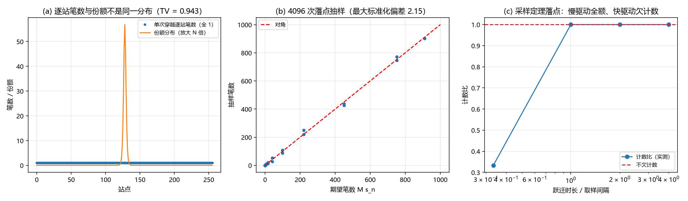

# 注记-缺陷动力学线 D-5 的接口轮：缺陷过轴一笔、与包络份额的配对形式、两个速度上界的层次（判据W1至W5）

- **日期**：2026-09-20 09:41:23
- **来源**：[[理论攻坚/缺陷动力学攻坚计划：σ 锁定方程的候选形式、与写入机制的接口与降级预案]] D-5；作者 2026-09-20 开工指令
- **脚本**：`验证脚本/minimal_verification_defect_dynamics_d5.py`
- **状态**：判据级（模型内）读数；接口口径已定，互补性形式改写一条
- **图**：见 §二 图 1
- **依据**：[[记录机制：碰撞即写入的算符形式、三维缺陷读数与弦的分层]] §2.2、§3.1、§7.1、§7.3（命题 12、13、16、17）；[[验证脚本/注记-缺陷动力学线 D-2 的最小验证：连续极限与色散（涨落缺口与孤子质量的分工、第 227 条质量口径的确认）]]；[[内部草稿/总结报告-份额的抽样口径：机制面七轮读数与收束]]

---

## 一、任务与模型

D-5 问的是一件很硬的事：缺陷每穿过一个格点写下几笔，这个笔数与包络模方（份额）是什么关系。若相等，双侧互补在这条线上就是定理；若不相等，得到的是一条限制量子化方式的负面结果。

模型沿用 D 线口径：$E = \sum_n[\tfrac12 k_b(u_{n+1}-u_n-1)^2 + K(1-\cos 2\pi u_n)]$，$k_b = 1$、$K = 0.005$、$N = 256$。移动 kink 取解析解 $u_n(t) = \frac{2}{\pi}\arctan\exp[\gamma(n-n_0-vt)]$，$\gamma = 2\pi\sqrt K/\sqrt{1-v^2}$。相位场以整圈为单位，指针转满一圈记一笔，故单站笔数等于相位增量的绕数。

份额模型取缺陷的平移零模，$\psi_n \propto \mathrm{sech}(\gamma(n-n_0))$，$s_n = \psi_n^2/\sum_m\psi_m^2$。取零模的理由是它是束缚谱的最低支，与缺陷的中心位置读数同源。

---

## 二、判据与读数

| 判据 | 内容 | 实测 | 期望 | 结果 |
| --- | --- | --- | --- | --- |
| W1 | 18 组（速度 6 档 $\times$ 宽度 3 档）上每站笔数对 1 的最大偏差 | $0$ | $\le 10^{-12}$ | 通过 |
| W2 | 单次穿越笔数分布（均匀）与份额分布的总变差距离 | $0.9432$ | $\ge 0.5$ | 通过（逐事件相等判负） |
| W3 | 4096 次落点抽样对 $Ms_n$ 的最大标准化偏差 | $2.148$ | $\le 3$ | 通过 |
| W3 | 抽样频次分布对份额的总变差距离 | $0.0198$ | $\le 0.05$ | 通过 |
| W4 | 跃迁时长 4、2、1 个取样间隔的计数比 | $1.000$ 三档 | 全为 1 | 通过 |
| W4 | 跃迁时长 $1/3$ 个间隔的计数比 | $0.3333$ | $0.3333$ | 通过 |
| W5 | 色散带上界 $v_{\max}(0.0900)$ 对采样上界 $1$ | $0.95601$ | $<1$ | 通过 |
| W5 | $m\to0$ 时两上界之差 | $5\times10^{-9}$ | $\le 10^{-6}$ | 通过 |

---

## 三、读数与含义

**其一，笔数是拓扑量。** 缺陷每穿过一格恰写一笔（偏差 $0$），速度六档与宽度三档都改不了它。它数的是相位绕数增量，落在粒性侧计数。

**其二，逐事件相等不成立。** 单次穿越的逐站笔数分布是均匀的（每个站都被穿过一次），份额分布是局域的（$\mathrm{sech}^2$ 型），两者的总变差距离 $0.9432$。把笔数直接读成份额，在这一层判负。

**其三，正确的配对是抽样。** 按份额抽取 4096 个落点，每站笔数对期望的最大标准化偏差 $2.148$（$3\sigma$ 内），频次分布对份额的总变差 $0.0198$。故成立的形式是「份额 = 抽样落点分布」，它与笔数通过抽样相联系。

**其四，采样定理的落点与记录机制线对上。** 跃迁时长达到或超过取样间隔 $t_P$ 时全额计数（三档比值为 $1.000$）；缩短到三分之一间隔时计数比 $0.3333$（$12/36$），与[[记录机制：碰撞即写入的算符形式、三维缺陷读数与弦的分层|记录机制]]命题 17 的读数一致。两线接口的第一个闭合读数由此建立，且本线未重测该读数，只做口径对照。

**其五，两个速度上界有层次。** 采样给出 $1$ 格每 $t_P$，色散带边给出 $v_{\max}(0.0900) = 0.95601$，后者更紧；质量趋于零时两界重合。采样上界是粗界，色散上界继承质量，二者不是两条独立约束。

**互补性的定理形式（本轮结论）**：份额 = 抽样落点分布，笔数 = 相位绕数增量。二者靠抽样联系，不靠逐事件相等。

---

## 四、严格程度与边界声明

| 结论 | 严格程度 |
| --- | --- |
| 单次穿越每站一笔（与速度、宽度无关） | 解析（相位绕数）加数值（18 组，偏差 $0$） |
| 逐站笔数分布与份额分布的总变差 $0.9432$ | 模型内读数（份额取平移零模剖面） |
| 抽样落点分布与份额一致（$2.148\sigma$） | 统计（4096 次，固定种子） |
| 计数比三档为 1、快驱动 $0.3333$ | 模型内（离散取样），与命题 17 读数一致 |
| 两个上界的层次（$0.95601 < 1$，$m\to0$ 重合） | 解析闭式加数值 |

**本注记验证**：缺陷过轴一笔的计数口径；笔数分布与份额分布的关系；与写入机制线取样口径的一致性；两个速度上界的层次。

**本注记不验证**：三维与完全量子化（D-7）；写入算符的算符实现（属记录机制线）；缺陷的生成与湮灭（属 C1 线）；份额剖面从动力学导出的严格性（本轮取平移零模，属模型选择）。

---

## 五、过程记录

本轮无判负。一处口径需要写明：份额剖面取平移零模 $\mathrm{sech}$ 型，属最低束缚支的选择；换成其它局域剖面只改变 W2 的总变差数值（$0.9432$ 会随之变化），均匀分布对局域分布的定性结论不变。若后续从动力学导出份额剖面，W2 的数值需按新剖面重算。

---

## 六、登记联动

- [[验证脚本/README.md]] 第 255 条。
- [[内部草稿/开放问题总览：元相子理论待解决问题清单]] P1-11 条目补 D-5 读数。
- [[理论攻坚/缺陷动力学攻坚计划：σ 锁定方程的候选形式、与写入机制的接口与降级预案]] D-5 状态改为已交付；D-6 的入口（缺陷密度与写入率）由此具备口径。
