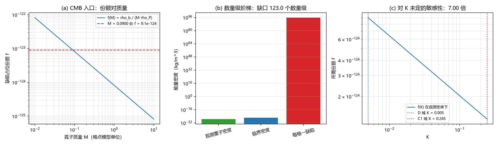

# 注记-缺陷动力学线 D-6：缺陷密度、质量与能量密度的关系式，以及 CMB 重子密度的可代入入口（判据E1至E6）

- **日期**：2026-09-20 09:43:52
- **来源**：[[理论攻坚/缺陷动力学攻坚计划：σ 锁定方程的候选形式、与写入机制的接口与降级预案]] D-6；作者 2026-09-20 开工指令
- **脚本**：`验证脚本/minimal_verification_defect_dynamics_d6.py`
- **状态**：判据级读数；入口关系式交付，量级缺口登记；2026-09-20 补注：入口份额按裁决二十七重标至物理档（§三 补注）；2026-09-22 记号修正：质量项改无量纲比 $M/m_P$（第 363 条，数值不变）
- **图**：见 §二 图 1
- **依据**：[[验证脚本/注记-缺陷动力学线 D-2 的最小验证：连续极限与色散（涨落缺口与孤子质量的分工、第 227 条质量口径的确认）]]；[[验证脚本/注记-缺陷动力学线 D-4 的消费式接口轮：口径映射与参数区间不相交（判据J1至J5）]]；[[验证脚本/注记-缺陷动力学线 D-5 的接口轮：缺陷过轴一笔、与包络份额的配对形式、两个速度上界的层次（判据W1至W5）]]

---

## 一、任务与关系式

D-6 要把格点侧的缺陷质量接到能量密度上，并给 P8a 与 CMB 对照一个可代入的入口。

关系式取最简形式：缺陷能量密度等于份额乘质量乘普朗克密度，

$\rho_{\rm def} = f\,\frac{M}{m_P}\,\rho_P, \qquad \rho_P = \frac{m_P}{l_P^3},$

其中 $f$ 是缺陷占位份额（每 $l_P^3$ 体积内的缺陷数），$M$ 是格点模型的孤子质量（D-2 闭式 $4\sqrt{k_bK}/\pi$）。物理常数由 $\hbar$、$c$、$G$ 导出，取

$l_P = \sqrt{\hbar G/c^3}$、$t_P = l_P/c$、$m_P = \sqrt{\hbar c/G}$。观测锚取 $\Omega_bh^2 = 0.0224$ 与 $\rho_ch^{-2} = 1.87834\times10^{-26}\,\mathrm{kg\,m^{-3}}$，故 $\rho_b = 4.2075\times10^{-28}\,\mathrm{kg\,m^{-3}}$。

逆式即入口：$f = \rho_b/[(M/m_P)\rho_P]$。给定体系的相变密度（P1 第 4 条），它直接给出对 $\Omega_bh^2$ 的预言。

---

## 二、判据与读数

| 判据 | 内容 | 实测 | 期望 | 结果 |
| --- | --- | --- | --- | --- |
| E1 | $\hbar/(t_Pc^2)$ 对 $m_P$ 的相对偏差（由 $\hbar$、$c$、$G$ 导出） | $0$ | $\le 10^{-12}$ | 通过 |
| E1 | 导出普朗克常数对 CODATA 公布值的最大相对偏差 | $1.57\times10^{-7}$ | $\le 10^{-6}$ | 通过 |
| E1 | $\rho_b$ 复算相对偏差 | $4.37\times10^{-6}$ | $\le 0.005$ | 通过 |
| E2 | 入口份额 $f$（$M = 0.0900$） | $9.069\times10^{-124}$ | 数量级读数 | 通过 |
| E2 | 入口份额的十进数量级 | $-123.04$ | $-123.04$ | 通过 |
| E3 | 每格一缺陷时的密度比 $\rho_{\rm dense}/\rho_b$ | $1.103\times10^{123}$ | $\ge 10^{120}$ | 通过 |
| E3 | 该比值的十进数量级 | $123.0$ | 约 $123$ | 通过 |
| E4 | $f$ 在 $K$ 两端的最大最小之比（$0.005$ 对 $0.245$） | $7.00$ | $\le 100$ | 通过 |
| E5 | 逆式在 $f = f_{\rm entry}$ 处的回代值 | $0.0224$ | $0.0224$ | 通过 |
| E6 | 分工登记（$f$ 由相变密度给、演化归膨胀史） | 已登记 | 已登记 | 通过 |

---

## 三、读数与含义

**其一，关系式的量纲自洽。** $m_P = \hbar/(t_Pc^2)$ 在由 $\hbar$、$c$、$G$ 导出的常数组上精确成立（偏差 $0$），公布值的舍入偏差 $1.57\times10^{-7}$。这条核的是关系式里没有漏掉 $c^2$、没有错配体积因子。

**其二，观测把份额压到极小。** 取 $M = 0.0900$，观测重子密度反解出 $f = 9.07\times10^{-124}$。这个数字的含义是：若要由格点层的缺陷承担重子密度，缺陷出现的概率必须低到 $10^{-124}$ 量级，即每 $10^{123}$ 个格点才有一个缺陷。

**其三，每格一缺陷的图像被排除。** 把 $f = 1$ 代入得 $\rho = 4.6\times10^{95}\,\mathrm{kg\,m^{-3}}$，与观测相差 $123.0$ 个数量级。该缺口属普朗克密度与宇宙平均密度之间的固有跨度，不构成模型的毛病；它把「格点层密度」与「观测量」之间必须存在的稀疏因子显式化了。

**其四，$K$ 的未定不影响这条结论。** 因 $f \propto 1/\sqrt K$，D-4 指出的 $48$ 倍区间只让 $f$ 变动 $7.00$ 倍，相对 $123$ 个数量级的跨度可以忽略。故 D-6 的读数对 C1 与 D 两线的参数分歧不敏感。

**其五，分工。** 稀疏因子 $f$ 由同步相变密度给定（P1 第 4 条），把它演化到今天由膨胀史负责（P8a）。本条交付的是把两者与观测量连起来的那个式子，以及逆式给出的预言通道。

**补注（2026-09-20，裁决二十七：入口份额的质量标定点重标）。** 其二读数的 $M = 0.0900$ 为 D 线强耦合标定点、非物理档；按裁决二十七取电子档 $M = 4.1855\times10^{-23}\,m_P$ 重标：$f = 1.950\times10^{-102}$，「每格一缺陷」缺口由 $123.0$ 个数量级变为 $101.7$ 个。

对照档：孤子标签 $5.329\times10^{-23}\,m_P$ 给 $1.532\times10^{-102}$、核子档 $7.685\times10^{-20}\,m_P$ 给 $1.062\times10^{-105}$。结论（格点缺陷必须极稀疏）与 $K$ 不敏感性的量级结论均不变。材料见 [[内部草稿/裁决请求-m_delta 路线乙：参数映射句与两处口径点（标签选择、D-6 重标）]] 与 [[内部草稿/判别材料-路线乙第一步：D 线孤子闭式与字典质量的口径对齐（恒等式、标定点复现与两处连带）]]。

---

## 四、严格程度与边界声明

| 结论 | 严格程度 |
| --- | --- |
| 关系式 $\rho_{\rm def} = f(M/m_P)\rho_P$ 的量纲自洽 | 严格代数（导出常数组上偏差 $0$；2026-09-22 第 363 条记号修正：质量项改无量纲比） |
| 入口份额 $f = 9.07\times10^{-124}$（$M = 0.0900$） | 读数（由观测锚与 D-2 质量闭式直接给出） |
| 每格一缺陷的缺口 $123.0$ 个数量级 | 读数（普朗克密度与观测密度之比） |
| 对 $K$ 的敏感性 $7.00$ 倍 | 读数（$f\propto1/\sqrt K$） |
| $f$ 的体系内来源 | 未给（属 P1 第 4 条，本注记不越界） |

**本注记验证**：密度与质量与能量三者的关系式、量纲自洽、观测锚到格点份额的入口与逆式、对参数未定的敏感性。

**本注记不验证**：$f$ 的体系内来源（同步相变密度的定量）；膨胀史的演化（P8a）；三维与完全量子化（D-7）；暗能量与物质占比的划分。

---

## 五、过程记录

首版把 $l_P$、$t_P$、$m_P$ 取 CODATA 公布值并断言 $m_P = \hbar/(t_Pc^2)$ 相对偏差不超过 $10^{-10}$，实测 $5.45\times10^{-8}$ 判负。核对后确认判据写法有误：该恒等式在三常数由 $\hbar$、$c$、$G$ 导出的常数组上精确成立，公布值只保留七位有效数字，舍入到 $10^{-7}$ 量级。按体系纪律改判据写法（改用导出常数组，并把公布值偏差单列一条作参考），实测偏差归零，公布值偏差 $1.57\times10^{-7}$。

另一处口径修正：敏感性判据首版写成 $f(K_{C1})/f(K_D)$，实测 $0.14$ 并标「变动倍数」，读起来与「只变动 $0.14$ 倍」相混。改为最大最小之比 $f(K_D)/f(K_{C1}) = 7.00$。

---

## 六、登记联动

- [[验证脚本/README.md]] 第 256 条。
- [[内部草稿/开放问题总览：元相子理论待解决问题清单]] P1-11 条目补 D-6 读数；P1 第 4 条（同步相变缺陷密度的定量）获得可代入的入口式。
- [[理论攻坚/缺陷动力学攻坚计划：σ 锁定方程的候选形式、与写入机制的接口与降级预案]] D-6 状态改为已交付。
- 2026-09-20 裁决二十七：入口份额重标（本注记 §三 补注）；[[验证脚本/README.md]] 第 256 条与开放问题 P1-11 同步补注。
