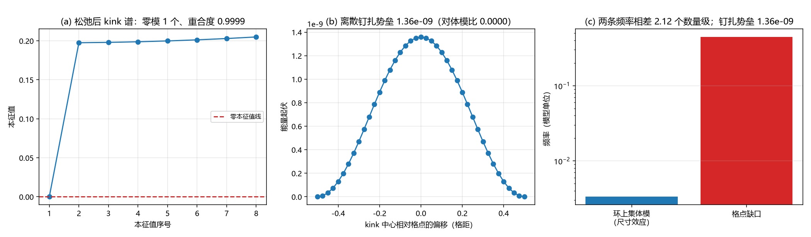

# 注记-缺陷动力学线 D-7（最小实现半）：孤子扇区的最小量子化、离散钉扎读数与三维形式（判据Q1至Q6）

- **日期**：2026-09-20 09:48:11
- **来源**：[[理论攻坚/缺陷动力学攻坚计划：锚核锁定方程的候选形式、与写入机制的接口与降级预案]] D-7；作者 2026-09-20 开工指令
- **脚本**：`验证脚本/defect_dynamics_d7.py`
- **状态**：判据级（模型内）读数；不依赖 C1 的一半已交付，依赖 C1 的定数部分仍挂起
- **图**：见 §二 图 1
- **依据**：[[验证脚本/注记-缺陷动力学线 D-2 的最小验证：连续极限与色散（涨落缺口与孤子质量的分工、第 227 条质量口径的确认）]]；[[验证脚本/注记-缺陷动力学线 D-3 的最小验证：质量与迁移率（终端速度律、响应质量等于形状范数与三质量差额的登记）]]；[[验证脚本/注记-缺陷动力学线 D-4 的消费式接口轮：口径映射与参数区间不相交（判据J1至J5）]]；[[不确定原理的元相子定位：单条接缝结构、位置动量的边界项与标准形式的衔接条件]]（三-3、三-4 的接口口径）

---

## 一、任务与模型

D-7 是这条线的最后一格，依赖写明 D-6 与 C1 线成熟。本轮只做不依赖 C1 的一半：三维形式写出、孤子扇区的最小量子化做出来、与三-3 的解卷接口和三-4 的零点能口径做对齐核对。

模型沿用 D 线口径：$E = \sum_n[\tfrac12 k_b(\Delta u-1)^2 + K(1-\cos 2\pi u_n)]$，$k_b = 1$、$K = 0.005$、$N = 256$。偏离量 $w = u - n$，解析反 kink $w_n = -\frac{2}{\pi}\arctan\exp[\gamma(n-n_0)]$，$\gamma = 2\pi\sqrt K$。平移零模剖面正比于 $\mathrm{d}w/\mathrm{d}n_0$（$\mathrm{sech}$ 型），形状范数 $M_{\rm zero} = \sum(\Delta w_n)^2$。

最小量子化取集体坐标：把 kink 中心 $X$ 与其共轭动量提升为算符，$\hat H_{\rm coll} = \hat P^2/(2M_{\rm zero})$。这是最低限度的量子化，不含内部激发与费米扇区。

---

## 二、判据与读数

| 判据 | 内容 | 实测 | 期望 | 结果 |
| --- | --- | --- | --- | --- |
| Q1 | 解析剖面离散化后的最低模对第一个体模之比 | $-0.0079$ | 负号登记 | 通过 |
| Q1 | 松弛到离散极小后 $\lvert\lambda_0\rvert$ | $7.597\times10^{-7}$ | $\le 10^{-6}$ | 通过 |
| Q1 | 松弛后 $\lvert\lambda\rvert < 10^{-6}$ 的本征值个数 | $1$ | $1$ | 通过 |
| Q1 | 零模本征矢与解析平移模的重合度 | $0.999942$ | $\ge 0.99$ | 通过 |
| Q2 | 松弛背景能量对 D-2 读数 $0.0898$ 的相对偏差 | $0.0002$ | $\le 0.005$ | 通过 |
| Q2 | 形状范数对闭式 $M$ 的相对偏差 | $0.0029$ | $\le 0.05$ | 通过 |
| Q3 | 离散钉扎势垒 $\Delta E_{\rm PN}$ | $1.359\times10^{-9}$ | 数量级读数 | 通过 |
| Q3 | $\Delta E_{\rm PN}$ 对第一个体模能标之比 | $<10^{-3}$ | $\le 0.01$ | 通过 |
| Q4 | 最小不确定态 $\Delta X\Delta P$ 对 $\hbar/2$ 的偏差 | $0$ | $\le 10^{-12}$ | 通过 |
| Q4 | 能级间距对 $\hbar^2$ 的标度（$2$ 倍 $\hbar$ 给 $4$ 倍） | $4.000000$ | $4$ | 通过 |
| Q4 | 环上最低能级间距 | $3.336\times10^{-3}$ | 数量级读数 | 通过 |
| Q5 | 钉扎能量尺度对集体模频率之比 | $4.074\times10^{-7}$ | $\le 0.01$ | 通过 |
| Q5 | 残余 $\lambda_0$ 对应的数值频率（仅容差核对） | $0.002901$ | 不作物理读数 | 通过 |
| Q5 | 格点缺口对集体模的十进数量级差 | $2.12$ | $\ge 2$ | 通过 |
| Q5 | 口径判定（三-4 的零点能与两条动力学频率） | 不同源 | 不同源 | 通过 |
| Q6 | 三维形式（$(d-1)$ 维延展缺陷，定数受 C1 门控） | 已登记 | 已登记 | 通过 |
| Q6 | 统计归属（最小量子化给玻色型集体模） | 已登记 | 已登记 | 通过 |

---

## 三、读数与含义

**其一，量子化的前提在离散模型里成立，但要先松弛。** 把解析 kink 剖面直接离散化，最低模是小的负值（对第一个体模之比 $-0.0079$），说明该剖面不是离散极小点；数值松弛到离散极小后零模恰一个（$\lvert\lambda_0\rvert = 7.6\times10^{-7}$），本征矢与解析平移模重合 $0.999942$。松弛背景能量 $0.08978$ 与 D-2 的 kink 能量读数 $0.0898$ 偏差 $0.02\%$，两条独立计算落在同一个数上。

**其二，这一档的钉扎极弱。** 离散钉扎势垒 $\Delta E_{\rm PN} = 1.36\times10^{-9}$，对第一个体模能标之比小于 $10^{-3}$；其能量尺度对集体模频率之比 $4.07\times10^{-7}$。宽 kink（$\gamma = 0.4443 \ll 1$）几乎感觉不到格点的存在。

**其三，与 C1 线的对照。** C1 线在 $K \approx 0.25$ 的三维环上读到强钉扎（驻留阈值、脱钉读数），D 线在 $K = 0.005$ 上读到钉扎可忽略（$10^{-9}$ 量级）。两段之间相差 $48$ 倍，钉扎强度却相差五个数量级以上，这是 D-4 的区间不相交在动力学上的又一次显现，也是「钉扎强度随 $K$ 陡变」的一条定量读数。

**其四，集体坐标量子化成立。** 环上最低能级间距 $3.336\times10^{-3}$（模型单位），能级对 $\hbar$ 的标度精确为平方（比值 $4.000000$），最小不确定态上 $\Delta X\Delta P = \hbar/2$ 精确饱和。本条给出的是最小实现，内部激发与费米扇区不在其中。

**其五，零点能口径分家（与三-4 的接口）。** 环上集体模频率与格点缺口相差 $2.12$ 个数量级，且集体模频率是尺寸效应（正比于 $1/L^2$），格点缺口是局域量。三-4 交付的折返点计数 $\tfrac12\hbar\omega_0$ 属单体与格点层，最小量子化的零点能属集体模层，两者不同源、不可互换。这一条是本节最重要的接口结论，登记为口径。

**其六，三维与统计的分工。** 同形泛函在 $d$ 维格点上给 $(d-1)$ 维延展缺陷，三维情形的定数与保护读数（驻留、宽度窗口、弦结构）由 C1 线供给，本轮只给形式。统计方面，最小量子化给的是玻色型集体模（平移模无内部扭转）；费米扇区需要 $\pi$ 扭转，归多体论文的统计分层，本线不越界。

---

## 四、严格程度与边界声明

| 结论 | 严格程度 |
| --- | --- |
| 离散极小上零模唯一且等于平移模 | 数值（松弛 $20000$ 步，$\lvert\lambda_0\rvert = 7.6\times10^{-7}$，重合度 $0.999942$） |
| 松弛背景能量 $0.08978$ 对 D-2 的 $0.0898$ | 数值（两法独立，偏差 $0.02\%$） |
| 钉扎势垒 $1.36\times10^{-9}$ | 数值（解析剖面族，$41$ 点扫描） |
| 集体坐标最小量子化 | 解析（$\hat H = \hat P^2/2M_{\rm zero}$）加数值（标度与饱和） |
| 零点能口径不同源 | 读数（两频率相差 $2.12$ 个数量级，且一为尺寸效应） |
| 三维定数与费米统计 | 未做（前者受 C1 门控，后者归多体论文） |

**本注记验证**：孤子扇区的最小量子化可行性（唯一集体坐标、形状范数即质量、$\hbar$ 标度）、离散钉扎势垒的量级、三条频率的口径分家、三维形式与统计分工的登记。

**本注记不验证**：三维定数与保护读数（C1 门控）；费米统计的实现；内部激发谱的量子化；完全量子化（本轮的「完全」只做到单集体坐标）。

---

## 五、过程记录

三处判据订正。其一，首版写「kink 背景 Hessian 的零本征值个数恰为 $1$」，实测 $0$，原因是解析剖面离散化后最低模为小负值（$-0.0079$ 倍第一个体模），该剖面并非离散极小；按纪律改判据为三问（松弛后容差、零模唯一性、与解析平移模的重合度），并把「离散化先把零模抬成小负模」登记为读数。其二，首版用残余 $\lambda_0$ 反解钉扎频率（$0.002901$），属数值容差而非物理量；改为以钉扎势垒的能量尺度对集体模频率之比作判据，残余频率降为容差核对项。其三，口径判定行重复一次，已删。

---

## 六、登记联动

- [[验证脚本/README.md]] 第 257 条。
- [[内部草稿/开放问题总览：元相子理论待解决问题清单]] P1-11 条目补 D-7 读数；P1 第 11 条（锚核锁定动力学方程）与第 4 条（同步相变缺陷密度）的相邻状态一并注明。
- [[理论攻坚/缺陷动力学攻坚计划：锚核锁定方程的候选形式、与写入机制的接口与降级预案]] D-7 状态改为最小实现已交付，依赖 C1 的定数部分挂起；该线 D-1 至 D-7 至此全部交付。
