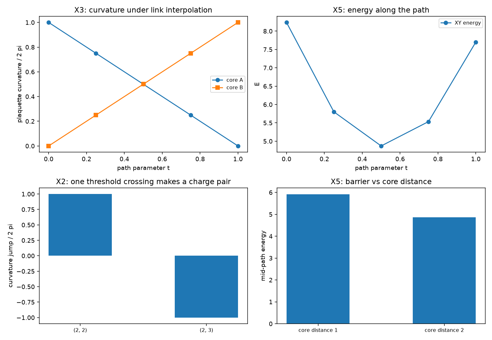

# 注记-缺陷动力学耦合轮的最小验证：站点层拓扑阻塞、阈值穿越等于电荷对生成、棱层插值与半荷分裂

- **日期**：2026-09-19
- **对应脚本**：`验证脚本/defect_motion_topology.py`（判据 X1 至 X6 共 7 项，7/7 通过；确定性，种子 20260919；运行约 0.0 秒；图存 `images/defect_motion_topology.png`，见 §一 图 1）
- **依据**：[[验证脚本/注记-标架场曲率轮的最小验证：面元环量、离散 Stokes 与半整数绕数的障碍]]（第 134 条，曲率与整数量子化）；[[验证脚本/注记-弦的可观测性轮的最小验证：切割线不可观测、墙只活在棱层]]（第 136 条，棱层读数）；[[验证脚本/注记-写入算符三维推广轮的最小验证：逐站点直和、底噪按站点数标度、绕数缺陷的整周期滑移]]（第 132 条，写入时刻平移）；[[内部草稿/开放问题总览：元相子理论待解决问题清单]] P3-12
- **状态**：判据 7/7 通过。核心读数：$35$ 次阈值穿越全部符合同一规则（无关面元变化 $1.8\times10^{-15}$，受影响面元的跳变为 $2\pi$ 的整数倍，量子化偏离 $1.4\times10^{-16}$，总曲率守恒到 $1.8\times10^{-15}$）；单次穿越给两侧面元 $+6.2832$ 与 $-6.2832$；棱层插值下 $F_A(t) = 2\pi(1-t)$ 与 $F_B(t) = 2\pi t$（最大偏离 $0$），中点两格各 $3.141593$；中点绕核回路棱差之和 $3.141593$；能量剖面起点 $8.2368$、中点 $4.8708$、终点 $7.7020$。

---

## 一、判据与结果

| 判据 | 内容 | 通过条件 | 实测 |
|---|---|---|---|
| X1 | 未受影响面元变化为零且受影响者取 $2\pi$ 的整数倍 | 偏差 $< 10^{-12}$ | $1.8\times10^{-15}$；$1.4\times10^{-16}$（$35$ 次穿越） |
| X1 附 | 总曲率守恒 | 偏差 $< 10^{-12}$ | $1.8\times10^{-15}$ |
| X2 | 单次穿越只动两侧面元且跳变 $\mp 2\pi$ | 两个面元、跳变 $2\pi$ | $+6.2832$ 与 $-6.2832$ |
| X3 | 棱层插值给连续移动 | 偏离 $< 10^{-12}$ | $0$；中点各 $3.141593$ |
| X4 | 半荷态不可由站点场实现 | 回路和为 $\pi$ | $3.141593$ |
| X5 | 能量剖面读数 | 见 §三 | 起点 $8.2368$；中点 $4.8708$；终点 $7.7020$ |
| X6 | 口径登记 | 见 §三 | 登记 |

图注：左上为棱层插值下两个核面元的曲率（$2\pi(1-t)$ 与 $2\pi t$，中点各 $\pi$）；右上为路径上的能量剖面（中点低于两端）；左下为单次阈值穿越造成的两个面元曲率跳变（$+2\pi$ 与 $-2\pi$）；右下为两档核距的中点能量读数。

## 二、模型设定

格点取 $7 \times 7$ 站点（开放边界，$36$ 个面元），站点方向场取整数绕数构型（$w = 1$，核在指定面元中心），棱差取相邻站点值的最小角差，面元曲率取沿面元一周的棱差之和。

两类操作：站点层形变（对站点值加随机扰动场，两档幅度各 $20$ 组）与棱层插值（在两组棱差之间线性插值）。能量取棱差型的格点 XY 形式 $E = \sum_{\rm links}(1 - \cos d)$。

## 三、读数的意义

**站点层：连续形变不能移动电荷。** $35$ 次阈值穿越全部符合同一条规则：未受影响的面元曲率严格不变（$1.8\times10^{-15}$），受影响面元的跳变取 $2\pi$ 的整数倍（量子化偏离 $1.4\times10^{-16}$），全场总曲率守恒（$1.8\times10^{-15}$）。曲率只在某条棱差的代表值跨过阈值时改变，那一跳就是电荷对的生成或湮灭（单次穿越给两侧 $+6.2832$ 与 $-6.2832$）。

**棱层：插值给出连续移动。** 在两组棱差之间线性插值时，两个核面元的曲率分别为 $2\pi(1-t)$ 与 $2\pi t$（最大偏离 $0$），中点两格各 $\pi$，即半荷分裂。移动在棱层是连续的，代价是中间态不再由单值站点场实现（绕核回路棱差之和为 $\pi$，实现条件要求 $0$），须带一条弦。

**能量读数与待定项。** 棱差型的 XY 能量在中点更低（$4.8708$ 对起点 $8.2368$ 与终点 $7.7020$），即该泛函不惩罚分裂态；端点的高能来自核附近的大棱差。若缺陷运动真有代价，代价须来自额外项（弦的自身能或拓扑项），这一项尚未定出，登记为待定。

**双侧更正（2026-09-19，作者指出）。** 以上把站点层与棱层分读，容易读成棱层才是运动的真身，这是单侧写法。运动的正确读法是双侧协同：粒性侧给离散，电荷的移动是一次整数跃迁；波性侧给连续，方向差与写入时刻在过程中连续流动，中间态的半荷铺展就是这股连续流。两侧缺一不可，只有连续流则位置没有定义，只有离散跳则说不清为什么能跳。下一轮（运动的双侧读数）把这条读成判据。
**三条口径。** 其一，缺陷运动要求棱自由度可用，这与本体层重建的链接型写入（排布二）语义同向，站点值唯一决定的写法做不到连续移动。其二，与记录机制的关系是：运动表现为写入时刻的重排（第 132 条的标架平移加本轮的路径族），本体上仍缺动力学方程。其三，能垒的有无依赖所取泛函，本轮只报读数。

## 四、过程记录

判据订正两处。其一，X2 首版把穿越量写成基线值加 $\pi$ 再偏移，两个构型落在同一分支上，跳变只有 $0.02$；改为把代表值直接推到阈值两侧（$\pi \mp 10^{-6}$）后给出 $\mp 2\pi$。其二，X5 首版预期能量在中点取极大，实测中点更低，判据改为按读数表述，并把能垒依赖泛函登记为口径。

效率记录：脚本约 $0.0$ 秒（纯格点代数），无字体问题。
