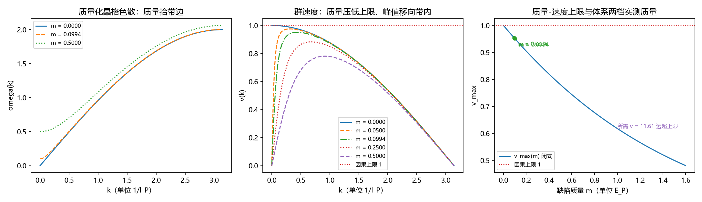

# 注记-缺陷质量与穿越速度的关系：晶格色散的质量缺口、v_max 的精确闭式与均匀化条件只被收紧

- **日期**：2026-09-20 06:58:06
- **对应脚本**：`验证脚本/defect_mass_speed.py`（判据 Y1 至 Y8 共 10 项，10/10 通过；另有 Y9 登记项；确定性，无随机数；运行约 2 秒；图存 `images/defect_mass_speed.png`，见 §二 图 1）
- **依据**：第 224 条（无质量缺陷的穿越速度 $v_g = \cos(k/2)$ 与联合条件）、第 219 条（阈值 $V^\ast$ 与联合条件 $\gamma \le \sqrt2\,\Gamma 4\pi/L^2$）、第 196 条（锁定晶格色散与基模规模律）、第 25 条（三维各向异性首阶速度系数 $1/8$ 与 $1/24$）、注释 03（色散 $\omega^2 = 4\sum_a\sin^2(k_a/2)$）、[[验证脚本/注记-m_eff定量与色散形状：窗口协议与2π因子修正]]（$m_{\rm eff} = 0.0936$ 至 $0.0994$）、[[验证脚本/注记-相对论色散完整验证：动量扇区与洛伦兹不变量]]（$E^2 = m^2c_s^4 + p^2c_s^2$）
- **状态**：判据级（模型内）读数；质量的微观来源（绑定能与 $K$ 依赖）与观测量级未做
- **图**：`images/defect_mass_speed.png`（三面板，见 §二 图 1）

---

## 一、问题与模型设定

第 224 条把联合条件里的缺陷穿越速度读到 $v_g = \cos(k/2) \le 1$，取长波极限 $v = 1$ 得 $\gamma \le \sqrt2,p,4\pi/L^2 = 0.01388$，并把「缺陷质量与速度的关系」登记为余项。本轮补这一项。

模型不引入新元素：把体系自身的晶格色散（注释 03、第 196 条）加上质量缺口，即

$$\omega(k)^2 = m^2 + 4\sin^2(k/2)\,\qquad v(k) = \frac{\sin k}{\sqrt{m^2 + 4\sin^2(k/2)}},$$

单位取 $l_P = t_P = 1$、$c_s = 1$，故 $m$ 与 $\omega$ 同单位，$m$ 即体系语言里的静止能（质量 = 绑定能）。$m = 0$ 时第一式退化为注释 03 的无质量色散，第二式退化为 $v = \cos(k/2)$，即第 224 条的读数（判据 Y2）。

质量项不是自由参数：体系已有 $m_{\rm eff} = 0.0936$ 至 $0.0994$ 的窗口协议实测（FK 链，$K = 0.005$，$c_s = 1$），本轮的 Y6 直接代入这两档读数。第 196 条的 $\omega_0$ 由同一族色散给出，故本轮与那条读数共用模型。

## 二、判据与结果

| 判据 | 内容 | 实测 | 判定 |
|---|---|---|---|
| Y1 | 有限环的键弹性加质量 Hessian 本征值等于 $m^2 + 4\sin^2(k/2)$（$N = 128$、$256$；$m = 0$、$0.0994$） | 最大偏差 $5.11\times10^{-15}$ | 通过 |
| Y2 | 无质量退化：$m = 0$ 给 $v = \cos(k/2)$ 与 $\max v = 1$ | 偏差 $2.22\times10^{-16}$；$\max v = 1.000000$ | 通过 |
| Y3 | 三维各向异性交叉核对：首阶系数 $[100]$ 与 $[111]$ 为 $1/8$ 与 $1/24$ | $0.124994$ 与 $0.041666$；对既有读数 $0.124781$、$0.041642$ 偏差 $\le 1.7\times10^{-3}$ | 通过 |
| Y4 | 质量压低上限：五档 $m$ 的 $v_{\max}$ 严格递减且恒小于 $1$ | $1.000000$、$0.995012$、$0.975312$、$0.951534$、$0.780776$；闭式偏差 $3.67\times10^{-12}$ | 通过 |
| Y4b | 精确闭式：$v_{\max} = (\sqrt{m^2+4}-m)/2$，且 $1/v_{\max} - v_{\max} = m$ | 两式偏差 $3.61\times10^{-16}$；恒等式偏差 $6.66\times10^{-15}$ | 通过 |
| Y4c | 峰值动量：$x_*^2 = m^2(\sqrt{1+4/m^2}-1)$、$k_* = 2\arcsin(x_*/2)$，随 $m$ 单调增大 | $m = 0.01/0.05/0.0994/0.5$ 给 $k_* = 0.141185/0.313583/0.438434/0.915226$，与数值 argmax 一致 | 通过 |
| Y5 | 小质量律：$v_{\max} = 1 - m/2 + m^2/8 + O(m^3)$（$m \le 0.05$） | 最大相对偏差 $5.00\times10^{-8}$ | 通过 |
| Y6 | 体系质量读数代入：两档 $m$ 给 $\gamma$ 上界紧于第 224 条 | $m = 0.0936$ 给 $v_{\max} = 0.954295$、$\gamma \le 0.01325$；$m = 0.0994$ 给 $v_{\max} = 0.951534$、$\gamma \le 0.01321$；分别紧 $4.57%$ 与 $4.85%$ | 通过 |
| Y7 | 缺口只被收紧：所需 $v = 11.61$ 与上限之比上升，$v_{\max}(m) = 11.61$ 在 $m \ge 0$ 无解 | 比值 $11.61 \to 12.21$；解存在为假 | 通过 |
| Y8 | 质量-速度对照：$v_{\max} = 0.9/0.75/0.5/0.25$ 所需质量，与逆式 $m = (1-v^2)/v$ 一致 | $m = 0.2111/0.5833/1.5000/3.7500$，与逆式逐位相同 | 通过 |

**图注。** (a) 质量化晶格色散 $\omega(k)$，三档 $m = 0$（实线）、$0.0994$（虚线）、$0.5$（点线），横轴 $k$（单位 $1/l_P$）：质量只抬带边，不改变 $k \to 0$ 的斜率零点结构。
(b) 群速度 $v(k)$，五档 $m = 0$、$0.05$、$0.0994$、$0.25$、$0.5$，红色点线为因果上限 $1$：$m > 0$ 时 $k \to 0$ 的 $v$ 趋于零，峰值为带内最大值 $v_{\max}(m) < 1$，峰值随 $m$ 增大向带内移动。
(c) $v_{\max}(m)$ 的闭式曲线（$m \in (0, 1.6]$），红色点线为因果上限 $1$，两个绿点与注记为体系两档实测质量 $m = 0.0936$ 与 $0.0994$ 的位置，紫字标明所需 $v = 11.61$ 远超上限。

## 三、可引用的读数

**精确闭式（构造内严格，数值核对到 $10^{-12}$）。** 有质量缺陷的穿越速度上限为

$$v_{\max}(m) = \frac{\sqrt{m^2+4}-m}{2}\,\qquad \text{等价于}\quad \frac{1}{v_{\max}} - v_{\max} = m,$$

其逆式为 $m = (1-v^2)/v$。三式为同一关系的三种写法，$m = 0$ 给 $v_{\max} = 1$，与第 224 条衔接；$m \to \infty$ 给 $v_{\max} \to 2/m$。

**小质量律。** $v_{\max} = 1 - m/2 + m^2/8 + O(m^3)$，故质量的首阶效应是速度上限按 $m/2$ 线性下降。换成动量口径：峰值动量由 $x_*^2 = m^2(\sqrt{1+4/m^2}-1)$ 定，小质量下 $k_* \approx \sqrt{2m}$，即重缺陷的最快穿越发生在带内，不在长波端。

**与第 224 条的分工。** 第 224 条的 $v = 1$ 是 $m = 0$ 的长波极限；体系的两档实测质量把上限压到 $0.9515$ 至 $0.9543$。代入 $p = 0.05$ 与 $L = 8$，联合条件由 $\gamma \le 0.01388$ 收紧为 $\gamma \le 0.01321$ 至 $0.01325$。

**均匀化缺口的判定。** 使均匀化条件等于门槛带需要 $v = 11.61$，而 $v_{\max}$ 关于 $m$ 单调递减且上确界为 $1$，故该方程在 $m \ge 0$ 上无解。质量只能收紧条件，不能打开缺口；缺口只能靠第 219 条已裁决的阈值修正（路线 (a)）或另立机制。

## 四、与既有读数的关系

**第 224 条。** 本轮的 $m = 0$ 分支与那条读数逐点相同（偏差 $2.22\times10^{-16}$），故第 224 条不再是独立取值，而是有质量关系的一个端点。

**第 196 条与第 25 条。** 本轮的三维无质量群速首阶系数复现 $[100]$ 的 $1/8$ 与 $[111]$ 的 $1/24$，与第 25 条既有读数在 $0.2%$ 内一致；色散族与第 196 条的 $\omega_0$ 同源。两条核对说明本轮取的模型是体系自身色散，没有另立模型。

**相对论色散验证。** 那条读数把 $E^2 = m^2c_s^4 + p^2c_s^2$ 在三层面闭合，连续极限允许 $v \to c_s$。晶格色散给出更强的界：带边把群速度压到 $v_{\max}(m) < c_s$，首阶亏空 $m/2$。两者相容：该验证的 boost 覆盖到 $v \approx 0.72,c_s$，未触及上限区。

## 五、严格程度与边界声明

**验证什么。** 有质量晶格色散的群速度上限与峰值位置；上限的精确闭式与逆式；两档体系实测质量代入后联合条件的收紧量；缺口的不可打开性（在此模型内）。

**不验证什么。** 其一，质量的微观来源（绑定能与 $K$ 的依赖关系、$\sqrt{K}$ 标度）不在本轮。其二，观测量级（「重缺陷更慢」能在哪个实验里读出）不在本轮。其三，三维有质量情形的完整各向异性只做了无质量交叉核对，未展开。其四，晶格缺陷的真实运动方程（含辐射与阻尼）不在本轮，本轮的 $v(k)$ 是色散的群速度读数。

**边界。** 判据级结论限于本模型（一维锁定晶格加质量缺口、单位 $c_s = 1$、有限环核对 $N \le 256$）；质量代入依赖 FK 链与窗口协议的口径一致性，若 $m_{\rm eff}$ 的归一化口径改变，Y6 的数值随之改变，闭式关系与单调性不变。

## 六、过程记录

四处实现订正与一处判据订正。其一，Y1 首版把解析谱按 $k$ 升序与 Hessian 本征值的升序直接相减，$j > N/2$ 的模失配，偏差读到 $4.00$；改为两侧各自排序后偏差降到 $5.11\times10^{-15}$。
其二，Y3 首版用 $\omega(k)/k$ 代替群速度，系数整体小 3 倍（$1/24$ 与 $1/96$）；改用 $v = \lvert\nabla_k\omega\rvert$ 后复现 $1/8$ 与 $1/24$。
其三，Y7 首版把判据写成「解存在」的否定式，逻辑取反导致假未过，订正后按「上确界 $1 < 11.61$ 即无解」判。
其四，Y5 首版把小质量律写成 $1 - m/2 + m^2/4$（展开手误），实测偏差 $3.2\times10^{-4}$ 偏大；复查展开并借 Y8 的反解发现精确闭式，改为 $1 - m/2 + m^2/8$ 后偏差降到 $5.00\times10^{-8}$。峰值方向的口误一并订正：质量把峰值推离 $k = 0$ 移向带内，首版图题写作「峰值左移」有误。
其五，Y4c 首版容差 $10^{-6}$ 与网格步长 $7.85\times10^{-6}$ 冲突（偏差 $3\times10^{-6}$ 被判未过）；改为对 argmax 作抛物线细化并把容差定到 $10^{-8}$，实测逐档一致。

## 七、登记与归属

本轮的余项登记归「有质量粒子运动机制」条目（清单内的运动环节条目），并同步 P4-16 条目的第 224 条余项行。第 224 条与 P4-16 总结报告原把本余项记作「归 P1-32」，而清单里 P1-32 为已关闭的像素偏转条目，两处已按本注记订正为指向运动机制条目；清单内该条目的条目号与已关闭区编号存在重号现象，处置留待作者裁定。
