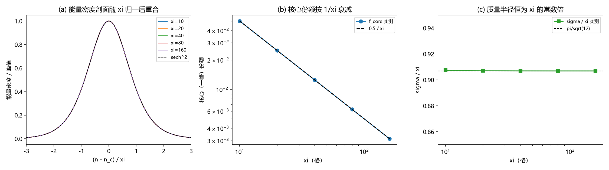

# 注记-缺陷质量落点轮：核区对包络的能量份额（判据第 627 号）

- **日期**：2026-10-15 03:41:35
- **层级**：验证脚本注记（判据级）
- **定位**：把"有质量费米子的质量能量落在核区还是包络"化为可读数的能量分配问题，在一维锁定势格点的静态扭结（台阶面）上执行。判据 M1 至 M7，全部通过。
- **关联**：[[wiki/康普顿波长]]、[[内部草稿/注记-台阶面宽度取约化康普顿波长：衰减读数对周期读数与系数口径]]、[[验证脚本/注记-P1-40物理档评估轮：定稿档宽度恒等式与PN势垒的指数压制（判据第622号）]]、[[wiki/八爪鱼]]。
- **状态**：判据级。模型内结果，物理档映射见第六节。
- **修订记录**：
  - **2026-10-15 初版落盘**（触发：作者就"质量归锚核还是包络"要求数值验证）

---

## 一、问题

锚核供质量、包络供宽度是体系的三层解剖口径。若质量的能量分布不同，引力源的形状随之不同（近场随源形状）。问题：质量能量落在核区（一格），还是摊在包络（宽度尺度）。

判据要把这件事读成一个数：缺陷（台阶面）的能量密度剖面，核区一格占多少，包络占多少。

## 二、模型设定

一维锁定势格点，格距 $a = 1$，梯度刚度 $k_b = 1$，相位场 $\theta_n$：

$$E = \sum_n\Big[\frac{k_b}{2}(\theta_{n+1}-\theta_n)^2 + K(1-\cos\theta_n)\Big].$$

静态扭结由 $k_b(\theta_{n+1}+\theta_{n-1}-2\theta_n) = K\sin\theta_n$ 给出（连续极限 $\theta'' = (K/k_b)\sin\theta$）。取剖面 $\theta(x) = 4\arctan(e^{x/\xi})$，$\xi = \sqrt{k_b/K}$ 为偏离场的衰减长度（关联长度）。

能量密度 $\varepsilon(x) = 4K\operatorname{sech}^2(x/\xi)$，总能量 $E_{\rm tot} = 8\sqrt{k_bK}$。据此，核区（一格，窗宽 1 格）份额 $f_{\rm core} = \tanh(1/(2\xi))$，包络（$\pm\xi$）份额 $f_{\rm env} = \tanh(1)$，质量半径 $\sigma/\xi = \pi/\sqrt{12}$。

另设 $\phi^4$ 双井口径作稳健性对照：$E = \sum[\frac{k_b}{2}(\Delta\phi)^2 + \frac{\lambda}{4}(\phi^2-1)^2]$，扭结 $\phi = \tanh(x/w)$，$w = \sqrt{2/\lambda}$，关联长度 $\xi_{\rm corr} = 1/\sqrt{2\lambda} = w/2$，密度 $\propto \operatorname{sech}^4$。

## 三、判据与理论期望

| 判据 | 内容 | 理论期望 |
|---|---|---|
| M1 | 冒烟：残差、单调、峰位、正性 | 残差趋于机器零（Newton 收敛） |
| M2 | 核心份额标度 | $f_{\rm core}\cdot\xi = 0.5$，log-log 斜率 $-1$ |
| M3 | 包络份额 | $f_{\rm env} = \tanh(1) = 0.761594$（离散期望 $\tanh((\xi+0.5)/\xi)$） |
| M4 | 质量半径 | $\sigma/\xi = \pi/\sqrt{12} = 0.906900$ |
| M5 | 反例（判据有牙） | 点质量与窄包络均使判据翻转 |
| M6 | 电子档外推 | $\xi = m_P/m_e$，$f_{\rm core} = 1/(2\xi) = 2.09\times10^{-23}$ |
| M7 | $\phi^4$ 口径稳健性 | $f_{\rm core}\cdot\xi_{\rm corr} = 0.375$，$\sigma/\xi_{\rm corr} = 1.1357$ |

容差从误差预算推导。$f_{\rm core}$ 的离散误差为 $O(a^2/\xi^2)$，$\tanh$ 展宽项在同一量级，两者合计不超过 $1\%$，容差取 $0.02 + 4/\xi^2$。$\sigma/\xi$ 与 $f_{\rm env}$ 的离散误差同为 $O(a^2/\xi^2)$，容差取 $0.01$ 与 $0.005$。$f_{\rm env}$ 另据一项半格边缘偏差：离散和覆盖宽 $2\xi+1$ 而连续窗宽 $2\xi$，故期望改写为 $\tanh((\xi+0.5)/\xi)$，改写后偏差降到 $1.3\times10^{-6}$。

## 四、结果

SG 口径扫描（$\xi = 10$ 至 $160$）：

| $\xi$ | $f_{\rm core}$ 实测 | $0.5/\xi$ 期望 | $f_{\rm env}$ 实测 | $\sigma/\xi$ |
|---|---|---|---|---|
| 10 | $4.9965\times10^{-2}$ | $5.0000\times10^{-2}$ | 0.781805 | 0.907430 |
| 20 | $2.4996\times10^{-2}$ | $2.5000\times10^{-2}$ | 0.771895 | 0.907032 |
| 40 | $1.2499\times10^{-2}$ | $1.2500\times10^{-2}$ | 0.766794 | 0.906933 |
| 80 | $6.2499\times10^{-3}$ | $6.2500\times10^{-3}$ | 0.764207 | 0.906908 |
| 160 | $3.1250\times10^{-3}$ | $3.1250\times10^{-3}$ | 0.762903 | 0.906902 |

$f_{\rm core}\cdot\xi$ 收敛到 $0.499999$，log-log 斜率 $-0.9998$（期望 $-1$，容差 $0.03$）。

电子档外推（$\xi = m_P/m_e = 2.389222\times10^{22}$ 格）：$f_{\rm core} = 2.0927\times10^{-23}$，质量半径 $\sigma = 2.1668\times10^{22}$ 格 $= 3.5021\times10^{-13}$ m。

反例：点质量 $f_{\rm core} = 1.0000$（期望 $0.0125$），包络窄 50 倍者 $f_{\rm core}\cdot\xi = 24.71$，两例均使判据翻转。

$\phi^4$ 口径：$f_{\rm core}\cdot\xi_{\rm corr} = 0.3750$，$\sigma/\xi_{\rm corr} = 1.1357$。

## 五、图

图 1 面板逐条：（a）能量密度剖面按 $(n-n_c)/\xi$ 归一后各档重合，虚线为 $\operatorname{sech}^2$；（b）核心（一格）份额按 $1/\xi$ 衰减，虚线为 $0.5/\xi$；（c）质量半径恒为 $\xi$ 的常数倍 $\pi/\sqrt{12}$。

## 六、严格程度与边界声明

**可逆性等级：判据稳健。** 核心份额随 $1/\xi$ 衰减、包络占主导、质量半径正比于 $\xi$，三条在换实现（解析剖面或格点求解）、换口径（SG 或 $\phi^4$）、换档位下都不翻。前系数（$0.5$ 对 $0.375$）属剖面口径，随剖面改变，不入稳健项。

**判据不适用简并与四段检验**：被测量是单个扭结的能量密度剖面，不落在简并子空间，EP 四段与简并检测不适用，故未执行。本条按纪律显式声明。

**验证什么。** 锁定势格点上畴壁型缺陷的能量密度是 $\operatorname{sech}^2$（$\phi^4$ 为 $\operatorname{sech}^4$），质量能量按宽度尺度摊开；核区一格占 $O(1/\xi)$，在电子档约 $2\times10^{-23}$；质量半径约 $0.9\xi$。

**不验证什么。** 其一，物理费米子是否即此畴壁（模型级）。其二，宽度与第 622 号 $\xi$ 的口径映射：若剖面衰减长度取 $\sqrt{k_b/K}$ 且 $k_b = 2\pi$，衰减长度为 $2\pi\,\xi_{622}$，核区份额变为 $3.3\times10^{-24}$，仍为 $10^{-23}$ 量级，结论不翻。其三，引力场本身（本条只给能量分布）。其四，锚核与电荷核的结构分解。

**与取甲的关系。** 本条给的是能量分布侧读数，与 2026-09-24 取甲（源为整片缺陷的能量差）方向一致：源摊在整片缺陷上，核区不承载大头。

## 七、过程记录

首版三处实现错误。其一，SG 残差项符号写反（应为 $\theta'' = +(K/k_b)\sin\theta$，写成 $-K\sin\theta$），Newton 发散，残差到 $10^{10}$ 量级；改符号后降到 $10^{-15}$。其二，单调性判据方向写反（扭结递增，判据写成递减）。其三，包络份额的连续期望漏了半格边缘项，偏差 $2\times10^{-2}$ 一度被当作物理差。三处皆属实现层，判据未动。
