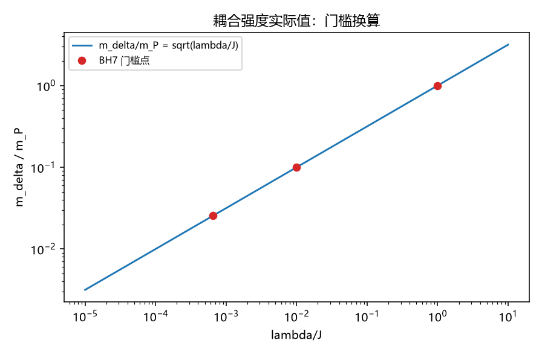

# 注记-耦合强度实际值：lambda = (m_delta/m_P)^2 换算链与 BH7 门槛表

- **日期**：2026-09-20 07:19:43
- **层级**：验证脚本/（理论验证材料，未确认）
- **脚本**：验证脚本/lambda_value.py（系统 Python 3.13 + numpy + matplotlib，确定性，运行约 1 秒）
- **定位**：接 BH7 首轮小结开放项其四：把耦合重开系数 $\lambda$ 的实际值落到登记换算链上，并将 BH7 的全部门槛翻译成 $m_\delta/m_P$ 刻度。
- **关联**：[[验证脚本/注记-M6-S2-1b（路线一）：本构常数比 K-J 的色散路线换算与格点核对]]（换算恒等式与登记值）；[[验证脚本/注记-M6-字典对账：归一化口径对齐、J 惯性反推与识别项的可推导边界]] 与裁决十七（$K/J = (m_\delta/m_P)^2$）；[[内部草稿/裁定材料-耦合符号与强度：登记符号（回拉）与强度惯例]]；[[验证脚本/注记-U2（最小臂）：耦合重开区的有效应力判决]]（$\lambda^*$）；[[验证脚本/注记-BH7-W3：越界构型的探索读数（存在性与结构；稳定性口径未立）]]（$\lambda_0$）
- **状态**：执行完成，判据 4/4 通过。读数：$\lambda/J = (m_\delta/m_P)^2 = 6\pi\kappa_\phi t_P$；门槛表 $\lambda^* = 6.5\times10^{-4} \leftrightarrow m_\delta = 0.0255\,m_P$，$\lambda_0 = 0.01 \leftrightarrow 0.1\,m_P$，惯例 $\leftrightarrow m_\delta = m_P$；剩余单点 = $m_\delta$
- **图**：images/lambda_value.png（单面板，见 §三 图 1）
- **修订记录**：
  - **2026-09-20 初版**（承接：BH7 首轮小结开放项其四）

---

## 一、换算链

其一，登记恒等式（M6-S2-1b）：$\lambda/J = K/J = 6\pi\,\kappa_\phi t_P$。其二，字典（裁决十七）：$K/J = (m_\delta/m_P)^2$。其三，两式合取：$\lambda/J = (m_\delta/m_P)^2 = 6\pi\,\kappa_\phi t_P$；惯例点 $\lambda/J = 1$ 给 $\kappa_\phi t_P = 1/(6\pi) = 0.0530516\ldots$，与登记值 $0.053052$ 一致（L3）。其四，质量无关性：$\lambda$ 为格点级常数，各黑洞质量档共用同一 $\lambda/J$。

## 二、门槛表

| 门槛（BH7 读数） | $\lambda/J$ | $m_\delta/m_P = \sqrt{\lambda}$ |
|---|---|---|
| U2 对照臂越界阈值 $\lambda^*$ | $6.5\times10^{-4}$ | $0.0255$ |
| W3 越界阈值 $\lambda_0$ | $0.01$ | $0.1$ |
| （报告用台阶） | $0.1$ | $0.31623$ |
| 惯例（$\lambda/J = 1$） | $1.0$ | $1.0$（$m_\delta = m_P$） |

## 三、结果与图

判据 4/4 通过；图 1 为 $m_\delta/m_P = \sqrt{\lambda/J}$ 直线与门槛点。

## 四、解读

其一，**实际值被压缩为一个单点**：$m_\delta$。换算式已定（两条登记恒等式的合取），BH7 的全部门槛已有 $m_\delta$ 刻度：若要"负耦合能量分支"的越界阈值落在实际值之下，需 $m_\delta \gtrsim 0.026\,m_P$；惯例对应的 $m_\delta = m_P$ 使实际强度远超该阈值——但登记符号（回拉，裁决二十六）下该分支不在册，故本条只作换算，不改判定。

其二，**判定随 $m_\delta$ 自动翻译**：登记符号臂（回拉）至 $\lambda = 1$ 无阈值（U2 与 W3 读数），故对任意 $m_\delta \le m_P$ 结论不变；仅当 $m_\delta > m_P$（超出惯例）需要复扫 $\lambda/J > 1$（登记为条件项）。其三，质量无关性：所有质量档共用 $\lambda/J$，与 BH7 的质量窗口（$5.1$ 至 $5.5\,m_P$）无耦合。

## 五、严格程度声明

纯换算（两条登记恒等式加算术），无新求解；L1 至 L3 为算术与登记值核对。

## 六、诚实边界

其一，$m_\delta$ 的实际值属粒子线（质量论文与 P1-2 归口），本材料不代定；其二，$\lambda/J = K/J$ 的等同取本构比读法（M6-S2-1b），未重新论证；其三，$\lambda/J > 1$ 开域未扫。

## 七、过程记录

无修正（一次通过）。

## 八、登记衔接

- 验证脚本/README.md 第 231 条（本注记落盘时同步）。
- [[内部草稿/总结报告-BH7首轮小结：第二主问题四件读数与判据退化教训：2026-09-20]]：开放项其四标记（换算落定，实际值仍以 $m_\delta$ 单点表达）。
- [[理论攻坚/黑洞线攻坚计划：坍缩机制重定位与强场终态]]：BH7 行与修订记录。
- [[内部草稿/开放问题总览：元相子理论待解决问题清单]] P1-34a：补注。
