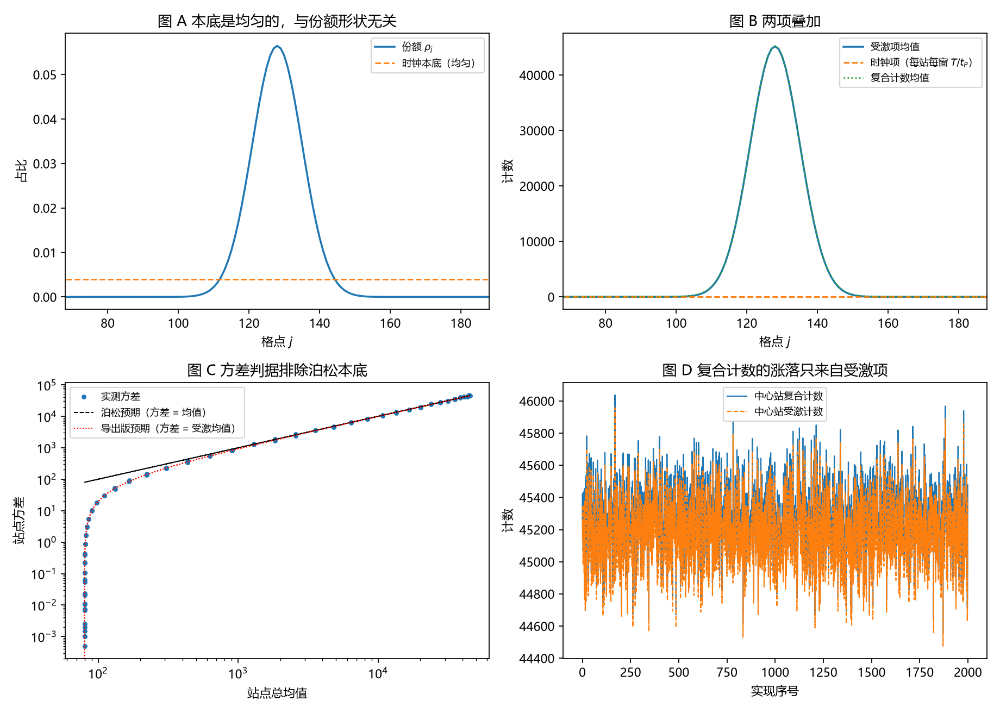

# 注记-自发项导出轮的最小验证：本底来自时钟折返，与真空涨落分家

- **日期**：2026-09-18 06:17:30
- **对应脚本**：`验证脚本/spontaneous_term_derivation.py`（判据 J1 至 J7，7/7 通过；确定性，种子 20260918；运行约 0.8 秒；图存 `images/spontaneous_term_derivation.png`，见 §一 图 1）
- **依据**：[[验证脚本/注记-计数规则涌现的最小验证：受激发射给份额、自发发射给均匀本底]]（上一轮，自发项原为设定）；[[研究方向-计数规则的动力学涌现：模型设定与判准（待裁决）]]；[[注记-自触发采样的最小验证：相位临界条件给出时钟、速率不变性与噪声标度]]（时钟折返的读数）；[[注记-载子钟与激发数的最小验证：率口径给不出份额]]（率口径即本底的接口）；[[内部草稿/份额的抽样口径与半经典分工：束缚振荡晶格上的抽样机制读数]] §3；[[内部草稿/开放问题总览：元相子理论待解决问题清单]] P3-12
- **定位**：把上一轮给定的自发项 $+1$ 改为从体系结构导出，并给出可判别读法（时钟折返的确定性周期项与真空涨落的泊松项在方差上分家）。本注记不改动基准文件。
- **状态**：判据 7/7 通过。核心读数：每站折返计数严格等于 $T/t_P = 4000$（两次独立相位实现一致）；阱曲率放大四倍（本征值从 $0.009994$ 到 $0.019975$、模式宽度同时改变）后本底完全不变；复合计数方差等于受激均值（显著站点平均相对偏差 $0.0292$，估计噪声 $3.2\%$）；两项可加（偏差 $0.0000$）；记录份额总变差 $0.02125$ 对解析 $0.02126$（相对偏差 $0.0002$）；若本底取泊松则平均相对偏差 $0.1483$，被排除。

---

## 一、判据与结果

| 判据 | 内容 | 通过条件 | 实测 |
|---|---|---|---|
| J1 | 时钟折返的确定性 | 每站计数 $=T/t_P$ | $4000.0$（两次实现一致） |
| J2 | 本底与模式无关 | 改变模式后不变 | 偏差 $0$（本征值与宽度均已改变） |
| J3 | 复合计数方差 | $=$ 受激均值 | 平均相对偏差 $0.0292$（噪声 $3.2\%$） |
| J4 | 两项可加 | 偏差 $<1\%$ | $0.0000$ |
| J5 | 与涌现轮一致 | 相对偏差 $<2\%$ | $0.0002$ |
| J6 | 本底即率口径 | 与份额总变差 $>0.8$ | $0.8516$ |
| J7 | 排除泊松本底读法 | 平均相对偏差 $>5\%$ | $0.1483$ |

图注：左上为份额与时钟本底（均匀）的对照；右上为受激项、时钟项与复合计数的站点分布；左下为实测方差与两种预期（泊松线、导出版线）的双对数对照；右下为单站点复合计数与受激计数在 2000 条实现下的涨落对照。

## 二、导出的内容

**自发项导出命题。** 由单体模固定（相位指针半径固定、以 $\omega_P = 2\pi/t_P$ 匀速转动）与"每站点每摆程完成一次折返"，每个站点的时钟在窗口 $T$ 内折返 $T/t_P$ 次，与局域激发数、模式形状、模式频率 $\omega_M$ 均无关。每次折返向计数器提供一次机会，发射耦合 $\gamma_{\rm em}$ 把机会变成计数。故发射率为

$$\Gamma_j(t) = \gamma_{\rm em}\big(\bar N\rho_j(t) + 1\big),$$

其中受激项 $\bar N\rho_j$ 由局域激发数给出，末项 $1$ 由时钟自身折返给出。它是**确定性周期项**，与外加的真空涨落项判然有别。

**判别读法。** 教科书读法把本底当作真空涨落，属泊松过程，其方差等于均值；本导出的本底方差为零。故复合计数的方差应等于受激项均值，而小于总均值。两条读法在方差上分家，可测。

**与第三轮的接口。** 本底项就是第三轮被排除的"率口径"（每站点每摆程一次）；受激项就是"激发数口径"。第三轮把率口径排除出份额口径，本轮指出它的正身：它是时钟项，与份额并列共存。

## 三、读数的意义

时钟折返的角色被确定。折返计数严格等于 $T/t_P$，与站点相位无关，也与模式无关：把阱曲率放大四倍（本征值 $0.009994 \to 0.019975$，模式宽度同时改变）后本底完全不变（J1、J2）。这条读数说明本底项与模式性质无关，故它不能承载份额信息。

方差判据把两条读法分家。复合计数方差与受激均值一致（平均相对偏差 $0.0292$，与 $1/\sqrt{M}$ 的估计噪声同量级），而与总均值相差 $0.1483$（J3、J7）。若本底属真空涨落，方差应等于总均值，实测不支持该读法。

两项严格可加（J4），且与上一轮的记录统计一致（J5，相对偏差 $0.0002$）。这意味着上一轮的自发项在数值上无损地换成了导出项，涌现轮的结论（高占据端总变差 $0.02102$）原样成立。

第三轮的读数在此闭环。率口径的空间分布是均匀的，与份额的总变差 $0.8516$（J6，第三轮同读数 $0.8354$，差异来自两轮所用模式族不同）。同一块本底，在第三轮作为份额口径被排除，在本轮作为时钟项被计入记录，两处身份清楚分开。

**一个可检验的方向。** 本底的时间结构是本轮最可操作的红利：周期性（间隔严格 $t_P$）对泊松。若将来本底的时间统计可测，两种读法可以被直接判定。

## 四、严格程度声明

J1、J2、J4 属精确或构造级（折返计数是相位折返的直接后果；两项按定义相加）；J3、J7 是统计读数，其判定阈值已按估计噪声 $1/\sqrt{M}$ 设定（$M = 2000$，噪声 $3.2\%$）；J5、J6 是分布比较读数。导出所依赖的两条前提（单体模固定、每站点每摆程一次折返）取自体系既有裁决与已核读数；时钟项与受激项的相对权重由发射耦合 $\gamma_{\rm em}$ 给出，该耦合本身未从更底层导出。结论只能在"若采用该模型"的条件下引用。

## 五、边界声明

本验证只做：一维闭链、单模情形下的本底导出与方差判别、模式无关性与加法性核对。

**2026-09-18 限定（与既有实验的调和）**：本轮的方差判据建立在"每次折返必被登记"（登记概率 $\eta = 1$）的理想化之上。有限 $\eta$ 下周期序列被伯努利抽样，计数方差为均值乘 $(1 - \eta)$，即 Fano 因子 $\mathrm F = 1 - \eta$；$\eta \to 0$ 时退化为泊松。实测的真空噪声处于散粒噪声水平、自发发射时刻呈指数分布，故物理可见性要求 $\eta$ 接近 $1$，而现有观测指向 $\eta \ll 1$，即周期结构在物理探测中不可见。本注记的读数因此限定为模型内部计数通道的陈述；$\eta$ 的量级或上界登记为后续必答项。

本验证不做：$\gamma_{\rm em}$ 的底层导出；截断玻色算符下的完全量子化（多激发数涨落与压缩效应）；计数器反作用；本底时间结构的实际测量方案（本轮只指出该方向可检验）；三维与缺陷构型；多模叠加与模式间跃迁。

## 六、过程记录

判据与设定订正三处，均由实测推翻后订正。其一，时钟项的单位未与受激项对齐：首版把"每摆程一次"直接当一次计数，未乘发射耦合 $\gamma_{\rm em}$，使本底比受激项大五十倍，J5 的总变差达 $0.478$；改正后与上一轮解析式一致到 $0.0002$。其二，J3 原用站点最大偏差判定，与 $M = 200$ 时约 $10\%$ 的方差估计噪声冲突（实测最大偏差 $0.31$ 属正常涨落）；改为显著站点均值判定，并把实现数提到 $2000$（噪声降到 $3.2\%$）。其三，J7 原用最小偏差，个别站点偶发通过（实测 $0.0018$）；改为显著站点平均偏差。

效率记录：脚本约 $0.8$ 秒，无字体问题。
