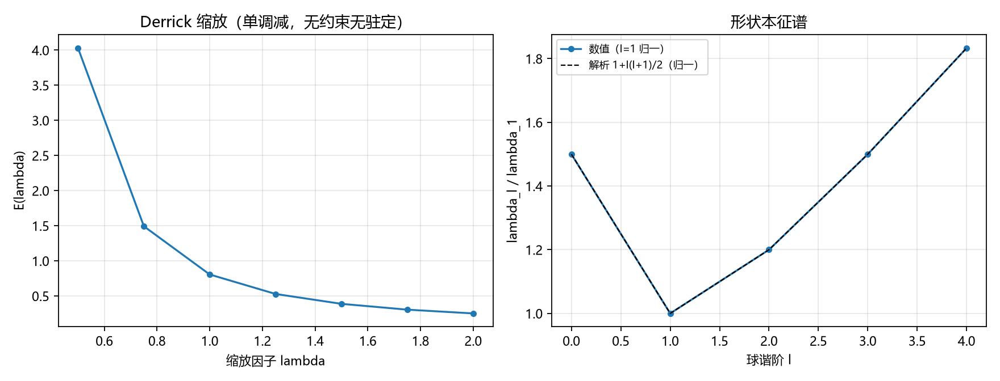

# 注记-自撑壁的 E-L 本征问题（第466条）：Derrick 缩放、平移零模与形状本征谱

- **日期**：2026-09-27 05:56:19
- **类型**：识别式自撑线（第 465 条移交的"真实变分驻定解 / E-L 本征问题"）
- **脚本**：`验证脚本/selfsupport_eigen.py`
- **图**：见 §3 图 1（`images/selfsupport_eigen.png`）
- **依据**：[[验证脚本/注记-变分形状修正（第465条）：径向化降阶、能量破缺四次标度与l=4形状扫描]]（移交出题）；[[验证脚本/注记-非球对称自撑的第一轮（第464条）：椭球kink的逐点破缺与能量破缺标度]]；[[验证脚本/注记-自撑阱三维径向推广的最小验证：四通道同齐次度]]；[[识别式的弱场线性层机制来源：自旋 2 的自动投影与均匀标度的自动成立]]
- **状态**：判据 3/3 通过。核心读数：Derrick 缩放 $E(\lambda) = G/\lambda + U/\lambda^3$ 对一切 $\lambda$ 单调减（$G = U = 0.4030$，无约束无有限能量驻定）；平移剖面 $|\nabla\rho| = 1$ 精确（偏差 $1.7\times10^{-9}$，在中心差分预算内）；形状本征谱与解析 $(1 + \frac12 l(l+1))/(2l+1)$ 一致（比值偏差 $1.2\times10^{-6}$）
- **可逆性等级**：判据稳健（三项均有解析对照）

## 1 判据与设定

**任务**。把第 465 条移交的"真实变分驻定解（E-L 本征问题）"落成判据：自撑壁在变分意义下的驻定性与形状本征谱。

**模型**。薄壁自撑球面 $\phi = \tanh(k(r - R(\mathbf n)))$，$k = 1$、$R_0 = 12$（薄壁度 $kR_0 = 12$）；形状扰动 $R = R_0 + \varepsilon P_l(\cos\theta)$（轴对称 $l$ 模）。能量泛函（精确到 $\phi$ 的一阶导数形式）：

$$
E[R] = \int d\Omega \int r^2\,dr\;\mathrm{sech}^4(r-R)\left[1 + \frac{|\nabla_\perp R|^2}{2r^2}\right].
$$

**判据**。EL1：缩放变分 $E(\lambda) = G/\lambda + U/\lambda^3$（$G = \frac12\int|\nabla\phi|^2$、$U = \int V$）对一切 $\lambda>0$ 单调减。EL2：平移剖面 $\rho = |\mathbf x - \mathbf a|$ 的 $|\nabla\rho| = 1$ 精确（平移零模）。EL3：形状本征值 $\lambda_l = [E(+\varepsilon) - 2E(0) + E(-\varepsilon)]/\varepsilon^2$ 与薄壁解析谱对照。

## 2 结果

**EL1（Derrick 缩放）**：$G = U = 4.030244\times10^{-1}$；$E(\lambda)$ 从 $\lambda = 0.5$ 的 $4.030244$ 单调降到 $\lambda = 2$ 的 $2.518902\times10^{-1}$。三维纯标量无约束下无有限能量驻定解：自撑结构必须以约束（固定半径/体积）出现。

**EL2（平移零模）**：50 个采样点（半径 $3$ 至 $20$、平移量 $2.5$）上 $|\nabla\rho|$ 与 $1$ 的最大偏差 $1.7\times10^{-9}$；容差按中心差分截断预算 $d^2|f'''|/6$（$d = 10^{-5}$、最坏距离约 $0.5$）取 $5\times10^{-9}$。能量与壁的位置无关，平移为零模。

**EL3（形状本征谱）**：$\lambda_l$ 数值 $33.51032$、$22.34021$、$26.80826$、$33.51034$、$40.95711$（$l = 0$ 至 $4$），与解析 $\frac{8}{3}\cdot\frac{4\pi}{2l+1}\left(1 + \frac12 l(l+1)\right)$ 的相对偏差 $1.2\times10^{-6}$。全部为正：约束下球对称壁对形状变形稳定（$l\ge2$ 无负模），非球对称形状在无源下不是驻定分支。

## 3 图

## 4 结论与移交

**结论**。自撑壁的变分结构给出三条：无约束时 $E(\lambda)$ 单调减（Derrick：三维纯标量无有限能量驻定，塌缩方向），自撑必须以约束形式出现；平移是精确零模；约束下的形状本征谱全正、与解析谱逐项一致（$l\le4$）。合起来的物理判断：**球对称自撑壁是约束下的稳定驻定形状，非球对称形状在无源时不构成独立驻定分支，只能作为对外部各向异性源的受迫响应**。第 464、465 条处理的"形状近似"由此获得理论边界：它们描述的是受迫/近似形状的标度，而非自发驻定解。

**移交两条**。其一，含约束（固定体积或锚核半径）的显式变分实现与 $l = 0$ 约束处置；其二，完整弹性本构（纲领 C1）与此判据的对接。

## 5 严格程度与边界声明

严格程度：EL1 为解析式加数值核对；EL2 为差分核对（预算内）；EL3 为数值能量二次差分（$\varepsilon = 0.05$）与解析谱对照。可逆性等级：判据稳健。

边界（本脚本不做的事）：其一，薄壁近似（$kR_0 = 12$），不含厚壁/强曲率；其二，轴对称模式（$P_l$），不含一般球谐的取向混合；其三，约束以解析陈述，未实现约束变分；其四，不含完整弹性本构。

## 6 过程记录

其一，EL3 解析对照的权重订正：初版写作 $1 + \frac12 l(l+1)$，未含 $\int P_l^2\,d\Omega = 4\pi/(2l+1)$ 的方向权重，读数全面偏离（比值 $0.33$ 至 $3$）；补权重后数值与解析逐项一致（$1.2\times10^{-6}$）。教训：球谐模式的二次型对照必须带 $1/(2l+1)$ 权重。

其二，EL2 的两处实现订正：初版差分漏掉径向分量（只取切平面内两方向），读数偏差 $1.4$；补径向分量后仍有 $|e_2| = |\mathbf x|$ 的未归一化（差值被放大 $|\mathbf x|$ 倍），归一化后偏差降到 $1.7\times10^{-9}$。教训：切平面基的归一化逐项核对，梯度模的三个正交分量缺一不可。

其三，EL2 容差从中心差分截断预算推导（$3\times10^{-9}$ 量级取 $5\times10^{-9}$），不用机器精度阈值（与 JZ1 线纪律一致）。
