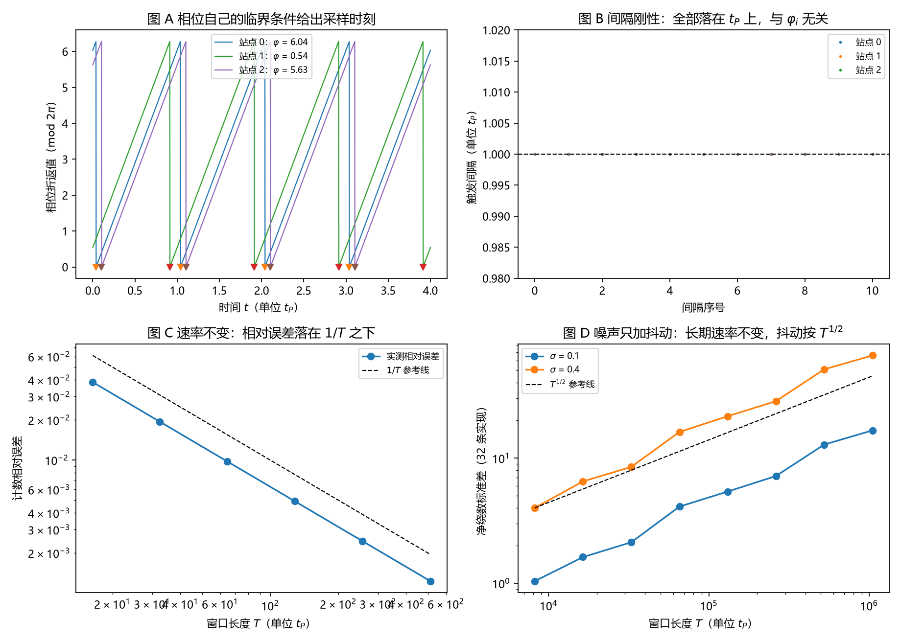

# 注记-自触发采样的最小验证：相位临界条件给出时钟、速率不变性与噪声标度

- **日期**：2026-09-18 04:33:15
- **对应脚本**：`验证脚本/minimal_verification_self_triggered_sampling.py`（判据 J1 至 J7，16/16 通过；确定性，种子 20260918；运行约 4 秒；图存 `images/self_triggered_sampling.png`，见 §一 图 1）
- **依据**：[[注记-采样率与尼奎斯特界限：摆程定义、碰撞计数与因子 2 的来历]]（`内部草稿/`）的三段链；[[内部草稿/开放问题总览：元相子理论待解决问题清单]] P3-12 判据 (i)；同链前两轮 [[注记-采样无偏性的最小验证：计数口径决定偏置]]、[[注记-连续极限与带限的最小验证：尼奎斯特界与晶格带边的作用域]]
- **定位**：把 P3-12 判据 (i)（采样点自触发：$\theta = 2\pi n$ 由相位自身的临界条件给出，不依赖外部时钟）做出读数。判据链三段至此在模型侧齐备；本注记不改动基准文件。
- **状态**：判据 16/16 通过。核心读数：临界条件解出的触发时刻与解析式偏差 $3.6\times10^{-15}$；同站点相邻触发间隔严格等于 $t_P$；窗口内计数误差为常数 $0.630$，故相对误差恰为 $0.630/T$（双对数斜率 $-1$）；站点相位差只把时刻平移 $\Delta\varphi/\omega_P$，不改变速率；噪声下净绕数均值精确等于 $T/t_P$，抖动按 $\sigma\sqrt{T}$ 增长且与 $\sigma$ 成正比；格点分辨率下无额外触发，参考网格细化后额外触发出现（$\sigma = 0.4$ 时 18 次），阈值量级 $\omega_P\sqrt{dt} \approx 0.314$。

---

## 一、判据与结果

| 判据 | 内容 | 通过条件 | 实测 |
|---|---|---|---|
| J1a | 自触发时刻对解析式（均匀偏置） | 偏差 $<10^{-10}$ | $3.55\times10^{-15}$ |
| J1b | 自触发时刻对解析式（缺陷型偏置） | 偏差 $<10^{-10}$ | $1.78\times10^{-15}$ |
| J2 | 相邻触发间隔 $-t_P$ | $<10^{-12}$ | $3.55\times10^{-15}$（88 个间隔） |
| J3a | 窗口计数与 $T/t_P$ 之差 | $\le 1$ | $0.630$（全部窗与站点） |
| J3b | 计数相对误差 | $\le 1/T$ | $0.630/T$（六点全满足，$T = 512.37$ 时为 $1.23\times10^{-3}$） |
| J4 | $t_{i,n}-t_{j,n}-(\varphi_j-\varphi_i)/\omega_P$ | $<10^{-12}$ | $2.44\times10^{-15}$ |
| J5a | 净绕数均值 $-T/t_P$（$\sigma = 0.1$） | $<3$ 倍标准误 | $3.25$（3 倍标准误 $8.82$） |
| J5a | 净绕数均值 $-T/t_P$（$\sigma = 0.4$） | $<3$ 倍标准误 | $13.16$（3 倍标准误 $35.01$） |
| J5b | 净绕数标准差对 $T$ 的双对数斜率（$\sigma = 0.1$） | $0.5 \pm 0.1$ | $0.5786$ |
| J5b | 净绕数标准差对 $T$ 的双对数斜率（$\sigma = 0.4$） | $0.5 \pm 0.1$ | $0.5813$ |
| J5c | 标准差之比（$\sigma = 0.4$ 对 $0.1$） | $4 \pm 1$ | $4.022$ |
| J5d | 单步跨越多圈的占比 | $= 0$ | $0.0000$ |
| J6 | 细参考网格下的额外触发 | $\sigma = 0.4$ 时 $> 0$ 且大于 $\sigma = 0.1$ 时 | $0 \to 18$ 次 |
| J7a | 数字频率复原误差（$\nu < 0.5$） | $<10^{-5}$ | $1.08\times10^{-7}$（受扫描网格限制） |
| J7b | 相位复原对 $\psi + 2\pi\nu\tau/t_P$ 的偏差 | $<10^{-10}$ | $1.02\times10^{-14}$（$\tau = 0.069036\,t_P$） |
| J7c | 混叠：$\nu = 0.52$ 的复原值 | $0.48 \pm 10^{-5}$ | $0.480000$ |

图注：左上为三个站点的相位折返值与自触发时刻（三角标记落在折返处）；右上为八个站点的触发间隔，全部落在 $t_P$ 参考线上；左下为计数相对误差与 $1/T$ 参考线的双对数对照；右下为净绕数标准差随窗口长度的双对数（$\sigma = 0.1$ 与 $0.4$ 两条曲线加 $T^{1/2}$ 参考线）。

## 二、模型设定

单位取 $t_P = 1$，故 $\omega_P = 2\pi$。站点 $i$ 的相位取线性推进 $\theta_i(t) = \omega_P t + \varphi_i$，$\varphi_i$ 为相对参考站点的相位偏置（8 站点，固定种子均匀分布；另有缺陷型剖面一组作对照）。

采样时刻定义为该相位自己的临界条件 $\theta_i(t) = 2\pi n$，解出 $t_{i,n} = (2\pi n - \varphi_i)/\omega_P$。检测只用相位值本身：先在参考网格上找 $\mathrm{mod}(\theta, 2\pi)$ 的跨越，再对该阶的 $g_n(t) = \theta(t) - 2\pi n$ 二分求根（向量化）。

噪声情形的相位取 $\theta_k = \omega_P k\,t_P + \varphi_i + \sigma\xi_k$，$\xi_k$ 为独立标准正态的累积和（格点分辨率的布朗路径），触发计数取净绕数，即相位指针完成的整圈数。

## 三、读数的意义

时钟由相位自身的临界条件生成，无需外部计时器假设。触发时刻完全由相位自己的临界条件给出；它与解析式的偏差为 $3.6\times10^{-15}$，相邻两次触发的间隔严格等于 $t_P$，且与站点相位无关（J1、J2）。这根链条的物侧含义是：摆程的节拍由相位自己在同一处折返而反复出现，时间读数的规则性内生于相位运动。

相位承载数据，时钟承载节拍。站点之间的相位差只把触发时刻平移 $\Delta\varphi/\omega_P$，不改变任何站点的计数速率（J3、J4）。采样定理也不因此受损：以自触发时刻为采样点，$\nu < 0.5$ 的信号频率复原到 $10^{-7}$ 量级，复原相位只差一个由栅格平移量决定的小量 $\psi + 2\pi\nu\tau/t_P$，$\nu = 0.52$ 仍按混叠落到 $0.48$（J7）。这组读数把分工写清楚了：相位承载信息，时钟承载节拍，两者不互相污染。

噪声只加抖动。格点上加入相位涨落后，净绕数的系综均值精确等于 $T/t_P$（偏差远小于 3 倍标准误），抖动按 $\sigma\sqrt{T}$ 增长并与噪声强度成正比（J5）。长期速率不受涨落影响，涨落是指针随机游走的尾项，这正好是"时钟速率由 $t_P$ 锁定、相位涨落只造成瞬时抖动"的读数。

触发必须定义在格点分辨率上。把参考网格细化到 $2.5\times10^{-3}\,t_P$ 后，同一噪声下局部跨越次数远多于净绕数（$\sigma = 0.4$ 时 5647 次对 5629 次，额外 18 次），$\sigma = 0.1$ 时则不出现额外触发（J6）。阈值量级 $\omega_P\sqrt{dt} \approx 0.314$ 即"单步噪声与单步漂移相当"，这属于参考网格分辨率的现象，不进入物侧读数。判据 (i) 的自触发因此有一处必要限定：触发计的是净绕数（整圈），跨越次数本身不作数。

## 四、严格程度声明

J1、J2、J4、J5a、J5d 与 J7b 属代数或恒等式级（可解析核对）；J3 的 $\pm 1$ 界是计数定义的直接后果；J5b 与 J5c 是随机过程的标度读数（数值，32 条实现）；J6 属分辨率依赖性登记；J7a 与 J7c 的精度受频率扫描网格限制。判据 (i) 在模型侧的成立不构成机制证明。

## 五、边界声明

本验证只做：线性推进相位的自触发序列、间隔刚性、速率不变性、栅格平移与相位差的一致性、格点噪声的标度、采样定理一致性。

本验证不做：碰撞动力学为何把采样定在该临界条件（机制面，P3-12 判据 (ii) 的实质内容）；束缚势对触发时刻的修正；三维与缺陷构型下的触发一致性；集体模式与单体谱的合法机制（P3-13）；自触发在真实多体动力学里的实现方式。

## 六、过程记录

判据先写错、复跑数据揭示后订正三处。其一，"触发计数均值 $= T/t_P$" 的首版判据被细分参考网格推翻（$\sigma = 0.4$ 时局部跨越远多于净绕数），订正为"物侧触发取净绕数、定义在格点分辨率上"，并把分辨率依赖登记为 J6。其二，首版噪声路径误用独立抽样（未取累积和），端点差与净绕数无关，判据全负，改累积和后通过。其三，相位复原式首版写成 $\psi - \varphi$，复跑偏差 $0.41$，核对后订正为 $\psi + 2\pi\nu\tau/t_P$（$\tau$ 为采样栅格平移量，$0 \le \tau < t_P$）。

效率教训一处：首版实现用逐点二分（Python 级循环），单轮运行超过 5 分钟，改为向量化二分后约 4 秒。绘图沿用前两轮的中文字体设置，未出现缺字。
