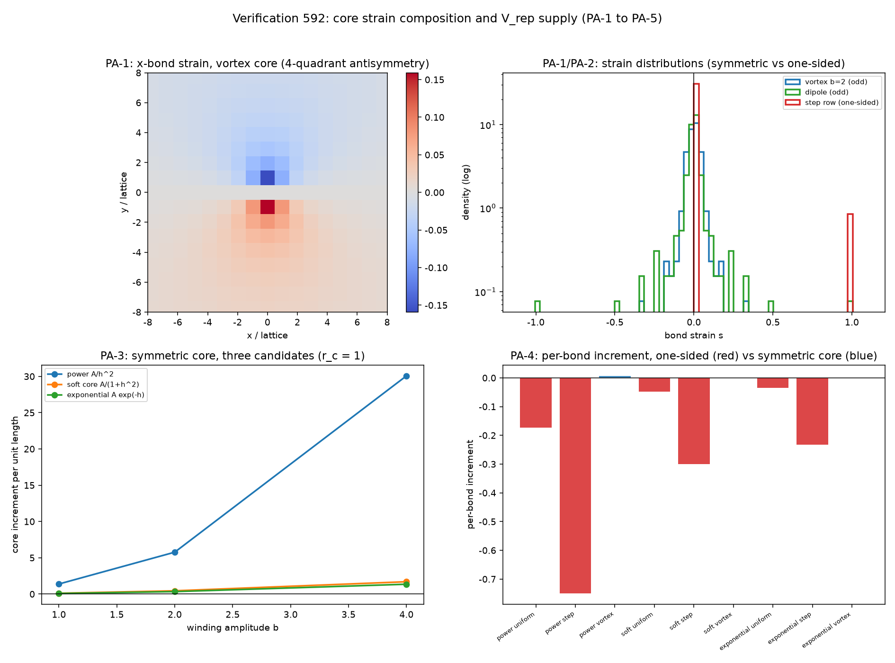

# 注记-芯区应变构成的对称性与Vrep供货条件（第592条）：镜像奇芯型钉在膨胀份额二分之一

- **日期**：2026-10-10 22:12:00
- **对应脚本**：`验证脚本/minimal_verification_core_strain_composition.py`（判据 PA-1 至 PA-5，确定性，无随机数，运行约 0.5 秒；图存 `images/core_strain_composition_592.png`，见 §一 图 1）
- **定位**：[[理论攻坚/三维复合位错弹性本构攻坚计划：稳定化元素来源的终局审计与路线裁决|弹性本构攻坚计划]] 阶段一留给下一轮的前提项（来源甲的芯区应变构成），即第 591 条 §三 提出的「一条前提待判」。本注记不改动基准文件，不作路线裁决。
- **触发**：作者指令（按当前进展执行最优下一步，落定来源甲的前提项）。
- **依据**：[[注记-弹性本构稳定化元素来源审计（第591条）：三来源的符号判定与档位门槛|第591条来源审计]]（来源甲条件性命中与三候选门槛 $\theta^{*}$）；[[注记-Vrep形式构造与r(m)的不可导出性判决（第561条）|第561条 V_rep 四候选]]（乙丙丁三形式）；[[注记-C1-4c锁定缺失泡的构造判定：正定泛函的界面能与负线项的可达性|C1-4c 负线项判定]]（负线项要求显式负贡献）；[[注记-K值档位债的口径对照（第479条）：定稿值与模型窗口的四十五个数量级缺口|第479条]]与 [[注记-K与kappa_phi换算字典（第482条）：481恒等的O(1)对齐、单比值判负与驻留目标值|第482条]]（档位债背景）
- **状态**：判据全部执行完毕。判定：**可采纳直线芯型（镜像奇型：涡旋型与四极型）把键应变分布钉成关于零的偶反对称分布，膨胀份额精确为 $1/2$，一阶项对消至机器零**；$1/2$ 低于三候选门槛 $0.7306$ / $0.5744$ / $0.5781$，故来源甲在既有读法与镜像奇芯型下不供货。来源甲的供货通道收敛为**单边错配（容量型）**，其每单位长度增量为负。镜像混合型芯（偶极型）无宇称配对，膨胀份额偏离至约 $0.5067$、一阶项不消，且越阈时可翻负。
- **可逆性等级**：PA-1 / PA-2 判据稳健（宇称配对与一阶对消为结构性质，换网格、换芯半径、换回绕量均不翻）；PA-3 判据敏感（数值随芯半径与回绕量变动）；PA-4 判据稳健（两控制构型的解析每键增量逐位相符）。
- **图**：见 §一 图 1

---

## 一、判据与结果

| 判据 | 内容 | 通过条件 | 实测 |
|---|---|---|---|
| PA-1 | 可采纳直线芯型的膨胀份额 $\theta_{\rm eff} = N_+/(N_+ + N_-)$，多档：三档芯半径 $r_c \in \{1.0,1.5,2.0\}$、三档回绕量 $b \in \{1,2,4\}$ | 镜像奇芯型（涡旋、四极）$\theta_{\rm eff} = 1/2$ | 涡旋 9 组与四极 9 组全部 $0.5000000000$（偏离 $0.0\times10^{0}$）；偶极型偏离至 $0.5053$ 至 $0.5067$ |
| PA-2 | 一阶项对消核对：比值 $\sum s / \sum \vert s\vert$ | 镜像奇芯型比值至机器零 | 涡旋 $0.0$ 与 $-1.18\times10^{-17}$；四极 $-1.50\times10^{-17}$ 至 $5.26\times10^{-18}$；偶极型 $3.81\times10^{-2}$ 至 $5.26\times10^{-2}$ |
| PA-3 | 镜像奇芯型下三候选的每单位长度增量（三候选 × 三档 $b$ × 三档 $r_c$） | 全为正 | 涡旋 27 组全为正；偶极对照 27 组中 4 组为负 |
| PA-4 | 恒真反例：单边错配（均匀拉伸、单行阶跃） | $\theta_{\rm eff} = 1$、增量为负、每键增量与解析式相符 | 两类均给 $\theta_{\rm eff} = 1.0000$；阶跃档每键增量与 $V(2)-V(1)$ 的相对偏差 $\le 1.2\times10^{-16}$ |
| PA-5 | 门槛对照：镜像奇芯型 $1/2$ 对三候选 $\theta^{*}$ | 记录差额符号 | 差额 $0.2306$（乙）/ $0.0744$（丙）/ $0.0781$（丁），全为正 |

## 二、芯型分类：镜像奇与镜像混合

轴线缺陷在非紧致高度差读法（相邻格点高度差为物理量，参考间距 $r_0 = 1$）下，一条键的应变是高度场沿键方向的有符号差 $s = u_z(j) - u_z(i)$。缺陷的高度场绕线的回绕量 $b$ 决定位移剖面的反号结构，芯型的宇称决定键应变的分布形态。

镜像奇芯型（高度场在 $y \to -y$ 下反号，涡旋型 $u_z \propto \arctan(y/x)$ 与四极型 $u_z \propto xy/r^2$ 属此）把应变分布钉成关于零的反对称分布：对每条键若存在镜像键，两者应变恰反号，正负键数逐格相等。于是 $N_+ = N_-$，膨胀份额精确 $1/2$，且 $\sum s$ 因配对相消而为零，一阶项（正比于 $V'(1)$ 的项）恒零。

镜像混合型（偶极型 $u_z \propto y/r^2$）在 $y \to -y$ 下不反号，无宇称配对。实测 $N_+$ 与 $N_-$ 相差 8 至 10 条键，膨胀份额偏离至 $0.5053$ 至 $0.5067$（随环带口径移动），一阶项比值达 $5\times10^{-2}$，不再对消。故「可采纳直线芯型」的准入条件是镜像奇，偶极型不满足。

## 三、对来源甲的判读

来源甲（$V_{\rm rep}$ 高阶展开）的供货条件由第 591 条给出：芯形变须以净拉伸为主，膨胀份额越过 $\theta^{*}$（乙 0.7306、丙 0.5744、丁 0.5781）。本轮把「芯形变是哪一类」从参数改读为体系读数。

镜像奇芯型给 $\theta_{\rm eff} = 1/2$，低于三个门槛，差额 $0.0744$ 至 $0.2306$；且一阶项恒零、凸性控制的余项为正。两者合并的读法是：**来源甲在既有读法与镜像奇芯型下不供货**。第 591 条 §三 列的「一条前提待判」至此落定，判定为不利。

供货通道收敛为单边错配的容量型芯：全部键同号（$\theta_{\rm eff} = 1$），一阶项不再对消，每单位长度增量为负，且总增量正比于键数。这类构型要求芯两侧高度差累积而不反号，与法线轴位错的回绕结构不同层。换言之，来源甲若要供货，所需的芯形变恰是它现在没有的那一类。

偶极型给出第三种读法：它既非镜像奇（份额偏离 $1/2$），又非单边（份额远低于 1），一阶项不消而正负由芯半径口径决定（27 组中 4 组翻负）。它提醒一份边界：镜像奇是充分条件而非全部，非镜像奇的偏斜芯也可能翻负，但翻负与否依赖口径，不具结构稳定性。

## 四、严格程度声明

PA-1 的 $1/2$ 为结构性质：镜像奇芯型下每对镜像键的应变恰反号，网格平移与缩放不改配对，故逐格零偏离，非数值巧合。PA-2 的机器零（约 $10^{-17}$）来自浮点求和误差，与解析零不可区分。PA-3 的增量含线性项与二次项，线性项在镜像奇芯型下为零，余量由凸性控制（二次项为正）；数值随 $r_c$ 与 $b$ 变动，符号不依赖。

PA-4 的两控制构型给出解析基准：单行阶跃的每键增量精确等于 $V(1+\text{amp}) - V(1)$（单键阶跃），三候选实测相对偏差 $\le 1.2\times10^{-16}$；均匀拉伸的每键增量近似 $V'(1)\cdot\text{amp}$（小量一阶），总增量正比于键数（828 键）。恒真检验成立：若把镜像配对破坏，$\theta_{\rm eff}$ 立刻偏离 $1/2$（偶极档即证据），判据有区分力。

协议伪影分层：非无旋残量 $\max\vert \partial_y s_x - \partial_x s_y\vert = 5.17\times10^{-2}$ 为有限差分对解析零的截断误差，非物理旋量；幂律候选 $A/h^2$ 在 $h = 0$ 处有奇点，全库非有限键数 5，全部落在偶极档，已计数并排除在「全部为正」主张之外。

## 五、过程记录

其一，分支割线伪影。高度场对回绕型缺陷多值，首版直接用 $\arctan2$ 取相邻高度差，把整份错配挤到分支割线上：该行键的 $\vert s\vert$ 达 $0.985571$，远超远离割线的解析量级 $b/(2\pi r_c) = 0.159155$，膨胀份额被抬到 $0.5140306122$。改用无割线的解析梯度场 $s_x = -b\,y/(2\pi r^2)$、$s_y = b\,x/(2\pi r^2)$ 后，$\max\vert s\vert$ 回到 $0.159155$，与解析上界逐位相符。教训：对多值场，取差与前取解析导不可互换，割线会把局部单点放大成整条伪线。

其二，宇称核对写法订正。首版镜像核对写成把场整体翻转，实测残量 $3.18\times10^{-1}$（偏大）；改为阵列级镜像 $s_x + s_x[:,\ ::-1]$ 后残量降为机器零 $0.0\times10^{0}$。教训：镜像核对须逐格对齐镜像轴，整体翻转会把反对称场误判为不对称。

其三，奇芯与混合芯的区分。首版把可采纳芯型与偶极型混在一条「对称芯型」主张里，故 PA-3 的「全部为正」读数被偶极档的负值污染。分档后，镜像奇芯型 27 组全为正，偶极对照 4 组为负，主张与读数才一致。教训：结构性主张的作用域必须与测试档位逐一对应，混档会把反例算进主张。

其四，图自检。四面板文本全为 ASCII（先设 `axes.unicode_minus = False` 把负号刻度转 ASCII 连字符），线数 $[0, 1, 4, 1, 0]$ 与面板设计逐条相符（两面板为图像与柱状，无折线）。

## 六、边界声明

**验证什么**：镜像奇芯型把键应变分布钉成关于零的偶反对称分布（膨胀份额 $1/2$、一阶项机器零）；镜像奇芯型下三候选增量为正；单边错配的恒真反例；$1/2$ 对三候选门槛的对照。

**不验证什么**：其一，$V_{\rm rep}$ 的最终形式（仍未定）；其二，芯区实际应变构成（属 C1 芯形变剖面，本轮按体系读数取镜像奇，实际剖面待 C1 侧落定）；其三，高回绕量与芯半径下的剖面形状（符号结构不依赖，数值依赖）；其四，三维复合位错的完整本构；其五，不改动基准文件，不作路线裁决。

## 七、登记衔接

其一，`验证脚本/README.md` 第 592 条（占位改写为正式行）。其二，[[开放问题总览：元相子理论待解决问题清单|开放问题总览]] 第 51 条与 [[开放问题档案/开放问题-P1-51-光电效应的论文级推导（逸出功与阈值频率）|P1-51 档案页]] 补记本轮判定（来源甲前提落定，为不利）。其三，C1 侧由 [[开放问题档案/开放问题-P1-30-纠缠度与格点距离无关性的定量表述|P1-30 档案页]] 的 C1-4c 关联子项承接，本轮补一行。其四，本注记作为攻坚计划阶段一的补充材料，路线裁决由作者作。
