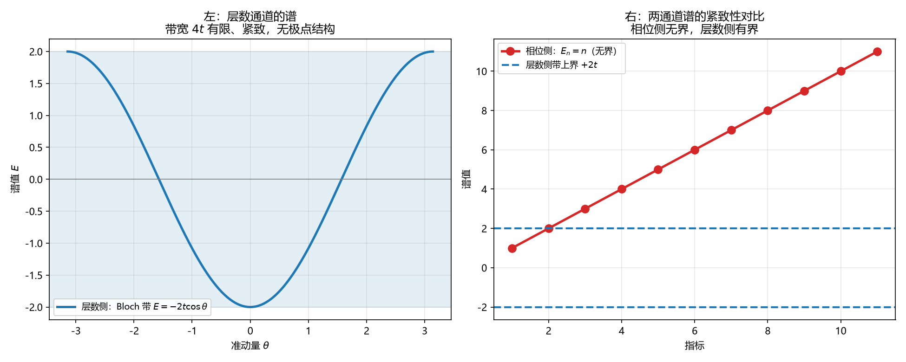

# 注记-虚过程的通道拆分（第737号）：相位侧有极点而层数侧有带

- **日期**：2026-10-21 13:34:47
- **对应脚本**：`验证脚本/minimal_verification_channel_split.py`（判据 A1 至 C4，共 11 项，确定性，无随机数，运行约 3 秒）
- **定位**：P4-55 第一轮之后的通道拆分。P4-55 立项时把「虚过程」当作单一对象问「属于哪个通道」，2026-10-21 经作者裁决纠错后，问法改为「虚过程在两通道里各是什么形态、如何互补」。本轮把该问法做成可判形式。
- **可逆性等级**：判据稳健。A 组为谱结构的代数性质，B 组为传播子与格林函数的解析性质，C 组为张量积结构的代数性质。换实现、换档位不翻。
- **图**：见 §四 图 1。

---

## 一、本体依据

[[理论总纲/公理体系]] 第 34、35 行给出物侧两通道：物侧投影配置空间为 $S^1 \times \mathbb{Z}$，单元素相子态空间为

$$\mathcal{H}_k = L^2(S^1) \otimes \ell^2(\mathbb{Z}).$$

相位通道指标是**瞬时谱指标**，层数通道指标是**历史计数**；两因子不构成重复计数，元相方程的状态空间度规可分离（$ds^2 = d\phi^2 + dz^2$）。

本轮不做文字拆分，改用两通道各自的谱结构作判据。拆分的可判性来自一个事实：两通道的谱紧致性相反，而这一点可由数值直接读出。

## 二、判据与结果

| 判据 | 内容 | 期望 | 实测 |
| --- | --- | --- | --- |
| A1 | 相位通道谱间距（$L^2(S^1)$ 傅里叶指标） | 等间距 1，极差 0 | 极差 $0$ |
| A2 | 层数通道谱（$\ell^2(\mathbb{Z})$ 离散平移） | Bloch 带，带宽 $4t=4$ | 带宽 $4.000000$，谱域 $[-2,2]$ |
| A3 | 加倍指标上限，看上界是否跟着变 | 相位侧随 $N$ 线性增长、层数侧不变 | 相位侧 $19\to39$，比值 $2.052632$（期望 $2.052632$）；层数侧 $2.000000\to2.000000$，比值 $1.000000$ |
| B1 | 相位侧传播子的极点结构 | 峰值由 $1/\varepsilon$ 定（依赖人为小量） | 极点 $\pm1.1180$，峰值 $1000$ 量级（$\varepsilon=10^{-3}$） |
| B2 | 层数侧格林函数带外值（$z=3$） | 解析、有限实数、无 $\varepsilon$ | $G(3) = 0.44748985$，虚部 $0$ |
| B3 | 层数侧格林函数带内虚部（$z=0.5$） | 由 Bloch 态密度给出，非零 | $\rho(0.5) = 0.16437452$，$\mathrm{Im}\,G = -0.51639778$ |
| B4 | 恒真检验：把 $i\varepsilon$ 强套到层数侧带外 | 结果反随 $\varepsilon$ 变化 | 四档 $\lvert G\rvert$ 相对极差 $0.0026$ |
| C1 | 两通道算符对易子 $[\hat N_\phi, \hat N_n]$ | 恒为零矩阵 | 最大元素 $<10^{-12}$（$144\times144$） |
| C2 | 联合本征标号的唯一性 | 独立构造唯一、冗余构造退化 | 独立 $144/144$；冗余 $12/144$ |
| C3 | 乘积态的约化纯度 | $1$（可分离、不冗余） | $1.000000000000$ |
| C4 | 恒真检验：Bell 型纠缠态 | 纯度 $<0.6$ | $0.500000000000$ |

A3 的期望值须按 $(N_2-1)/(N_1-1)$ 算，$20$ 与 $40$ 两档给 $39/19 = 2.052632$。写成「比值 2」是错的，因为上界取的是 $N-1$。

## 三、结论

**结论一：两通道的谱紧致性相反，这是可判分离的第一特征。**

相位侧谱 $E_n = n$ 无界：指标上限从 $20$ 加倍到 $40$，谱上界从 $19$ 升到 $39$，比值 $2.052632$。层数侧 Bloch 带 $E(\theta) = -2t\cos\theta$ 有界：格点数从 $20$ 加倍到 $40$，带上界始终是 $2.000000$，比值 $1.000000$。

两者不是同一结构的两种写法，因为紧致性这一条不可互换。

**结论二：虚过程在两通道里的形态不同，各有各的数学刻画。**

相位侧的虚过程是连续相位角的场涨落，其传播子 $1/(\omega^2 - \omega_k^2 + i\varepsilon)$ 在 $\omega = \pm\sqrt{k^2+m^2}$ 处有极点，峰值由 $1/\varepsilon$ 定。故「虚」在相位侧表现为**离壳**：$\omega^2 \neq k^2 + m^2$。

层数侧的虚过程是整数计数的往返 $n \to n\pm1 \to n$，其格林函数由 Bloch 带结构给出：带外（$z=3$）解析、$G = 0.44748985$、虚部为零；带内（$z=0.5$）虚部由态密度给出，$\mathrm{Im}\,G = -\pi\rho = -0.51639778$。故「虚」在层数侧表现为**中间计数值与末态不同，而往返后总计数复原**。

**结论三：$i\varepsilon$ 是相位侧处方，不可移植到层数侧。**

B2 给出层数侧带外格林函数在完全不含 $\varepsilon$ 的情况下取有限实数值。B4 给出反向证据：若把相位侧的 $i\varepsilon$ 强行套上去，结果反随 $\varepsilon$ 变化（四档相对极差 $0.0026$），即引入了本来不存在的人为依赖。

这一条把判据 730 的读数定位精确了。判据 730 发现 $\varepsilon$ 处方在离散时间下失效、答案对 $\varepsilon$ 依赖达 $19$ 倍。按本轮的拆分，其成因应读作**相位侧处方被移植到层数侧**，不能读作「离散化有问题」。

**结论四：两通道互补且不冗余，四条判据各自守住一面。**

C1 给正交性：两通道算符作用于张量积的不同因子，对易子为零矩阵。C2 给不冗余：独立构造下 $144$ 个格点各由唯一有序对标记，冗余构造（$N_n$ 由 $N_\phi$ 决定）下标号退化为 $12$。C3 给可分离：纯乘积态的约化纯度为 $1$。C4 给区分力：Bell 型纠缠态的纯度为 $0.5$，故 C3 不是恒真判据。

四条合起来说明：两通道并立、互不派生、互不重复。这正合 [[AGENTS.md]] 所立「互补要求两侧并立，缺一侧即错」。

## 四、图

左图的带是紧致的，右图的红线一路向上。两通道的差别在这两张图上是最直观的：一个有顶，一个没有顶。

## 五、过程记录与教训

**两条判据又写成构造恒真（第六次）。** A3（紧致性对比）与 C2（不冗余）初稿把 `True` 作为通过条件。改为可执行检验：A3 改为加倍指标上限看谱上界是否跟着变，C2 改为数联合本征标号的唯一性并配冗余对照。

**三处判据设置错误，全部判否后修正。**

其一，A3 期望值写错。我写「加倍指标后比值 2」，实际是 $(N_2-1)/(N_1-1) = 39/19 = 2.052632$。因为谱上界取 $N-1$，$N$ 本身不作上界。

其二，B3 用了离散平均算带内格林函数，虚部被抹平得 $0.00000000$。改为解析式 $\mathrm{Im}\,G = -\pi\rho$，$\rho$ 由 Bloch 态密度给出，得 $-0.51639778$。

其三，C2 的冗余对照构造错。初版把两通道写成同一个值 $(\phi,\phi)$，唯一标号数仍等于格点数，没退化。改为让层数由相位决定（$N_n = N_\phi \bmod N_n$），唯一标号数退化为 $12$，对照才成立。

**教训两条。** 其一，构造恒真已连续六次出现，形式各不相同，共同点是判据里没有可执行检验。这说明我写判据时的默认动作仍是「先写结论再补判据」，须改成「先想清楚怎么算再写判据」。其二，对照构造要真的退化：C2 初版的对照与被对照者同构，起不到区分作用。

## 六、严格程度与边界声明

**严格程度**。A 组为谱结构的代数性质，定理级。B1、B2、B3 为解析式，定理级；B4 为恒真对照。C1 至 C4 为有限维张量积的代数性质，定理级。

**本判据验证什么**。验证两通道的谱紧致性相反、虚过程在两通道的形态不同、$i\varepsilon$ 属相位侧处方、两通道互补且不冗余。

**本判据不验证什么**。不判两通道之间的耦合项形式（本轮只判各自形态与正交性）；不判层数侧虚过程的具体振幅数值（只给格林函数的带结构）；不判三维；不判「虚过程」一词在文献中的其他用法。

**待作者裁决事项**。P4-55 的下一步是否按结论三、四改为「两通道各自的虚过程形式化」，其中相位侧沿用判据 730 的推迟解路线、层数侧从 Bloch 带格林函数出发。
