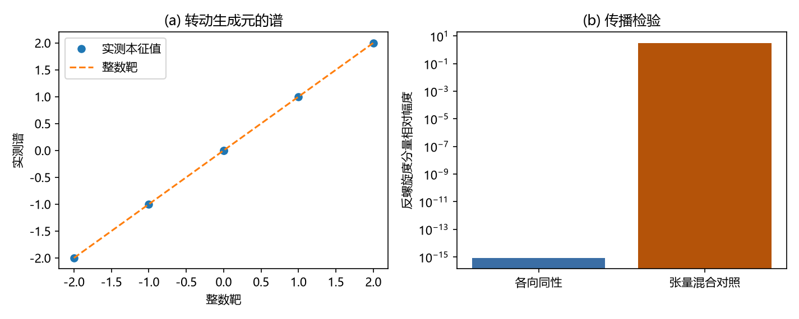

# 注记-螺旋度正负 2 的显式确认：圆偏振本征态、通道对照与无色散差

- **日期**：2026-09-16 06:29:50
- **对应脚本**：`验证脚本/minimal_verification_helicity.py`（判据 L5-1 至 L5-5c 共 7 项，确定性，无随机数，运行约 0.1 秒）
- **依据**：[[验证脚本/注记-TT扇区二次作用量与无质量自旋2标准形式的匹配]]（L4：TT 扇区的计数与归一化）；[[验证脚本/注记-3+1铰链显式化的最小验证：TT扇区的演化方程闭合]]（判据 V：两支波的演化方程）；[[内部草稿/注记-G2低能侧核对：软引力子定理前提与本框架判据的逐条对照]]（G2 三项具名缺口之二）；[[内部草稿/立项评估-几何耦合对称性原理：软引力子路径的适用性与前提对照]] 第五节；[[验证脚本/注记-三通道归一化一致性的最小验证：单入口、4pi与外部锚]]（G2-L2：三通道）
- **定位**：G2 具名缺口之二（螺旋度 $\pm 2$ 的显式确认）的执行注记。把 TT 两支的螺旋度算出来，给出它们与圆偏振本征态的同一性、约束方向的螺旋度归属、以及传播中两螺旋度不混合与同速的读数。判据标号取 L5 以避免与 G4 第二半第一块的 L4 标号相撞。本注记不改动任何基准文件。
- **状态**：判据 L5-1 至 L5-5c 全部通过。结论为 TT 两支即螺旋度 $\pm 2$ 的圆偏振本征态，约束子空间给 $0$ 与 $\pm 1$，三通道与螺旋度 $0$、$\pm 1$、$\pm 2$ 一一对应。

---

## 一、判据（先立判据，再实现）

| 判据 | 内容 | 通过条件 | 实测 |
|---|---|---|---|
| L5-1 | 谱：绕 $\hat k$ 的转动生成元在六维对称张量空间上的谱为 $\{+2,+1,0,0,-1,-2\}$，且在 Frobenius 度量下自伴 | 落在六个整数上至 $10^{-12}$ | 三个方向的最大偏差 $4.4\times10^{-15}$，本征值虚部 $1.3\times10^{-16}$，自伴偏差 $0$ |
| L5-2 | 不变性与限制谱：TT 投影与生成元交换，限制谱恰为 $\{+2,-2\}$（迹 $0$、行列式 $-4$） | 交换子为 $0$ | 交换子 $0$；限制的非零本征值 $\{-2,+2\}$，迹 $-0.000000$，行列式 $-4.000000$ |
| L5-3 | 偏振身份：TT 的两个本征矢在实基 $(h_+,h_\times)$ 下的分量满足 $v_\times = \pm i\,v_+$ | 偏差 $\le 10^{-12}$ | $4.4\times10^{-16}$ |
| L5-4 | 约束子空间身份：迹方向与沿 $\hat k$ 的无迹纵向-纵向方向给螺旋度 $0$，两条纵向-横向方向给 $\pm 1$ | 期望值 $0$ 与 $\pm 1$ | 两处 $0.000\times10^{0}$；纵向-横向本征值 $\{-1,+1\}$ |
| L5-5a | 传播守恒：纯螺旋度模式在离散波动方程下演化，反分量保持 $\le 10^{-12}$ 且 TT 性保持 | 反分量 $\le 10^{-12}$ | 反分量 $8.3\times10^{-16}$，TT 占比 $1.000000$，相位推进 $-3.141593$ 对预测 $-3.141593$ |
| L5-5b | 灵敏度对照：给演化算子加张量混合项后，反分量须长到 $\ge 10^{-3}$ | 对照可判负 | 反分量相对幅度 $3.13$（完全混合） |
| L5-5c | 无色散差：两个螺旋度的相位推进之差为 $0$ | 差 $\le 10^{-12}$ | $1.3\times10^{-15}$ |

## 二、模型设定

生成元取自旋部分作用在对称张量的两个指标上：$(S_i)_{jk} = -i\varepsilon_{ijk}$，$(S_i h) = S_i h + h S_i^{\mathsf T}$，螺旋度算子为 $\sum_i \hat k_i S_i$，在五维对称空间与一维迹直和成的六维空间上用系数基表示。度量取 Frobenius 型 $G = \operatorname{diag}(1,1,1,2,2,2)$，自伴性按 $G W = (G W)^\dagger$ 判定。TT 投影沿用 L4 的构造。

传播腿取沿 $\hat k$ 的平面波模（横向均匀，回避横向着色），一维格点 $N = 64$、$k = 2\pi\cdot4/64$、$c = 1$、$dt = 1$（一维 Courant 数 $1$，单向解精确），初值为单一螺旋度本征矢乘平面波，左右行由初速指定。灵敏度对照在更新式中加入 $\hat x$、$\hat y$ 两个线性偏振分量的交叉项（相对强度 $0.05$）。

## 三、结果

**L5-1 给出谱。** 生成元在六维对称张量空间上的谱是六个整数 $\{+2,+1,0,0,-1,-2\}$，三个不同的 $\hat k$ 方向给出同一组谱（至 $4.4\times10^{-15}$），本征值为实数，生成元在 Frobenius 度量下自伴。整数谱这件事本身是判据：约定或因子写错时，本征值不会恰好落在这些数上。

**L5-2 与 L5-3 给出身份。** TT 投影与生成元交换（交换子为 $0$），限制到 TT 子空间后谱恰为 $\{+2,-2\}$（迹 $0$、行列式 $-4$）。两个本征矢在实基 $(h_+,h_\times)$ 下满足 $v_\times = \pm i v_+$（偏差 $4.4\times10^{-16}$），即圆偏振基 $(h_+ \pm i h_\times)/\sqrt 2$。螺旋度本征态与圆偏振态在此是同一件事。

**L5-4 给出约束方向的归属。** 迹方向与沿 $\hat k$ 的无迹纵向-纵向方向的螺旋度期望值为零，两条纵向-横向方向的本征值为 $\pm 1$。这三个方向加上 TT 的两支，构成完整的六维分解。

**L5-5 给出传播读数。** 纯螺旋度模式演化四十步后，反螺旋度分量的相对幅度为 $8.3\times10^{-16}$，TT 占比保持 $1.000000$，相位推进与每步 $-k$ 的预测一致到机器精度。两个螺旋度的相位推进之差为 $1.3\times10^{-15}$，即同速传播、无色散差、无混合。对照把 $\hat x$ 与 $\hat y$ 两个线性偏振的响应拉开 $5\%$ 后，反分量长到 $3.13$，说明这条判据能被推翻。

## 四、物理读数

**G2 缺口之二闭合。** 此前"螺旋度 $\pm 2$"的依据是判据 T 的张量结构加判据 V 的无质量色散。本轮把两个螺旋度算出来：TT 子空间上的限制谱为 $\{+2,-2\}$，本征态是圆偏振态。

**三通道与螺旋度的对应。** 六维分解与框架三条通道对上：

| 通道 | 子空间维数 | 螺旋度 | 判据 |
|---|---|---|---|
| 标量（迹） | 1 | 0 | L5-4 |
| 矢量（纵向-横向） | 2 | $\pm 1$ | L5-4 |
| 纵向-纵向无迹 | 1 | 0 | L5-4 |
| 张量（TT，应力通道） | 2 | $\pm 2$ | L5-2、L5-3 |

这与 G2-L1 的 $3+1+2$ 计数与 G2-L2 的三通道归一化一致：被约束的四维给出 $0$ 与 $\pm 1$，自由的两维给出 $\pm 2$。

**传播上的含义。** 两个螺旋度同速且不混合，等价于这套场在传播中不出现双折射。这条读数与 L4 的归一化结论互补：L4 说波扇区没有独立的归一化入口，本轮的 L5-5c 说两个偏振也没有各自的速度入口。

**与 L4 的分工。** L4 给计数（两支）与归一化（一个入口），L5 给量子数（$\pm 2$）与传播性质（不混合、同速）。两者合起来把"这两支确实是无质量自旋 2 的那两支"这一步做实。

## 五、严格程度声明

**线性代数事实**：L5-1 的谱、L5-2 的交换性与限制谱、L5-3 的偏振身份、L5-4 的约束方向归属，都是有限维矩阵本征问题的结果，可用一行代码复核。

**可复现数值**：L5-5a、L5-5c 是格点上演化四十步的读数；L5-5b 是灵敏度对照，说明该判据能被推翻。

**未验证什么**：其一，未涉及非线性或强场。其二，未把螺旋度与本框架的绕数或角动量算符直接挂钩（本轮只做张量空间的表示论事实）。其三，三通道与螺旋度的对应是表示论的对照，通道自身的微观来源仍由各自判据承担。

**边界**：本轮在弱场线性层与自由扇区完成，不构造新动力学。

## 六、过程记录

**三处实现修正。** 其一，偏振身份一条初版把复分量比写成实型，虚部被丢弃并触发除零；改为保留复型后偏差落到 $4.4\times10^{-16}$。其二，传播腿初版用带横向高斯着色的三维波包，两个毛病同时出现：三维七点模板的 Courant 数上限是 $1/\sqrt 3$，取 $1$ 不稳定；即便取稳，带横向结构的波包在固定 $\hat k$ 下分解到 $\pm 2$ 时本来就会混进约束分量。改为横向均匀的平面波模后读数正常。其三，相位记账初版把本征矢自带的相位当成传播相位，误判出 $\pi/2$ 的差；改为按同一分量初末相位之差记账，并与每步 $-k$ 的离散预测对照后一致。

**一处判据设计说明。** 传播腿只取平面波模，是为了让螺旋度分解在固定 $\hat k$ 下有定义；带横向着色的波包不适用这条判据，这不是精度问题。

## 七、登记衔接

建议在[[内部草稿/开放问题总览：元相子理论待解决问题清单]] P1-5 关联子项下登记本轮结论（G2 三项具名缺口之二闭合），并在[[内部草稿/立项评估-几何耦合对称性原理：软引力子路径的适用性与前提对照]] 第五节增加螺旋度一行的状态；REA$E 索引新增一条。源项（张量桥分段 (d)）仍为 G2 与 G4 的剩余项。
