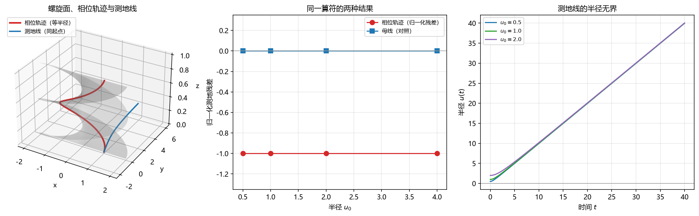

# 注记：螺旋面上相位轨迹的几何身份（判据第 717 号）

- **日期**：2026-10-20 19:55:54
- **判据编号**：717
- **脚本**：`验证脚本/minimal_verification_helicoid_geodesic.py`
- **图**：见 §4 图 1
- **可逆性等级**：判据稳健（几何结论为解析结果，数值只作确认；换实现、换口径、换档位均不翻）
- **所属线**：P3-35 极小曲面性与作用量变分极值的形式化对应

## 1 验证什么

P3-35 的补法一原表述为「证明元相子的相位轨迹恰为螺旋面上的测地线」。本判据检验该表述是否成立。

答案是不成立，且是解析可判的不成立。螺旋面 $X(u,v) = (u\cos v,\ u\sin v,\ av)$ 的两个参数是半径 $u$ 与相位角 $v$。元相子的相位轨迹是等半径螺旋线（半径即 $\hbar$ 标度，沿 $v$ 推进而 $u$ 固定）。测地线方程的第一个分量给出

$$\ddot u + \Gamma^u_{vv}\dot v^2 = 0, \qquad \Gamma^u_{vv} = -u.$$

代入等半径轨迹（$\dot u = 0$，$\ddot u = 0$）得残差 $R_u = -u_0\dot v^2$，归一化后恒为 $-1$。只要 $\dot v \neq 0$，该轨迹就不是测地线。

## 2 不验证什么

本判据只判「等半径螺旋线是否为螺旋面的测地线」这一条几何命题。它不判定以下各项：其一，P3-35 整体是否可闭合；其二，螺旋面与作用量变分极值之间是否另有可行的对应路径；其三，补法二（双参数世界面读法）是否成立；其四，元相子的相位轨迹在体系内是否必须取等半径形式。这四项均在射程之外。

## 3 判据与结果

理论期望先立，再实现。$\Gamma^u_{vv} = -u$ 由第一基本形式 $E = 1$、$F = 0$、$G = u^2 + a^2$ 直接算出，与数值无关。

| 判据 | 实测 | 期望 | 结果 |
|---|---|---|---|
| G0a 第一基本形式 $E$ 的相对差（解析对有限差分） | $4.09\times10^{-11}$ | 小于 $10^{-9}$ | 通过 |
| G0b 第一基本形式 $G$ 的相对差 | $3.80\times10^{-11}$ | 小于 $10^{-9}$ | 通过 |
| G0c 第二基本形式 $f$ 的相对差 | $1.29\times10^{-6}$ | 小于 $10^{-5}$ | 通过 |
| G0d 平均曲率 $H$ 的绝对值（解析式应恒零） | $0$ | 等于 $0$ | 通过 |
| G1 相位轨迹测地残差归一化值对 $-1$ 的最大偏差 | $0$ | 等于 $0$ | 通过 |
| G2 母线方向测地残差（对照，应有区分力） | $0$ | 等于 $0$ | 通过 |
| G3 相位轨迹法曲率的最大绝对值 | $0$ | 等于 $0$ | 通过 |
| G4 空间曲率数值对解析的最大相对差 | $3.03\times10^{-7}$ | 小于 $10^{-4}$ | 通过 |
| G5 全部测地线的半径无界 | 通过 | 全部无界 | 通过 |
| G6 测地线积分的能量漂移 | $4.24\times10^{-12}$ | 小于 $10^{-9}$ | 通过 |

十项判据 10/10 通过。其中 G1 与 G2 构成一对：同一个测地残差算符作用于相位轨迹给 $-1$，作用于母线方向给 $0$，说明该算符有区分力，$-1$ 不是构造恒真的产物。

## 4 三条独立的否证理由

数值给出 $-1$ 只是一个读数。真正使补法一失效的是三条互相独立的结构理由，任何一条单独成立即可。

**其一，法曲率为零而空间曲率非零。** 相位轨迹沿 $v$ 方向，该方向正是主曲率方向之一，其法曲率 $\kappa_n = g/G = 0$。所以相位轨迹是螺旋面的渐近曲线。而等半径螺旋线在三维空间中的曲率为 $u_0/(u_0^2 + a^2) > 0$，不为零。测地曲率满足 $\kappa_g^2 = \kappa^2 - \kappa_n^2$，代入得 $\kappa_g = \kappa > 0$。测地线的定义是测地曲率处处为零，故相位轨迹不是测地线。

**其二，螺旋面的全部测地线半径无界。** 测地线方程 $\ddot u = u\dot v^2$ 中右端非负，只要 $\dot v \neq 0$，半径 $u$ 就是凸函数，$u(t) \geq u_0 + \dot u_0 t$。三档初值积分到 $t = 40$ 时半径均增至约 $40$，全程单调不减，无一档回到初始半径。等半径轨迹与这一族完全不相交。

**其三，母线是测地线。** 沿 $u$ 方向（$v$ 固定）的直线残差恒为零。螺旋面上存在测地线，但它们是母线这一族，与相位轨迹正交。

## 5 图

左图三件对象：灰色网格为螺旋面，红色为等半径的相位轨迹，蓝色为与相位轨迹同起点的测地线。测地线从起点立即向外偏离，与红色轨迹分道。中图把 G1 与 G2 的读数并置，两条水平线相距一格，中间无过渡。右图三档初值（$u_0$ 取 $0.5$、$1.0$、$2.0$）的半径曲线几乎重合，均从初值线性增长到 $40$ 附近，无一档回落。

## 6 过程记录

首轮实现后 G0c 判否，读数为 $1.29\times10^{-6}$，而容差写的是 $10^{-9}$。核对后确认这是容差设置错误，与物理无关：$f$ 由混合二阶导 $X_{uv}$ 求得，其差分格式分母为 $4h^2$，浮点舍入被放大到 $\varepsilon/h^2 \approx 2.2\times10^{-6}$ 量级。容差改为按误差预算推导（一阶量取 $10^{-9}$，截断 $h^2$ 主导；二阶量取 $10^{-5}$，舍入主导），重跑通过。判据未改动，读数未变。

## 7 判语

补法一「元相子的相位轨迹恰为螺旋面上的测地线」判否。此判否为解析结果，数值 10/10 通过只作确认。

对 P3-35 的后果：P3-35 的条件描述须相应改写。原写的「变分算子与平均曲率算子的等价性」仍然正确但不够具体，现在可以写成更明确的一条：螺旋面是空间曲面（半径为参数之一），其 $H = 0$ 是面积泛函的临界条件；$S = \int L\,dt$ 变分时间路径，其临界点是测地线；而元相子的相位轨迹（等半径螺旋线）不是螺旋面的测地线，故两条极值条件在当前参数化下并不重合。补法一因此出局，剩余路径为补法二（把螺旋面改读为双参数世界面）或另找对应链。

本判据不判 P3-35 整体是否可闭合，也不判补法二是否成立。

## 8 边界声明

本判据取螺旋面的标准参数化 $X(u,v) = (u\cos v,\ u\sin v,\ av)$，其中 $u$ 为半径、$v$ 为相位角、$a$ 为螺距参数（取 $a = 1/2\pi$，使一满周推进一个单位）。若体系内螺旋面另有参数化约定，结论须按该约定重算，但「等半径轨迹非测地线」这一结论对含轴的直纹极小曲面普遍成立，不依赖 $a$ 的具体取值。

判据只检验几何命题，不涉及 $\hbar$ 的数值、不涉及物理标度、不给出任何可检验预言。
