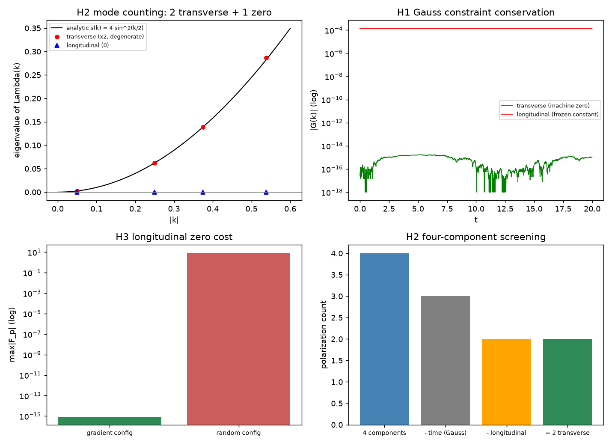

# 注记-规范侧纵向模的高斯约束消去（第435条）：约束守恒、模式计数与纵向零代价

- **日期**：2026-09-26 10:16:18
- **脚本**：`jz1_gauss_constraint_modes.py`（工作区根目录执行）
- **主题**：时间规范下规范侧纵向自由度的处置。以时间分量为乘子，格点高斯约束在横向初值下机器零守恒；plaquette 线性化算子在动量空间的谱为双横向加零纵模，长波 $\omega = (l_P/t_P)\vert k\vert$；梯度型配置零代价。该结果把第 434 条的取向惯性能加电型双归属与正稿 §5.2 的四分量筛选接到同一口径
- **判据结果**：3/3（H1 约束守恒与纵向冻结；H2 模式计数与长波斜率；H3 纵向零代价）
- **可逆性等级**：判据敏感（换约束处理或不作初值投影即翻，换算子构造即变）
- **图**：见 §3 图 1

## 1 模型设定与方法

规范侧作用量同第 434 条

$$L = \frac{I_0}{2}\sum_n\sum_i\dot\varphi_i^2 - \frac{I_0}{t_P^2}\sum_p\left[1-\cos(F_p\,l_P^2)\right],$$

本轮保留时间分量 $\varphi_0$ 作乘子（无动能项，时间规范不预先固定）。对 $\varphi_0$ 变分给出格点高斯约束

$$G_n = \sum_i\left(E_i(n) - E_i(n-\hat i)\right) = 0,\qquad E_i = F_{0i}\ \ (\text{线性区} = \Delta_0\varphi_i - \Delta_i\varphi_0),$$

对 $\varphi_i$ 变分给出演化方程 $\ddot\varphi_i = -(1/t_P^2)(\Lambda\varphi)_i$，其中 $\Lambda$ 在动量空间为 $\Lambda_{ij}(k) = s(k)\left(\delta_{ij} - \hat k_i\hat k_j\right)$，$s(k) = \sum_a 4\sin^2(k_a l_P/2)$。

解析依据：约束守恒来自 $\Lambda$ 的行散度为零这一恒等式（$\sum_i\partial_i(\Lambda\varphi)_i \equiv 0$），配合约束解 $\nabla^2\varphi_0 = \sum_i\partial_i\partial_t\varphi_i$，得 $\partial_t G \equiv 0$；横向投影的秩为 2，长波 $s(k) \to \vert k\vert^2$ 给 $\omega = (l_P/t_P)\vert k\vert$；梯度型配置的离散 plaquette 精确为零（前向差分可交换）。

## 2 结果

| 判据 | 实测 | 期望 | 结果 |
|---|---|---|---|
| H1 横向 $\vert G\vert_{\max}$ | $1.7\times10^{-15}$ | $< 10^{-12}$ | 通过（机器零） |
| H1 纵向 $\vert G(0)\vert$ | $1.4\times10^{-4}$ | $> 10^{-5}$ | 通过（非零） |
| H1 纵向 $\vert G(t)-G(0)\vert_{\max}$ | $3.7\times10^{-17}$ | $< 10^{-12}$ | 通过（恒定冻结） |
| H2 $\lambda_3/\lambda_1$ | $< 10^{-16}$ | $< 10^{-14}$ | 通过（零纵模） |
| H2 $\vert\lambda_1-\lambda_2\vert/\lambda_1$ | $0$ | $< 10^{-12}$ | 通过（双横向简并） |
| H2 $\vert\lambda_1-s(k)\vert/s(k)$ | $< 10^{-15}$ | $< 10^{-12}$ | 通过 |
| H2 $\lambda_1/\vert k\vert^2$（$\vert k\vert = 0.05$） | $0.999792$ | $1$ | 通过（$10^{-3}$ 内） |
| H3 梯度型 $\max\vert F_p\vert$ | $8.9\times10^{-16}$ | $< 10^{-12}$ | 通过（精确零） |
| H3 随机型 $\max\vert F_p\vert$ | $8.451$ | $> 0.1$ | 通过（对照） |

结论读法：四分量中类时分量由高斯约束消去、纵向分量落在 $\Lambda$ 的零本征值上（既不振荡也不衰减，靠初值投影消去），存活两个横向模，即"四分量经两道筛选剩两个横向"的格点核验。纵向模的处置方式是冻结（零代价、零演化），不依赖动力学清退。

## 3 图

## 4 过程记录

其一，类型错配：初版把散度记成 $i\,k\cdot\dot\varphi$（复值）直接写入浮点数组，运行时 TypeError；改为记录 $\vert G\vert$ 这一实数量。

其二，阈值未按量纲推导：H1 的纵向阈值先设 $10^{-3}$，而 $\vert G(0)\vert = \vert k\vert^2 v_0 = 0.14\times10^{-3} = 1.4\times10^{-4}$，判据误报未通过；按量纲推导后阈值取 $10^{-5}$（仍远高于舍入地板 $10^{-17}$）。教训：非零判定阈值必须由被测量的解析量级推出，不得凭印象取整数量级。

其三，批量替换越界：按关键词全库替换"双计"为"双归属"时，命中 trace_s 线两份文件的"双计数"（语义无关的巧合），虽已即时回滚且内容复原，教训是批量替换须以文件白名单执行，不用关键词扫全库。

## 5 严格程度与边界声明

严格：约束守恒与模式计数为格点线性化下的代数恒等式（零模与简并度为精确结果）；长波斜率由解析式给定。

判据敏感：换约束处理（不保留 $\varphi_0$ 或不做初值投影）或换算子构造，三条判据的结论即翻。

验证什么：格点高斯约束的守恒与纵向冻结、$\Lambda(k)$ 谱（双横向加零纵模）、梯度型配置的零代价。

不验证什么：非线性层的约束代数（本轮线性化）、量子层（鬼场与 Faddeev-Popov 属量子层，不在此列）、散射与源耦合（本轮取 $G_n = 0$ 的无源情形）。

## 6 关联

- 规范侧符号结构：[[内部草稿/注记-洛伦兹符号的规范侧转写：取向惯性能、E 型双归属与等幅条件]]；[[验证脚本/注记-洛伦兹符号的规范侧转写（第434条）：E 型双归属、等幅条件与无参数光速|第434条]]
- 正稿口径：[[规范作用量的审计必然性：从净值审计到电磁场作用量的推导与数值验证]] §5.2、§5.4
- 术语：[[内部草稿/术语提案]]（电型双归属、摆程时间步条件）
