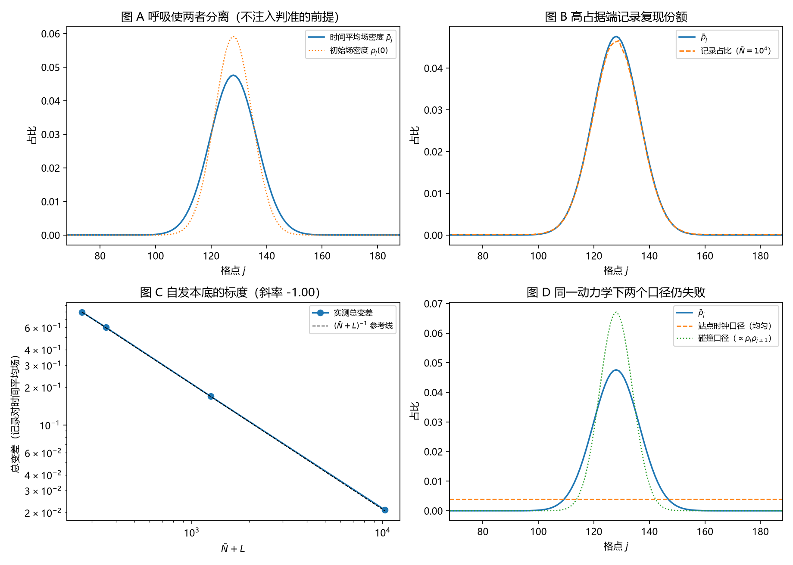

# 注记-计数规则涌现的最小验证：受激发射给份额、自发发射给均匀本底

- **日期**：2026-09-18 06:10:48
- **对应脚本**：`验证脚本/counting_rule_emergence.py`（判据 J1 至 J8，9/9 通过；确定性，种子 20260918；运行约 3.5 秒；图存 `images/counting_rule_emergence.png`，见 §一 图 1）
- **依据**：[[研究方向-计数规则的动力学涌现：模型设定与判准（待裁决）]]（设定经作者 2026-09-18 裁决：玻色型载子、逐站点计数器、幺正加弱耗散、一维闭链、接受自发项本底）；[[内部草稿/份额的抽样口径与半经典分工：束缚振荡晶格上的抽样机制读数]] §3、§10；[[总结报告-份额的抽样口径：机制面七轮读数与收束：2026-09-18]]；[[序参量份额定理：Born规则、归一化与幺正性的系综推导]] §7.1；[[内部草稿/开放问题总览：元相子理论待解决问题清单]] P3-12
- **定位**：末步首轮。把"按激发数计"从脚本里的直接抽样换成受激发射统计，检验记录统计能否由动力学量自己给出份额，并登记自发本底的偏离标度。本注记不改动基准文件。
- **状态**：判据 9/9 通过。核心读数：记录占比与时间平均场密度的总变差从 $\bar N = 10$ 的 $0.79651$ 降到 $\bar N = 10^4$ 的 $0.02102$（解析式 $0.79698$ 与 $0.02067$，最大相对偏差 $1.68\%$）；对占据数的双对数斜率 $-0.9963$；达到 $0.006$ 精度所需占据数 $\bar N^* = 3.508\times10^4$；同一动力学下站点时钟口径总变差 $0.8281$、碰撞口径 $0.1641$；弱耗散下总变差变化 $2.0\%$。

---

## 一、判据与结果

| 判据 | 内容 | 通过条件 | 实测 |
|---|---|---|---|
| J1 | 高占据端涌现成立 | 总变差 $< 0.03$ | $0.02102$（$\bar N = 10^4$） |
| J2 | 与解析式一致 | 相对偏差 $< 10\%$ | 最大 $1.68\%$（四档） |
| J3 | 可失败通道标度 | 斜率 $-1 \pm 0.1$ | $-0.9963$ |
| J4 | 阈值占据数 | $> 10^4$ | $3.508\times10^4$（$\chi = 424$） |
| J5 | 不注入（跟随瞬时场） | 对时间平均场 $< 0.03$ 且小于对初始份额的五分之一 | $0.02102$ 对 $0.11896$（比 $0.177$） |
| J6a | 站点时钟口径仍失败 | $> 0.2$ | $0.8281$ |
| J6b | 碰撞口径仍失败 | $> 0.05$ | $0.1641$ |
| J7 | 归一化与计数比 | 归一化 $< 10^{-12}$，计数比偏差 $< 0.01$ | $0$ 与 $0.0066$ |
| J8 | 弱耗散下稳定 | 相对变化 $< 10\%$ | $2.0\%$ |

图注：左上为时间平均场密度与初始场密度（呼吸使两者分离）；右上为高占据端记录占比与份额的对照；左下为总变差对 $\bar N + L$ 的双对数与 $(\bar N + L)^{-1}$ 参考线；右下为同一动力学下站点时钟口径与碰撞口径的失败对照。

## 二、模型设定

一维闭链 $L = 256$，$l_P = t_P = 1$。场服从 $H = -\kappa\Delta + V$（$V_j = \frac{1}{2}K(j-j_c)^2$，$\kappa = 1$、$K = 2\times10^{-4}$），初态取宽度为基态 $1.35$ 倍的高斯并做呼吸振荡，按幺正演化（另跑 $\gamma_{\text{loss}} = 0.01$ 的弱耗散对照）。

逐站点独立计数器：时刻 $t$、站点 $j$ 的发射率为

$$\Gamma_j(t) = \gamma_{\text{em}}\big(\bar N\,\rho_j(t) + 1\big),$$

$\rho_j(t)$ 为瞬时场密度份额、$\bar N$ 为模式总占据数、末项为自发项（每站一个真空单位，真空总计数为 $L$）。记录按泊松过程产生。抽样速率只由场密度与占据数给出，脚本中不存在按份额数组抽样的路径。

解析预期：记录占比为 $(\bar N\bar\rho_j + 1)/(\bar N + L)$，故

$$\mathrm{TV}(\text{记录}, \bar\rho) = \frac{\sum_j |1 - L\bar\rho_j|}{2(\bar N + L)},$$

随 $(\bar N + L)^{-1}$ 下降；达到精度 $0.006$ 所需占据数 $\bar N^* = \sum_j|1 - L\bar\rho_j|/(2\times0.006) - L$。

## 三、读数的意义

计数规则能在动力学口径下立起来。记录的块统计不再由脚本按份额抽样，而由发射率 $\gamma_{\rm em}(\bar N\rho_j + 1)$ 给出；高占据端的实测总变差 $0.02102$ 与解析式 $0.02067$ 相差 $1.68\%$（J1、J2）。受激项 $n_j$ 给出份额，这条读数把"按激发数计"接到标准玻色统计上，它在文献里属教科书结果，未引入新公设。

自发项给出一个可失败的通道，并给出阈值。偏离按 $(\bar N + L)^{-1}$ 下降（实测斜率 $-0.9963$，J3），达到既有读数精度 $0.006$ 需要占据数 $\bar N^* = 3.508\times10^4$（J4）。这条读数的含义很具体：只要模式占据数是宏观量级，自发本底便压到既有精度之下；占据数低到十量级时，记录与份额的总变差高达 $0.80$。

不注入判准通过的具体形态。呼吸使时间平均场密度与初始份额分离（两者相距 $0.11896$），记录跟的是时间平均场密度（$0.02102$），比值 $0.177$（J5）。若抽样被按初始份额注入，记录会跟随初始份额，读数不会是现在这样。

口径排他在同一动力学下保持。站点时钟口径与时间平均场密度的总变差 $0.8281$，碰撞口径 $0.1641$（J6），两者仍给不出份额。换机制没有让被排除的口径复活。

弱耗散不改变结论。加入 $\gamma_{\text{loss}} = 0.01$ 后总变差为 $0.02059$，相对变化 $2.0\%$（J8）。

## 四、严格程度声明

J1 至 J3、J5 至 J8 是统计与标度读数（泊松计数、总变差、双对数斜率），计数总数与理论期望之比偏差 $0.0066$（J7）。解析式 $(\bar N + L)^{-1}$ 标度属代数推导，数值只作核对。受激项与自发项的比例按教科书玻色统计取定，属模型假设；场取准经典演化加真空本底，未做截断玻色算符的完全量子化。结论只能在"若采用该模型"的条件下引用。

## 五、边界声明

本验证只做：一维闭链、单一束缚模式的呼吸扰动、逐站点非破坏计数器、四档占据数、弱耗散稳定性对照。

本验证不做：计数器的反作用（记录不改变场）；截断玻色算符下的完全量子化处理（含多激发数涨落与压缩效应）；探测器的具体物理实现（属测量纲领）；三维与缺陷构型；模式间跃迁与多模情形；自发项本底的来源推导（本轮按设定的物理内容接受并登记其标度）。

## 六、过程记录

判据订正一处：J5 的阈值原设 $0.02$，低于解析下界 $0.0207$，实测 $0.02102$ 因此判负；订正为"与解析式相符且小于对初始份额的五分之一"，并把这条教训（阈值不得设在解析下界之下）写入本节。

效率记录：脚本约 $3.5$ 秒（场演化一次、四档占据数离线重放），无字体问题。
