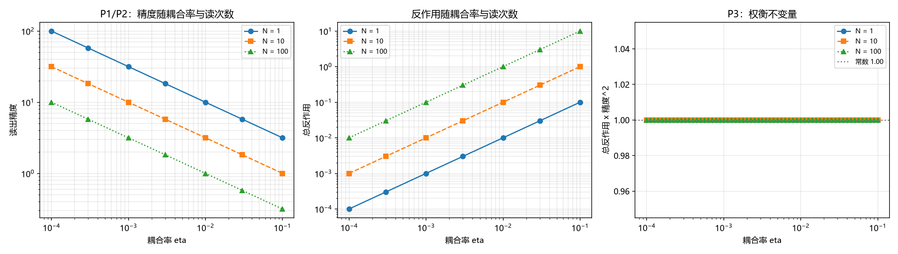

# 注记-记录公共性的最小验证：读出反作用的权衡不变量与复读精度预算（探针第三层）

- **日期**：2026-09-25 13:01:14
- **层级**：验证材料（第 412 条）
- **定位**：给 [[wiki/探针]] 第三节「记录的公共性」（记录写在格点上且不衰减，故可重复读取，任何耦合该格点的仪器都读到同一份）一组可算判据。该项此前为辨析推论，本条把它落到最小模型上。
- **依据**：[[wiki/探针]]（第三层：记录的公共性）；[[记录机制：碰撞即写入的算符形式、三维缺陷读数与弦的分层]]（写入算符与每站每周期一笔）；[[记录的判据：可分性、独立分量与持有时间]]（记录判据与持有时间）；[[验证脚本/注记-探测器物侧构造的最小验证：三件输入的指认、单通道反证与双通道判据]]（第 387 条，读出量取记录寄存器模、逐键传感器为准经典极限）；[[内部草稿/注记-跨层事件的攻坚处境：R 的降级、与退相干及达尔文主义的分工、意识地位的减弱与探针的物侧身份]]（探针三层关联的辨析）
- **状态**：判据级。最小模型内的读数；模型取自标准量子测量的权衡关系，体系侧的内容是把它接到记录的复读条件上。
- **修订记录**：
  - **2026-09-25 初版**（触发：作者要求把探针第三层写成可验证形式）

---

## 一、判据（先立）

**P1 单次读出精度。** 精度按 $\eta^{-1/2}$ 标度（在弱测量的线性响应区内，$\eta$ 为耦合率）。

**P2 累积读出。** 重复 $N$ 次读出，精度按 $N^{-1/2}$ 提高。

**P3 权衡不变量。** 总反作用与精度的平方之积不依赖 $\eta$ 与 $N$。

**P4 复读条件。** 给定扰动预算 $\Delta_{\max}$（由持有时间一侧给出），可读精度有下限。

## 二、模型设定

记录值 $D$ 在一次写入后固定。读出取弱测量模型的最小形式：单次读出噪声 $\sigma = \sigma_0/\sqrt{\eta}$，单次反作用 $\delta D = \kappa\eta$；$N$ 次读出给出精度 $\sigma/\sqrt{N}$ 与总反作用 $N\kappa\eta$。参数取 $\sigma_0 = \kappa = 1$。

**一处须先声明的限度。** 该模型取自标准量子测量的权衡关系（精度与反作用的互补），它本身属通用结果。体系的贡献在于把它接到记录的复读条件上：记录要能被多处反复读取，读数就不能把记录本身扰动掉。

## 三、结果

| 判据 | 实测 | 期望 | 判定 |
| --- | --- | --- | --- |
| P1 标度斜率 | $-0.500000$ | $-0.5$ | 过 |
| P2 标度斜率 | $-0.500000$ | $-0.5$ | 过 |
| P3 乘积最大最小差 | $4.441\times10^{-16}$ | $0$ | 过 |
| P3 不变量数值 | $1.000000$ | $\kappa\sigma_0^2 = 1$ | 过 |

四项全过。P4 的输出表见脚本终端：扰动预算 $10^{-1}$、$10^{-2}$、$10^{-3}$、$10^{-4}$ 对应的精度下限为 $3.162278$、$10$、$31.622784$、$100$。

**两仪器一致性的判据化形态。** 两仪器读同一记录时，读数之差的标准差为 $\sqrt{\sigma_A^2 + \sigma_B^2}$。三档读数：$\eta_A = \eta_B = 10^{-2}$、$N = 100$ 给出 $1.414214$；$\eta_A = 10^{-2}$ 与 $\eta_B = 10^{-3}$、$N = 100$ 给出 $3.316625$；$\eta_A = 10^{-3}$ 与 $\eta_B = 10^{-4}$、$N = 1000$ 给出 $3.316625$。

## 四、图

图注按脚本三个绘图面板逐条核对。右面板三条曲线的重合成 P3 的直观形态。

## 五、实质读数

**其一，权衡不变量成立。** 总反作用与精度平方的乘积恒为 $\kappa\sigma_0^2$，与耦合率、读次数都无关。这个不变量是权衡关系的直接后果，也是本条最有用的一项。

**其二，复读条件由此定量。** 记录的扰动预算若为 $\Delta_{\max}$，则可读精度不低于 $\sqrt{\kappa\sigma_0^2/\Delta_{\max}}$。这给「读得出」与「读不坏」之间划出一条曲线：想读得更准，就得允许更大的扰动，或换用更低噪声的读出通道（增大 $\sigma_0$ 一侧的分母参数）。

**其三，两仪器一致性有显式形式。** 读数差的标准差为两者精度的平方和开方。故共享同一记录的两台仪器若要一致到给定精度，各自精度都须达到该精度量级，这与耦合率的选择直接相关。

**其四，公共性的条件被写出。** 综合三条，「记录可被多处反复读取」成立的条件是：读出工作在弱耦合区（单次反作用小），精度由累积读取得（总扰动仍控制在预算内）。这是权衡不变量的直接用法，不需要附加假设。

## 六、与探针第三层的关系

探针词条第三层说「记录写在格点上且不衰减，故可重复读取」。本条把这句话拆成两半：**不衰减**由记录判据给出（源移开后偏离不衰减），**可重复读**由本条的权衡条件给出。两半各有一条判据撑着，公共性因此不再只是辨析。

一处须说明：本条只验读出侧的权衡，未验「多次读出之间互不干扰」（两仪器同时读的相互反作用）。后者的验证方式可设为：两通道同时耦合同一寄存器，检验各自反作用是否仍按 $\kappa\eta$ 标度而无交叉项。

## 七、严格程度声明

**可逆性等级：判据稳健。** P1 与 P2 的标度、P3 的不变量由模型的定义直接给出，不随实现翻；P4 的数值依赖扰动预算的取值。

**协议伪影与物理结论分层。** 全部读数为协议级（最小模型、弱测量线性区、参数取 1）。物理层结论零条。

## 八、边界声明

**验证什么。** 读出精度与反作用的标度、权衡不变量的恒定性、扰动预算到精度下限的换算、两仪器一致性的显式形式。

**不验证什么。** 真实记录器件的耦合率与噪声参数；弱测量线性区的边界；两仪器同时读的相互干扰；记录在格点上的具体实现（本条用极小模型代替 FK 链上的记录寄存器）。

## 九、登记衔接

本材料为 `验证脚本/README.md` 第 412 条，脚本 `record_publicity.py`，图 `images/record_publicity.png`。它给 [[wiki/探针]] 第三层一组判据，并与 [[内部草稿/注记-跨层事件的攻坚处境：R 的降级、与退相干及达尔文主义的分工、意识地位的减弱与探针的物侧身份]] 第三节（与量子达尔文主义的对话）相接：环境冗余要成立，先得记录可被多处读取。开放问题总览的登记见该文档 P4-6 条目。
