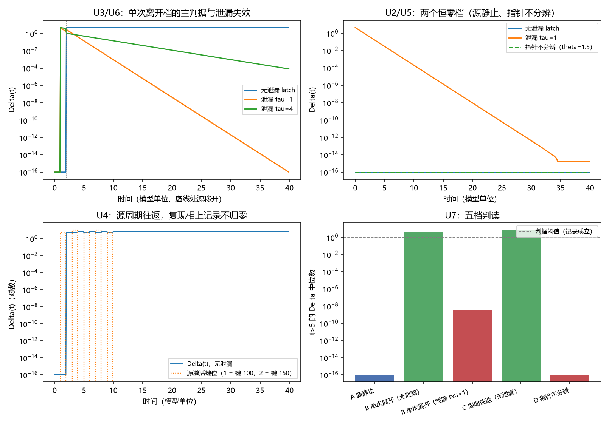

# 注记-记录判据的最小验证：独立性的定义域、反例与判据级表述

- **日期**：2026-09-24 03:30:25
- **层级**：验证注记（对应 `验证脚本/minimal_verification_record_criterion.py`，`验证脚本/README.md` 第 379 条）
- **图**：见 §三 图 1
- **定位**：执行 [[研究方向-记录判据：独立性的定义域、反例与判据级表述（判据草案）]] 的判据 U1 至 U8。把近四轮共用的判别量 $\Delta(t)$ 立成体系口径，并给出"记录成立"的判据级表述、定义域与反例清单。
- **依据**：[[研究方向-记录判据：独立性的定义域、反例与判据级表述（判据草案）]]；[[测量的三层判据：从相互作用分层到单次测量机器]]（§2.3 记录的技术定义）；[[注记-增益阈值物理内容的最小验证：读数门限、指针分辨与记录寿命的三分]]（$\Delta$ 的首用、$\theta < w_{\max}$、持有时间）；[[注记-弹性通道代价归属的最小验证：M2 缓增的轨迹分解与时间反演可逆性]]（从属与独立）；[[注记-滚动记录与持久记录可分性的最小验证：无独立因子条件、两种累积律与重写实现的影响]]（$\kappa$ 条件式）
- **关联**：[[开放问题总览：元相子理论待解决问题清单]]（测量塌缩的元相子机制）；[[理论攻坚/测量问题攻坚纲领：三条承重墙的闭合]]（裁决点 2 的两条限制）
- **状态**：模型内判据级。判据表述在受控键滑序列上验证；真实源情形由上一轮的 T7 读数覆盖。

---

## 一、模型与协议

本轮的源取受控键滑序列，不依赖 FK 积分：尺度归一，越阈键取 $w = 1.0$、指针阈值 $\theta = 0.5$，键数 $400$，采样步 $0.1$，记录深度 $G = 5$。保持档三种：无泄漏 latch（越阈即置 $G$、不衰减）、泄漏型（弛豫时间 $\tau$）、指针阈值放大档（$\theta = 1.5$，无键越阈）。当前构型平衡值取 $y^{\text{eq}}(t) = G\,\Theta(w(t) - \theta)$，偏离取 $\Delta(t) = \lVert y(t) - y^{\text{eq}}(t)\rVert_2$。

四档源形态：甲 源静止（键 $100$ 全程越阈）；乙 源单次离开（键 $100$ 只在 $t \in [1, 2)$ 越阈）；丙 源周期往返（键 $100$ 在 $[1,2)$、$[5,6)$、$[9,10)$，键 $150$ 在 $[3,4)$、$[7,8)$）；丁 指针不分辨（同甲之源，$\theta = 1.5$）。

## 二、判据结果

| 判据 | 判据量 | 实测 | 期望 | 结论 |
| --- | --- | --- | --- | --- |
| U2 源静止档 | 无泄漏 $\Delta$ 中位数 / 泄漏档末值 | $0$ / $1.78\times10^{-15}$ | $0$ | 通过 |
| U5 指针不分辨档 | $\Delta$ 中位数 | $0$ | $0$ | 通过 |
| U5 对照 | 单次离开档下 $\theta = 0.5$ 对 $1.5$ 的 $\Delta$ 中位数 | $5.0000$ / $0.0000$ | 读数 | 读数 |
| U3 单次离开档 | $t = 40$ 时无泄漏 / $\tau = 1$ / $\tau = 4$ | $5.000$ / $9.92\times10^{-17}$ / $8.28\times10^{-5}$ | 读数 | 读数 |
| U3 保留比 | 无泄漏对泄漏（$\tau = 1$） | $5.04\times10^{16}$ | 读数 | 读数 |
| U6 泄漏档衰减率 | 对 $-1/\tau$ 的最大相对偏差 | $2.22\times10^{-15}$ | $< 5\%$ | 通过 |
| U4 周期往返档 | 复现相位 $\Delta$ / 首个离开相 / 初始相 | $5$ / $5$ / $0$ | $> 0$ / $> 0$ / $0$ | 通过 |
| U7 逐档核对 | 五档判读与判据一致档数 | $5$ | $5$ | 通过 |

U7 的五档读数依次为：源静止 $0$；单次离开（无泄漏）$5.0000$；单次离开（$\tau = 1$）$3.58\times10^{-9}$；周期往返（无泄漏）$7.0711$；指针不分辨 $0$。

## 三、图 1

四面板与脚本绘图面板逐条对应：左上为 U3 与 U6，右上为 U2 与 U5，左下为 U4，右下为 U7。

## 四、读数分解

两个恒零档先钉住定义域。源静止时无泄漏档的偏离中位数为 $0$（机器零），泄漏档末值 $1.78\times10^{-15}$；指针不分辨时偏离恒为 $0$。两档都说明判据的内容依赖源曾改变构型与指针能分辨源，这正是判据草案 §二 的两条前提。作为对照，单次离开档在 $\theta = 0.5$ 下偏离中位数为 $5.0000$，在 $\theta = 1.5$ 下为 $0.0000$，同一个源形态因指针分辨率而分居两侧。

主判据在单次离开档上成立。$t = 40$ 时无泄漏档的偏离为 $5.000$，$\tau = 1$ 档为 $9.92\times10^{-17}$、$\tau = 4$ 档为 $8.28\times10^{-5}$，保留比 $5.04\times10^{16}$。泄漏档的衰减率在 $\tau = 0.25,\,1,\,4$ 三档读到 $-4.000000$、$-1.000000$、$-0.250000$，对 $-1/\tau$ 的相对偏差 $2.22\times10^{-15}$。

反例二在周期往返档上显现。源在 $t \in [3,4)$ 改到位点 $150$、在 $t \in [5,6)$ 回到位点 $100$ 时，无泄漏档的偏离中位数在复现相为 $5$、在首个离开相为 $5$、在初始相为 $0$。源回到原位并不使记录归零，因为位点 $150$ 的记录仍在位。五档读数中周期往返档的偏离为 $7.0711 = 5\sqrt{2}$，对应两个键位同时持有，与 $\sqrt{n_{\text{diff}}}$ 的增长形态一致。

## 五、结论与判据级表述

**记录判据**：记录成立，当且仅当源移开后偏离 $\Delta$ 不衰减。

三条推论随判据一并使用。其一，定义域：源须曾改变构型，保持档的分辨范围须覆盖源的键滑范围，且须可计算 $y^{\text{eq}}$（即须知道指针阈值与源读数）。其二，四个反例：源静止时 $\Delta \equiv 0$；指针不分辨或增益为零时 $\Delta \equiv 0$；泄漏型持有的 $\Delta$ 按 $e^{-t/\tau}$ 交还，故要求 $\tau_{\text{rec}} \gg N_{\text{拍}} t_P$；源周期复现时"复现即归零"的朴素期望为假，记录内容是历史而非瞬时构型。

其三，三处结论同源：限制三的 $\kappa = 0$ 条件、限制一的指针分辨条件（$\theta < w_{\max}$）与持有时间条件，都可由本判据派生。

论文 §2.3 的技术定义（"记录由不随源消亡的自由度持久地、放大地持有"）由此获得可判定形态：不随源消亡即源移开后 $\Delta$ 不衰减；持有所要求的正是无泄漏档。

## 六、严格程度声明

| 结论 | 档位 |
| --- | --- |
| 四条定义与判据级表述（U1、U7、U8） | 定义级与模型内判据级 |
| 两个恒零档（U2、U5） | 模型内判据级（机器零） |
| 保留比与衰减率（U3、U6） | 代数结论（模型内），实测 $10^{-15}$ |
| 周期往返档的历史保留（U4） | 模型内判据级 |
| 实数源上的同类读数 | 见上一轮 T7（无泄漏对泄漏中位数比 $20.4$） |

## 七、边界声明

**验证什么**：偏离 $\Delta$ 在两档恒零形态下的行为；主判据在单次离开档上的分离度；泄漏档的衰减律；周期往返档的历史保留；五档判读与判据的一致性。

**不验证什么**：真实探测器阵列中 $y$ 与 $\theta$ 的物理来源；退相干速率的绝对值（归 P4-10）；三维与复合体；$\Delta$ 与物理可见度之间的换算（上一轮已给判别协议，换算仍待）。本注记不改动 [[理论总纲/子理论索引]] 与任何基准文档。

## 八、过程记录

首轮有三处判据量设计不当并已纠正。其一，源静止档的泄漏档用中位数判归零，而中位数含 $t = 5$ 附近的早期过渡（该处偏离约 $0.03$），故判据误判；改为取末值后读 $1.78\times10^{-15}$。其二，指针不分辨档的对照原用源静止档，两档皆为零、不构成对照；改为用单次离开档作参照后读 $5.0000$ 对 $0.0000$。其三，新对照首版引用了同轮内尚未定义的变量（定义次序在前），改为块内自算。教训：恒零档之间的比较不构成对照，须选一个非零档作参照；判据量的窗口选择要避开过渡段。
