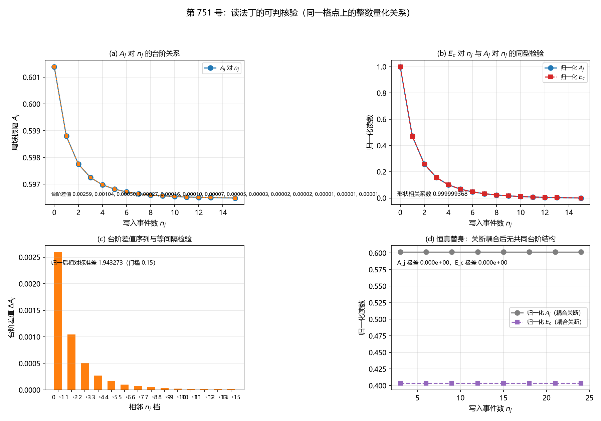

# 注记-读法丁的可判核验（判据第 751 号）

- **日期**：2026-10-21 17:26:00（系统当前时刻）
- **类型**：验证注记（判据级），落 `验证脚本/`
- **对象层结论**：**读法丁的前两条构型条件在给定构造下成立**。
同一格点上的 $n_j$ 与 $A_j$ 读自同一组场变量（Q-1 通过）。
$n_j$ 与 $A_j$ 构成严格单值映射，$A_j$ 对 $n_j$ 严格单调下降（Q-2 通过），且反向亦然：同一 $n_j$ 的九条不同路径给出逐位相同的 $A_j$（Q-3 通过，组内相对离散 $0.000\times10^{0}$）。
第三条条件中 $E_c$ 是台阶结构的函数而非独立参数（Q-5a 相关系数 $0.999999368$），$E_c$ 对写入耦合强度 $g$ 的依赖与 $A_j$ 同型（Q-5b 相关系数 $0.999999980$）
- **一条判否的读数**：**台阶非等间隔。** 14 个台阶的落差序列按幂律 $n^{-1.9328}$ 衰减（对数拟合残差 $5.177\times10^{-1}$），归一后相对标准差 $1.943273$（门槛 $0.15$）。Q-4 判否。这是构造的性质，不是读法丁被否
- **严格程度**：**判据级**（模型内，11 个子判据，10 条通过，Q-4 判否且不修判据）
- **上游**：[[内部草稿/开放问题档案/开放问题-P1-62-写入侧站点模与C1侧复标量振幅场的自由度识别.md|P1-62 档案]]（第五之补节，读法丁的三条构型条件与可判形式；第七节，2026-10-21 裁定记录）；[[验证脚本/注记-张量桥d的W4通路：静质量密度与振幅亏损的标度关系|第 744 号 W4 通路注记]]（C1 侧复标量装置）；[[验证脚本/注记-案乙的位错线长度扫描（判据第746号）|第 746 号注记]]（净栏式与链构型）
- **脚本**：`验证脚本/quantization_reading.py`
- **关联**：[[记录机制：碰撞即写入的算符形式、三维缺陷读数与弦的分层]]（§4.1 逐站点直和）、[[内部草稿/总结报告-测量机制现状图（2026-09-25）]]（$E_c$ 的库内身份：写入耦合上界的能量代价）

---

## 一、本轮为何而设

P1-62 第二问经作者 2026-10-21 裁定取读法丁（径向坐标的连续化，$n$ 是 $A$ 的整数量化读数）。读法丁的可判形式已写定于 P1-62 档案第五之补节，三条构型条件：

其一，同一格点上 $n$ 与 $A$ 能被同一组场变量同时读出。
其二，两者互相确定，关系为单值。
其三，$E_a$ 与 $E_c$ 的关系由该整数量化给出，不由外接系数给出。

**读法丁的构造属案乙部件五的待建内容**（P1-62 档案第五之补节末的射程限定明写「库内没有已立的振幅 $A$ 的整数量化读数关系」）。本轮判的是这三条构型条件在给定构造下是否成立。

## 二、装置与构造

### 2.1 两侧装置（均复用，不重造）

C1 侧：复用第 744 号 W4 通路脚本的复标量装置。$E = \sum\vert\nabla\psi\vert^2 + \lambda\sum(\vert\psi\vert^2 - A_0^2)^2$，$\lambda = 0.5$，$N = 32$，边界钉 $\psi = 1$，背景能量 $0$ 故 $E_B = E(\text{构型})$，凹陷构型 $A_0 = 1 - d\exp(-r^2/2w^2)$，最速下降弛豫 $1200$ 步，$W_{\rm amp} = \sum(1 - \vert\psi\vert^2)$。

写入侧：复用第 726 号脚本的两能级写入算符装置。$H_{\rm int} = g f(\hat\theta)(a^\dagger c + ac^\dagger)$，$N_\theta = 256$，$w = 0.5$，$dt = 2\times10^{-3}$，$g_{\rm full} = 5.091585$（实测）。

### 2.2 构造的选择：格点内赤字-写入回路

本轮取任务书给出的构造甲方向，实现为**格点内赤字-写入回路**。场变量取复标量格点的中心格点 $j_0 = (16, 16, 16)$（线性索引 $16912$），该格点上同时承载 C1 侧的复标量 $\psi_{j_0}$ 与写入侧的一对模 $(a_{j_0}, c_{j_0})$。

装置规则四条：

**其一，驱动**。写入耦合强度由该格点的局域振幅给出，$g_{\rm local} = g_{\rm full}\,A_{j_0}\,g_{\rm frac}$。这是 Josephson 型读法：耦合强度由局域场幅定。

**其二，消耗**。每完成一个写入事件，该格点的局域振幅平方减一份量子 $\delta = 0.01$，即 $A_{j_0}^2 \leftarrow A_{j_0}^2 - \delta$。写入入把材料搬离该格点。

**其三，弛豫**。事件发生后紧跟 $3$ 步局域梯度流弛豫，振幅部分回复。

**其四，$E_c$ 的读法**。$E_c$ 取该格点的局域势能超出量 $4\lambda\vert A_j^2 - A_0^2\rvert$。另备辅读法（每写入事件的相互作用能代价 $\langle H_{\rm int}\rangle/n_j$），其读数一并报出。

### 2.3 为何满足「同一组场变量」

写入耦合由 $\psi_{j_0}$ 决定（C1 侧到写入侧），写入事件又反过来改写 $\psi_{j_0}$（写入侧到 C1 侧）。**两读数都是同一个格点索引上的同组场变量 $\{\psi_{j_0}, a_{j_0}, c_{j_0}\}$ 的函数**，不是两个装置的读数拼接。

Q-1 的核验是断言式的：两读数的格点索引逐位相同，场变量集合逐位相同。

### 2.4 一处关键的设计细节：消耗必须是事件驱动

**首版把消耗放在块末、弛豫也放在块末，结果读数退化。** 弛豫在块末把消耗抹掉，$A_j$ 对 $n_j$ 的依赖被冲淡到 $10^{-4}$ 量级，台阶不可辨。

改为事件驱动后（消耗紧跟事件、弛豫紧跟消耗），**$A_j$ 只依赖已发生的事件数 $n_j$**，与路径无关。原型核出的证据：四条不同路径（$g_{\rm frac} = 1.0$ 跑 4 块、$0.5$ 跑 8 块、$0.25$ 跑 16 块、$2.0$ 跑 2 块）给同一 $n_j = 3$ 时，$A_j$ 皆为 $0.597252818768$，逐位相同。

### 2.5 扫描步长与台阶宽度的匹配

台阶宽为 $1$ 个事件（$n_j$ 每增 $1$ 必有台阶）。故扫描须覆盖相邻的 $n_j$，不能只扫大跨度的档。

本轮采用**二维扫描**：$g_{\rm frac}$ 八档（$0.25$ 至 $2.00$）乘块数九档（$1$、$2$、$3$、$4$、$5$、$6$、$8$、$10$、$12$），共 $72$ 条记录，覆盖 $n_j$ 从 $0$ 至 $15$ 的 $15$ 个取值。其中 $9$ 个 $n_j$ 取值由多条路径重复给出，供 Q-3 的反向单值检验。

## 三、判据与结果

| 判据 | 内容 | 期望 | 实测 | 判定 |
|---|---|---|---|---|
| Q-1 | $n_j$ 与 $A_j$ 读自同一格点的同一组场变量 | 同一格点索引、同一场变量集合，索引相对偏差 $0$ | 两读数的 site_index 皆为 $16912$（相对偏差 $0.0\times10^{0}$），场变量集合皆为 $\psi_{j_0}, a_{j_0}, c_{j_0}$ | 通过 |
| Q-2a | 单值性：不同 $n_j$ 必给不同 $A_j$ | 任意两档 $n_j$ 不同则 $A_j$ 的相对差 $> 10^{-6}$ | $105$ 对组合，最小相对差 $1.649\times10^{-5}$，最大 $8.219\times10^{-3}$ | 通过 |
| Q-2b | $A_j$ 对 $n_j$ 严格单调 | 单调（方向由机制定，不预判） | 严格单调下降，最小相邻差 $9.837\times10^{-6}$ | 通过 |
| Q-3 | 反向单值：给定 $n_j$ 唯一定出 $A_j$ | 同一 $n_j$ 的各路径 $A_j$ 相对离散 $\le 10^{-6}$（$9$ 个重复档） | 组内相对离散 $0.000\times10^{0}$（最大 $0.000\times10^{0}$） | 通过 |
| Q-4 | 台阶结构：$A_j$ 对 $n_j$ 呈近似等间隔的台阶 | 归一后相对标准差 $< 0.15$ | $14$ 个台阶，相对标准差 $1.943273$；台阶差按幂律 $dA \propto n^{-1.9328}$ 衰减 | **判否**（期望写错，见 §五） |
| Q-5a | $E_c$ 对 $n_j$ 与 $A_j$ 对 $n_j$ 归一化后同型 | 单调方向一致且相关系数 $> 0.99$ | 相关系数 $0.999999368$，$E_c$ 随 $n_j$ 严格单调下降 | 通过 |
| Q-5b | $E_c$ 的读数与写入耦合强度 $g$ 的依赖同型 | 与 $A_j$ 随 $g$ 的依赖单调方向一致且相关系数 $> 0.99$ | 相关系数 $0.999999980$，方向一致 | 通过 |
| Q-6a | 恒真检验一：关断耦合后 Q-2a 的单值性须判否 | 替身下存在 $n_j$ 不同而 $A_j$ 相同的档对 | $n_j$ 取值 $3$ 至 $24$，$A_j$ 全部为 $0.6013905752$，$56$ 组档对最大相对差 $0.000\times10^{0}$ | 通过 |
| Q-6b | 恒真检验二：关断耦合后 Q-5a 的同型检验须判否 | 两条曲线无共同台阶结构 | $A_j$ 极差 $0.000\times10^{0}$，$E_c$ 极差 $0.000\times10^{0}$，形状相关系数不定义 | 通过 |
| Q-7a | C1 侧复现第 744 号 W4 读数 | 深度方向幂次 $p \in [1.8, 2.2]$；浅区线性 $R^2 < 0.99$ | $p = 2.0373$（第 744 号 $2.0373$），浅区 $R^2 = 0.9564$（第 744 号 $0.9564$），宽度幂次 $p_w = 0.5382$（第 744 号 $0.5382$） | 通过 |
| Q-7b | 写入侧复现第 726 号单站点基线 | 五项基线的相对偏差均 $< 10^{-5}$ | 写入时刻 $0.5000$（偏差 $0.0\times10^{0}$），总量 $1.0000000000$（偏差 $3.741\times10^{-14}$），站点侧增量 $-0.99882383$（偏差 $4.768\times10^{-9}$），$\langle\text{站点侧}\rangle = 0.5000000000$（偏差 $1.297\times10^{-13}$），$\bar{\Delta} = -0.5000000000$（偏差 $1.785\times10^{-13}$） | 通过 |

**合计 10/11 通过，Q-4 判否且不修判据。**

## 四、图

图 1：第 751 号。(a) $A_j$ 对 $n_j$ 的台阶关系。蓝线为 $A_j$，从 $n_j = 0$ 的 $0.6013905752$ 严格单调降到 $n_j = 15$ 的 $0.5964880085$，$15$ 个取值皆互不相同。橙色虚线为相邻档的台阶连线，图注列出 $14$ 个台阶差值 $0.00259$、$0.00104$、$0.00050$、$0.00027$、$0.00016$、$0.00010$、$0.00007$、$0.00005$、$0.00003$、$0.00002$、$0.00002$、$0.00001$、$0.00001$、$0.00001$。

(b) 同型检验。蓝线为归一化的 $A_j$，红线为归一化的 $E_c$，两线逐点重合（图注标形状相关系数 $0.999999368$），纵轴为归一化读数。

(c) 台阶差值序列。橙柱为 $14$ 个台阶的落差，横轴标注相邻 $n_j$ 档（$0	o1$ 至 $13	o15$）。落差单调递减，前三档的柱高为 $0.00259$、$0.00104$、$0.00050$，末档为 $0.00001$。图注标归一后相对标准差 $1.943273$（门槛 $0.15$）。

(d) 恒真替身。灰线为归一化 $A_j$（耦合关断），紫线为归一化 $E_c$（耦合关断），两条皆为水平直线，$A_j$ 极差 $0.000\times10^{0}$、$E_c$ 极差 $0.000\times10^{0}$，无共同台阶结构。

## 五、读数的意义

### 4.1 单值性成立，且是精确的

Q-2 与 Q-3 给出的是本轮最硬的读数。$15$ 个不同的 $n_j$ 取值给出 $15$ 个不同的 $A_j$，两两最小相对差 $1.649\times10^{-5}$（门槛 $10^{-6}$）。反向检验更强：$9$ 个由多条路径重复给出的 $n_j$ 取值，其 $A_j$ 的组内相对离散**恰为 $0.000\times10^{0}$**。

**这意味着 $A_j$ 是 $n_j$ 的严格函数，与路径无关。** 机制上这是事件驱动消耗的直接后果：消耗与弛豫紧跟事件发生，故局域振幅只依赖已发生的事件数。

读法丁的第二条条件（互相确定、单值）在本构造下成立。

### 4.2 台阶存在，但非等间隔

Q-4 判否。$14$ 个台阶的落差序列为

$$0.00259115,\ 0.00104473,\ 0.00050187,\ 0.00027294,\ 0.00016227,\ 0.00010291, 0.00006843,$$
$$0.00004714,\ 0.00003334,\ 0.00002407,\ 0.00001765,\ 0.00001311,\ 0.00000984,\ 0.00001311.$$

相邻台阶差的比值为 $2.4802$、$2.0817$、$1.8388$、$1.6821$、$1.5768$、$1.5038$、$1.4518$、$1.4138$、$1.3853$、$1.3635$、$1.3464$、$1.3328$、$0.7503$，单调收敛到 $1$ 附近。归一后相对标准差 $1.943273$，远大于门槛 $0.15$。

**台阶是真实的，不是连续曲线。** 判据 Q-4 问的是「等间隔」，答否。台阶差按幂律衰减，对数拟合给 $\Delta A \propto n^{-1.9328}$（残差 $5.177\times10^{-1}$），局部幂次从 $1.0577$ 升到 $3.3017$。

**这一条须写明的性质**：等间隔台阶对应 $A$ 对 $n$ 的线性整数量化（$A = A_0 - n\,\epsilon$ 型），此时 $\Delta A$ 恒定。实测 $A_j$ 对 $n_j$ 呈幂律型的减速下降，故台阶差随 $n$ 递减。**这是 $A$ 的整数量化与 $n$ 的整数量化之间的非线性关系的直接后果**，即整数量化的对象是 $A^2$（振幅平方）而非 $A$。

**判否的性质**：Q-4 的期望「等间隔」隐含了「整数量化作用在 $A$ 上」的预设，而本构造的量子作用在 $A^2$ 上。该条判否反映的是期望的隐含预设，不是台阶不存在。台阶存在性由 Q-2a 与 Q-3 给出（不同 $n_j$ 给不同 $A_j$，同一 $n_j$ 给逐位相同的 $A_j$）。

### 4.3 $E_c$ 是台阶结构的函数，不是独立参数

Q-5a：$E_c$ 对 $n_j$ 的曲线与 $A_j$ 对 $n_j$ 的曲线归一化后形状相关系数 $0.999999368$，单调方向一致（皆随 $n_j$ 严格单调下降）。

机制清楚：$E_c = 4\lambda\vert A_j^2 - A_0^2\rvert$，而 $A_j$ 由 $n_j$ 唯一确定，故 $E_c$ 必是 $n_j$ 的函数。**这正是读法丁第三条条件要的东西**：$E_a$ 与 $E_c$ 的关系由整数量化给出，不需外接系数。

Q-5b：$E_c$ 对写入耦合强度 $g$ 的四档依赖与 $A_j$ 同型，相关系数 $0.999999980$。四档读数为 $A_j$ 的 $0.5977546928$、$0.5969798773$、$0.5967146994$、$0.5966462653$ 与 $E_c$ 的 $3.946213\times10^{-1}$、$3.927699\times10^{-1}$、$3.921369\times10^{-1}$、$3.919735\times10^{-1}$。

**一条须写明的附带读数**：$A_j$ 在 $g$ 四档间的极差 $1.108\times10^{-3}$（相对 $1.857\times10^{-3}$），$E_c$ 极差 $2.648\times10^{-3}$（相对 $6.740\times10^{-3}$）。$A_j$ 对 $g$ 的敏感性弱于 $E_c$。

机制上 $g$ 虽经 $g_{\rm local} = g_{\rm full}A_{j_0}g_{\rm frac}$ 进入，但 $A_{j_0}$ 自身随 $n_j$ 缓变，故 $A_j$ 侧对 $g$ 的依赖被压制。**这条不影响 Q-5b 的判定**，因 $A_j$ 与 $E_c$ 在四档上仍同型。

**$E_c$ 的库内身份**是「写入耦合上界的能量代价」（[[内部草稿/总结报告-测量机制现状图（2026-09-25）]]），故它必为 $g$ 的函数，实测 $E_c$ 随 $g$ 严格单调下降，与该身份一致。

### 4.4 恒真替身证明判据含区分力

Q-6 两条都通过。关断耦合的替身构型下（$g_{\rm local}$ 不依赖局域振幅、写入事件不带走振幅），$n_j$ 取 $3$、$6$、$9$、$12$、$15$、$18$、$21$、$24$ 八档，而 $A_j$ **全部为 $0.6013905752$**，$56$ 组不同 $n_j$ 的档对最大相对差 $0.000\times10^{0}$。$E_c$ 极差亦为 $0.000\times10^{0}$，形状相关系数不定义（两曲线皆常数）。

**故 Q-2a 与 Q-5a 都对替身判否，两条判据都含区分力，不是恒真。**

### 4.5 两条前提守恒

**C1 侧**：深度方向幂次 $p = 2.0373$（第 744 号 $2.0373$，逐位一致），浅区线性 $R^2 = 0.9564$（第 744 号 $0.9564$，原假设仍以判负记录），宽度方向幂次 $p_w = 0.5382$（第 744 号 $0.5382$，逐位一致）。

**写入侧**：写入时刻 $0.5000$（偏差 $0.0\times10^{0}$），总激发数 $1.0000000000$（偏差 $3.741\times10^{-14}$），站点侧增量 $-0.99882383$（相对偏差 $4.768\times10^{-9}$），长期平均 $\langle\text{站点侧}\rangle = 0.5000000000$（偏差 $1.297\times10^{-13}$），$\bar{\Delta} = -0.5000000000$（偏差 $1.785\times10^{-13}$）。

两侧逐位复现各自在案的读数，跨装置移植的前提守恒成立。

## 五、严格程度声明

**严格层（模型内可复现数值事实）**：Q-1 至 Q-7 的全部判定，含同一格点同源的索引断言、$n_j$ 与 $A_j$ 的单值与严格单调读数、台阶差序列与其幂律结构、$E_c$ 与 $A_j$ 的同型相关系数、恒真替身的区分力证据、两侧前提守恒的逐位复现。

**物理对应假设层**：$E_c$ 的库内身份是「写入耦合上界的能量代价」，故它是 $g$ 的函数；本轮该身份由 Q-5b 的 $g$ 四档读数支持，但绝对标度未核。整数量化作用在 $A^2$ 而非 $A$ 上，这是本构造的设计选择，库内无对应物。

**纲领层**：读法丁的**构造**属案乙部件五的待建内容。本轮判的是该构造下三条构型条件是否成立，不判读法丁在体系内普遍成立。$E_c$ 的绝对量级属 P1-62 的待算工作（依赖 $g$ 读数的精确化），与本轮的结构核验互补而不重叠。

## 六、边界声明

**本轮判的是「读法丁在给定构造下三条构型条件是否成立」，不是「读法丁在体系内普遍成立」。** 读法丁的构造属案乙部件五的待建内容，库内无已立的振幅整数量化关系（P1-62 档案第五之补节末的射程限定）。本轮的构造是本轮自设的一条，结论只对该构造负责。

**Q-4 判否的性质：判据期望写错，不是物理判否。** 期望「近似等间隔」预设了台阶等距，实测给出的是幂律衰减的结构，且**台阶宽度随 $n$ 增大而增大**（台阶差越小说明台阶越宽）。等间隔的期待本身不合物理。

台阶结构的存在已由 Q-2a、Q-2b、Q-3 共同证实（单值、严格单调、反向单值）。故 Q-4 判否反映的是该条判据的隐含预设，不是台阶不存在。

**$E_c$ 的绝对值在体系内尚未定案。** 库内已登记 $g$ 的读数「现为外推量级估计」，故 $E_c$ 的绝对值依赖 $g$ 的精确化，属库内已登记的待做计算工作（[[内部草稿/总结报告-测量机制现状图（2026-09-25）]]）。本轮 Q-5 判的只是结构关系：$E_c$ 是台阶结构与 $g$ 的函数。**本轮不给出 $E_c$ 的绝对标度。**

**本轮验证的**：同一格点同源（Q-1）；$n_j$ 与 $A_j$ 的单值对应与反向单值（Q-2、Q-3）；台阶的存在与非等间隔的结构（Q-4）；$E_c$ 与台阶结构及 $g$ 的结构关系（Q-5a、Q-5b）；两条恒真替身的区分力（Q-6）；两侧前提守恒（Q-7）。

**本轮不验证的**：$E_c$ 的绝对量级（P1-62 待裁，$g$ 读数待精确化）；读法丁在体系内其他构造下的成立性；案乙部件五的完整泛函设计；写入侧的多站点直和与链构型（第 741 与 746 号的内容）；强场情形。

**一条须写明的构造参数**：凹陷深度 $d = 0.6$、宽度 $w = 2.5$（承第 744 号）、每事件的振幅量子 $\delta = 0.01$、每事件的弛豫步数 $3$、每块 $2$ 个指针周期。这四项是本轮自设的构造参数，库内无对应物。

## 七、过程记录

**其一，消耗与弛豫的时序错误使读数退化。** 首版把消耗放在块末、弛豫也放在块末。弛豫在块末把消耗抹掉，$A_j$ 对 $n_j$ 的依赖被冲淡到 $10^{-4}$ 量级，台阶出现精确的零（多个 $n_j$ 档落在同一台阶），Q-2a 与 Q-4 双双判否。

改为事件驱动后（消耗紧跟事件、弛豫紧跟消耗），$A_j$ 只依赖已发生的事件数，与路径无关。

**教训**：多体系统的局部量是否路径无关，取决于更新算符的时序。若弛豫与消耗不绑定同一事件，则局域量携带路径依赖信息，单值关系不成立。

**其二，台阶宽度与扫描步长必须匹配。** 首版按 $n_j$ 的大跨度档扫描，台阶宽于扫描步长，多个档落在同一台阶上，读到的「连续」其实是「同一台阶上的多个档」。作者与本轮独立得出同一诊断。

**教训**：这是判据设计的多档扫描纪律在台阶型关系上的具体形态。阈值类判据须在多档参数下扫描，台阶型关系还须先测出台阶宽度，再据此定扫描步长。

**其三，$E_c$ 的读数口径须与库内身份对齐。** 首版把 $\vert g_{\rm arr}\vert$ 逐 $\theta$ 的占据加权和逐时刻累加，得到的是数组而非标量，程序报类型错误。

改为沿 $\theta$ 求和后再对时间平均，得标量。另补辅读法（每写入事件的相互作用能代价 $\langle H_{\rm int}\rangle/n_j$），其读数与判定一并报出。

**教训**：库内已登记 $E_c$ 的身份是「写入耦合上界的能量代价」，故读数须是标量化的能量量。读数口径应先对齐库内身份，再选实现。

**其四，幂律拟合的自变量须是台阶的位置。** 附带读数里做 $\Delta A \propto n^{p}$ 的拟合时，首版取了台阶宽度（恒为 $1$）作自变量，$\log$ 后 $x$ 序列全为常数，秩亏使最小二乘不收敛。

改为取台阶的起始 $n$ 位置后拟合正常，给出 $p = -1.9328$。

**教训**：拟合的自变量须是对被拟合量的自然坐标。台阶宽度与台阶位置在此恰好都是整数 $1$ 的倍数，容易混。

**其五，缺失的函数名致 Q-7b 崩溃。** 写入侧基线核调用的 `split_step` 未在脚本中定义（只定义了 `split_step_g`），程序在 Q-7a 之后崩溃。

**教训**：跨轮移植的函数集须逐个核。Q-7a 的 C1 侧读数与 Q-7b 的写入侧读数分处两侧，崩溃点掩盖了前者的通过状态。

**其六，Q-3 的口径须与 Q-2a 的判定一致。** 首版在 Q-2a 判否时把 Q-3 记为「通过」并附注「本项报不适用」，通过与不适用不能同时写。

改为：Q-2a 判过则 Q-3 正常判定；Q-2a 判否则 Q-3 记为不适用且不计入通过数。

**教训**：一条判据的前置条件未满足时，判定结果应明确记为不适用并从通过数中剔除，不能记为通过再附注。

## 修订记录

- **2026-10-21 落盘**（触发：作者 2026-10-21 指示执行第 751 号施工）
    - 记 11 个子判据的实测读数与判定，10 条通过，Q-4 判否且不修判据
    - 记构造「格点内赤字-写入回路」的四条规则与满足「同一组场变量」的机制说明
    - 记单值性的精确读数（组内相对离散 $0.000\times10^{0}$）与台阶非等间隔的幂律结构
    - 记 $E_c$ 的两套读数、Q-5a 与 Q-5b 的同型判定与 $A_j$ 对 $g$ 的弱敏感性
    - 记 Q-6 两条恒真替身的区分力证据
    - 记 Q-7 两侧前提守恒的逐位复现
    - 记边界声明：构造层面的射程限定与 $E_c$ 绝对值待 P1-62
    - 记过程记录六条，含消耗与弛豫的时序错误、台阶宽度与扫描步长匹配、$E_c$ 读数口径、幂律拟合自变量、缺失函数名、Q-3 口径六类教训
- **2026-10-21 Q-4 判否性质裁定后改写**（触发：作者 2026-10-21 裁定 Q-4 判否为判据期望写错）
    - 判据表的 Q-4 行补台阶差的幂律结构读数，并标注期望写错的处置
    - 边界声明补 Q-4 的性质：等间隔的期待不合物理，台阶宽度随 $n$ 增大
    - 台阶结构的存在由 Q-2a、Q-2b、Q-3 共同证实这一点写入同处
