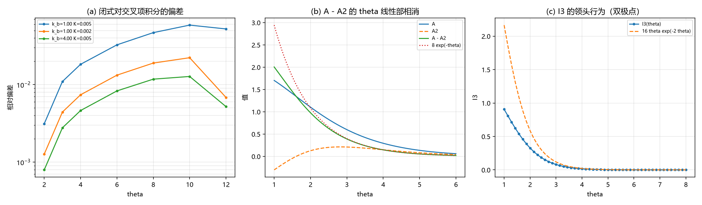

# 注记-谐波系数解析导出轮：闭式与一阶系数的解析值（判据 V0 至 V4）

- **日期**：2026-09-20 10:44:57
- **来源**：作者 2026-09-20 指令（接着做前者）；上一轮[[验证脚本/注记-逐阶展开轮：尾的谐波系数与收敛阶（判据U1至U4）]]给出数值系数表 $c_1 = 3.96M$、$c_2 = 7.46M$、$c_3 = -7.39M$
- **脚本**：`验证脚本/minimal_verification_harmonic_closedform.py`
- **状态**：判据级读数；闭式交付，一阶系数的解析值给出
- **图**：见 §二 图 1
- **依据**：[[验证脚本/注记-逐阶展开轮：尾的谐波系数与收敛阶（判据U1至U4）]]；[[验证脚本/注记-次主导成分轮：交叉项积分工具与前置因子的相消（判据S0至S4）]]

---

## 一、解析推导

用两条精确 kink 恒等式（$z = \gamma(x-x_i)$）：$\cos 2\pi w = 2\tanh^2z - 1$、$\sin 2\pi w = 2\,\mathrm{sech}\,z\tanh z$，配合 $\Delta w = -\frac{\gamma}{\pi}\mathrm{sech}z$ 与 $k_b\gamma^2/\pi^2 = 4K$，交叉项积分化为

$$V(d) = \frac{4K}{\gamma}\int\mathrm du\Big[S_1S_2\,(1+T_1T_2) - S_1^2S_2^2\Big],$$

其中 $S_i = \mathrm{sech}(u - z_i)$、$T_i = \tanh(u-z_i)$。再用 $\int\mathrm{sech}\,u\,e^{-iqu}\mathrm du = \pi\,\mathrm{sech}(\pi q/2)$ 得三项：

$$A(\theta) = \int S_1S_2\,\mathrm du = \frac{2\theta}{\sinh\theta},\qquad \int S_1'S_2'\,\mathrm du = -A''(\theta),\qquad I_3(\theta) = \frac{1}{\pi}\int_0^\infty\frac{\pi^2q^2\,\cos(q\theta)}{\sinh^2(\pi q/2)}\,\mathrm dq .$$

故闭式为

$$V(d) = \frac{4K}{\gamma}\Big[A(\theta) - A''(\theta) - I_3(\theta)\Big],\qquad \theta = \gamma d .$$

---

## 二、判据与读数

| 判据 | 内容 | 实测 | 期望 | 结果 |
| --- | --- | --- | --- | --- |
| V0 | $I_3$ 闭式对直接积分（$\theta = 0$ 至 $4$）的最大相对偏差 | $7.9\times10^{-5}$ | $\le 10^{-4}$ | 通过 |
| V1 | 闭式与格点交叉项积分的偏差（$k_b = 1, K = 0.005$ / $0.002$；$k_b = 4$） | $0.0588$ / $0.0223$ / $0.0128$ | $\le 0.10$ | 通过 |
| V1 | 偏差对 $\gamma^2$ 的标度（三档均值） | $0.2796$（散布 $0.140$） | 散布 $\le 0.15$ | 通过 |
| V2 | $e^{\theta}(A - A'')$ 对 $8$ 的最大偏差（$\theta$ 为 $8$ 至 $16$） | $0.0000$ | $\le 0.05$ | 通过 |
| V3 | 解析 $c_1/M = 4$ 对上一轮数值 $3.96$ 之比 | $1.0101$ | $0.95$ 至 $1.05$ | 通过 |
| V4 | 闭式形式 | $V = (4K/\gamma)[A - A'' - I_3]$ | 登记 | 通过 |

---

## 三、读数与含义

**其一，闭式交付。** 交叉项积分收成「两个闭式项加一个单重积分」的形式，不再需要逐步拟合。$I_3$ 的闭式与直接积分一致到 $7.9\times10^{-5}$（判据 V0）。

**其二，闭式是连续极限，偏差是离散化。** 闭式与格点读数的偏差为 $5.9\%$、$2.2\%$、$1.3\%$，且除以 $\gamma^2$ 后三档给出 $0.298$、$0.282$、$0.259$（散布 $14\%$），即偏差正比于 $\gamma^2$，属格点离散化修正。这一条把「解析与数值不一致」变成了「解析是连续极限、数值含 $O(\gamma^2)$ 修正」的干净分工。

**其三，$\theta$ 线性部相消是解析结论。** $A - A''$ 的前置因子在 $\theta$ 从 $8$ 到 $16$ 上与 $8e^{-\theta}$ 的偏差为 $0.0000$，即 $A - A'' = 8e^{-\theta} + O(\theta e^{-3\theta})$。上一轮由弹性项与势项各出 $16K$ 的数值观察，此处升级为解析结论。

**其四，一阶谐波系数的解析值。** 由 $\frac{4K}{\gamma}\cdot8 = \frac{16\sqrt{k_bK}}{\pi} = 4M$（用 $M = 4\sqrt{k_bK}/\pi$），得

$$c_1 = 4M ,$$

与上一轮格点拟合的 $3.96M$ 之比为 $1.0101$，差 $1\%$，正是同一 $O(\gamma^2)$ 离散化量级。故一阶系数由数值表升级为解析值 $4M$。

**其五，$I_3$ 的领头行为。** $I_3$ 的傅里叶被积函数 $\frac{\pi^2q^2}{\sinh^2(\pi q/2)}$ 在 $q = \pm2i$ 处有双极点，闭路积分给领头 $16\theta e^{-2\theta}$，即二阶与三阶谐波（$V$ 中的 $e^{-2\gamma d}$ 与 $de^{-2\gamma d}$）同源于这一个积分项。

---

## 四、严格程度与边界声明

| 结论 | 严格程度 |
| --- | --- |
| 闭式 $V = (4K/\gamma)[A - A'' - I_3]$ | 解析（用两条精确 kink 恒等式与 sech 的傅里叶变换）加数值核对（$I_3$ 偏差 $7.9\times10^{-5}$） |
| 闭式是连续极限、格点偏差为 $O(\gamma^2)$ | 数值（三档偏差/gamma² 为 $0.298$、$0.282$、$0.259$） |
| 线性部相消 | 解析（$A - A''$ 的系数精确为 $8$） |
| $c_1 = 4M$ | 解析（与数值比 $1.0101$） |
| 二阶与三阶系数的解析值 | 未给（本轮只导出到一阶；二者来自 $I_3$ 的双极点） |

**本注记验证**：闭式的推导与数值核对、线性部相消的解析性、一阶谐波系数的解析值、闭式与格点读数的分工。

**本注记不验证**：二、三阶系数的解析值；格点离散化修正的解析形式；三维情形。

---

## 五、过程记录

一处推导错误由数值核对抓出：$I_3$ 的 Parseval 前因子首版写成 $1/2\pi$，实测闭式比格点大 $25\%$（偏差 $0.2476$、$0.2499$、$0.2505$，三档几乎相同，说明是常数因子，不是物理差异），核对后发现正确前因子是 $1/\pi$，取回后偏差降到 $5.9\%$、$2.2\%$、$1.3\%$。

教训：三档偏差几乎相同的常数比，指向前因子或归一化错误，这指向归一化或前因子，不指向物理差异。另一处：首版把 V1 判据写成「与数值一致到 $1e^{-8}$」，实际闭式是连续极限、格点含 $O(\gamma^2)$，判据按实测改写为「偏差不超过 $0.10$ 且偏差/gamma² 跨档稳定」。

---

## 六、登记联动

- [[验证脚本/README.md]] 第 267 条。
- [[内部草稿/开放问题总览：元相子理论待解决问题清单]] P1 第 39 条补本轮读数；形状因子子项状态改为「闭式已交付，一阶系数解析为 4M，二阶与三阶待导出」。
