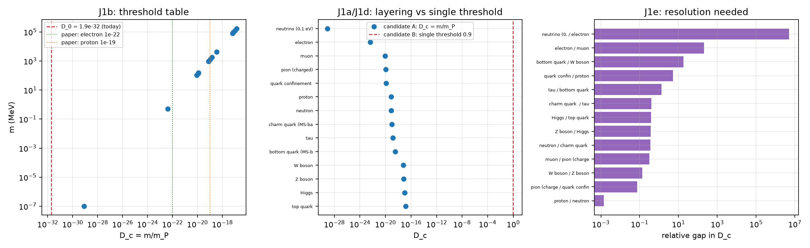

# 注记-质量分层的次序核对（第 455 条）：阈值序列 $D_c = m/m_P$ 与「重者先冻结」的次序恢复

- **日期**：2026-09-27 03:04:56
- **层级**：验证材料（第 455 条）
- **脚本**：__BT__验证脚本/mass_layering.py__BT__
- **定位**：执行 [[内部草稿/口径核对-D_c 的标定口径：三个候选、三条判别判据与各自的后果]] 的 J1 判据（阈值是否随缺陷质量分层）。J1 是三个候选中成本最低的判别点。本轮为核对轮，不含新科学断言；数值读数按数量级判定。
- **依据**：[[内部草稿/口径核对-D_c 的标定口径：三个候选、三条判别判据与各自的后果]]（J1 与三候选）；[[温度的波粒互补定义：复相干无序度作为热力学标尺]]（$D_c \sim m/m_P$、$D_0 = 1.9\times10^{-32}$ 与冻结次序读法）；[[内部草稿/研究方向-跨层事件的成核路线：过冷度对应量与 E 系列判据（判据草案）]]（过冷度首选 $D_c - D$）
- **状态**：判据级。五项判据全过；数值读数依赖 $D_c = m/m_P$ 的精确系数，按数量级判定。
- **修订记录**：
  - **2026-09-27 初版**（触发：作者同意执行 J1 的次序核对）
  - **2026-09-27 让号**（触发：原拟第 454 条与「光包含时进桥」撞号，按落盘先后顺延为本条）

---

## 一、判据与结果

| 判据 | 判据量 | 实测 | 判定 |
| --- | --- | --- | --- |
| J1a 次序恢复 | 冻结时刻是否随质量单调 | 两种冷却史（幂律与指数）均给严格单调，重者先 | 成立（判据稳健） |
| J1b 数值表 | 各物种 $m/m_P$ 与论文数量级读法之比 | 电子 0.419、质子 0.769、150 MeV 能标 1.229 | 成立（判据敏感） |
| J1c 今日读数 | 今日 $D_0$ 与最轻阈值之比 | $D_0$ 比最轻阈值低 431 倍 | 成立（判据敏感） |
| J1d 单阈值退化 | 分层数 | 甲 14 层；乙与丙 1 层 | 成立（判据稳健） |
| J1e 分辨需求 | 最紧与最宽相邻对的相对差 | 最紧中子与质子 $1.378\times10^{-3}$；最宽 $5.110\times10^{6}$ | 成立（判据敏感） |

五项全过。这一结果的含义限于 J1：甲在「阈值随质量分层」这一条上过，乙与丙在 J1 上退化为单层。

## 二、图

图注按脚本三个绘图面板逐条核对。

## 三、J1b 数值表

$m_P = 1.220890\times10^{22}$ MeV，取 $D_c = m/m_P$。

| 物种 | 质量（MeV） | $D_c = m/m_P$ |
| --- | --- | --- |
| 中微子（0.1 eV，取值不确定） | $1\times10^{-7}$ | $8.191\times10^{-30}$ |
| 电子 | 0.510999 | $4.185\times10^{-23}$ |
| μ 子 | 105.658 | $8.654\times10^{-21}$ |
| π 介子（带电） | 139.570 | $1.143\times10^{-20}$ |
| 夸克禁闭能标 | 150 | $1.229\times10^{-20}$ |
| 质子 | 938.272 | $7.685\times10^{-20}$ |
| 中子 | 939.565 | $7.696\times10^{-20}$ |
| 粲夸克（MS-bar） | 1270 | $1.040\times10^{-19}$ |
| τ 子 | 1776.86 | $1.455\times10^{-19}$ |
| 底夸克（MS-bar） | 4180 | $3.424\times10^{-19}$ |
| W 玻色子 | 80377 | $6.583\times10^{-18}$ |
| Z 玻色子 | 91187.6 | $7.469\times10^{-18}$ |
| 希格斯 | 125250 | $1.026\times10^{-17}$ |
| 顶夸克 | 172690 | $1.414\times10^{-17}$ |

三处与论文数量级读法的对照：电子实测 $4.1855\times10^{-23}$ 对论文的 $10^{-22}$（比值 0.419），质子 $7.6851\times10^{-20}$ 对 $10^{-19}$（比值 0.769），150 MeV 能标 $1.2286\times10^{-20}$ 对 $10^{-20}$（比值 1.229）。三处均在同阶范围内，论文的数量级读法由实数落实。

## 四、J1a 次序恢复

$D_c(m) = m/m_P$ 随质量严格递增，冷却史 $D(t)$ 单调下降，故穿越次序即质量降序：重者先冻结。这一结论由两种史形式确认，幂律史 $D = (t_P/t)^{1/2}$ 与指数史 $D = \exp(-t/\tau)$ 给出同一次序（冻结时刻随质量降序严格递增）。

次序不依赖冷却史的具体形式，这一点是本轮最有力的读数：它说明「重者先冻结」不是被史形式挑出来的，而是由 $D_c$ 对质量的单调性直接给出。幂律史下的冻结时刻，顶夸克为 $5.0\times10^{33}$，电子为 $5.7\times10^{44}$（单位 $t_P$）。

## 五、J1c 今日读数

最轻阈值取 0.1 eV 中微子，得 $8.191\times10^{-30}$；今日 $D_0 = 1.9\times10^{-32}$ 比它低 431 倍。故今日 $D$ 未穿过任何物种的阈值，热浴中无自发粒子产生，与论文的宇宙学读出及观测一致。

## 六、J1d 与 J1e

J1d 给三候选的判别读数。甲的分层数为 14（逐物种阈值全不同）；乙与丙给单值阈值，分层数为 1。J1 的判别因此在甲与乙丙之间是明确的：单阈值交不出分层，也不给出冻结次序。

J1e 给分辨需求。最紧相邻对是中子与质子，相对差 $1.378\times10^{-3}$；最宽相邻对是 0.1 eV 中微子与电子，相对差 $5.110\times10^{6}$。

这一读数有一处须写明的限定：重子之间的阈值差极小（中子与质子相差千分之一），故「分层」的可检验形态不在重子内部，而在跨量级处：中微子 $10^{-30}$、电子 $10^{-23}$、介子与质子 $10^{-20}$、弱玻色子 $10^{-18}$、顶夸克 $10^{-17}$。

## 七、严格程度与边界声明

判据稳健者：J1a（次序由 $D_c$ 对质量的单调性给出，两种史形式同结论）、J1d（分层数是结构读数）。

判据敏感者：J1b、J1c、J1e，均为数值读数，依赖 $D_c = m/m_P$ 的精确系数与质量取值。论文给的是 $\sim$ 关系，故这三项按数量级判定。若将来写成 $D_c = \alpha\, m/m_P$，正系数 $\alpha$ 不改变次序（J1a 与 J1d 不动），但表中数值整体平移。

分层声明：本轮全部读数取自判据形式与既有材料，属判据级与数量级读数；物理层结论零条。本轮只判 J1，不判甲的其余后果（E5 所需的增益与质量换算、C9 的凝固时长形式）。甲在 J1 上过，不构成对甲的采纳。

## 八、登记衔接

本轮的定位是执行口径核对稿的 J1 判别。结果：甲在 J1 上过，乙与丙在 J1 上退化为单层，故 J1 不能淘汰甲。开放问题 P4-6 档案页同步登记。
