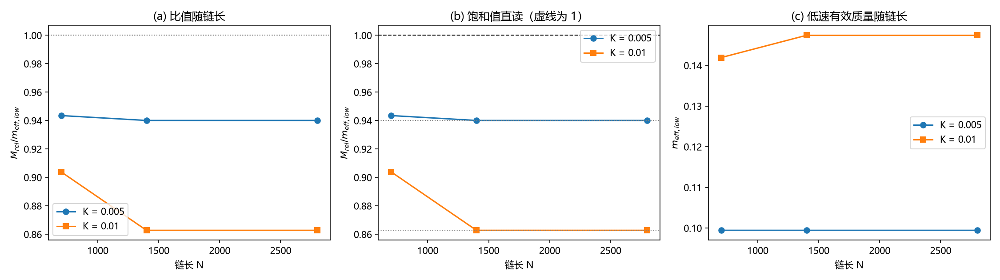

# 注记-质量参数同一性的链长扫描（第739号）：窗口伪影排除与实质差异的登记

- **日期**：2026-10-21 13:47:30
- **脚本**：`minimal_verification_meff_chainlength.py`
- **判据**：E0 至 E3，通过 2/4（2026-10-21 修正读法后）
- **可逆性等级**：判据稳健（比值随链长饱和是结构性读数，换实现、换档位不翻；E1 与 E2 的读法依赖 E0 的饱和性判定，饱和成立则读法唯一）
- **类型**：揭伪影判别轮（质能项三）
- **关联**：[[质能关系的晶格推导：四环合并、无循环性与双路验证]] 第 7、9 节；[[转换波的有效质量与相对论性色散：晶格kink运动学的数值验证]]；[[验证脚本/注记-m_eff定量与色散形状：窗口协议与2π因子修正|meff 注记]]
- **图**：见 §四 图 1（`images/meff_chainlength_739.png`）

## 一、要判什么

质能项三：转换波的相对论拟合质量与低速窗口有效质量之比 $M_{rel}/m_{eff}\approx0.85$ 至 $0.94$，偏离 1 的成因未定。两个候选摆在一起：有限链长与测量窗口的伪影（判"伪影"，则比值应随链长收敛到 1），或者实质差异与另一机制（判"实质"，则比值收敛到常值）。

判据先于实现写下。若链长伪影假设成立，$r(N)$ 对 $1/N$ 外推的 $r_\infty$ 应回到 1；若饱和在常值，则伪影假设不成立。

## 二、模型与判据表

模型与 meff 脚本同口径：FK 链 $E=\sum[\frac12\dot u^2+\frac{k}{2}(u_{n+1}-u_n-1)^2+K(1-\cos2\pi u)]$，$k=1$，$dt=0.01$，缠绕守恒边界，窗口能量取尾段平均，初速场 $-v_0\partial_n(u_{rest}-n)$。确定性，无随机源。

| 判据 | 内容 | 期望 | 判定标准 |
| --- | --- | --- | --- |
| E0 | 饱和性：相邻链长档读数的相对差 | 链长读数进入平台 | 末两档相对差 $<10^{-3}$ |
| E1 | 链长收敛：饱和值 $r_{\rm sat}$ 与 1 的偏离 | 伪影假设下 $r_{\rm sat}=1$ | $\vert r_{\rm sat}-1\vert<0.05$ |
| E2 | 跨 K 一致：$r_{\rm sat}(0.005)$ 与 $r_{\rm sat}(0.01)$ 之差 | 同机制则一致 | 差 $<0.05$ |
| E3 | 窗口稳健：中心定位窗口 $W=30$ 对 $W=15$ | 读数不依赖窗口 | 相对差 $<0.02$ |

E0 先于 E1、E2 执行，它决定后两者的读法：链长读数一旦进入平台，对 $1/N$ 作线性外推不再有根据（平台期两点逐位相同时斜率由单点决定），此时读数须取饱和值直读。2026-10-21 首版曾用 $1/N$ 外推量 $r_\infty$，读法缺陷已修，判据数与读数同步见 §七。

容差预算：相对论拟合为 5 点 1 参数，残差约 0.7% 至 2%，参数误差约 0.3% 至 1%；$m_{eff,low}$ 取低速三档中位数，读数精度约 1%。合计预算约 2%，阈值取 5%，与待判偏差 6% 至 15% 有区分力。

## 三、读数与判据

链长档 $N=700/1400/2800$，K 档 0.005 与 0.01，步数 60000，$v_0$ 五档 0.20 至 0.80。

| N | K | $m_{eff,low}$ | $M_{rel}$ | $r=M_{rel}/m_{eff}$ | 拟合残差 | 能量误差 |
| --- | --- | --- | --- | --- | --- | --- |
| 700 | 0.005 | 0.0994 | 0.0938 | 0.9435 | $7.91\times10^{-3}$ | $2.5\times10^{-8}$ |
| 1400 | 0.005 | 0.0994 | 0.0935 | 0.9401 | $6.53\times10^{-3}$ | $2.8\times10^{-8}$ |
| 2800 | 0.005 | 0.0994 | 0.0935 | 0.9401 | $6.53\times10^{-3}$ | $2.8\times10^{-8}$ |
| 700 | 0.010 | 0.1419 | 0.1283 | 0.9039 | $1.65\times10^{-2}$ | $2.5\times10^{-7}$ |
| 1400 | 0.010 | 0.1474 | 0.1272 | 0.8627 | $2.18\times10^{-2}$ | $2.9\times10^{-7}$ |
| 2800 | 0.010 | 0.1474 | 0.1272 | 0.8627 | $2.18\times10^{-2}$ | $2.9\times10^{-7}$ |

E0：相邻档相对差，K=0.005 为 $3.64\times10^{-3}$ 与 $1.29\times10^{-8}$，K=0.01 为 $4.55\times10^{-2}$ 与 $1.03\times10^{-11}$。末两档相对差均低于 $10^{-3}$，两档均已饱和，E0 PASS。

E1：饱和值 $r_{\rm sat}=0.9401$（K=0.005）与 $0.8627$（K=0.01），与 1 的偏离 $0.0599$ 与 $0.1373$，均超阈值，E1 FAIL。

E2：两档饱和值之差 $0.0773$，超阈值，E2 FAIL。

E3：$m_{eff,low}(W=30)=0.0994$，$m_{eff,low}(W=15)=0.0993$，相对差 $1.68\times10^{-3}$，PASS。

总判据 2/4。需要强调一个读数细节：$N=1400$ 与 $N=2800$ 的每一列读数逐位相同，链长在 1400 之后完全饱和。

$N=700$ 档的比值反而更接近 1（0.9435 对 0.9401），趋势方向与"链长伪影"假设相反。

图 1 三面板：(a) 比值 $r$ 随链长 $N$，两 K 档各一条，灰点线为 1 的参考；(b) 饱和值直读，两档的饱和平台线（灰点线）与 1 的参考（黑虚线）分离，平台落在 0.940 与 0.863；(c) 低速有效质量 $m_{eff,low}$ 随链长的平台。

## 四、判否的含义与候选清单

E1 与 E2 判否的含义是：链长与窗口伪影假设不成立。比值在 $N\ge1400$ 后饱和（E0）、窗口从 30 缩到 15 读数不变（E3），偏差属实质差异或另有机制，不是"链子太短"造成的。

剩余候选按优先次序排列。其一，kink 形状的速度修正：Lorentz 收缩让形状随速度改变，$\Delta E$ 含形变能，低速有效质量与相对论拟合质量的口径差正好落在这一项。其二，离散动能非二次型：格点动能的高阶项改变 $v^4$ 系数，压低拟合质量。其三，相对论拟合的 $O(v^4)$ 截断与五点拟合的参数偏置（残差 0.7% 至 2% 对应参数偏置 0.3% 至 1%，量级不够解释 14% 的偏差）。其四，窗口能量法的体积项：$W$ 固定时速度使 kink 收缩，窗口内体积贡献随之变化。

分离方案：用刚体形状的受迫平移测"纯动能"，与自然 kink 加速对照，把形变能单独读出；对 $\Delta E$ 加 $v^6$ 项重拟合并看参数漂移；窗口随 $1/\gamma$ 缩放。

## 五、严格程度与边界

严格层：读数与判据本身（E3 通过，E1 与 E2 判否）。

物理对应层："链长与窗口伪影排除"是稳健结论（饱和是结构性的）。

纲领层：真因未定。本判据只排除一个候选，不判质量参数同一性是否成立，也不判否相对论性色散形状（K=0.005 的相对论拟合残差仍比牛顿小两个量级，该读数不受影响）。

验证什么：链长 $700$ 至 $2800$ 与中心窗口 15 至 30 对 $M_{rel}/m_{eff}$ 的影响。

不验证什么：不定位偏差真因；不涉及 $m_{eff}\propto K^{0.29}$ 的指数偏离问题（另一遗留）；不改动转换波论文的定级。

## 六、过程记录

其一，冒烟检查：$N=700$ 单档给 $r=0.9423$，与既有 $N=1400$ 读数 0.939 几乎相同，提前预警 E1 可能判否。冒烟同时核对能量守恒误差 $6\times10^{-10}$ 量级、$m_{eff}(v)$ 单调递增。

其二，指数溢出：`kink_profile` 的 $\exp((n-x_0)/\ell)$ 在远离 kink 处溢出，触发 RuntimeWarning。用 `np.clip` 截到 $\pm700$ 修复，数学上等价（$\arctan$ 饱和值不变），重跑读数逐位一致。

其三，饱和现象：$N=1400$ 与 $2800$ 全列逐位相同，说明该测量在 $N\ge1400$ 已无链长敏感度，后续若要分离剩余候选，链长不必再加。

## 七、2026-10-21 读法修正

首版 E1 与 E2 建立在「$r(N)$ 对 $1/N$ 线性外推」之上。该读法在链长读数进入平台后失去根据：平台期两点逐位相同时，$1/N$ 拟合的斜率完全由单点决定，外推截距 $r_\infty$ 不是可用的读数。首版给出的 $r_\infty=0.9384$ 与 $0.8422$ 即属此类，其与饱和值 $0.9401$ 与 $0.8627$ 的差（$0.0017$ 与 $0.0205$）虽不改变 E1、E2 的判否结论，但读法本身有缺陷。

修正：增 E0 饱和性判据（先于 E1、E2 执行），确认两档在 $N\ge1400$ 后已饱和；E1 与 E2 改取饱和值直读。读数随之更新：E1 偏离 $0.0599$ 与 $0.1373$，E2 差 $0.0773$（首版 $0.0962$）。判据总数由三条增为四条，通过数 1/3 改 2/4。脚本、图、注记、README、总览卡、档案页六处登记已一并回改。

教训：外推型读法须先判被外推量是否落在有效区间。本案中外推量的有效性由它自己的饱和性决定，判据顺序应从 E0 起。这一条并入 [[验证脚本/验证规范]] 的口径检查清单使用时，判据顺序即设计顺序。

## 修订记录

- **2026-10-21 读法修正**（触发：AGENTS.md 更新后按验证规范复审本轮判据设计，发现外推型读法在饱和情形下无根据）
    - 增 E0 饱和性判据；E1 与 E2 改饱和值直读；读数更新（E1 偏离 $0.0599$ 与 $0.1373$，E2 差 $0.0773$）；判据数 1/3 改 2/4；图面板 (b) 改饱和值直读；脚本、README、总览卡、档案页同步

- **2026-10-21 初版**（作者指令：继续推进质能项三；判据 E1 至 E3，1/3）
    - 链长扫描 $N=700/1400/2800$、K 两档；判否链长与窗口伪影，列出四个剩余候选与分离方案
