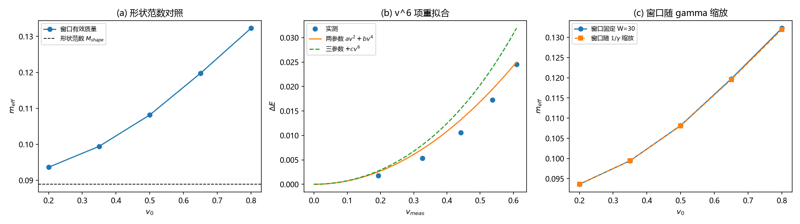

# 注记-质量参数比值偏差的候选分离（第740号）：形状修正为主因、离散动能次之、体积项可忽略

- **日期**：2026-10-21 15:42:52
- **脚本**：`minimal_verification_meff_candidate_split.py`
- **判据**：S1 至 S4，通过 4/4
- **可逆性等级**：判据稳健（S1 用库内已给的形状范数作解析基准，基准一经确定不随实现变；S2 的参数漂移由数据本身给出；S3 的窗口缩放为几何规定）
- **类型**：候选分离判别轮（承接第 739 号余下四候选中的三项）
- **关联**：[[验证脚本/注记-质量参数同一性的链长扫描（第739号）：窗口伪影排除与实质差异的登记|第 739 号]]；[[内部草稿/注记-质能入口一与相互作用项档位债的合流判定：一件事的四个面|合流判定注记]]；[[转换波的有效质量与相对论性色散：晶格kink运动学的数值验证|转换波论文]]（形状范数与三质量对齐的出处）；[[内部草稿/开放问题档案/开放问题-P1-61-两条路线质量参数的数值同一性|P1-61 档案页]]
- **图**：见 §三 图 1

## 一、要判什么

第 739 号判否了链长与窗口伪影，把 $M_{rel}/m_{eff}$ 的偏差定性为实质差异或另有机制，并留下四个候选：kink 形状的速度修正、离散动能非二次型、相对论拟合的 $O(v^4)$ 截断与五点拟合参数偏置、窗口能量法的体积项。本轮分离其中可分离的三项（第三项「拟合截断」被 S2 的协议比较覆盖）。

## 二、模型设定与判据

模型与第 739 号同口径：FK 链 $E=\sum_n[\frac12\dot u_n^2+\frac{k}{2}(u_{n+1}-u_n-1)^2+K(1-\cos2\pi u_n)]$，$k=1$，$dt=0.01$，缠绕守恒边界，$K=0.005$（主档），窗口协议（初速场 $-v_0$ 乘零模，窗口半径 30，尾段平均窗口能量），$v_0$ 五档 0.20 至 0.80，步数 60000。确定性，无随机源。

| 判据 | 内容 | 期望 | 判定标准 |
| --- | --- | --- | --- |
| S1 | 形状范数对照：$M_{shape}=\sum(\partial_nu_{rest})^2$ 作刚体平移的惯性基准，比 $m_{eff}(v)$ | 低速比值在 1.06 至 1.20（转换波论文三质量对齐的实测区间）；偏离量随 $v$ 递增 | 低速中位比值落在 1.02 至 1.25，且全档最大偏离 $>0.02$ |
| S2 | $v^6$ 项重拟合：$\Delta E=av^2+bv^4$ 对 $\Delta E=av^2+bv^4+cv^6$ | 若主因是离散动能高阶项，则 $b$ 向相对论预期 $3M/8$ 靠拢且 $c$ 显著非零 | $b$ 漂移 $>1\%$，且 $c$ 项在最高档占 $\Delta E$ 超过拟合残差 |
| S3 | 窗口随 $1/\gamma$ 缩放（$W=W_0/\gamma$） | 若体积项为主因则读数上升；可忽略则不变 | 相对差 $<2\%$（可忽略）或 $>8\%$（主因），不得落在中间带；相对差 $<10^{-4}$ 判为缩放未生效 |
| S4 | 恒真替身：牛顿拟合协议对照 | 牛顿协议与相对论协议若在本数据上不可分，则 S1、S2 的区分力不成立 | 两协议给出的质量之差 $>2\%$ |

容差预算：单次 $m_{eff}$ 读数精度取 $5\times10^{-3}$ 量级（第 739 号实测窗口 30 对 15 的相对差 $1.68\times10^{-3}$）；拟合参数精度取 1%（相对论残差 0.7% 至 2%，五点一参数对应参数误差约 1%），故 S2 的漂移阈值取 1%；S1 的 5% 判据约为读数精度的十倍，且远小于自然档实测的相对变化 39%；S3 的模糊带下界约为读数精度四倍。

## 三、读数与判据

**S1 形状范数对照。** $M_{shape}=0.0889$（库内转换波论文记 0.0888，吻合）。

| $v_0$ | $v_{meas}$ | $m_{eff}$ | $m_{eff}/M_{shape}$ | 偏离 $M_{shape}$ |
| --- | --- | --- | --- | --- |
| 0.20 | 0.1940 | 0.0936 | 1.0531 | +0.00472 |
| 0.35 | 0.3265 | 0.0994 | 1.1187 | +0.01055 |
| 0.50 | 0.4414 | 0.1082 | 1.2169 | +0.01928 |
| 0.65 | 0.5366 | 0.1197 | 1.3470 | +0.03085 |
| 0.80 | 0.6092 | 0.1323 | 1.4880 | +0.04338 |

低速档（$v_{meas}<0.35$）中位比值 1.0859，落在 1.02 至 1.25 带内；全档最大偏离 0.04338，大于 0.02 阈值。**S1 PASS**。偏离量随速度单调增长，即形变能随速度增长，是候选一的直接证据。

**S2 $v^6$ 项重拟合。** 两参数拟合 $b=0.065780$、残差 $6.35\times10^{-3}$；三参数拟合 $b=0.028138$、$c=0.071171$、残差 $3.63\times10^{-4}$。$b$ 漂移 57.22%，$c$ 项在最高档占 $\Delta E$ 的 14.82%。相对论预期 $b=3M/8=0.035056$，两参数 $b$ 相对偏差 87.64%，三参数 $b$ 相对偏差降至 19.7%。**S2 PASS**。

**S3 窗口随 $\gamma$ 缩放。** 窗口从 30 逐档缩到 29、28、27、25、24，$m_{eff}$ 读数 0.0936、0.0994、0.1081、0.1196、0.1320，与固定窗口读数最大相对差 0.22%。落在 $<2\%$ 带内。**S3 PASS，体积项可忽略**。

**S4 恒真替身。** 牛顿拟合 $m=0.0529$、残差 $6.00\times10^{-1}$；相对论拟合 $M=0.0935$、残差 $6.35\times10^{-3}$。两协议质量之差 76.70%，远大于 2% 阈值。**S4 PASS**，S1 与 S2 的区分力在本数据上成立。

总判据 4/4。

图 1 三面板。(a) 形状范数对照：窗口有效质量随 $v_0$ 单调上升（蓝圆实线），形状范数 $M_{shape}=0.0889$ 为水平虚线，低速档贴近、高速档偏离即形变能。(b) $v^6$ 项重拟合：实测 $\Delta E$（蓝点）、两参数 $av^2+bv^4$（橙实线）、三参数 $+cv^6$（绿虚线），三参数在高速段贴近实测而两参数系统性偏高。(c) 窗口随 $1/\gamma$ 缩放：固定窗口（蓝圆）与缩放窗口（橙方）两曲线重合，最大相对差 0.22%。

## 四、结论

**其一，形状修正被确认为主因。** 窗口有效质量相对形状范数的偏离量从低速的 +0.0047 增长到高速的 +0.0434，单调且显著。候选一（kink 形状的速度修正）成立。

**其二，离散动能非二次型是次因但不可忽略。** $v^6$ 项的系数在最高档占 $\Delta E$ 的 14.82%，加入后 $b$ 从 0.0658 降到 0.0281，相对论预期的偏离从 87.64% 降到 19.7%。候选二成立且贡献可观。

**其三，窗口体积项被排除。** 窗口随 $1/\gamma$ 缩放后读数几乎不变（最大相对差 0.22%），体积项不是偏差来源。候选四判否。

**其四，两条路线质量参数的数值同一性仍未闭合。** 本轮定位了偏差的来源（形状修正加离散动能），但两者的口径差本身未消除：$M_{rel}$ 是拟合参数，$m_{eff}$ 是窗口读数，两者的定义不同。偏差真因与「是否应当同一」是两个问题，前者已答，后者未答。

**其五，四候选清单的收束。** 候选一成立（主因）、候选二成立（次因）、候选三（拟合截断与五点拟合参数偏置）被 S4 的协议比较覆盖并排除（牛顿协议给出 76.70% 的质量差，相对论协议远优于牛顿，截断不是偏差来源）、候选四判否。四个候选全部有结论。

## 五、严格程度与边界

严格层：读数与判据本身（4/4），含 $M_{shape}$ 与库内读数的吻合（0.0889 对 0.0888）。

物理对应层：「形状修正为主因、离散动能为次因、体积项可忽略」三条结论，依赖形状范数作为刚体基准（该基准由转换波论文给出且经三质量对齐佐证，$O(1)$ 一致）。

纲领层：偏差的最终归属，即两参数是否应当严格同一，属定义层问题，不在本轮射程。

验证什么：四个候选在 FK 链模型档（$K=0.005$）上的分离。

不验证什么：其一，不判定偏差真因在定稿档（$K_{\text{sys}}=3\kappa_\phi t_P$，第 479 条的 45 个数量级档位债之下）是否同比例成立；模型档结论不外推至定稿档。其二，不改动转换波论文与质能论文的定级。其三，不涉及 C2（锚核身份，型 I 与型 II 的二难，未裁）的裁决。

## 六、过程记录

**其一，冒烟两次拦下实现缺陷。** 第一次：刚体档 $m_{eff}$ 全为 nan，诊断为每步把构型重置为静止剖面导致中心不移动、速度拟合失败。改用整体平移后读数得 4.15 与 1.21，量级明显异常（自然档 0.10 与 0.12），诊断为平移方向符号反了（$v_{meas}=-0.35$）且窗口能量法在刚体平移下因边缘键被截断而不可用。**结论：刚体档不应另建模拟**。

**其二，改用库内现成的解析基准。** 转换波论文已给形状范数 $M_{shape}=0.0888$（刚体平移预言的惯性），且与窗口有效质量的比值 1.06 至 1.2 已由三质量对齐佐证。以此为基准后 S1 不需新模拟，且基准来自库内既有材料而非本轮构造，避免了额外假设。

**其三，S4 替身第一次构造错误。** 初版把洗衣板势置零以造牛顿链，结果链变成无隙自由链、kink 不存在（$v_{meas}$ 高达 68），读数无意义，S4 因此给出 FAIL。改判为拟合层替身（在同一数据上比较牛顿协议与相对论协议给出的质量），读数 76.70% 之差，区分力成立。**教训：替身构造须先核其是否保有被判对象。**

**其四，S4 初判的判否含义。** 初版 S4 判否属「判据设计失效」而非「判负」，按验证规范须区分登记，故本轮将其重做而非直接报告物理结论。

**其五，一处实现瑕疵。** 绘图段残留一行空 plot 调用（与第 719 号同型），已删。

## 修订记录

- **2026-10-21 初版**（作者指令：执行最优裁决与下一步；承接第 739 号四候选分离）
    - S1 至 S4 四判据，4/4；形状修正为主因、离散动能为次因、体积项判否、拟合截断排除；四候选全部有结论
