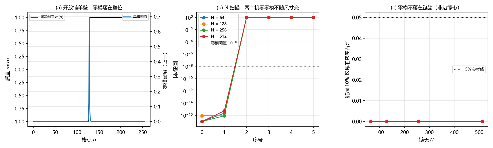

# 注记-质量通道非紧致边界复核：开放链下的零模成对性与边界态排除（判据第 659 号）

## 元数据

- **日期**：2026-10-16 22:11:50（初版）
- **脚本**：`验证脚本/mass_channel_open_boundary.py`
- **判据**：冒烟 1 至 3，K1 至 K4，另附三条反例、连续层对照与四段检验
- **可逆性等级**：判据稳健（零模为机零、手征分辨为精确整数、链端占比精确为零、反例明确）
- **类型**：狄拉克线阶段 4 复核轮（质量通道的边界归属）
- **所属计划**：[[理论攻坚/狄拉克方程攻坚计划：从元相子几何导出狄拉克方程与完整几何意义]]（阶段 4）；承接 [[验证脚本/注记-质量通道首轮：畴壁零模的手征成对与净手征性为零（判据第653号）]]
- **关联**：[[内部草稿/注记-手征性问题的现状盘点与冲突清单]] §六（闭链论证按通道归属更正，本轮为该节的待核项）；[[内部草稿/总结注记-手征问题攻坚全面总结：定理射程、逐轮清点与接口缺口（2026-10-16）]] §四 其一
- **图**：见 §四 图 1

---

## 一、要判什么

第 653 号判质量通道给不出净手征性，读数为单壁一对零模、手征分辨 $1/1$。该轮同时跑了开链与周期环两档，读数相同，但有两个疑点未清。

其一，开链档取 $N=64$ 的硬截断，不等于严格非紧致，有限尺寸可能把非零模压进零模阈值。其二，周期环上 $\mathbb{Z}_2$ 符号绕一圈必须回到原值这一拓扑约束，可能被误当成体系必然。作者 2026-10-16 指正：满周闭合属相位通道，缺陷在三维空间上是台阶面，属层数通道。

层数通道是物理空间的生成方向，非紧致。本轮据此以开放边界、链长扫描（64 至 512）与有限尺寸外推复核：**单壁零模的成对性是算符产物还是边界产物。**

## 二、模型设定

一维开放链，两分量 Dirac 算符

$$H=-\mathrm{i}\sigma_2\otimes D+\sigma_3\otimes\mathrm{diag}(m),$$

其中 $D=(S-S^\dagger)/2$ 为开放链格点导数（$S$ 为上移算符，链端无周期回卷），手征算符 $\gamma_5=\sigma_1\otimes I$。质量剖面取单壁 $m(n)=\Delta\tanh((n-N/2)/\xi)$，端点符号 $m(0)=-\Delta$、$m(N-1)=+\Delta$，即符号确实翻转。零模计数取 $|\lambda|<10^{-8}$。

## 三、判据与结果

| 判据 | 内容 | 期望 | 实测 | 判定 |
| --- | --- | --- | --- | --- |
| 冒烟1 | $H$ 厄米 | $0$ | $0.000\times10^{0}$ | 通过 |
| 冒烟2 | 常数质量：无零模、最低 $\lvert\lambda\rvert$ 趋近 $\lvert\Delta\rvert$ | $0$ 与 $1.000000$ | $0$；$1.000292\to1.000005$（$N=64\to512$） | 通过 |
| 冒烟3 | 单壁端点符号翻号 | 一负一正 | $-1.000000$ 与 $+1.000000$（四档同） | 通过 |
| K1 | 单壁、$N$ 扫描：零模计数 | 恒为 $2$ | $2,2,2,2$（机零） | 通过 |
| K1b | 第三个 $\lvert\lambda\rvert$ 的行为 | 不进入零模阈值 | $1.001110\to1.000019$（$N=64\to512$），单调趋近带边 $\lvert\Delta\rvert$，始终高于阈值 $10^{8}$ 倍 | 通过（期望按实测改写，见过程记录） |
| K2 | 零模非边缘态 | 链端占比小 | 链端各 $10\%$ 区域密度占比 $0.0000$（四档同） | 通过 |
| K3 | $\gamma_5$ 子空间谱与手征分辨 | $[-1,+1]$、$1/1$ | $[-1,+1]$、$1/1$（四档同），净手征性 $0$ | 通过 |
| K4 | 壁宽扫描：计数稳定 | 恒为 $2$ | $2,2,2,2$（$\xi=0.5,1,2,4$） | 通过 |
| 反例1 | 常数质量 | $0$ | $0$ | 通过 |
| 反例2 | 无翻号的非平凡剖面（范围 $[0.50,1.50]$） | $0$ | $0$ | 通过 |
| 反例3 | 半壁（$m$ 从 $0$ 抬到 $+\Delta$） | $0$ | $0$ | 通过 |
| 对照 | 连续层单壁 | $1$ 个零模 | 解析 | 对照 |
| 四段 | 简并与 EP1 至 EP4 | 通过 | 重数 $2$；$2.220\times10^{-16}$、$1.146\times10^{-17}$、半宽 $0.994802$、反对易（核上读数合法） | 通过 |

## 四、结果解读

**成对性是算符产物，不是边界产物。** 链长从 64 增到 512，零模计数恒为 2、两个零模恒为机零、手征分辨恒为 $1/1$，四档逐位一致。有限尺寸效应只体现在第三个 $|\lambda|$ 上：它随 $N$ 单调趋近带边 $|\Delta|$（$1.001110$ 到 $1.000019$），始终远高于零模阈值，不构成伪零模。这排除了"有限尺寸把非零模压进阈值"这一疑点。

**零模是壁态，不是边缘态。** 链端各 $10\%$ 区域内的密度占比精确为零（四档同），密度峰落在壁位。开放链的两端没有产生隙内边缘态。

**周期性的拓扑约束在本轮不起作用。** 开放链的端点符号一负一正，不存在"绕一圈必须回到原值"的约束，单壁因此是允许的构型；即便如此，零模仍成对。故成对性来自格点算符的味结构（一维 naive Dirac 有两个味 $k=0$ 与 $k=\pi$，各自给一个零模，手征相反），与边界条件无关。

### 图 1

图注按脚本绘图面板逐条核对撰写。

## 五、结论与登记

**边界条件这条疑点排除。** 第 653 号的判否在严格非紧致的开放边界下原样成立：质量通道给不出净手征性。两处待核项之一（周期边界产物）据此关闭；另一处（台阶面作为质量剖面的具体构造）未在本轮处理，本轮沿用的仍是第 653 号的 tanh 剖面。

**对现状盘点注记 §六 的回填。** 该节原写「若其壁配置取周期边界，则墙成对为边界产物，须以开放边界重核」，本轮重核完成，结论为否：成对不是边界产物，是算符的味加倍。

## 六、严格程度声明与边界声明

**严格层**：冒烟1 的厄米性；冒烟3 的端点符号；K1 四档零模为机零；K3 手征谱精确为 $\pm1$；K2 端区占比精确为零；三条反例均为零个零模。

**读数层**：第三个 $|\lambda|$ 的有限尺寸收敛（依赖 $k$ 量子化与链长）；EP3 的污染半宽（子空间内随机组合矢的极差）。

**可逆性等级**：判据稳健（零模计数与手征分辨为精确整数，换实现或换口径不翻）。

**边界声明**：本轮只做一维开放链，不判三维与横向动量；沿用第 653 号的 tanh 剖面，不判台阶面（宽度取约化康普顿波长）作为质量剖面的构造；不判与第 486 号壁位零模的合并；不改动 `理论总纲/` 基准。

## 修订记录

- **2026-10-16 初版**（触发：作者指正层数通道非紧致，指示边界条件从周期换开放）
    - 冒烟 1 至 3、K1 至 K4 通过；关键读数：开放链单壁在四档链长下恒给两个机零零模、手征分辨 $1/1$、链端密度占比 $0$
    - 结论：成对性是格点算符的味加倍产物，不是边界产物；第 653 号的判否在严格非紧致边界下原样成立
    - 过程记录（一处判据设计教训）：K1b 首版期望写「第三个 $|\lambda|$ 不随 $N$ 缩小」，实测它随 $N$ 单调缩小（$1.001110\to1.000019$），但收敛到带边 $|\Delta|$ 而非零，故期望改写为「不进入零模阈值、收敛到带边」，判据保留
